# Development Plan: CU Result Viewer

Updated: 2026-10-22

This is the single development plan for the rendering component and its cu-cli delivery. Product scope is defined in [requirements](requirements.md); setup, embedding, limits, and commands are maintained in the [README](../README.md). Historical drafts and detailed execution logs belong in Git history, not parallel planning documents.

## Contents

1. [Scope and delivery status](#scope-and-delivery-status)
2. [Approved productization refactor](#approved-productization-refactor)
3. [Architecture](#architecture)
4. [Repository responsibilities](#repository-responsibilities)
5. [Implementation phases and acceptance criteria](#implementation-phases-and-acceptance-criteria)
6. [Dependencies and delivery sequence](#dependencies-and-delivery-sequence)
7. [CLI handoff contract](#cli-handoff)
8. [Rendering decisions and evidence](#rendering-and-evidence)
9. [Test plan and requirement mapping](#test-plan-and-requirement-mapping)
10. [Recorded verification](#verification)
11. [Risks and maintenance controls](#risks-and-maintenance-controls)
12. [Build, rollout, and rollback](#build-rollout-and-rollback)
13. [Completion criteria](#completion-criteria)

## Scope and delivery status

The project supplies the browser Viewer used by cu-cli to inspect an original source document and its saved Content Understanding (CU) Analyze result.

- The component is React/TypeScript and rendering-only. It neither calls Analyze nor authenticates, uploads, manages analyzers, or polls a service.
- Hosts pass `source` and the original parsed JSON through `result`; no caller normalization, CU SDK, or SDK model is required.
- Supported sources are PDF, JPEG/JPG/JPE, PNG, BMP, and HEIF/HEIC.
- The implemented UI includes source navigation and transforms, structured fields, applicable rich-result views, source grounding, previews, table inspection, and a persistent OCR word layer.
- Current delivery is validated with Chrome/Edge, React 18/19, and Vite 8. Other build/runtime profiles are unverified, not additional tasks.
- The independent CLI frontend now implements both confirmed `--view` flows. Its code is on `feat/cu-result-viewer` in the adjacent toolkit checkout; this is not a claim that an existing published CLI already contains the feature.
- Viewer is independently distributed as a Python package with prebuilt resources and a standard-library launcher. cu-cli consumes its compatible dependency, not a copied ZIP or local-server implementation. The candidate `cu-result-viewer 0.1.0b1` is not published; release approval remains separate.
- No additional public customization API or separate host integration is planned. Add an interface only when a concrete CLI requirement demonstrates a gap.

The original Demo implementation phases below are complete within their recorded verification scope. The approved productization refactor has its own status table. Cleanup and packaging verification must not be confused with automatic publishing, blanket format support, or certification of every possible input.

### CU version and evidence boundary

| API version | Current evidence |
| --- | --- |
| `2025-11-01` (GA) | Real saved CU source/result pairs and the authorized live CLI invoice run. |
| `2026-06-01-preview` (Preview) | Guarded display mappings checked with explicitly synthetic fixtures and schema/reference evidence, not a complete live-service matrix. |

Task `4.2a` completion refers to these display mappings and their recorded evidence; it does not imply exhaustive real-service validation of Preview features.

## Approved productization refactor

Approved on 2026-10-22. The primary users are CU developers, technical implementers, and technical testers. The product remains a read-only local Viewer, independently delivered as a Python wheel; cu-cli is a host, not a runtime dependency of the Viewer.

Structural refactoring comes before new product features. This iteration changes only this repository. Moving source into content-understanding-toolkit, publishing releases, adding result editing/review state, multi-document browsing, search, or comparison are not included.

### Target layout and dependency boundaries

```text
frontend/
  src/
    model/          CU types, guarded parsing, result availability and limits
    source/         document adapters, geometry, rendering and source layers
    interaction/    selection, hover and navigation state
    components/     result views and UI composition
  app/              production browser entry, formerly cli/
  demo/             development-only host
  tooling/          Vite asset build plugins
python/
  src/cu_result_viewer/
  tests/
scripts/            cross-language packaging, fixtures and delivery verification
tests/              shared fixtures and end-to-end/installed-package checks
assets/             licensed runtime build inputs
codecs/             reproducible decoder source and locks
docs/               requirements, this plan and maintained operational guidance
```

- Production and demo hosts use the same component. Model parsing must not depend on React components or browser-host startup.
- Keep one npm project and the existing root verification commands; do not introduce workspaces, a new build framework, or a plugin architecture.
- Preserve npm exports, React props, Python public names/signatures, wheel name, archive layout, session JSON, local-only serving protections, and source/result semantics.
- Rename the results composition to match its actual responsibility, and separate cohesive source-rendering effects from pane composition without changing source, focus, or cancellation ownership.
- Separate Python errors, input validation, packaged-resource validation, HTTP serving and startup lifecycle. Build-time validation reuses resource validation without loading HTTP/browser startup.
- Unit tests remain beside frontend modules or under Python tests; shared fixtures and delivery tests remain under the root tests directory.
- Generated outputs and caches remain ignored. Do not delete required licenses, decoder binaries, fixtures, or unrelated local environments to make the explorer look cleaner.

### Tasks and acceptance gates

| Task | Scope and acceptance criteria | Depends on | Status |
| --- | --- | --- | --- |
| R1 | Establish baseline and path/reference inventory. Record failures caused by missing generated resources separately from regressions. | None | Done |
| R2 | Move frontend source/hosts/plugins into the target layout; group modules by responsibility, clarify result composition, and update imports/configuration/resource URLs. Existing root commands and public exports remain valid. | R1 | Done |
| R3 | Separate Python runtime concerns and share pure asset validation with packaging. Existing public API, error categories, session routes and shutdown behavior remain unchanged. | R1 | Done |
| R4 | Remove retired Code implementation, exclusive dependencies/styles/tests/references; relocate shared scripts and update every build, test, CI and documentation path. Preserve active Markdown code rendering. | R2 | Done |
| R5 | Verify frontend/Python tests, type checks, lint, production library/demo/app builds, bundle/resource checks, packed React consumers and an installed Viewer wheel outside the repository. Exercise browser source/result interactions without accepting new visual baselines automatically. | R2, R3, R4 | Done |

### Baseline and completion evidence

- Frontend baseline: 23 test files, 519 tests passed.
- Initial Python/exporter run: 47 passed and 5 failed because ignored generated `resources/viewer` files were absent. After the existing `npm run export:cli` build/export step: all 52 passed. No source change was needed to restore this baseline.
- Final local evidence for this iteration is recorded below. Unrun platform, browser, live-service and visual-reference approvals remain explicit.
- Keep behavior changes out of directory moves. If validation fails, inspect the affected import/resource/runtime path and repair it before progressing; do not suppress failures or copy stale build output as a fallback.
- Rollback is the inverse of each scoped change set; no automatic commits, force pushes, repository relocation, or package publishing is authorized by this plan.

| Final check, 2026-10-22 | Outcome |
| --- | --- |
| `npm run typecheck`, `npm run lint`, `npm run test:unit` | Passed; 23 unit files and 516 tests. Removed 8 retired Code cases and added 5 source-rendering ownership cases relative to the 519-test baseline. |
| `python -m pytest -c python\pyproject.toml python\tests tests\test_export_cli_viewer.py` | 57 passed, including five new public API/value/error-category cases. |
| Ruff on the changed Python package/tests/exporter/setup; `python -m mypy python\src\cu_result_viewer` | Passed; mypy checked all 7 runtime package modules. Pylance reported no syntax errors in the extracted assets/server modules or diagnostics in the public API module. |
| `npm run verify:bundle` | Library/demo builds, lazy chunks, reviewed HEIF hashes and the existing 500,000-byte entry budget passed. |
| `npm run build:python`, then a no-dependencies wheel installation in a fresh environment outside the repository | Built both sdist and wheel, including rebuilding the wheel from sdist; `pip check` passed. The initially missing `build` tool was installed only in a task-local build environment. |
| Chrome/Edge: accessibility, responsive result tabs and OCR word-layer suites | All 40 cases passed across the initial run and focused rerun. One old test assumed Result was always directly visible; it now uses the existing overflow-aware selection helper. The existing service on port 5173 was left untouched; a temporary test-only configuration used port 5187. |
| `npm run verify:consumer` with product screenshot approval disabled | 32 passed: real packed React 18/19 consumers, production/development, Chrome/Edge, their own dependencies, no source aliases, local decoder assets and host CSP. |
| `playwright test --config playwright.cli.config.ts --grep "independent Viewer wheel"` | 10 passed against the installed wheel: PDF/PNG/JPEG/BMP/HEIF, real grounding, lazy result panes, overflow selection, local-only CSP, no cu-cli/core or Node hosting, and port release. |
| `playwright test --config playwright.performance.config.ts` | All 4 production Markdown/JSON lazy-loading and interaction-budget cases passed. |
| `git diff --check` and staged-change whitespace check | Passed. |

This is local Windows/Python 3.11 evidence, not a new remote CI run, Python 3.10 validation, cross-platform certification, or live CU service validation. Existing product screenshots were not regenerated or re-approved; only the six retired Code references were removed.

Builds still report setuptools metadata/standalone-README/resource-package-discovery warnings and the packed consumer's late-bound PDF/HEIF URL warnings. Successful builds and installed-artifact tests are not a claim of warning-free release readiness. Review these packaging warnings, screenshot references and the supported-platform matrix in the next release-hardening phase, separately from this behavior-preserving refactor.

### Post-refactor cleanup, 2026-10-22

- Removed 8 ignored, rebuildable cache/metadata directories: Python pytest/Ruff caches, four bytecode-cache directories, the setup bytecode cache, and generated `cu_result_viewer.egg-info` metadata. Total: 27 files, 140,259 bytes.
- Checked that the removal targets contained no tracked files or reparse points. Retained the current wheel/sdist and required packaged Viewer archive/manifest; their SHA-256 hashes were unchanged by cleanup.
- Existing root build/test outputs and `node_modules` were already absent. Active build/fixture/verification scripts, source, tests, licensed resources and codec inputs were retained; no additional source files were classified as disposable.
- Cache-free validation passed: `$env:PYTHONDONTWRITEBYTECODE = "1"; python -B -m pytest -p no:cacheprovider -c python\pyproject.toml python\tests tests\test_export_cli_viewer.py` (57 tests). No empty source/test/resource/documentation directories remained.
- This pass did not change frontend logic or reinstall its absent dependencies. It does not claim a new frontend build/browser run beyond the refactor evidence above.

## Architecture

```mermaid
flowchart LR
    subgraph Hosts["Host responsibilities"]
        CLI["Python cu-cli"]
        Launcher["Independent Viewer Python package"]
        Demo["Development demo"]
        Data["Original source and Analyze JSON"]
        CLI --> Launcher
        Launcher --> Data
        Demo --> Data
    end
    subgraph Viewer["Rendering-only React component"]
        Entry["Viewer orchestration"]
        Parser["Unknown-input guards and CU parsing"]
        State["Selection, hover, page and view state"]
        Source["PDF and image adapters"]
        Projection["Shared geometry and viewport projection"]
        Panes["Fields and lazy result panes"]
        Words["OCR word canvas"]
        Regions["Tab outlines and selected regions"]
        Preview["Previews and table dialog"]
        Entry --> Parser
        Entry --> State
        Entry --> Source
        Parser --> Panes
        Panes --> State
        State --> Source
        Source --> Projection
        Parser --> Projection
        Projection --> Words
        Projection --> Regions
        State --> Preview
    end
    Data --> Entry
```



### Public and internal contracts

| Boundary | Contract |
| --- | --- |
| Public input | `source: File \| Blob \| ArrayBuffer \| string`, `result: unknown`; see [public types](../frontend/src/index.ts). A string source is an allowed browser URL, not a filesystem path. |
| Parser | Guard the original JSON, accept the supported envelope/inner-result shapes, preserve unknown properties in Result, and derive private field/page/region records. Do not mutate or flatten the caller's input. |
| Field identity | Use stable content/field paths rather than display labels. Preserve nested objects, arrays, missing values, `0`, `false`, empty strings, `null`, and all valid source regions. |
| Source adapter | Share page metadata, render/cancel/dispose, and source dimensions across PDF and images. PDF.js and decoder types remain private. |
| Geometry | Validate CU source coordinates against their page and project them through the same real CSS frame, zoom, and rotation used by the rendered source. Never compensate with guessed offsets or fabricated regions. |
| Interaction | Keep transient hover separate from persistent selection. Navigate explicit selections to available source pages; adjust pan only when the selected region is outside the viewport. Retain zoom and rotation. |
| Result switching | Recompute applicable tabs for the selected content. Tab switches do not remount Source or reset its page, transforms, pin, or selected region. |
| Lifecycle | Cancel obsolete work, reject stale completions, and release owned workers, bitmaps, URLs, canvases, and render tasks. Caller-owned input buffers and URLs retain their ownership. |
| Errors | Show loading, empty, invalid-input, source, rendering, and limit errors explicitly. A source failure must not hide a valid result. Missing grounding does not invent navigation or hide values. |

### Display contracts

Applicable nonempty data determines this tab order:

`Fields -> Markdown -> Paragraphs -> Tables -> Figures -> Signatures -> Metadata -> Result`

The tab bar fits the available width and puts overflow views in a `...` dropdown instead of scrolling horizontally. Selecting an overflow view keeps its active tab visible. Arrow keys and Home/End still reach every view; the menu supports Up/Down, Home/End, Enter/Space, and Escape. The Code tab has been removed.

Fields preserve generic values, confidence when returned, structured relationships, stable root colors, and multi-region navigation. Paragraphs preserve service order. Tables preserve native headers and spans, show one current table, and locate cells. Figures/Signatures crop actual loaded source regions rather than generating images or inferring detection states. Metadata preserves returned key/value order. Result renders the complete original input with a mature interactive JSON tree.

Markdown uses sanitization; the current remote-image omission policy and synchronous capacity limits are implementation choices documented in the README, not new product requirements.

### Source layers and previews

1. Render the original source without baking annotations into its pixels.
2. Draw valid current-page `pages[].words[].source` polygons on an independent transparent Canvas 2D layer, with `#FAFF7F40` fill and a 1 CSS px same-color stroke. Keep it across tabs, independent of field confidence; deduplicate identical polygons.
3. Draw tab-specific source outlines above the OCR layer, then interactive emphasis.
4. Field hover/focus previews show the returned name, value, and optional confidence; paragraph previews show Content only. Keep unrelated outlines and the pinned selection.
5. Source table markers provide Rows/Columns previews and a read-only native Table dialog. Closing with X/Esc restores focus without changing the result tab, pin, or source transforms.

## Repository responsibilities

| Location | Responsibility | Retention rule |
| --- | --- | --- |
| [frontend/src](../frontend/src) | Component, model parsing, source adapters/rendering/geometry, interaction state, result panes, styles, and colocated unit tests. | Rendering-only TypeScript; no Python or CU service dependencies. |
| [frontend/app](../frontend/app) | Sample-free production browser entry used by the independent Python package and CLI. | Keep source and Vite configuration; rebuild its output. |
| [python](../python) | Independent Viewer distribution, public preparation/display API, read-only service, browser launcher, and runtime/build tests. | No cu-cli/core or third-party runtime dependency; generated archive and build outputs are ignored. |
| [frontend/demo](../frontend/demo) | Development host with saved sample selection and file inputs. | Keep for local development and repository browser tests; it is not the CLI production page. |
| [assets/heif](../assets/heif) | Pinned, licensed runtime decoder assets and SBOM. | Required build inputs, not disposable build caches. |
| [codecs/heic-rs-wasm](../codecs/heic-rs-wasm) | Reproducible wrapper, lockfile, and codec build instructions. | Keep source/locks/licenses; remove generated `target` output when cleaning. |
| [frontend/tooling](../frontend/tooling) | PDF/HEIF asset build plugins shared by frontend build entries. | Build-only Node/TypeScript code, not browser runtime code. |
| [scripts](../scripts) | Fixture generation, bundle/consumer checks, and deterministic production-page export. | Keep active cross-language build and regression tools. |
| [tests/fixtures](../tests/fixtures) | Licensed source/result pairs, derived/synthetic decoder cases, provenance, and the active Fields reference. | Keep test inputs and their original bytes; no accumulated project progress logs. |
| [tests/e2e](../tests/e2e) | Functional, visual, lifecycle, performance, consumer, and CLI-wheel tests. | Keep tests and approved reference images, not run output or traces. |
| [CI workflow](../.github/workflows/ci.yml) | Existing build, functional, package, performance, and scheduled stress/codec jobs. | Keep; local success does not imply the latest branch ran remotely. |

The workflow now builds the independent Viewer sdist/wheel and runs its Python/exporter tests on Python 3.10. Installed-Python-wheel browser and compatible-upgrade checks remain local; editing the workflow is not evidence of a completed remote run.

`dist`, `dist-demo`, `dist-cli`, test reports, Python caches, and Rust build output are rebuildable and ignored. Local `node_modules` may be retained for development but is not source or a distribution artifact. Superseded static prototype pages/images are removed; the still-used approved Fields image lives with the fixtures. There is no additional archive-document tree.

## Implementation phases and acceptance criteria

Task identifiers retain the established numbering. **Done** means the delivered behavior has the stated local evidence; it does not mean every codec variant, host, or human accessibility workflow was tested.

### Phase 1: Evidence and rendering decisions

| Task | Delivered scope and acceptance criteria | Direct dependencies | Status |
| --- | --- | --- | --- |
| `1.1` | Record original inputs, real paired samples, provenance, and Studio behavior. **AC-1.1:** pair original source bytes with real CU JSON; distinguish real, derived, and synthetic evidence; preserve source hashes and licenses. | None | Done |
| `1.2` | Select PDF/image rendering and resource delivery. **AC-1.2:** document the PDF.js adapter and permissive HEIF route, coordinates/orientation handling, worker ownership, and required notices without adopting a service application as the component base. | 1.1 | Done |

### Phase 2: End-to-end component

| Task | Delivered scope and acceptance criteria | Direct dependencies | Status |
| --- | --- | --- | --- |
| `2.1` | Establish tooling and public inputs. **AC-2.1:** strict type-check, lint, unit runner, library build, and all declared source variants work without a CU SDK in the browser. | 1.1, 1.2 | Done |
| `2.2` | Parse verified CU shapes. **AC-2.2:** envelope and inner results work without caller normalization; preserve optional/unknown values; malformed shapes and grounding produce explicit errors/warnings. | 2.1 | Done |
| `2.3` | Implement shared geometry. **AC-2.3:** independently derived source points remain aligned through fit/zoom/rotation and page changes; reject invalid or unavailable regions. Existing test tolerances are engineering checks, not a new SLA. | 2.2 | Done |
| `2.4` | Render PDF through a private adapter. **AC-2.4:** multi-page PDFs expose correct dimensions, navigation, and local Worker/font resources; load/render failures, cancellation, and disposal are observable. | 2.1 | Done |
| `2.5` | Render required image formats. **AC-2.5:** required extensions use the shared adapter, approved orientation behavior, explicit decode errors, packaged HEIF resources, cancellation, and resource cleanup. | 2.4 | Done |
| `2.6` | Connect fields, source, navigation, and overlays. **AC-2.6:** real fields locate real regions; cross-page selection navigates correctly; hover does not overwrite pins; missing grounding leaves results inspectable. | 2.2, 2.3, 2.4, 2.5 | Done |

### Phase 3: Complete the library and development host

| Task | Delivered scope and acceptance criteria | Direct dependencies | Status |
| --- | --- | --- | --- |
| `3.1` | Complete controls, errors, and lifecycle. **AC-3.1:** page controls, fit, zoom, pan, and rotation preserve alignment; replacement/unmount cannot show stale work or leak owned resources. | 2.6 | Done |
| `3.2` | Deliver the independent demo. **AC-3.2:** select saved source/JSON or real built-in pairs without authentication or Analyze calls; explicit loading/empty/error states and browser regression checks work. | 3.1 | Done |
| `3.3` | Package and document the component. **AC-3.3:** install an actual tgz with declarations/CSS/local assets; independent React 18/19 development/production hosts load workers and lazy chunks under the tested CSP. | 3.2 | Done |

### Phase 4: Complete the approved result and desktop interactions

| Task | Delivered scope and acceptance criteria | Direct dependencies | Status |
| --- | --- | --- | --- |
| `4.1` | Structured fields and multiple sources. **AC-4.1:** stable nested/array identities, collapse/expand, missing-value filtering, and all valid own/descendant regions remain reachable without losing selection. | 3.3 | Done |
| `4.2` | Safe Markdown and original JSON. **AC-4.2:** sanitize content, preserve the full caller input, support interactive nesting, lazy-load rich dependencies, retain source state, and report limits rather than truncating data. | 3.3, 4.1 | Done |
| `4.2a` | Dynamic Studio-style result views. **AC-4.2a:** data-driven tabs, dedicated paragraph/table/crop/metadata/code displays, valid-source navigation, raw Result preservation, and explicit invalid-detail handling work within the [version/evidence boundary](#cu-version-and-evidence-boundary). | 4.1, 4.2 | Done |
| `4.3a` | Keyboard/focus/ARIA, bounded two-pane layout, conditional centering, and confirmed source interactions. **AC-4.3a:** visible/stable focus, no unintended pane remount or transform reset, previews and table dialog have keyboard behavior, and the OCR base layer remains stable across tabs and transforms. | 4.1, 4.2, 4.2a | Implemented; automated checks passed |

Automated focus/ARIA coverage is not a claim of completed human assistive-technology certification. No separate certification task blocks CLI delivery.

### Phase 5: cu-cli handoff and implementation

| Task | Delivered scope and acceptance criteria | Direct dependencies | Status |
| --- | --- | --- | --- |
| `5.1` | Confirm actual CLI entry points, repository/branch, source/result handoff, resources, and lifetime. **AC-5.1:** the confirmed commands and responsibilities match the inspected standalone Python frontend; keep credentials/services outside the component. | 3.3, 4.2a, 4.3a | Done |
| `5.2` | Implement and validate CLI viewing. **AC-5.2:** the independently installed Viewer works without cu-cli, and the CLI calls its compatible dependency; analysis-then-view reuses the result, saved viewing makes no service/authentication calls, outputs remain unchanged, and wheels work without Node/repository paths; lifecycle and independent upgrades pass. | 3.3, 5.1 | Implemented; independent-package revision locally verified as recorded below |

## Dependencies and delivery sequence

The completed execution sequence is:

1. Verify evidence and rendering decisions (`1.1`-`1.2`).
2. Build the source/result/geometry vertical slice (`2.1`-`2.6`).
3. Complete controls, demo, and independent packaging (`3.1`-`3.3`).
4. Complete the approved structured/rich results and source interactions (`4.1`, `4.2`, `4.2a`, `4.3a`).
5. Confirm and implement the external CLI handoff (`5.1`-`5.2`).

The tables specify direct prerequisites rather than implying dependencies from row order. There is no unfinished generic extension stage between the Viewer and CLI. Review, commit, remote verification, installation into a user's existing CLI environment, and publication occur only when explicitly requested; they are not invented product features.

<a id="cli-handoff"></a>
## CLI handoff contract

### Repository and ownership

The standalone host is in [Azure/content-understanding-toolkit](https://github.com/Azure/content-understanding-toolkit), under `cu-cli/packages/standalone`. Implementation uses the workspace branch `feat/cu-result-viewer`, created from the inspected `origin/main` at `b3ff066960d6b517b6f1b4ee12201376369279a3`.

- This repository owns the component, [production browser entry](../frontend/app), independent [Python package](../python), resource build, [archive exporter](../scripts/export_cli_viewer.py), local service, browser launch, and shutdown.
- The CLI frontend owns command options, source selection, analysis and result serialization, and translation of Viewer exceptions into its existing errors. It calls the independent package; it neither reads its archive nor exposes its internals.
- The shared analysis engine and other command frontends were not changed to implement viewing.
- Public component props remain `source` and `result`.

The Python API is `prepare_viewer(source) -> PreparedViewer`, `PreparedViewer.show(result)`, and `read_result(path)` for saved JSON. Preparation validates basic source conditions and installed assets without networking or browser startup; display blocks until Ctrl+C. `ViewerInputError` distinguishes invalid local input from a `ViewerError` installation/serving failure. This API adds no React customization props.

### Confirmed command behavior

```powershell name="CLI viewing commands"
cu analyze sample.pdf --view
cu analyze sample.pdf --view --result sample.result.json
```

| Case | Required behavior |
| --- | --- |
| `--view` without `--result` | Perform the normal analysis/output flow, then view its completed result. Do not submit a second analysis for display. |
| `--view --result FILE` | Read the selected local source and saved JSON before loading profiles, authenticating, or creating a CU client. Never fall back to analysis on a missing/invalid result. |
| No `--view` | Do not start a browser/service or require viewer assets. Preserve existing analysis, batching, URL handling, stdout, files, and reports. |
| Unsupported viewing selection | Reject directory, batch, remote URL, or `--dry-run` combinations before analysis. The first release views one local PDF/image at a time. |
| Invalid option combination | Require `--view` with `--result`; reject additional analysis/output options in saved-result mode. Do not overwrite the source. |
| Missing/corrupt independent Viewer | Fail explicitly before analysis/authentication with guidance to repair the Viewer dependency in the actual CLI environment through its original installer. Do not require a development environment, silently ignore `--view`, or download software. |

Status and the local URL go to stderr, preserving stdout data pipelines. Existing raw JSON, Markdown, result-file, and report behavior is retained in analysis-then-view mode. Source/result pairing is the caller's responsibility; the Viewer does not falsely certify that arbitrary files belong together.

### Independent package delivery and updates

```text name="Production asset pipeline"
src + cli + licensed runtime assets
    -> dist-cli
    -> viewer.zip + manifest.json
    -> independent cu-result-viewer sdist/wheel
    -> package-manager installation alongside cu-cli
    -> Viewer-owned preparation/display API
    -> loopback HTTP session
    -> browser component
```

The archive includes the page, CSS/JS/lazy chunks, PDF Worker/fonts/CMaps/ICC/WASM, HEIF Worker/decoder, and notices. The exporter uses Python's standard library with fixed entry order, timestamps, and permissions. The manifest records archive and per-entry sizes/SHA-256 values.

The independent Viewer checks the exact manifest/archive inventory and serves verified bytes from memory. It neither extracts into user directories nor runs Node/Vite at runtime. Resource paths remain local and use correct MIME/CSP headers. Its wheel/source builds reject absent/corrupt resources; the sdist contains prebuilt assets so rebuilding a user wheel does not require Node.

cu-cli declares `cu-result-viewer>=0.1.0b1,<0.2.0`, allowing compatible independent updates. Package managers perform installation/repair/upgrades in the same environment, not the `--view` command. Runtime code does not fetch latest releases or maintain a separate cache/updater. Breaking Python API changes require a compatible CLI update.

Publish the independent package to the approved index before releasing the CLI dependency. The name was not found on PyPI when checked, which is not ownership or publication approval. Local validation installs built wheels, not an unpublished index dependency. Source repositories retain no generated Viewer ZIP; the toolkit has no Viewer resource directory. Export updates stop on unknown or modified files.

### Session and lifecycle

- Bind only `127.0.0.1` on an available dynamic port, with an unpredictable session URL.
- Serve only the selected source, original result, and manifest-listed assets. No arbitrary paths or directory listings.
- Validate Host/Origin, deny cross-origin access, and disable data caching. Do not expose credentials, profiles, or service connection settings to the page.
- Open the browser after the listener is ready. Report open failures and retain a usable manual URL instead of claiming success.
- Keep the foreground process until Ctrl+C; release listeners, handles, and temporary resources. Closing a tab is not a reliable shutdown signal.
- Preserve the original source, saved JSON, and completed analysis output on errors or shutdown.

<a id="rendering-and-evidence"></a>
## Rendering decisions and evidence

| Decision | Current implementation and rationale |
| --- | --- |
| PDF | `pdfjs-dist 6.3.289` behind a private adapter; local resources and shared real-frame geometry. No public PDF.js contract or hard-coded coordinate-unit shortcut. |
| Highlighting | Source grounding is not an editable annotation product. Evaluated highlighter/OCR-tool patterns informed the adapter/geometry choice without importing their application or service architecture. |
| Images | One image adapter, content-based recognition, representative orientation checks, and explicit unsupported/decode errors. Licensed equivalent JPEG/BMP derivatives are not independent Analyze pairs. |
| HEIF | Pinned `heic-rs 0.1.4` under MIT OR Apache-2.0; owned Worker, checked-in runtime assets, lockfiles, notices/SBOM, and [rebuild instructions](../codecs/heic-rs-wasm/README.md). No historical LGPL decoder is shipped. |
| OCR base | Separate Canvas 2D rasterization tied to actual CSS frame/DPR; do not replace it with an unstable translucent SVG or change source pixels to hide differences. |
| Rich results | Mature Markdown/JSON dependencies, sanitization, safe syntax highlighting, and lazy activation. Keep existing limits/errors until an actual requirement justifies a behavior change. |
| Evidence | [Fixture inventory](../tests/fixtures/manifest.json) retains acquisition, licenses, hashes, expected values, and real/derived/synthetic distinctions. Owner-approved [visual references](../tests/e2e/visual.spec.ts-snapshots) are regression inputs, not Studio pixel-copy requirements. |

## Test plan and requirement mapping

| Area / tasks | Existing checks | Required observations |
| --- | --- | --- |
| Public contract / `2.1`, `3.3` | [Public API tests](../frontend/src/index.test.ts), type-check, library build, [Vite asset tests](../frontend/src/vite.test.ts) | Declared inputs compile, internal types do not leak, styles/assets ship. |
| Parsing / `1.1`, `2.2`, `4.1`, `4.2a` | [CU parser tests](../frontend/src/model/parseCuResult.test.ts), [result-view tests](../frontend/src/model/resultViews.test.ts), [detail tests](../frontend/src/model/resultDetails.test.ts) | Original shapes/values survive, optional data is guarded, no invented tabs or regions. |
| Geometry / `2.3`, `2.6`, `4.3a` | [Geometry](../frontend/src/source/geometry.test.ts), [viewport reveal](../frontend/src/source/viewportReveal.test.ts), [interaction](../frontend/src/interaction/interaction.test.ts) | Page/coordinate correctness, invalid-region rejection, pin/hover separation, conditional positioning. |
| Source/lifecycle / `2.4`, `2.5`, `3.1` | [PDF](../frontend/src/source/pdfSource.test.ts), [images](../frontend/src/source/imageSource.test.ts), [HEIF](../frontend/src/source/heifSource.test.ts), [format browser checks](../tests/e2e/image-formats.spec.ts), [stress](../tests/e2e/stress.spec.ts) | Decode/render success or explicit errors, orientation, cancellation/replacement, balanced resource disposal. |
| Fields/details / `2.6`, `4.1`, `4.2a` | [Fields](../frontend/src/components/ResultsPane.test.tsx), [detail panes](../frontend/src/components/DetailPanes.test.tsx), [detail browser checks](../tests/e2e/detail-results.spec.ts) | Nested/array/table behavior, all regions, state retention, crops and copy errors. |
| Safe rich output / `4.2` | [Markdown](../frontend/src/components/MarkdownPane.test.tsx), [JSON](../frontend/src/components/JsonPane.test.tsx), [rich browser checks](../tests/e2e/rich-results.spec.ts), [production performance](../tests/e2e/performance.spec.ts) | Sanitization, complete raw JSON, lazy chunks, explicit limits and existing regression thresholds. |
| Source interactions / `4.3a` | [Source previews](../frontend/src/components/SourcePopover.test.tsx), [table dialog](../frontend/src/components/TableDialog.test.tsx), [Studio overlays](../tests/e2e/studio-overlays.spec.ts), [source tables](../tests/e2e/source-tables.spec.ts) | Correct preview contents, independent outlines/pins, modal focus/closing, unchanged view state. |
| OCR base / `4.3a` | [Word parsing](../frontend/src/model/pageWords.test.ts), [WordLayer](../frontend/src/components/WordLayer.test.tsx), [word browser checks](../tests/e2e/word-overlay.spec.ts) | Correct source/color/ordering, deduplication, invalid-source warnings, cross-tab stability and cleanup. |
| Keyboard/layout / `4.3a` | [Accessibility browser checks](../tests/e2e/accessibility.spec.ts) | Visible stable focus, keyboard equivalence, pane scrolling, page input and offscreen-target behavior. |
| Visual regression / `3.2`, `4.2a`, `4.3a` | [Product visual tests](../tests/e2e/visual.spec.ts), [detail visual tests](../tests/e2e/detail-visual.spec.ts), approved Fields fixture | Existing zero-difference comparisons; no automatic re-recording, threshold relaxation, or UI masking. |
| Browser source URLs / `3.1`, `3.3` | [Source input tests](../tests/e2e/source-inputs.spec.ts) and controlled loopback CORS host | HTTP/HTTPS/blob policy, explicit CORS failures, anonymous cross-origin behavior, viewer-origin assets. |
| Independent package / `3.3` | [Consumer verifier](../scripts/verify-packed-consumers.mjs), [packed-host browser checks](../tests/e2e/package-host.spec.ts) | Real tgz installs with React 18/19, development/production assets, strict CSP, no source aliases. |
| Independent assets/runtime / `5.2` | [Exporter tests](../tests/test_export_cli_viewer.py), [Python runtime tests](../python/tests/test_runtime.py), [API/build tests](../python/tests/test_api.py), clean sdist/wheel builds | Deterministic output, shared server-independent asset validation, integrity/path errors, explicit broken-build failures, no ignored Worker, standalone installation without CLI. |
| CLI behavior / `5.1`, `5.2` | Toolkit adapter/command tests and [installed-wheel browser checks](../tests/e2e/cli-host.spec.ts) | Single analysis or zero-call saved viewing, unchanged output, dependency failure before billing, no embedded assets, compatible Viewer-only upgrades, CSP and shutdown. |

### Validation commands

Use the smallest relevant existing checks; do not rerun every stress/consumer matrix for a documentation-only change.

```powershell name="Core validation"
npm run typecheck
npm run lint
npm run test:unit
npm run build
```

```powershell name="Targeted visual and export validation"
npx playwright test '(^|[\\/])visual\.spec\.ts$' --project=chrome --project=edge
python -m pytest tests\test_export_cli_viewer.py
npm run build:cli
```

The exact visual selector above targets only the [product visual suite](../tests/e2e/visual.spec.ts), matching the recorded 18-case cleanup run. The [detail visual suite](../tests/e2e/detail-visual.spec.ts) is separate.

The Python/exporter tests require pytest. `npm run build:python` builds precompiled resources, then a sdist and a wheel from that sdist. For browser checks, set `CU_CLI_PYTHON` / `CU_CLI_PACKAGE_ROOT` to the three-package CLI installation and `CU_VIEWER_PYTHON` / `CU_VIEWER_PACKAGE_ROOT` to a Viewer-only environment, then run `npm run test:cli`. No source aliases are used. Use `npm run verify:consumer` or `npm run verify:performance` when their respective surfaces change.

<a id="verification"></a>
## Recorded verification

Results have an explicit scope/date. They are not promises about untested hosts, all format variants, or the latest remote branch.

| Evidence | Recorded outcome |
| --- | --- |
| Viewer baseline, 2026-10-15, `8eb04a6` | Type/lint and 511 unit cases; 178 ordinary Chrome/Edge cases including 600 stress rounds; four isolated performance cases; 32 independent React 18/19 consumer cases; 60 approved product images unchanged. |
| Superseded CLI archive delivery, 2026-10-16 | Before independent packaging, built core/standalone wheels from a clean projection of 175 Git-deliverable files. The embedded resource directory held two files with all 229 payload hashes verified. Independent distribution now replaces this ownership model; these remain historical results. |
| CLI automated regression, 2026-10-16 | 246 focused Python cases, 12 exporter cases, Python lint/types and frontend checks passed. Twelve Chrome/Edge installed-wheel cases cover PDF/PNG/JPEG/BMP/HEIF, rich chunks, source navigation, CSP, no Node/extraction, and port release. |
| Authorized real CLI run, 2026-10-16 | The toolkit's `sample_files\sample_invoice.pdf` was analyzed once with `prebuilt-invoice`, API `2025-11-01`. One page, 31 returned fields, 63 paragraphs, three tables, and 197 words. Served PDF bytes and the original saved result matched exactly; tested fit/zoom/90-degree `InvoiceId` grounding stayed below 1 CSS px, with correct value/confidence preview. |
| Source cleanup, 2026-10-16 | 511 unit, 18 Chrome/Edge product visual, and 12 exporter cases passed; type/lint, fresh library/CLI builds, and the 316-file component package inventory passed. All 160 protected source/codec/fixture/reference hashes were unchanged. The migrated Fields image and 60 product references retained their bytes; the rebuilt CLI archive matched the delivered SHA-256 exactly. Validation outputs/caches were removed afterwards, local dependencies retained, and the installed invoice Viewer stayed available. |
| Independent Viewer migration, 2026-10-16 | Viewer runtime/API tests: 40; exporter: 12; CLI regression: 219; React unit cases: 511. Clean Viewer sdist-to-wheel and CLI wheels installed with dependency resolution; six missing/corrupt resource wheel/sdist builds were rejected. Fourteen Chrome/Edge cases passed, including a Viewer-only environment with no cu-cli. A simulated compatible `0.1.0b2` Viewer update changed the served page while all 82 installed CLI/core source files and the CLI wheel stayed unchanged; four further browser cases passed. The simulated update is not a published release. |

The real invoice produced a PDF.js `TT: undefined function: 32` font warning; no Viewer alert or tested grounding failure was observed. Do not describe that run as warning-free or as an exhaustive font-fidelity test. The saved result remains outside the repository and is reusable without another Analyze call. No new service call is required for repository cleanup.

Existing timing, capacity, geometric, DPR, stress, and screenshot thresholds are engineering regression methods, not additional user-defined SLAs. Remote CI has historical evidence, but local uncommitted work must not be described as a new remote success.

## Risks and maintenance controls

| Risk | Current mitigation / maintenance action |
| --- | --- |
| CU response or Preview changes | Guard unknown input; preserve raw Result; add representative fixtures/tests before claiming a new mapping. |
| Coordinate drift or stale source work | Shared projection and actual frame measurement, source/page validation, monotonically ordered requests, cancellation/disposal, targeted geometry and lifecycle tests. |
| HTML/script or unbounded synchronous rendering | Sanitization, safe text highlighting, explicit existing limits, lazy rich panes, visible errors. Keep policy changes separate from cleanup. |
| Missing workers/fonts/decoder assets | Exact archive manifest, hashes and MIME/CSP checks, package-only installs, and clean Git-deliverable build verification. Never rely solely on a working local build tree. |
| Archive export overwrites manual files | Verify ownership and prior bytes before replacement/migration; stop on unknown or changed files. |
| Cross-origin/local file exposure | Viewer URL policy plus the CLI's loopback-only capability session, Host/Origin checks, allowlisted assets and source, and no credential handoff. |
| Unexpected billable analysis | `--result` bypasses profiles/clients with no fallback to Analyze. Before analysis, the CLI checks option/selection constraints, source existence/readability, supported extension, nonempty input, and viewer asset integrity. It does not fully validate PDF/image contents: a corrupt nonempty file with a supported extension may still be submitted and incur charges. Maintainer live-service checks require explicit authorization. |
| Browser/font or screenshot drift | Keep approved inputs/versions and diagnose differences; do not automatically replace references or weaken checks. Retain the observed invoice font warning as a limitation, not a hidden success. |
| Cross-package version mismatch | Declare a compatible dependency range, verify standalone Viewer and CLI installations, and test upgrading only Viewer without rebuilding the unchanged CLI wheel. Do not copy artifacts between source repositories. |
| License/publication assumptions | Retain MIT and all third-party/sample notices, decoder SBOM and locks. Technical validation does not itself grant publication or patent approval. |

## Build, rollout, and rollback

### Build and handoff

1. Validate the component and build the sample-free CLI page using existing scripts.
2. Generate the ignored ZIP/manifest for the independent Viewer package, and build its sdist/wheel with resource validation.
3. Build the CLI wheel with its dependency, not Viewer assets; install the three wheels into a clean environment. Build sources exclude old working-tree output.
4. Run the relevant command/server and installed-wheel browser tests. Reuse saved real JSON unless another paid call has been authorized.
5. Review coordinated changes before any commit, push, installation replacement, or publication. Do not replace an existing user CLI automatically.

```powershell name="Build the independent Viewer distribution"
npm run build:python
```

### Clean source repository

After validation, remove rebuildable output, generated Python-package resources and caches, leaving source, tests, approved fixtures/references, and required licensed assets. Keep the demo and production host because they exercise different contracts. Preserve unrelated/staged user changes; cleanup must not stop a separately installed Viewer session.

### Rollback

- Reinstall the previous compatible independent Viewer release without rebuilding CLI. If the Python API compatibility range changes, coordinate the CLI dependency update.
- Revert only the relevant reviewed changes or install the previous known-good package; never reset unrelated work.
- Do not downgrade integrity checks or replace missing resources with an online download.
- Preserve source documents and saved Analyze JSON. Reverting a Viewer package does not require reanalysis.

## Completion criteria

- The supported source and raw CU inputs work without browser-side Azure credentials or a CU SDK.
- Approved result views, grounding, source controls, previews/table inspection, keyboard behavior, and OCR layering retain their defined semantics.
- Invalid input, limits, unavailable grounding, decode/render failure, and missing package resources are explicit.
- Replacements, cancellation, modal closing, and unmount release owned resources without corrupting caller input.
- Viewer installs and opens saved results without cu-cli; an actual packaged CLI calls it for both confirmed viewing commands, preserves non-view behavior, and needs neither Node nor source-repository paths at runtime.
- Clean-source builds include all required resources and notices; tests do not depend on obsolete prototype directories or local configuration.
- The repository contains one complete English plan, not duplicate plans or accumulated generated reports.
