# Development Plan: CU Viewer

Updated: 2026-10-28

This is the single development plan for the rendering component and its cu-cli delivery. Product scope is defined in [requirements](requirements.md); the new UI baseline is defined in the [approved prototype requirements](ui-redesign/requirements.md). Setup, embedding, limits, and commands are maintained in the [README](../README.md). Historical drafts and detailed execution logs belong in Git history, not parallel planning documents.

## Contents

1. [Scope and delivery status](#scope-and-delivery-status)
2. [Prototype-aligned React UI migration](#ui-redesign-react-migration)
3. [Approved productization refactor](#approved-productization-refactor)
4. [Architecture](#architecture)
5. [Repository responsibilities](#repository-responsibilities)
6. [Implementation phases and acceptance criteria](#implementation-phases-and-acceptance-criteria)
7. [Dependencies and delivery sequence](#dependencies-and-delivery-sequence)
8. [CLI handoff contract](#cli-handoff)
9. [Rendering decisions and evidence](#rendering-and-evidence)
10. [Test plan and requirement mapping](#test-plan-and-requirement-mapping)
11. [Recorded verification](#verification)
12. [Risks and maintenance controls](#risks-and-maintenance-controls)
13. [Build, rollout, and rollback](#build-rollout-and-rollback)
14. [Completion criteria](#completion-criteria)

## Scope and delivery status

The project supplies the browser Viewer used by cu-cli to inspect an original source document and its saved Content Understanding (CU) Analyze result.

- The component is React/TypeScript and rendering-only. It neither calls Analyze nor authenticates, uploads, manages analyzers, or polls a service.
- Hosts pass `source` and the original parsed JSON through `result`; no caller normalization, CU SDK, or SDK model is required.
- Supported sources are PDF, JPEG/JPG/JPE, PNG, BMP, and HEIF/HEIC.
- The implemented UI includes source navigation and transforms, structured fields, applicable rich-result views, semantic confidence highlighting, source grounding, compact previews and table inspection. Raw OCR is retained; the redesigned default does not paint a permanent OCR word layer.
- Current delivery is validated with Chrome/Edge, React 18/19, and Vite 8. Other build/runtime profiles are unverified, not additional tasks.
- The independent CLI frontend implements both confirmed `--view` flows on `feat/cu-result-viewer` in the adjacent toolkit checkout. That branch still targets the former package/module names and is not updated by this repository rename; its dependency and imports must be migrated before using the renamed Viewer. This is not a claim that an existing published CLI contains the feature.
- Viewer is independently distributed as a Python package with prebuilt resources and a standard-library launcher. cu-cli consumes its compatible dependency, not a copied ZIP or local-server implementation. The candidate `cu-viewer 0.1.0b1` is not published; release approval remains separate.
- The original productization refactor did not add customization APIs. The new UI phase below proposes optional field-order controls for the explicitly requested React integration; the existing `source`/`result` call remains compatible.

The original Demo implementation phases below are complete within their recorded verification scope. The approved productization refactor has its own status table. Cleanup and packaging verification must not be confused with automatic publishing, blanket format support, or certification of every possible input.

### Project rename, 2026-10-23

The npm/Python distribution and console command are now `cu-viewer`; the Python module and package resources are under `cu_viewer`. Hosts must update package dependencies and Python/npm imports; no aliases for the former names are provided. React component exports, Python public API signatures, archive layout and runtime behavior remain unchanged. Historical verification commands and the adjacent toolkit branch name below retain their original names; they are not new verification of the rename.

Rename validation passed locally: TypeScript checks, ESLint, 516 frontend unit tests, 57 Python/exporter tests, 32 isolated React 18/19 packed-consumer browser cases, and 10 independent-wheel Chrome/Edge cases. The renamed sdist/wheel built successfully; a fresh wheel-only environment verified distribution metadata, the `cu-viewer` console entry point, `python -m cu_viewer`, all 226 packaged resources, and the absence of the legacy Python module. This is local Windows/Python 3.11 evidence, not publication, remote CI, or validation of the unchanged toolkit host.

### CU version and evidence boundary

| API version | Current evidence |
| --- | --- |
| `2025-11-01` (GA) | Real saved CU source/result pairs and the authorized live CLI invoice run. |
| `2026-06-01-preview` (Preview) | Guarded display mappings checked with explicitly synthetic fixtures and schema/reference evidence, not a complete live-service matrix. |

Task `4.2a` completion refers to these display mappings and their recorded evidence; it does not imply exhaustive real-service validation of Preview features.

<a id="ui-redesign-react-migration"></a>
## Prototype-aligned React UI migration

Plan approved and implementation started on 2026-10-27 on `feat/prototype-aligned-react-ui`. Phase evidence below distinguishes new verification from the older delivery records.

### Frozen reference and confirmed boundaries

- Frozen visual and interaction base: local commit `01c515e77f507e9a23d2b449c316da4df44862e7`, the [standalone prototype](ui-redesign/prototype/index.html), and [UI requirements UI-01 through UI-31](ui-redesign/requirements.md#11-验收清单). This user-authorized local-only commit supplements the published `d31b613` reference with the reviewed menu-dismissal fix and migration plan; it has not been pushed.
- Port the approved behavior, dimensions, palette, typography, icons and default controls. Do not copy the prototype's imperative DOM replacement, simulated source coordinates, hard-coded schema IDs, or example values into production.
- Baseline defaults are two columns with the three-column comparison switch, confidence threshold `0.70`, and the three enabled highlighting options. Do not silently substitute new product defaults.
- Keep the reference prototype unchanged during implementation. A deliberate design deviation requires an explicit requirement update rather than adjusting the reference to make a regression pass.

| Boundary confirmed by the user | Implementation rule |
| --- | --- |
| Real source text | Preserve the PDF/image and its original text rendering. Apply source-region highlight overlays and outlines; do not reconstruct, mask or repaint OCR text. Palette text colors apply to DOM values, details and flyovers. Validate overlay opacity/compositing on real sources so highlights do not obscure the original. |
| Field-order ownership | Uncontrolled order is saved by the component in the current browser, isolated by analyzer, API version and field structure. Controlled order comes from the host, emits changes, and is persisted by the host. |
| Existing capabilities | Retain multiple-content selection, missing-value inspection/filtering, parser warnings, source errors and existing source formats. UI-38 explicitly supersedes the earlier eight-view commitment: seven applicable tabs remain, native source tables locate existing Fields, and complete raw tables stay in Result without a Document Tables group. |
| Public compatibility | Retain `ContentUnderstandingResultViewer`, `ViewerSource`, and required `source`/`result` inputs. Optional order configuration must not expose internal CU or PDF.js types. |
| Host versus component | Product naming is CU Viewer. Demo sample/file pickers, the prototype badge, simulated-data notice and requirements link remain development-only; never add them to the shared component or wheel. |
| Delivery boundary | Change only this repository. Do not migrate the toolkit, alter Python launcher APIs, publish packages, call Analyze, or replace an installed user application as part of this UI work. |

### Existing-code mapping

| Surface | Primary existing files | Required change or protection |
| --- | --- | --- |
| Composition and lifecycle | [Viewer](../frontend/src/ContentUnderstandingResultViewer.tsx), [public types](../frontend/src/index.ts) | Compose shared preferences/review state and optional order inputs. Keep source loading, abort/disposal and original-result ownership intact. |
| Selection and navigation | [Interaction reducer/helpers](../frontend/src/interaction/interaction.ts) | Separate hover, explicit scalar/group selection and source-region navigation. Hover must no longer change pages or restore pages on exit. Prefer an actual source on the current page; otherwise explicitly navigate to an available target page. |
| Fields and structured arrays | [ResultsPane](../frontend/src/components/ResultsPane.tsx) | Replace the stacked list with the approved searchable tree table, inline array grids, order controls, value details and navigation. Keep review state above conditional tab content so it survives tab changes. |
| Source transforms and gestures | [SourcePane](../frontend/src/components/SourcePane.tsx), [geometry](../frontend/src/source/geometry.ts), [rendering hook](../frontend/src/source/useSourceRendering.ts) | Reuse the real render frame and transforms. Add genuine region hit testing/selection, pointer-anchored wheel/pinch zoom and explicit reveal space without making hover move the source. |
| Highlighting and flyovers | [Source overlays](../frontend/src/source/sourceOverlays.ts), [SourcePopover](../frontend/src/components/SourcePopover.tsx) | Replace identity colors and the above-first card with semantic styles, independent pinned/preview outlines, the compact Gauge card, and the agreed below-value boundary rule. |
| Table association and copy | [Table/field association](../frontend/src/interaction/tableFields.ts), [Fields](../frontend/src/components/FieldsPane.tsx), [CopyButton](../frontend/src/components/CopyButton.tsx), [parser](../frontend/src/model/parseCuResult.ts) | Locate reliable existing groups/leaf cells by actual source geometry. Keep extracted-value actions and exact raw native tables; do not generate a Fields copy of a native table. The obsolete native grid pane was removed by UI-38. |
| Layout and hosts | [Component styles](../frontend/src/styles.css), [production host](../frontend/app/main.tsx), [production styles](../frontend/app/styles.css), [demo](../frontend/demo/App.tsx) | Match the shared shell, toolbar placement, resizers, menus and typography without duplicating host chrome or leaking global prototype styles into consumers. |
| Existing views and delivery | [Tabs](../frontend/src/components/ResultTabs.tsx), [view availability](../frontend/src/model/resultViews.ts), existing build/consumer/CLI tests | Keep dynamic view availability, overflow navigation, safe Markdown/JSON, crops, metadata and package asset contracts. |

Extract internal Fields, highlighting-settings and value-action components/helpers only where they remove a real responsibility or duplicate logic from these files. Do not build a parallel application, a generic design system, or a new state-management framework.

### State and public-contract rules to freeze in UI0

1. **Keep the data model truthful.** Reuse `CuField`, `CuRegion`, `CuTable` and guarded parsing. A structured object/array group is not the same target as a layout table or paragraph. Group selection includes every descendant leaf; source-less/missing leaves still belong, but do not acquire regions. Specify and test real parent-only grounding as a fallback, not an invented union polygon.
2. **Project, do not rewrite.** Search, display order and inline grids are projections over the parsed input. Object arrays, heterogeneous rows, primitive arrays, empty groups, currency/date-like values and unknown data must remain inspectable. Do not fabricate `CuTable` objects or cast arbitrary field arrays into layout tables merely to reuse their renderer.
3. **Share review semantics.** One matching-leaf set drives tree visibility, table-row inclusion, counts and next/previous navigation. One appearance helper drives the legend, list emphasis and source overlays. Unavailable confidence stays distinct from `0`; no parent/OCR confidence inheritance.
4. **Separate interaction intents.** Mouse/focus preview never changes source page, pan or reserve. Mouse preview requires actual pointer movement, not an automatic enter event when a menu closes or layout changes; keyboard focus remains a valid preview intent. Explicit selection/reveal stays authoritative across React focus restoration. Re-hovering the selected list item/current region does not demote it; another actual region can still be previewed.
5. **Own state at the correct lifetime.** The viewer/reducer owns selection and context identity; SourcePane owns real viewport transforms; ResultsPane owns per-view scroll and Fields review state; shared preferences are above both panes. Do not keep every expensive inactive rich view mounted merely to retain a scroll position.
6. **Version asynchronous feedback.** Use a viewer-scoped ref/generation for copy attempts and context-reset intents, including a clear while IDs are already null, document/content/result replacement, detail close/reopen and same-field re-selection. Check both success and failure, plus mount/context identity. A `useEffect` depending only on selected IDs cannot detect these no-op resets.
7. **Scope focus and overlays.** Use stable keys, refs, `useId` and the owning document. Restoring focus is not a new preview event; hidden affordances must become focusable without dropping focus to `body`. Menus, settings, details and dialogs follow their defined Escape hierarchy, and two embedded viewers must not clear one another.

The pre-migration source polygons were pointer-inert and SourcePane did not receive a field-selection callback. UI4 now uses real projected-region hit testing and a keyboard region interaction layer wired to shared selection state. It records the pointer-down candidate and separates click from pan before pointer-up. UI-37 subsequently replaces the separate table-marker/dialog controls with transparent real-table targets; field/cell hits keep priority.

UI5 replaces the former pan-resetting zoom buttons with real-frame inverse-transform cursor anchoring and a cleaned-up non-passive Ctrl/Command-wheel listener. Ordinary wheel retains scrolling. The gesture matrix includes cropped/intrinsically rotated PDF frames and DPR 1/2; it does not assume CU units equal CSS pixels.

Optional API frozen in UI0 and implemented/type-tested in UI1:

| Addition to the existing props/types | Proposed behavior |
| --- | --- |
| `ViewerFieldOrder = Readonly<Record<string, readonly string[]>>` | Parent-relative field paths map to ordered child paths; use escaped, content-relative JSON-pointer paths, not envelope prefixes, content indexes or display labels. Use `$root` for the root sibling list. Array business rows/cells are not reorderable entries. |
| `fieldOrder?: ViewerFieldOrder` | Controlled order: render the supplied value and emit proposed changes. Do not also write a competing browser order. Without a change handler, keep the configured order read-only and explain why drag is unavailable. |
| `defaultFieldOrder?: ViewerFieldOrder` | Initial uncontrolled configuration. A valid same-schema saved user preference takes precedence; otherwise use this value, then original input order. |
| `onFieldOrderChange?: (order: ViewerFieldOrder) => void` | Emit a new immutable order mapping without mutating the prop or raw result. The host owns persistence in controlled mode. |

An incomplete order must not hide newly returned fields: append unspecified siblings in input order. Reject cross-parent/array-row moves, validate configuration, report invalid/unrecognized storage explicitly, and provide an explicit reset. A schema key must ignore extracted values and object key display order while distinguishing changed field structure; do not use a file name or the prototype's fixed `invoice-example` key.

The source/result unions, API-version mapping, format limits, URL/CORS rules, worker paths and Python signatures stay unchanged. No new dependency is planned; request a specific, evidenced exception if an existing tool/helper cannot meet a requirement.

### Phases, dependencies and exit gates

Each phase includes its focused tests and a runnable review point. The final phase is not the first time interaction behavior is tested.

| Phase | Depends on | Work and review deliverable | Exit gate | Status |
| --- | --- | --- | --- | --- |
| **UI0 - Freeze contracts and regression fixtures** | None | Record the prototype-to-React mapping, freeze optional order paths/precedence, classify real input edge cases and host-only controls, and add durable browser regression scenarios for the previously missed entry paths. | Existing React baseline recorded; deterministic visual fixture and real PDF/image pairs identified; no unsupported prototype assumption is treated as service data. | Complete |
| **UI1 - Shared review state and preferences** | UI0 | Implement typed matching/order/appearance helpers, explicit group/scalar intent, clipboard generation ownership, preference validation and optional order props with adjacent tests. | Unit/type tests cover thresholds, missing/falsy values, group pages, immutable sorting, parent-summary matching, null-state resets and controlled/uncontrolled order. | Complete |
| **UI2 - Shared shell and controls** | UI1 | Migrate scoped layout/tokens, source toolbar, pane/column resizers, result tabs, menus and appropriate host chrome using the shared preference/state contracts. Keep all applicable views and error/status surfaces. | Default normal-state screen matches the reference; keyboard resizers/menus work; no demo controls or global style leakage in the component. | Complete |
| **UI3 - Fields tree table and value workflow** | UI1, UI2 | Add two/three-column Fields, nested/array presentation, one search/filter result set, sequential navigation, sibling drag/keyboard order, group location, shared value actions and synchronized full-value details. | Every field/value remains accessible, actions do not squeeze values on hover, array rows are unchanged, and focus survives rerender and consecutive reorders. | Complete |
| **UI4 - Real source highlighting and flyovers** | UI1, UI2, UI3 | Wire field/table semantic overlays, independent pinned/preview outlines, highlighting settings/legend, compact Gauge flyovers, current-page group sources and clear selection. Remove the permanent yellow OCR base from the default rendering path without deleting raw OCR data. | Original source text remains intact; absent confidence is gray; hover is stationary; all five explicit selection entry paths reveal a complete below-value card. | Complete |
| **UI5 - Gesture zoom and reveal geometry** | UI4 | Add Ctrl/Command-wheel and touchpad-pinch handling, cursor anchoring, pan/click separation, bounded zoom and dynamic explicit-reveal space using the existing adapter geometry. | Real PDF/image tests cover zoom limits, rotation, DPR, offscreen/current-page targets and group unions; ordinary wheel scroll never changes zoom. | Complete |
| **UI6 - Complete retained views and host integration** | UI3, UI4, UI5 | Apply the new shared shell to all applicable rich views; retain multi-content selection, table navigation/dialogs, crops, metadata copy and explicit warnings/errors. Update the demo/production hosts, embedding docs and consumer API examples. | The two-prop embedding still works; production and demo use the same React UI; dialogs and tab changes do not reset source state or corrupt current selection. | Complete |
| **UI7 - Visual sign-off and delivery verification** | UI6 | Approve intended new visual baselines, run the full relevant suites, build and test actual consumer/wheel artifacts, and record scoped results here. | Prototype parity, real-source correctness, compatibility, packaging and rollback gates below pass; no unresolved primary-flow correctness issue remains. | Complete (local scope below) |

Recommended execution order: UI0, UI1, UI2, UI3, UI4, UI5, UI6, UI7. Freeze shared state and preference ownership before wiring the controls, rather than building temporary competing state in each pane. Use coherent phase-sized commits; do not publish partial UI states or add a permanent legacy/new-UI switch.

UI0 evidence (2026-10-27): the unchanged React baseline passed TypeScript checks and all 516 unit tests after locked dependency restoration; the frozen prototype passed syntax and 26 model tests. [UI regression scenarios](../tests/e2e/ui-redesign.spec.ts) persist the stationary-menu sequence and ten page-bottom explicit entry cases. The [synthetic regression pair](../tests/e2e/uiRedesignFixtures.ts) uses an actual generated two-page PDF, explicitly not live CU data; real fidelity checks retain the saved `mixed-financial-docs` PDF/result and `receipt` PNG/result pairs. Order path/ownership rules above are the frozen optional API contract. Browser acceptance is pending implementation, not implied by adding scenarios. Dependency restoration reported one existing high-severity advisory; no lockfile upgrade or automatic audit fix was made.

UI1-UI5 evidence (2026-10-27): the user approved the working UI3 Fields review and UI5 real-source screen before proceeding. The current unit gate passed 555 tests; seven UI3 Chrome cases cover actual nested monetary LineItems, native cell actions, three desktop widths and order/layout persistence. The source regression matrix passed all ten normal/low-height explicit selection paths plus the group and stationary-menu sequences (eight exact repetitions). [Fourteen real-frame gesture cases](../tests/e2e/ui-gestures.spec.ts) passed for PDF, the real receipt pair, cropped/intrinsically rotated PDF, viewer rotation, DPR 1/2, pan/click, ordinary scrolling, Command-wheel and zoom bounds; measured anchor error is at most 1 CSS pixel. Result toolbar height is 146.83px; outer Fields horizontal overflow is zero. Real nested object amounts are projected into truthful path-labeled columns, not flattened into invented currency values. The user-confirmed original-text-color distinction remains intentional. UI6/UI7 and package/visual approval remain separate gates.

UI6/UI7 evidence (2026-10-28): all eight views, controlled order, read-only host order, two embedded viewers, caller JSON preservation, actual group drag/cross-parent rejection and per-view/nested scroll persistence have browser coverage. The complete current unit gate passed 556 tests. The user approved 50 primary and four supplemental Markdown/Result visual references before promotion; zero-difference thresholds and the negative drift probe are unchanged. The actual packed React 18/19 consumers passed 32 cases across production/development and Chrome/Edge after preparation by the existing verifier. A newly built sdist/wheel and isolated installation passed ten independent-wheel browser cases with no cu-cli/core or Node hosting, and 57 Python/exporter tests. Production Markdown/JSON cold/warm, long-task and heap gates passed all four Chrome/Edge cases. Library/demo entries are 125,864/338,146 bytes, below the unchanged 500,000-byte budget; all rich panes stay lazy and codec hashes match. The wheel contains 225 verified resources.

Final main-browser evidence is deliberately recorded chronologically: the full Chrome/Edge invocation executed all 290 cases, with 288 passes and two Chrome tab tests failing because the test fixture sampled visibility before its manual-width ResizeObserver update committed. No production change was needed. The local width-setting fixture now waits for its real ResizeObserver callback and the ensuing animation frame, rather than a guessed timeout. All five tab cases were then repeated five times in each browser: **50/50 passed**, including both formerly failing entry paths. All 290 scenarios therefore have passing coverage on the final product sources, but a second monolithic 290-case invocation was not run after this test-only synchronization fix. The full invocation also passed the zero-pixel visual comparisons, negative drift probes, source-format/decoder corpus, public-input/CORS/cancellation checks, and 100-round lifecycle/transform stress cases.

| Final local gate | Evidence |
| --- | --- |
| Static checks | `npm run typecheck` and `npm run lint` passed. |
| Frontend unit suite | `npm run test:unit -- --maxWorkers=4`: 556 passed; bounded workers avoid oversubscribing the shared Windows environment. Unit composition preloads real lazy-view modules; actual cold loading remains independently tested in browsers/production. |
| Main browser coverage | Full 290-case sweep: 288 passed, two test-fixture timing failures; final tab synchronization verification: 50/50 passed as described above. No assertions, visual thresholds or product behavior were weakened to resolve these. |
| Visual sign-off | 54 explicitly user-approved Chrome/Edge PNG references; full visual comparisons and deliberate icon-drift detection passed. The former Studio Fields image remains historical fixture material rather than being overwritten to impersonate the new design. |
| Packed consumers | Existing verifier prepared actual isolated React 18/19 tarball consumers; their type/build checks passed, followed by 16 production and 16 development browser cases. Final browser commands reused those prepared hosts after updating superseded UI assertions. |
| Independent wheel | New `cu_viewer-0.1.0b1` sdist/wheel built with isolated build tooling after the base interpreter reported missing `build`; ten installed-wheel Chrome/Edge cases passed against its 225-resource archive. No global installation was replaced. |
| Python/exporter | 57 passed; Python public code and launcher signatures unchanged. |
| Performance/resources | Four production cases passed: cold <=1,000ms, warm <=350ms, long tasks <=100ms, heap growth <=64MiB. Both entry bundles remain below 500,000 bytes; decoder hashes are unchanged. |
| Frozen comparison | Prototype implementation remains identical to local baseline `01c515e77f507e9a23d2b449c316da4df44862e7`; syntax and all 26 prototype model tests pass. |

This is local Windows/Chrome/Edge evidence, not publication, live CU certification, remote CI, or a full cu-cli adapter migration. The adjacent toolkit still needs its separate old-name adapter update before full CLI integration can be claimed. One pre-existing high-severity dependency advisory was reported by locked dependency restoration; no unrelated dependency upgrade was made. Only the user-authorized prototype/plan baseline commit was created; React implementation, documentation and visual references remain uncommitted on `feat/prototype-aligned-react-ui`, with no push or release.

### Source-to-Fields navigation follow-up

The user approved P0 plus both P1 location improvements after the migration: source clicks had selected the correct data, but native `scrollIntoView` could leave BillingAddress beneath a sticky Fields header or A123 beneath an inline table's fixed row index. The React implementation now measures the actual sticky cells, reveals the complete row/cell within the remaining safe area, and preserves an already-visible target. Necessary source-origin reveals favor the upper part of that area without moving keyboard focus to Results. Fields keyboard browsing uses the same safe-area navigation.

Persistent neutral outlines, a stronger scalar-name/side marker, and inline cell/row-index/column-header cues improve recognition without changing confidence colors or row/column dimensions. A viewer-local selection request distinguishes Source from Results: only explicit source selection starts a one-second outline emphasis, including repeated selection of the same field. Hover, menu dismissal, right-side selection and tab restoration do not replay it. Reduced motion retains static cues; clear, replacement and unmount cancel the previous animation. The optional footer path was not added, the public API is unchanged, and the HTML prototype stays frozen.

Follow-up verification: **75 tests across five related unit/component files passed**, along with TypeScript, targeted ESLint and the production library build. **124 Chrome/Edge cases passed in one invocation** covering [source/property navigation](../tests/e2e/source-field-navigation.spec.ts), [tree/grid, menu and scroll behavior](../tests/e2e/ui-redesign.spec.ts), [source gestures](../tests/e2e/ui-gestures.spec.ts) and [value workflows](../tests/e2e/ui-values.spec.ts). The new cases use native hit-testing at 1536/1280/1030px, real saved BillingAddress/A123 data, unchanged cell geometry/confidence fills, repeated selection, keyboard focus, filters, tab restoration, reduced motion and document replacement. The current library entry is **128,985 bytes**, below the unchanged 500,000-byte limit.

These are source-level follow-up results, not a second full-suite, consumer or wheel certification. The earlier UI7 package/performance and 54-image approval records above describe the preceding migration state; the new selection cues postdate those artifacts. No approved screenshot was overwritten, no consumer/wheel was repackaged, and no new commit, push or release was made. Visual-reference changes require their own review before promotion.

### Frozen-prototype parity corrections

A subsequent like-for-like audit identified six remaining differences, which the user approved for correction. Source field/table visibility switches now control source fills only; low-confidence result emphasis remains independent in Fields, inline arrays and returned layout tables. The selected-value toolbar action opens and focuses the full value without issuing another selection/reveal, and a one-shot focus request prevents later source selections from stealing focus. The settings panel, numeric threshold stepping/precision, switches, legend, group confidence/action/count cues, array typography and icon-bearing menus now follow the frozen reference. Page buttons use 30px, the responsive source breakpoint matches the reference, and the shared 12px flyover gap is also used in explicit reveal/reserve calculations. UI-32 selection cues remain intact; no public API or original source/result data changed.

Verification on the final product sources:

- **124 related unit/component tests across ten files passed** in two focused calls (79 + 45), including value-workflow focus/copy ownership, settings validation, projection/selection and source reveal.
- **130 Chrome/Edge cases passed in one invocation**: [UI-33 parity cases](../tests/e2e/ui-parity.spec.ts), [UI-32 native hit-testing](../tests/e2e/source-field-navigation.spec.ts), the related tree/grid/value/menu/scroll flows, pan-versus-click, and actual structured-group/unavailable-page regressions. Settings and flyover checks cover 1536/1440/1280/1030px; all normal/low-height explicit selection entry paths remain covered.
- TypeScript, targeted ESLint and the production library build passed. The current library entry is **131,108 bytes**, below the unchanged 500,000-byte budget.
- Independent Chrome/Edge comparisons used the same integer source-pane width and focused state. Both settings panels measure **326 x 628px**, with identical 18px/650 headings, 116 x 39px numeric inputs, 35 x 21px switches and 33 x 28px swatches. The settings content has **zero differing interior pixels**. The complete PNG is not claimed identical: 17 rounded-corner backdrop pixels differ by one color channel because the underlying source backgrounds differ. Value menus have the same 240px width and three icons.

The HTML prototype remains identical to `01c515e`; no golden PNG was overwritten or comparison tolerance relaxed. Updated comparison captures remain outside the repository for review. These corrections and UI-32 postdate the earlier UI7 visual/package artifacts; the old 54-image approval is not renewed approval of these changes. No full-suite/package/wheel recertification, commit, push or release is implied by this focused verification.

### Source color clarity follow-up

The user reported that the real viewer still looked fainter than the prototype. Native inspection confirmed that the RGB palette already matched, but Source used `fill-opacity: 0.75` whereas the reference used full-strength fills. The rendering now uses full-strength fills with the existing `multiply` blend, restoring the actual palette on white source pixels while preserving the original glyphs. No confidence threshold, palette RGB, source geometry, right-value color, preference format or public API changed. Original PDF/image text is not recolored or reconstructed.

[UI-34 composite-pixel tests](../tests/e2e/ui-parity.spec.ts) exercise both a real rendered synthetic PDF and its corresponding PNG. They compare screenshots with source fills disabled/enabled, require every sampled white interior source pixel to match the relevant one of all five palette colors exactly, check that dark glyph pixels are not lightened/obscured beyond one 8-bit rounding unit, and verify identical original Canvas data. The combined UI-33/UI-34 Chrome/Edge invocation passed **30/30** cases. TypeScript, targeted ESLint and the production library build passed; the entry is **131,106 bytes**, below 500,000. Same-document 0.75/full-strength comparison captures were kept outside the repository, using an isolated context rather than altering the user's threshold or preview state.

The frozen prototype and approved screenshot PNGs remain unchanged. This source-level color verification does not renew the historical package/wheel/full-suite or visual-reference approvals, and no commit or push was made.

### Whole-view fidelity and approved initial defaults

The second visual audit compared equal-window real samples and a matched synthetic document/result derived from the frozen prototype. It showed that matching palette RGB and isolated control dimensions did not establish whole-view parity: the real source regions were tighter, inline arrays retained a 130px column floor, and initial expansion/group summaries still differed.

The user confirmed a **1 CSS px same-color decorative edge** and **array-first, then first-level-object expansion**. The row-budget form was left blank, so the explicitly stated recommended **40-visible-row default** was used. Source decoration is a separate pointer-inert, accessibility-hidden path group; the original polygons still own coordinates, pointer/keyboard selection and flyover anchors. The edge follows source visibility and uses a rounded 2px stroke to extend one CSS pixel outward without repainting source text.

Initial expansion reserves the first nonempty array's business rows/header, then uses remaining budget for first-level objects in actual display order; nested groups are not recursively opened. Oversized groups stay folded, and manual/source-request expansion is unrestricted. Defaults are applied only for a new document/content context, not on threshold, filter, order or tab changes. This is intentionally a generic policy rather than copying the prototype's business-name preset: the matched 25-root fixture fits `BankDetails` as well as Customer/CustomerAddress/LineItems, for exactly 40 visible rows.

Ordinary object Values no longer invent `N properties` summaries or invisible search matches; full object data/copying remains available. Array names regain their real row counts. Content-driven inline columns and normal table line height replace the blanket 130px floor; paper elevation, scrollbar theme and main-header corners now use the reference styling. Real nested monetary columns, source originals, all applicable views, controlled order and UI-32/33/34 behaviors remain protected.

Final local evidence:

- The full frontend unit invocation passed **596 tests in 30 files**; TypeScript, targeted ESLint and the production library build passed. The entry is **132,021 bytes**, below the unchanged 500,000-byte budget.
- New [UI-35/36 cases](../tests/e2e/ui-visual-fidelity.spec.ts) verify decorative-only hit bounds, unchanged true polygon points/anchors, keyboard adjacency, source switches, the 40-row policy/user-state lifetime, compact table widths and non-phantom summary search. The coupled browser run also passed both PDF/PNG composite-color/glyph checks.
- Chrome/Edge matched-content probes both measured **773.421875px table width**, **29px row height**, and identical widths for all nine columns including the index; blank object summary, `[3]` annotation, scrollbar colors and header corners also match the reference.
- Browser verification is recorded chronologically, not as a false single green run. An early 132-case attempt was stopped after a test fixture closed an auto-opened array but left a scroll offset, making `hover()` correctly scroll an offscreen target. The fixture now restores its intended top/focus state; all three responsive no-shift cases repeated three times in each browser passed **18/18** with unchanged assertions.
- The final coupled invocation executed **150 cases: 146 passed**, with four failures from two legacy test assumptions in Chrome/Edge: clicking an already-open Group via an absent Expand button, and selecting an unscoped Amount now shared by two auto-opened objects. Only test setup/selectors changed. Both scenarios were then repeated three times per browser: **12/12 passed**. Product sources were unchanged after the 150-case run; a second monolithic invocation was not run after these test-only adaptations.

Matched comparison captures and the generated synthetic source/result remain outside the repository. The original source-text boundary and truthful real schemas still prevent claiming whole-document pixel identity with a simulated prototype. No frozen prototype/golden PNG, public API, dependency, installed wheel, commit or push was changed; historical package/visual approvals were not automatically renewed.

### Direct source-table location

The user explicitly removed the source-table grid icons and their row/column hover preview and independent modal. They confirmed that the destination is the exact returned native table in **Tables**, not a guessed Fields-array equivalent, and that existing field/cell value hits retain priority. Clicking real table blank space/borders, or activating its transparent source region with Enter/Space, now selects that whole table and locates its exact right-pane grid. Source page, zoom, rotation, pan and focus stay intact; dragging remains pan-only.

The viewer distinguishes source-table requests from field/source reveal requests so right-pane navigation does not recenter the document. Results snapshot Fields/native scroll before switching, resolve selected tables/cells by their actual identities, and consume explicit right-table reveal requests once. Repeating source-table location resets only the right table scroll; ordinary tab round trips preserve Fields vertical and nested-array horizontal positions. Invalid grids still report their real errors, and cells retain details/copy actions and spans.

The obsolete marker/dialog components, modal-only preview branch and associated styles/tests were removed. The product preview exposed an additional directly coupled layout issue: absolute screen-reader descriptions in a wide native table escaped its scroll clipping, creating page scrollbars and shifting the source by several pixels. Giving the table scroller its own positioned containing block fixes the overflow without removing accessibility descriptions. Real Windows-scrollbar tests now verify zero page overflow and unchanged source bounds.

Final local verification: **592 unit tests in 29 files passed** (six obsolete modal tests removed and two direct-table composition cases added), and the final Chrome/Edge coupled invocation passed **80/80** cases. The matrix includes the eleven direct-table scenarios, real PDF/image clicks, source/value priority, keyboard activation, current-page multi-region selection, quarter-turns/DPR 2/zoom/pan, repeated scroll reveal, Fields scroll retention, invalid/replaced inputs and source resource cleanup. Existing UI-32, menu-dismissal, semantic-color, native-cell and multi-viewer cases also passed. TypeScript, targeted ESLint and the production library build passed; the entry is **127,533 bytes**, below 500,000.

The frozen prototype and golden images were not changed. The new direct-table visual scenario replaces the old modal/marker scenarios but awaits separate screenshot approval; historical modal PNGs are not promoted or presented as current behavior. Packed-consumer tests were adapted but their packages/wheels were not rebuilt or recertified in this follow-up. No public API, raw CU/source data, dependency, commit, push or release changed.

### Source tables locate existing Fields only

The user clarified that no `Document Tables` group should be introduced: the native table is a navigation input, not an additional result display. UI-38 therefore removes the standalone **Tables** tab/native grid pane and routes source-table activation to existing Fields objects, arrays or scalar ranges. Table-only results still expose a Fields empty state explaining that no extraction exists; complete native table content, headers/spans and parser issues remain unmodified in Result. This deliberately supersedes the earlier eight-tab and UI-37 native-grid destination, not the other result views or public API.

[Association logic](../frontend/src/interaction/tableFields.ts) uses original CU coordinates, same-page complete containment of each grounded field polygon and unique table ownership. It does not associate by table number, business name or repeated text. Overlapping-table ambiguity is reported instead of guessing. A wholly associated existing group is a target; partial object-array matches target visible leaf cells, never hidden array row objects. Parent-only grounding is used only when descendants lack their own grounding. Multiple scalar/group targets are marked together; the first scalar is not silently selected as a substitute.

The source remains selected independently of the right-hand field association. Fields expand/reveal the appropriate existing targets and retain neutral related-field cues without inventing fields or mixing native tables into field statistics/order. Missing or ambiguous association is explicit in the persistent footer. Search/filter settings remain unchanged, with hidden-match counts. Source focus, polygon hit testing, original pixels, page/zoom/pan and field-value priority remain intact; explicit cross-page table-region navigation also preserves zoom.

Final verification:

- **603 frontend unit tests in 30 files passed**, including eleven association tests, actual invoice mappings, table-only availability, removed-tab overflow semantics, raw-data identity and repeated request ownership.
- The final **100-case Chrome/Edge invocation passed 100/100**, covering Fields-only source tables, related scalar ranges, existing arrays, partially matched object-array cells, no-match/overlap feedback, filters, input replacement, source resources, cross-page zoom, DPR 2/rotation/pan, current result tabs, UI-32 location cues, source previews, native raw errors, menu dismissal, semantic colors and two embedded viewers. An earlier diagnostic run was stopped to update a test that assumed Paragraphs was the initial view for table-only input; final cases explicitly choose that view.
- TypeScript and full ESLint passed. `npm run verify:bundle` built and checked actual library/demo outputs; the removed native table chunks are explicitly rejected. Entry sizes are **145,252 / 340,292 bytes**, both below 500,000, other detail panes remain lazy and decoder hashes are unchanged.
- In the shared real-PDF preview, clicking the line-item table activated Fields, highlighted the existing LineItems array and 23 grounded related fields, selected no first cell, and left the rendered source bounds exactly unchanged.

Native-grid-only components/tests and old destination assertions were removed or adapted; comparison PNGs were not promoted. This source/build verification does not rebuild or recertify previous consumer/wheel artifacts. The frozen prototype, original source/result, dependencies and public `source`/`result` contract remain unchanged; no commit, push or release was made.

### Pinned inline-array index clipping

The user reported text leaking to the left of the index after horizontal scrolling. The index was already sticky, but the array's 24px indentation was padding **inside** its scroll viewport: data could paint and receive pointer hits in that padding, before the sticky column. A CSS-only correction moves the indent to an external margin and subtracts it from the scrollport width. The index header and row numbers now meet the actual clipping edge; their opaque backgrounds, 29px width and separator are retained. Data-column widths and business row order are unchanged, with no extra masking element or selection logic.

[UI-39 regressions](../tests/e2e/inline-table-scroll.spec.ts) test 1536/1280/1030px, both Fields column modes, multiple offsets including both ends, actual native scrollbar-thumb dragging, native index/gutter hit-testing, and screenshot pixels. The sampled gutter has zero non-white pixels; value columns demonstrably move while index cells stay fixed. Source-driven A123 reveal, value menus, resize/tab scroll retention, matched reference table density and source-table/Fields association remain covered.

The coupled Chrome/Edge invocation passed **40/40** cases. Actual native scrollbar dragging was additionally repeated three times in each browser: **6/6 passed**. Seven targeted reveal-helper unit tests, TypeScript, targeted ESLint and `npm run verify:bundle` passed; library/demo entries remain **145,252 / 340,292 bytes**, decoder hashes and lazy-pane contracts unchanged. A final live check at horizontal offset 230 measured both scrollport and row-index left edges at **770.09375px**; the old gutter no longer hits a data header/cell.

Only the scoped scroll-container CSS, regression tests and directly related documentation changed in this follow-up. No raw data, public API, source geometry, frozen prototype, golden PNG, consumer/wheel, commit or push was changed; the prior full unit/package evidence is not represented as a new full-suite run.

### Quiet, full-width inline-array selection

The user approved removing the extra table indentation and replacing the stacked array-cell outlines with restrained background cues. Inline arrays now fill the Fields content width while retaining the fixed opaque index at the actual clip edge. Direct selection uses `#EDF3F8`, row-index/column-heading context uses `#F0F5F9`, and source-table-related cells use `#F6F8FB`. Extra cell box shadows, the thick row-index side marker and the column underline are gone; ordinary grid lines and the subtle frozen-column separator remain.

Keyboard focus is one 1px ring on the actual inline cell, not a second ring on its value/menu buttons. Mouse selection has no persistent focus frame; action-menu focus/restoration remains usable. Low-confidence value chips keep their original pink background over the neutral selection background, and neighboring body cells are not row/column tinted. Source-origin array-cell emphasis uses a 1,000ms background fade, not transient thick outlines; reduced motion retains static cues. Ordinary scalar/group selection styling is unchanged.

The final coupled Chrome/Edge invocation passed **70/70** cases, including all [pinned-index and quiet-selection scenarios](../tests/e2e/inline-table-scroll.spec.ts), real native scrollbar dragging, screenshot clip checks, three widths/two column modes, safe source reveal, pointer/keyboard/menu behavior, exact confidence colors, actual keyframe shape, matched compact widths, tab scroll restoration and existing Fields-only table association. Twenty-two targeted reveal/component unit tests passed, with TypeScript, targeted ESLint and `npm run verify:bundle`. Library/demo entries are **145,405 / 340,425 bytes**, below the unchanged 500,000-byte budget; decoder hashes and lazy-pane contracts match.

The UI-39 no-leak guarantee remains, but its interim 24px external indentation is deliberately superseded by UI-40's flush layout. The shared TaxDetails preview was checked with the user's existing threshold unchanged: value `10` had `rgb(237, 243, 248)` cell background, no cell/button outline or box shadow, and zero table indentation. No source geometry, raw values, public API, dependency, frozen prototype, golden PNG, consumer/wheel, commit or push changed; a new full-unit/full-browser/package certification is not implied by this focused follow-up.

### Related-table focus and continuous field blocks

The user approved two coordinated changes after finding table-related properties scattered through Fields: a continuous background for related groups/descendants, and a temporary **Related fields only** projection instead of manual/permanent reordering. No Document Tables container or duplicated native grid was introduced.

Association context is now independent of the currently selected value. A reliable source-table selection opens the related range; selecting its values, inspecting/copying them and ordinary tab switching retain the context/range. Explicit source selection outside that range exits it and reveals the new field; hover does not. Unmatched/ambiguous native tables retain explicit feedback and do not enter an empty scope. Native whole-table selection clears value inspection rather than presenting a fabricated table value.

Related existing objects/arrays keep their complete structure and necessary ancestors. Search, low-confidence and missing filters intersect the same scoped leaf set used by counts/navigation; user filter edits remain on exit. The existing summary row holds the range label and **Show all**, keeping the compact toolbar height. Reorder/Alt moves and Reset order are disabled while scoped; no preference format, saved order or controlled callback is changed by the projection.

Results owns a single pre-range expansion/focus/vertical/nested-horizontal snapshot, retained across switching source tables. Show all or clear restores that view; Show all preserves the current selection/association. A fresh outside-source reveal takes precedence over old scroll restoration. Document/content replacement drops the snapshot; after restoring a collapsed parent, closing details safely focuses/reveals the nearest visible ancestor (or search), without producing an incidental preview.

Full related blocks use **#E7F0FA**, current concrete fields/cells **#DCE8F2**. Old related-group frames and sidebars are suppressed, including their transient emphasis: related rows and array cells use a one-second **#CCDFF0 -> base background** fade. Confidence chips, opaque sticky indices, scalar behavior outside association context and the single inline keyboard focus ring remain intact.

Final local verification: **605 frontend unit tests in 30 files passed**, along with TypeScript, full ESLint and `npm run verify:bundle`. Actual library/demo entries are **148,899 / 343,303 bytes**, below 500,000; lazy panes, removed-grid chunk rejection and decoder hashes pass. The final coupled Chrome/Edge invocation passed **134/134** cases, including all ten new [related-scope scenarios](../tests/e2e/table-scope.spec.ts), original-source association, ordering/raw-input protection, context replacement, snapshots, query edits, live background/keyframe assertions, source reveal, native scrollbar dragging, keyboard/menu focus, two viewers and asynchronous copy ownership.

In the user's shared real-PDF preview, the totals scope displays **TaxDetails, AmountDue, BalanceForward, TotalAmount** in their already-saved order. All four blocks measured `rgb(231, 240, 250)` with no outer outline; the rendered PDF bounds and serialized browser preferences were exactly unchanged. No frozen prototype/golden PNG, public API, raw CU/source data, dependency, installed wheel, commit or push changed. This does not renew historical package/visual approvals.

### Ordinary field selection background follow-up

The next screenshot exposed the remaining ordinary-field treatment: CustomerAddress still had a white row, a one-pixel outer outline and a three-pixel inset sidebar. Ordinary current field rows now use the same **#DCE8F2** navigation background as current array cells, without selection frames or sidebars. Ordinary group selections use continuous **#E7F0FA** across their title, descendants, inline array body and opaque pinned indices. Choosing a child clears an ordinary whole-group highlight as before; UI-41 native-table association/range continuity remains independent. Existing name emphasis, low-confidence chips, row/column dimensions and actual keyboard focus indicators remain intact.

All Fields source targets now share the same one-second **#CCDFF0 -> computed base background** emphasis; the obsolete ordinary-row outline keyframes were removed. Replay, cancellation, reduced-motion handling, source focus, hover/right-side/tab behavior and safe reveal are unchanged.

The [source-navigation suite](../tests/e2e/source-field-navigation.spec.ts) adds six ordinary-selection cases covering both column modes, whole objects, whole arrays, keyboard/menu focus and reduced motion. The existing repeat/clear case now verifies exact background keyframes and rejects outline/shadow frames. Initial focused Chrome verification passed **7/7**; the final coupled Chrome/Edge invocation passed **86/86**, including existing safe-source navigation, scoped table lifecycle, pinned-index/native-scrollbar cases and selected group/menu regressions.

The full frontend unit invocation passed **605 tests in 30 files**. TypeScript, full ESLint and `npm run verify:bundle` passed; actual library/demo entries are **148,877 / 343,241 bytes**, within 500,000, with the existing lazy-pane and decoder checks intact. In the shared real-PDF preview, CustomerAddress measured `rgb(220, 232, 242)`, no visible row outline/sidebar and the unchanged **33px** height. Its source bounds and the SHA-256 fingerprint of all viewer preference records were exactly unchanged.

This follow-up does not modify the frozen prototype, raw source/result, public API, dependencies, golden PNGs or installed package. No commit/push or fresh consumer/wheel/full-visual certification is implied.

### Complete field-source selection and local multiline anchors

The user identified a field/value mismatch in BillingAddress and explicitly requested the general fix, not a field-name exception. Scalar pinning previously filtered to the active region even when the displayed value spanned several regions; groups and detail views were already exempt. Every pinned field now renders **all of its actual current-page polygons**, while the source index remains the explicit navigation/focus location. The current-page count and **Location n of total** are reported separately. Other fields, off-page regions and gaps do not become selected or clickable; no source rectangle is invented or widened.

A shared placement helper builds the continuous local block containing the focused region. Fragments connect only when their bounds' gap is no greater than their smaller short dimension, including transitive adjacent lines; this is scale/quarter-turn invariant and affects only popup/reveal bounds, never source ownership or hit polygons. A multi-line value's single popup sits below that block at the existing 12px gap. Distant occurrences remain individually navigable instead of pulling the viewport toward all selected locations. Ordinary hover retains its existing single dashed region and independent pin, but its popup also respects the complete local block without scrolling/reserving space. An off-page/unavailable focus does not silently substitute another region's popup; explicit missing-page feedback and valid current-page selection remain.

The new [complete-source browser suite](../tests/e2e/source-field-regions.spec.ts) contains ten scenarios per browser. It checks all six real multi-line fields (BillingAddress, CustomerAddress, RemittanceAddress, ServiceAddress, ShippingAddress, VendorAddress), arbitrary nested/array values, PDF/PNG, clicks on non-first fragments, exact original polygon points, separate distant locations, multi-page/missing-page navigation, hover/pin independence, low-height bottom reveal and rotated/zoomed images. Thirteen new anchor unit cases cover connected/disconnected/same-line blocks, order, zoom/rotation, input immutability, absent focus and invalid geometry.

The full frontend invocation passed **618 unit tests in 30 files**; TypeScript, full ESLint, final targeted ESLint and `npm run verify:bundle` passed. Actual library/demo entries are **150,377 / 344,372 bytes**, under 500,000, with existing lazy-pane and codec checks intact.

The coupled Chrome/Edge invocation ran **100 cases: 98 passed, 2 failed only at the historical rich-Markdown screenshot assertion**. Inspection confirmed both 265-pixel differences are confined to the formerly present Tables tab and shifted Result label, not this source-selection change. The two complete cross-view/location scenarios then passed **2/2** using the existing `CU_VERIFY_PRODUCT_SCREENSHOTS=false` functional gate, without updating references. This is intentionally not recorded as one 100/100 invocation or a renewed visual approval.

In the shared real-PDF preview, BillingAddress has exactly **two** selected polygons, both identical to its original source polygons, with no sibling field selected. The popup measured **11.9878px** below the complete address (12px with browser subpixel rounding). Source frame bounds and the fingerprint of all viewer preference records were exactly unchanged. The frozen prototype's seven files, raw data, public API, dependencies, installed package and golden PNGs were not modified; no commit/push or fresh consumer/wheel certification was performed.

### Safe display-only multiline selection frames

On 2026-10-29 the user approved replacing the repeated small selection boxes with one frame where safe, without merging CU evidence. Ordinary Fields values (including nested leaves and array cells) now use one unfilled, unpadded display envelope per eligible multiline block. Actual source polygons, semantic confidence fills, pointer/keyboard source targets, location indices and region counts remain separate and unchanged. Groups, native tables and non-Fields detail views retain their existing original outlines.

The implementation reuses the validated bounds and connected-region logic used by popup placement. Display merging additionally requires aligned consecutive lines: matching horizontal/vertical long-axis layout, at least half the shorter line's cross-axis overlap, distinct line centers and a gap no greater than the smaller line thickness. Nearby side-by-side/cross-column sources are not collapsed; distant multiline blocks get separate frames. If the proposed envelope touches any independent field's source bounds, it conservatively retains the original polygons. That collision query includes missing fields even when their display is hidden.

Only the selected decoration changes. Frames have no fill or additional padding and do not receive pointer events; newly enclosed blank space still follows the existing clear-selection rule. Hover, current-location reveal and below-block popup placement are unchanged. Display-frame metadata records all covered original region indices, rather than relabeling one frame as one source.

Fourteen new unit cases cover exact envelopes, unchanged inputs, separate blocks, foreign-field collisions, nearby recipients, columns/same-line fragments, two zoom factors/four rotations and invalid inputs. The existing [source-regions browser suite](../tests/e2e/source-field-regions.spec.ts) now checks actual frame counts, original interactive fragment coverage and exact single/envelope coordinates; it does not keep hidden old frames to satisfy the previous assertions. Four added browser cases verify hidden-neighbor protection, cross-column fallback, two frames/four genuine locations, and blank-space clicks with unchanged viewport/preferences. All six real multiline fields, generic nested/array values, PDF/PNG, cross-page/missing-page behavior and rotated/zoomed frames remain covered.

Verification: **53 focused source/popup/reveal unit tests** and the **632-test / 30-file full frontend suite** passed. TypeScript, full ESLint, final test lint and `npm run verify:bundle` passed. Actual library/demo entries are **152,750 / 346,185 bytes**, below 500,000, with the existing lazy-pane and codec checks intact. The final coupled Chrome/Edge invocation passed **108/108** functional scenarios in one run, using the existing `CU_VERIFY_PRODUCT_SCREENSHOTS=false` gate from the start; historical Tables-tab golden differences were not reapproved or rewritten.

The shared preview was left on BillingAddress at the user's existing **86%** zoom and **0.34** threshold: **two real source fragments, one merged frame**, region indices `0 1`, `fill="none"`, exact unpadded bounds and no intersecting other extracted fields. Its popup measured **11.9922px** below the block (12px with browser subpixel rounding); the footer still reports two regions and Location 1 of 2. Frozen prototype, original source/result, public API, dependencies, installed package and golden PNGs remain unchanged. No commit/push or fresh consumer/wheel/full-visual certification was performed.

### Stable popover value text with confidence-only status colors

The user requested that Microsoft Services and other extracted values use the same default dark text as the normal-value reference, while leaving confidence colors intact. Field/array popup body text now inherits **#1E3A2A** independently of score and table status. Only the body-color coupling was removed: confidence badge/score/Gauge still use the existing red, field-green, table-blue or unavailable-gray palette and backgrounds. Paragraph Content retains its previous explicit appearance; source fills, Fields low-confidence chips, value formatting and 14px/600 typography are unchanged.

Six unit cases cover low/normal/unavailable scores for both scalar and array IDs, confirming no confidence-dependent inline body color while retaining badge colors; the existing paragraph case also checks its original text appearance. The two relevant unit files passed **50/50** tests. The final focused Chrome/Edge invocation passed **10/10** cases, including all three new [body/badge color scenarios](../tests/e2e/ui-values.spec.ts), real Microsoft Services at confidence 0.309 (displayed 0.31), threshold/highlight transitions, original source Canvas checks, unchanged right-side chip/source fill and paragraph hover/focus regression.

TypeScript, targeted ESLint and `npm run verify:bundle` passed. Actual library/demo entries are **152,763 / 346,194 bytes**, below the existing 500,000 budget, with lazy-pane and codec checks intact. These are focused results, not a new full-unit/full-browser/package certification. The frozen prototype, raw source/result, public API, preferences format, dependencies, installed package and golden PNGs were not changed; no commit/push or fresh visual approval was performed.

### Complete solid value previews with independent pin state

The user confirmed that the temporary one-line dashed preview should match the complete fixed-selection frame. Ordinary Fields values, nested leaves and array-cell previews now use their complete current-page source set and the same shared frame factory as the pin. This reuses all multiline alignment, hidden-neighbor collision, column and disconnected-block guards, rather than duplicating the merge policy. Value previews match the pin's **#42576C, 1.8px, no dash, no fill** treatment and retain covered-region metadata. Group, paragraph and other detail previews keep their previous behavior/style.

Only preview rendering changed. The hovered/focused location still determines the local popup; hover does not call selection, replace a pin, navigate regions/pages, alter a related-table range, pan, scroll or reserve bottom space. Leaving clears only the temporary layer. Intentional keyboard focus previews the complete field, while Enter still performs explicit selection. Original hit polygons, semantic source fills, source counts and UI-45 body/confidence colors remain intact.

Six new [preview-parity browser scenarios](../tests/e2e/source-field-regions.spec.ts) compare real fixed/temporary points and stroke attributes for all six multiline fields through either source line; cover unselected nested/array PDF/PNG values; exercise hidden collisions/columns/separate blocks; distinguish focus from Enter; and compare four rotations plus manual zoom. The existing independent-hover case also checks full region coverage and solid style. The final focused Chrome/Edge invocation passed **84/84** cases in one run, including menu dismissal, bottom-value entry paths, group/current-page behavior, outside-table hover scope, bounded popovers, paragraph regression and all UI-45 color scenarios.

Four relevant unit files passed **100/100** tests; TypeScript, targeted ESLint, final test checks and `npm run verify:bundle` passed. Actual library/demo entries are **153,151 / 346,508 bytes**, below 500,000, with the existing lazy-pane/codec checks intact. These are focused results, not renewed full-suite, golden, consumer or wheel certification.

The shared preview was left with **ShippingAddress pinned and BillingAddress's second line hovered**: one complete BillingAddress frame covers indices `0 1`, has no dash/fill and matches the pin style. ShippingAddress's exact frame points, right-side pressed state and Location 1 of 2 remained unchanged; BillingAddress remained unselected. The rendered-page bounds were identical before/after hover. Popup value/confidence colors remained `rgb(30,58,42)` / `rgb(155,28,28)`. No frozen prototype, raw source/result, public API, preference format, dependency, installed package, golden PNG, commit or push changed.

### Real folded values, bounded long text and full-value access

The user approved showing real values after folding AmountDue and equivalent Fields, removing name-adjacent `n selected` labels, and handling long values without expanding row heights. Folded objects now summarize genuinely returned values in native child order using an iterative, schema-agnostic helper: the real totals show **610 USD / 500 USD / 110 USD** without hard-coded business names. Nested objects contribute actual values, arrays retain real item counts, and zero/false/null/empty/missing states remain distinct. Expanded children, original input/value data and existing copy serialization are unchanged; no fictitious property-count summary returns.

Folded summaries reuse the existing value typography and width-constrained single-line CSS ellipsis. The complete string stays intact, not character-sliced or rewritten with an ellipsis. A summary is now an explicit **View full value** button using the existing inspector and focused content; F2 remains available from the field. This neither expands the group nor changes its selection/source. Closing returns focus to the group name. The inspector and Copy full value use the complete original value JSON for groups/arrays, not the formatted summary; scalar behavior stays intact.

The selected-count span and unused CSS were removed, together with their directly related old assertions. Selection backgrounds, actual descendant/source selection, source-footer counts, hidden-selection warnings and blank group Confidence remain. Real summaries participate in the existing parent-summary search rule, with filtering/counts/navigation still sharing the same leaf set and each leaf's own confidence. Required ancestors inside a table scope summarize/search only included values, preventing an unrelated sibling from leaking through the new summary; explicitly inspecting/copying the full value still preserves the original whole object.

Seven new helper tests cover real schema-independent values, raw-copy immutability, falsy/null/empty data, long strings, 10,000 nested model groups, summary search/own-score filtering and scope isolation; two new component tests cover summary actions, focus, F2, arrays and complete long values. The full frontend suite passed **647/647 tests in 30 files**, with TypeScript, full ESLint and `npm run verify:bundle`. Actual library/demo entries are **154,106 / 347,227 bytes**, below 500,000, with the existing lazy-pane/codec checks intact.

The new [folded-value browser suite](../tests/e2e/field-summaries.spec.ts) passed all nine scenarios in Chrome before the final coupled Chrome/Edge invocation passed **96/96** in one run. It verifies selected real totals/source preservation, 1536/1030 widths and both column modes, actual overflow/ellipsis and unchanged row/action/Confidence layout, literal long text, full raw copy, focus/F2/collapse, falsy values, real-summary search and partial-scope ancestor protection. The coupled run also covers existing search/arrays/reordering, tab/scroll restoration, group-source actions, scoped review and asynchronous copy ownership.

The shared preview was left on selected, folded AmountDue: **610 USD**, 12.5px summary text, a 32px row, `nowrap`/`ellipsis`, no selected-count elements, the existing **#E7F0FA** group background, and the original source selection/footer (**2 fields / 1 region**). Only existing documentation was updated. Frozen prototype, raw source/result, public API, preference format, dependencies, installed package and golden PNGs remain unchanged; no commit/push or fresh consumer/wheel/full-visual certification was performed.

### Coordinated hover, selection and related-range palette

The user approved a single blue interaction family, distinct from confidence semantics. Shared component CSS tokens now define source hover **#5F82AA**, source pin **#2563A7**, Fields hover **#DFEBF8**, actual selection **#CCDFF4** and interaction-secondary text **#526276**. Related-table context remains **#E7F0FA**. Full field-frame geometry, no-fill rules, confidence source backgrounds/chips, popup value text and existing keyboard focus indicators remain intact.

Source-linked hover now reaches ordinary rows, collapsed ancestors and actual array cells, not only native right-pane `:hover`. Explicit selection overrides hover, including whole-group descendants and collapsed proxies for selected hidden values. Related ranges remain contextual rather than falsely becoming direct selection. Source pins paint after previews; previewing the same selected field or selected-group descendants also uses the selected stroke, preventing a lighter overlay from washing out the pin. No expansion, selection, page navigation or viewport movement was added.

Small neutral scores/counts/missing-value text on interaction fills use the darker neutral without overriding genuine inline low-confidence red chips or primary values. Measured primary/secondary text contrast on the selected fill is approximately **7.47:1 / 4.58:1**; hover/pin outlines have minimum contrast **3.39:1 / 5.21:1** against the existing source palette. The existing one-second source-location emphasis now fades from **#B8D0EA** to the actual base, avoiding a nearly invisible pulse after changing selection fill; cancellation/replay/reduced-motion ownership is unchanged.

Six new [computed interaction-color scenarios](../tests/e2e/interaction-colors.spec.ts) verify bidirectional linked colors, source/Fields selected precedence, collapsed proxies, array neighbors/opaque sticky indices, related ranges, actual neutral text contrast and unchanged semantic colors/pin/viewport. Exact old selection/group/keyframe expectations were updated; the multiline parity case still compares identical geometry/width/dash/fill while asserting the intentional distinct pin/hover stroke colors. Frozen prototype expectations and all golden PNGs remain untouched.

The full frontend suite passed **647/647 tests in 30 files**, along with TypeScript, full ESLint, final test checks and `npm run verify:bundle`. Actual library/demo entries are **154,509 / 347,563 bytes**, under 500,000, with the existing lazy-pane/codec checks intact. The final coupled Chrome/Edge invocation passed **108/108** cases in one run, including source reveal/background emphasis, original scrollbar/focus behavior, scoped review, real folded values, multiline frame parity/rotation and UI-45 body/confidence colors.

A shared-preview comparison confirmed selected AmountDue **rgb(204,223,244)** versus hovered BillingAddress **rgb(223,235,248)**, with source strokes **rgb(37,99,167)** versus **rgb(95,130,170)**. Popup value/confidence remained **rgb(30,58,42) / rgb(155,28,28)** and the low-value chip remained **rgb(252,232,230)**. No original source/result, public API, preference format, dependency, installed package, frozen prototype, golden PNG, commit or push changed; no renewed full-visual/consumer/wheel certification is implied.

### One array quantity in the Value column

The user approved keeping the Value-column `N items` summary and removing the redundant generated `[N]` beside array names, including equivalent arrays elsewhere. The shared Fields renderer no longer adds that name badge for any array, and its unused/interactive CSS was removed. Root, nested, projected, expanded and folded arrays use the same path; actual field names, business indices, original element counts, quantities/search formatting, full-value summary actions, F2 and raw copies remain unchanged.

A nested-array component case checks one Value count, clean name content, retained business rows and the original full JSON. Two new [single-count browser scenarios](../tests/e2e/field-summaries.spec.ts) cover real LineItems/TaxDetails in both expansion states and arbitrary root/nested arrays with full-value/F2 access. Direct source-table and density assertions now check the absent name badge and retained Value summary instead of expecting duplication.

Verification: the two relevant unit files passed **68/68** tests; TypeScript, targeted ESLint and `npm run verify:bundle` passed. Actual library/demo entries are **154,319 / 347,460 bytes**, below 500,000, with existing lazy-pane/codec checks intact. The paired new-count/source-table invocation passed **6/6**, and a separate paired reference-density invocation passed **2/2**, preserving the compact 773.421875px table / 29px business-row contract. These are focused results, not a new full-suite or visual/package certification.

Because the existing React page was no longer shared, validation opened a separate local preview rather than accessing it by an old handle. That page measured **LineItems**, no generated name-count elements, and exactly one **3 items** Value summary. No frozen prototype, raw source/result, public API, preference format, dependencies, installed package, golden PNG, commit or push changed.

### Uniform antialiased interaction-outline rendering

The user approved the diagnosed stroke-weight fix and separately asked whether the current colors should be stronger. Color changes were deliberately not mixed into this follow-up. The actual CustomerName coordinates reproduced unequal 1px/2px sides with a single 1.8px `crispEdges` SVG stroke; merely choosing 2px did not eliminate fractional-DPR snapping. Source pin/preview display SVGs now share a semantic interaction class with **geometricPrecision**, retaining the existing 1.8px, palette and exact points. Semantic fill/hit polygons retain their original crisp rendering, and the 1px highlight decoration is untouched.

An active preview already inside the fixed selection now reuses the visible fixed frame instead of painting a second antialiased stroke. This prevents alpha-overlap from making selected edges heavier, including selected-group descendants. Popup content/location and Root pin/selection remain independent; keyboard focus indicators and other valid preview frames are not removed.

Three new [pixel-coverage scenarios](../tests/e2e/ui-visual-fidelity.spec.ts) run with actual deviceScaleFactor **1 / 1.25 / 2**, **75% / 125%** zoom and **0 / 90 degrees**. They verify single CustomerName source outlines and merged BillingAddress preview/pin frames, original source points/render mode, unchanged stroke colors/widths, and absence of duplicate selected-range preview layers. Each real computed outline is rendered in isolation with its subpixel/device phase preserved; alpha integration across all four perpendicular edges must remain within **0.03 CSS px of 1.8**. This checks rendered coverage rather than only the `stroke-width` attribute or opaque-pixel count.

Initial Chrome pixel checks passed **3/3**. The final paired Chrome/Edge invocation passed **44/44** cases, including all DPR samples, existing source decorations/geometry/density, independent pin/preview and contrast states, multiline/rotation/keyboard behavior, UI-45 color rules and unchanged original Canvas checks. TypeScript, targeted ESLint and `npm run verify:bundle` passed; actual library/demo entries are **154,335 / 347,478 bytes**, within 500,000, with the existing lazy-pane/codec checks intact.

The shared CustomerName preview confirmed **geometricPrecision / 1.8px**, unchanged **rgb(37,99,167)** selected color and original points; the base polygon remains **crispEdges** and no extra preview layer is painted. This is a focused rendering verification, not a new full-unit/golden/package certification. No frozen prototype, raw source/result, public API, preferences format, dependency, installed package, golden PNG, commit or push changed. Stronger source colors remain a recommendation awaiting a separate decision.

### Violet interaction palette trial

The user approved trying the recommended violet alternative and explicitly skipped adding outline padding. Shared component CSS now uses source hover **#7C3AED**, source pin **#5B21B6**, Fields hover **#F3EEFF** and actual/whole-group selection **#E5DAFF**. Related-table blocks/cells and array row/column context share a paler **#F8F5FF** token. The existing one-second source-location background emphasis starts at **#D8C6F2** and still fades to the actual computed base; its duration, cancellation, replay and reduced-motion ownership are unchanged.

Only the field interaction palette was replaced, not the confidence palette or the whole host theme. Value/secondary text, low-confidence chips, source semantic fills, popup body/Confidence colors, keyboard focus, settings switches and ordinary controls retain their existing colors. The 1.8px antialiased source frames, merged-frame rules, original points/hit geometry, no-fill behavior, spacing and preview/pin independence remain intact. No padding or coordinate expansion was introduced.

The existing linked-state scenarios now check the violet values across ordinary rows, collapsed proxies, array cells/opaque indices, whole groups and related scopes. One new [source-palette contrast scenario](../tests/e2e/interaction-colors.spec.ts) verifies all five actual semantic source fills plus white against real computed hover/pin colors at **at least 3:1**, unchanged single-region points/no fill/1.8px precision, and exact original Canvas data before/after preview/selection. Static selection-secondary contrast is approximately **4.69:1**; source hover/pin minima against the existing palette are **4.84:1 / 7.62:1**. Existing geometry/keyframe/selection assertions were updated without changing their behavioral checks.

The focused paired Chrome/Edge invocation passed **70/70** cases in **4.4 minutes**, including ordinary/folded/group/array selections, quiet row/column context, scope restoration, source emphasis/reduced motion, PDF/image previews, all six real multiline values, UI-45 body/Confidence rules and source-pixel protection. UI-50 DPR **1 / 1.25 / 2**, **75% / 125%** zoom and **0 / 90 degrees** pixel-coverage tests continue to pass with the new colors and unchanged 0.03 CSS px stroke tolerance. TypeScript, targeted ESLint, **7/7** navigation unit tests and `npm run verify:bundle` passed; actual library/demo entries remain **154,335 / 347,478 bytes**, within 500,000, with existing lazy-pane/codec checks intact.

The shared preview measured BillingAddress pin **rgb(91,33,182)**, **1.8px / geometricPrecision**, covering original regions **0 1**, and its Fields row **rgb(229,218,255)**. Popup value/Confidence remain **rgb(30,58,42) / rgb(155,28,28)**. Exact color assertions in the screenshot suite were brought forward, but the old golden PNGs were neither run as a new visual certification nor rewritten. This is a local palette trial with focused verification, not new full-unit/consumer/wheel certification. No frozen prototype, raw source/result, public API, preference format, dependencies, installed package, commit or push changed.

### Linked hover tone alignment

The user approved making the source hover outline softer and the Fields hover fill slightly stronger, rather than assigning a pale large-area background directly to a thin outline. Only two runtime CSS tokens changed: source hover **#7C3AED -> #8C70C2** and Fields hover **#F3EEFF -> #EEE7FF**. Pin **#5B21B6**, selected fill **#E5DAFF**, related/array context **#F8F5FF**, source emphasis **#D8C6F2**, confidence/semantic fills, text and focus remain unchanged. No geometry, padding, stroke width, event, selection, preference or public API logic changed.

Existing exact-color expectations now check the softened hover without relaxing selected precedence, source fidelity or contrast thresholds. Actual hover-outline contrast against the five semantic source fills plus white remains at least **3:1** (minimum approximately **3.42:1**); static Fields hover-secondary contrast is approximately **5.20:1**, while selected-secondary/pin minima remain **4.69:1 / 7.62:1**. Original source points and exact Canvas preservation, merged previews, collision safeguards and independent pin/preview states remain checked.

The paired Chrome/Edge invocation passed **46/46** cases in **3.1 minutes**, including ordinary/collapsed/array/related hover, selected-range reuse, all six real multiline values, PDF/image previews, focus/rotation behavior, UI-45 body/Confidence colors and unchanged source pixels. The UI-50 actual DPR **1 / 1.25 / 2**, **75% / 125%** zoom and **0 / 90 degrees** pixel-coverage cases retain their **0.03 CSS px** tolerance. TypeScript, targeted ESLint and `npm run verify:bundle` passed; actual library/demo entries remain **154,335 / 347,478 bytes**, within 500,000, with existing lazy-pane/codec checks intact.

The shared ServiceAddress hover measured source **rgb(140,112,194)** and Fields **rgb(238,231,255)**, with the original **0 1** merged coverage, **1.8px / geometricPrecision**, popup value **rgb(30,58,42)** and Confidence **rgb(155,28,28)**. This CSS-only follow-up did not rerun the full unit suite, rewrite golden PNGs or renew package/consumer/wheel certification. The frozen prototype, raw source/result, dependencies, installed package, commit and push remain unchanged.

### Single-line inline-array grid

The user approved the proposed lighter grid for right-hand inline arrays, not a change to source-document tables or the earlier popup-placement proposal. The existing separate-border layout painted both adjacent 1px cell borders, while the sticky index added another separator shadow. Shared component CSS now keeps the original border-box allocation but colors only the right/bottom inner seams, adding the necessary top/left outer edges. Row rules use **#E7EBF0**, lighter column rules **#EEF1F5**, and the outer/header-bottom/sticky-index edges **#DCE3EB**. The sticky index has one opaque right border and no extra shadow. No padding, font, column sizing, row sizing, selection/focus, confidence, source or event logic changed.

Three new actual-DPR **1 / 1.25 / 2** cases in the [inline-grid regression](../tests/e2e/inline-table-scroll.spec.ts) compare original versus current header widths/table width/row heights with temporary original-border CSS, then sample real screenshot strips across horizontal/vertical body seams. They verify the single visible rule rather than only a `border-width` declaration, transparent opposite edges, complete header/outer edges, and the index before/after horizontal scrolling. The existing screenshot decoder is shared with the left-edge leakage test, closes decoded bitmaps, and baseline/reference styles are removed in `finally`.

The first fractional-DPR sticky sample exposed browser raster/compositor coverage differing from its declared 1px after scrolling. An isolated one-border probe reproduced the same pixels with all neighboring borders and shadows removed. The sticky gate therefore compares exact screenshot pixels with a **same-position, one-border/no-shadow reference**, rather than relaxing the normal-body coverage tolerance (**0.1 CSS px**) or introducing runtime snapping/compositor hacks. CSS width, opaque sticky hit behavior, a single separator and no-shadow expectations remain explicit.

Initial focused Chrome verification passed **3/3** after the diagnostic/reference correction. The final paired Chrome/Edge invocation passed **68/68** cases in **3.6 minutes**, including the DPR cases, three viewport widths/two- and three-column layouts, native scrollbar dragging, no left-edge leakage, source-driven cell reveal, keyboard/menu focus, ordinary/whole-array and scoped selections, hover/semantic colors and scope restoration. The matched flat-array reference remains **773.421875px** wide with **29px** rows. The live real LineItems table retained **1467.125px** width, all original header widths/**29px** header height and its existing **33px** data rows; this change does not force unlike input tables to one row height.

TypeScript, targeted ESLint and `npm run verify:bundle` passed. Actual library/demo entries remain **154,335 / 347,478 bytes**, within 500,000, with existing lazy-pane/codec checks intact. The shared preview shows the new single-line grid and retains the original scrollbar/business order. This CSS-only follow-up did not rerun the full unit suite, rewrite golden PNGs or renew package/consumer/wheel certification. The frozen prototype, raw source/result, source PDF lines, popup location, public API, preferences, dependencies, installed package, commit and push remain unchanged.

### Responsive toolbar Legend

The user approved moving Legend out of Highlighting settings into the blank source-toolbar area between zoom/rotation and More/settings. A dedicated Legend trigger is always available, including without a loaded source. At source-container width **1040px or greater**, the same five entries additionally appear as inline **Field / Table / Low field / Low table / N/A** labels with 10px swatches; narrower panes keep the compact trigger. This uses the existing source-container CSS rather than window-only breakpoints or a new observer/configuration API. Document/action controls retain their sizes; the original filename ellipsis absorbs constrained space.

One shared five-state definition/rendering supplies the compact and complete views, retaining the original appearance helper and all five color/description semantics regardless of actual threshold/visibility flags. The complete **310px**, maximum-**340px** nonmodal panel is anchored under the trigger and opens only on explicit mouse/keyboard activation. Highlighting keeps its numeric threshold, precision/error handling and three switches, with no duplicate legend. More/Legend/settings share one active-overlay state; a shared dismissal hook preserves outside-pointer/Escape behavior. Close/Escape restores the owning trigger, keyboard departure/outside input does not steal focus, and toolbar Escape cannot clear the document selection.

The [toolbar unit scenarios](../frontend/src/components/SourceToolbar.test.tsx) plus existing settings tests passed **14/14**, covering complete labels/colors at threshold **0 / 0.341 / 1** with all visibility flags off, no-source access, all dismissal/focus paths, overlay exclusion and independent Viewer IDs/focus. The new [responsive browser scenarios](../tests/e2e/toolbar-legend.spec.ts) initially passed **8/8** in Chrome. They check four window frames (**1030x760 / 1280x540 / 1800x1000 / 2100x1000**), actual source widths **1039 / 1041 / 570 / 1200px** driven by the real splitter, image controls, five-state colors, no toolbar overlap/overflow, panel containment, keyboard/Tab/More/settings interactions, exact original source points/Canvas, viewport/zoom/pin and preference preservation.

The final paired Chrome/Edge invocation passed **52/52** cases in **3.1 minutes**, including those new cases and existing desktop keyboard/minimum-width behavior, highlighting controls/precision/errors, below-value source flyovers, source-only wheel/pan behavior and UI-45 body/Confidence colors. TypeScript, targeted ESLint, final **14/14** units and `npm run verify:bundle` passed. Actual library/demo entries are **156,642 / 349,200 bytes**, within 500,000, with existing lazy-pane/codec checks intact.

The shared preview measured source width **623.484375px**, unchanged toolbar height **57px**, **zero toolbar overflow**, hidden inline summary and a **310x275px** complete Legend with all original five swatches. The current compact preview is open for inspection; widening the source pane reveals the inline summary without adding a row. This is focused local UI verification, not a new full-unit/consumer/wheel/golden certification. No frozen prototype, raw source/result, required public inputs, preference format, dependencies, installed package, golden PNG, source-field flyover placement, commit or push changed.

### Removing the selected-value toolbar shortcut

The user asked to remove the information icon beside the Fields match counter. The shared Fields renderer no longer adds the **View selected value** shortcut or its exclusive selected-scalar calculation, including disabled placeholders for no/group selections. The counter and previous/next field buttons remain. The normal complete-value workflow is intentionally retained: field-name/array-cell **F2**, value actions and collapsed-value summaries still work. The shared information SVG is still used by the value-menu detail action, and the focus-request mechanism is still used by summaries; neither was removed as purported dead code.

Results-pane regressions now assert shortcut absence for no/scalar/group selections, exactly two navigation buttons, original counts, field-level F2 inspection without reselecting or stealing field focus, and retained group-confidence behavior. The [browser checks](../tests/e2e/ui-parity.spec.ts) additionally verify four widths/two- and three-column layouts, F2 without source movement, subsequent source selection without focus theft, and a next/next/previous round trip with unchanged counts. The first converted browser check targeted the ordinary value button, which was not an existing F2 entry; it was corrected to the established field-name keyboard entry without changing runtime keyboard behavior.

The relevant results-pane/value-workflow units passed **29/29**. Focused Chrome removal/navigation verification passed **2/2**, and the final paired Chrome/Edge invocation passed **24/24** cases in **1.7 minutes**, including original array action-menu icons/keyboard behavior, field counts/search, scoped inspection, real folded money values and full long-value/F2/copy/focus behavior. TypeScript, targeted ESLint and `npm run verify:bundle` passed; actual library/demo entries are **156,185 / 348,896 bytes**, within 500,000, with existing lazy-pane/codec checks intact.

The shared preview shows **77 / 77 fields**, only **Previous field / Next field**, **zero** retired shortcut buttons and **zero** review-toolbar overflow. Only the shortcut and its exclusive renderer calculation changed at runtime; Legend, grid styling, source positions, popup placement, confidence, raw inputs, public API and preferences remain intact. This is focused verification, not renewed full-unit/consumer/wheel/golden certification. No frozen prototype, installed package, dependencies, golden PNG, commit or push changed.

### Clickable source-category Legend

The user approved converting the five Legend entries into source-category visibility controls and explicitly chose to **keep N/A**. Compact and complete views now use the same accessible, at-least-24px toggle buttons with `aria-pressed`, meaningful labels/descriptions and native Enter/Space activation. Off categories retain their label with a hollow/slashed swatch; disabled/off text is **#626F80**, approximately **5.12:1** on white and **4.77:1** on its hover background. N/A controls only missing-confidence coloring, not actual score zero or missing extracted values.

Readonly **sourceCategories** preferences independently cover **field / table / lowField / lowTable / unavailable**, defaulting on. A source-only appearance wrapper gates fill and the decorative edge; the existing generic appearance function, right-hand values/confidence/filter/count logic, source hit regions, selected/hover frames and source geometry remain unchanged. Existing field/table masters override their categories without resetting choices; unavailable remains operable while either master is on. Turning low-confidence emphasis off keeps the existing normal-color rendering, disables the two Low controls, and truthfully describes Field/Table as **all scored values while low-confidence emphasis is off**. Category actions never auto-enable a parent or change another category.

Persistence adds an optional-in-legacy-record five-boolean map within the existing v1 container/key. Old records default to all-on without being rewritten; explicitly supplied maps must have all five own boolean keys and no extras, are cloned, and malformed stored data follows the existing visible-error/blocked-write/explicit-reset path. A narrow compatibility getter handles older in-memory snapshots as all-on. The category preferences remain schema-isolated and do not store extracted values.

The five focused model/preferences/hook/source-rendering/toolbar unit files passed **137/137**. Eight initial Chrome cases passed for actual independent clicks/keyboard, master priority, invisible-fill hit/preview/pin behavior, all-off reload/recovery and legacy-v1 loading. The final paired Chrome/Edge invocation passed **60/60** in **4.2 minutes**, including all responsive Legend cases, actual source Canvas/points/viewport and right-pane preservation, original settings, hover/selection palette and UI-45 body/confidence behavior. Before the approved publication step, the complete existing unit suite also passed **686/686 in 31 files**.

TypeScript, targeted ESLint and `npm run verify:bundle` passed; final library/demo entries are **158,644 / 350,806 bytes**, within 500,000, with existing lazy-pane/codec checks intact. The shared complete Legend has all five native toggle buttons (**276x42px**), **325px** panel height, unchanged **57px** toolbar height and zero overflow. All initial category choices remain on in the shared preview. Source-field popup placement, raw inputs, public required inputs, dependencies and installed packages remain unchanged. The user subsequently approved committing/pushing the complete UI work and refreshing React visual baselines first; that publication verification is recorded separately below. The frozen prototype remains unchanged.

### Approved visual refresh and branch publication

The user explicitly approved committing/pushing the complete intended CU Viewer UI work, and then approved refreshing the current **React** visual baselines before publishing. The destination is **changjian-wang/cu-viewer**, branch **feat/prototype-aligned-react-ui**; publication of that branch is not an npm/Python package release. The unrelated toolkit workspace and the seven tracked frozen HTML-prototype files are outside this change.

The active visual suite now references **26 scenarios / 52 Windows Chrome+Edge PNGs**, all present after the approved refresh. Six retired historical Tables/dialog/marker PNGs remain retained and are not counted as current visual coverage. Capture ran **36/36** cases in **2.6 minutes**, excluding only the intentional icon-drift probe while writing. The first strict pass found the stateful collapse/filter test comparing its manually collapsed AmountDue against the newly approved initially-expanded default. Restoring AmountDue before reusing the default screenshot fixed the test fixture, without changing runtime expansion behavior, source data or pixel thresholds.

The subsequent **no-update** run passed **38/38** visual/rich-result cases in **2.5 minutes**, including both deliberate icon-size drift guards. Strict screenshot settings remain **threshold 0 / maxDiffPixels 0**. Representative default PDF, Fields pane, source-related array/totals and rich-Markdown images were inspected. The [visual regression](../tests/e2e/visual.spec.ts) state-restoration change is test-only; the current full existing unit suite passed **686/686 in 31 files**, full repository ESLint and TypeScript passed, and the final UI-56 paired functional run passed **60/60**.

The [CI browser list](../.github/workflows/ci.yml) now also runs the responsive/clickable Legend and settings/parity scenarios, so they do not depend only on local execution. A matching **140-case** Chrome/Edge invocation passed **136** and exposed **four legacy expectations** in the same two scenarios across browsers: old neutral stroke attributes, and a single-fragment/Region-only view of multiline selection. These were aligned with the approved computed purple stroke, independent **Location** navigation, both unchanged original source polygons and a stable complete merged frame. The focused post-correction run passed **4/4**; this is explicitly a focused rerun, not a claim that the original 140-case invocation passed in one run.

`npm run verify:bundle` passed with actual library/demo entries **158,644 / 350,806 bytes**, within 500,000, and unchanged lazy-detail/codec checks. `npm pack --ignore-scripts --dry-run` reported **328 files**, with the public declaration and style entry present, without creating/installing/publishing a package. Final repository/source boundaries, documentation links, staged paths and whitespace are checked before the authorized non-force branch push; the actual commit and remote SHA are reported in the delivery response. No new installed-wheel/packed-consumer/performance certification is implied by these UI and visual checks.

### Bug bash: responsive rotation entry (BUG-001, 2026-10-30)

The reported duplicate was reproduced on main revision **62dec42** with a **1046px** Source pane: both the direct toolbar button and More exposed **Rotate 90 degrees**. The first new PDF regression also failed for that exact duplicate at **741px**. The existing CSS hides direct rotation at Source widths of **740px or less**, while the menu previously added rotation unconditionally.

The [source toolbar](../frontend/src/components/SourceToolbar.tsx) now observes its own direct rotation button and derives overflow membership from the actual computed display state, without copying the CSS breakpoint into JavaScript. Wide panes keep only the direct rotation command; compact panes retain the same enabled/disabled menu command. A layout transition rebuilds the open menu so its position and keyboard focus remain valid. PDF/image rotation, fit commands, layout reset and other bug-bash items are intentionally unchanged.

The [toolbar units](../frontend/src/components/SourceToolbar.test.tsx) cover direct/overflow exclusivity, compact activation and disabled readiness, focus during open-menu transitions and observer cleanup. The [browser regressions](../tests/e2e/ui-parity.spec.ts) exercise real Source-splitter widths **741 / 740 / 570 / 1040px** for both PDF and PNG, actual quarter-turn geometry, unchanged page navigation, keyboard activation/dismissal, and an open menu crossing the breakpoint in both directions. Existing menu-icon assertions now check only the commands appropriate to the current layout. A resize may temporarily disable source commands while redrawing, so the focus requirement is an enabled menu item, not specifically Fit page.

Focused toolbar/settings units passed **27/27**. The final clean Chrome/Edge toolbar/parity invocation passed **66/66 in 4.9 minutes**, including all six BUG-001 browser cases and the existing Legend/settings/value-menu coverage. TypeScript, targeted ESLint and `npm run verify:bundle` passed; actual library/demo entries are **158,913 / 351,127 bytes**, within 500,000. The shared preview confirmed compact **582px** and wide **1046px** Source panes with exactly one accessible rotation entry and unchanged **57px** toolbar height. No CSS breakpoint, public input, dependency, raw source/result, frozen prototype or golden PNG changed. This is focused BUG-001 verification, not renewed full-suite/package certification; no commit or push was made.

### Bug bash: plain source file information (BUG-002, 2026-10-30)

The reported file decoration was reproduced on the built-in PDF's fourth page at a **1046px** Source width. The file icon was a non-actionable **29x31px span with a 1px border**; clicking it left page **4** and zoom **69%** unchanged, and the adjacent PDF badge repeated the filename extension. The initial new unit regression found three file-information children where only the plain filename was expected.

The initial approved fix removed the file icon and both PDF/IMAGE badges, retaining the existing complete filename, hover summary and accessible source information, and refreshed affected **React** visual baselines with strict verification. The [toolbar](../frontend/src/components/SourceToolbar.tsx) then rendered only its original filename element in that slot, and [styles](../frontend/src/styles.css) removed the three obsolete icon/badge rules. Filename font sizes, ellipsis, PDF page counts, image dimensions, viewport description links and the **57px** toolbar height remained unchanged. No source defaulted to a visible PDF badge before loading. The later decorative-icon trial below supersedes only the icon choice; BUG-001 rotation behavior and later bug-bash items remain outside this change.

The [toolbar units](../frontend/src/components/SourceToolbar.test.tsx) cover PDF/image names with and without extensions, complete summaries and no-source fallback without invented file types. The [browser cases](../tests/e2e/ui-parity.spec.ts) cover actual PDF page 4 and PNG at **1030 / 1800 / 2100px** window widths, plain non-actionable filename markup, complete hover/accessibility information, toolbar bounds and unchanged page/zoom after filename interaction. An additional long-name PDF checks genuine truncation without losing the full summary or overflowing the toolbar. Frozen HTML-prototype references and screenshot tolerances remain unchanged.

Focused toolbar/settings units passed **32/32**, and the six new Chrome/Edge cases initially passed **6/6**. The final combined functional/visual invocation passed **110/110 in 8.1 minutes** with screenshot updating explicitly disabled, including BUG-001 rotation, all toolbar/Legend cases and both intentional icon-drift probes. TypeScript, targeted ESLint and `npm run verify:bundle` passed; actual library/demo entries are **158,627 / 350,955 bytes**, within 500,000.

The approved changed-only capture passed **36/36 in 3.6 minutes** and refreshed **40 existing React PNGs**, leaving the other **12 active** references unchanged. A full RGBA comparison against HEAD confirmed identical image dimensions and **zero changed pixels outside the real 57px toolbar row** across all 40 PNGs. The ordinary row begins at **y=54**; the result-error scene's existing **33px** banner moves it to **y=87**, independently reproduced before auditing that scene. Strict **threshold 0 / maxDiffPixels 0** settings, frozen HTML, raw source/result, public inputs and dependencies remain unchanged. No package was installed/published and no commit or push was made; this is focused bug-bash verification rather than renewed full-suite/consumer certification.

### Bug bash: borderless decorative file icon trial (BUG-002, 2026-10-30)

After image-by-image revalidation, the user asked to try the other option explicitly allowed by the BUG-002 annotation: retain a decorative file icon without a button-like border. The existing shared file glyph now renders at **16x16px** in muted **#667487**, with no outer border, background, padding or shadow. Its wrapper is `aria-hidden` and pointer-transparent; the SVG remains non-focusable, with no button role, tab stop, click action or button-hover treatment. PDF/IMAGE badges stay removed. Full filename/title, page counts/image dimensions, accessible viewport descriptions and BUG-001 rotation remain unchanged.

The existing unit/browser cases now assert the decorative markup, accessibility exclusion and actual rendered dimensions/styles instead of icon absence. Physical pointer clicks at the glyph location and filename interactions must leave page and zoom unchanged; compact/wide and long-name checks remain. This is an appearance trial awaiting confirmation: the previously approved removal-variant PNGs are deliberately retained, and strict visual-reference refresh is deferred until the user confirms the new effect. No frozen HTML or screenshot tolerances change.

The trial's focused toolbar/settings units passed **32/32**, and the paired Chrome/Edge BUG-001/002 invocation passed **12/12 in 1.6 minutes**. TypeScript, targeted ESLint and `npm run verify:bundle` passed; library/demo entries are **158,783 / 351,061 bytes**, within 500,000. The shared preview measured a **16x16px**, borderless, transparent, shadow-free icon, unchanged **57px** toolbar height, zero overflow and **9px** minimum slot separation. No visual baseline, dependency, installed package, commit or push was changed for this trial. The strict visual results above certify the earlier removal variant, not this unapproved appearance trial.

### Filename-based decorative icon mapping (2026-10-30)

The user approved extending the borderless icon trial with filename-based type families: PDF; TIFF/JPEG/PNG/BMP/HEIF images; DOC/DOCX/DOCM/ODT/RTF documents; XLS/XLSX/XLSM/ODS/CSV/TSV spreadsheets; PPT/PPTX/PPTM/ODP presentations; EPUB books; TXT/Markdown text; HTML/XML/JSON/KML structured files; and EML/MSG mail. The existing generic file glyph remains the fallback for unknown, extensionless or unloaded sources.

The mapping is centralized beside the shared SVG glyphs, matches only the last extension case-insensitively and uses own-property lookup so inherited object keys cannot become icon names. SourceToolbar uses the actual Source display name, not the result JSON filename or PDF/image rendering kind. All families retain the existing 16px muted, borderless, noninteractive and accessibility-hidden treatment. No format decoder, picker restriction, public input, dependency or source data changes. Visual baselines remain deferred for appearance review.

The three focused unit files passed **54/54**, covering all **33** listed suffixes in lowercase/uppercase, last-extension selection, unknown/dotfile/prototype-like fallbacks and actual toolbar wiring with differing filename/render-kind values. The paired Chrome/Edge BUG-001/002 regressions passed **12/12 in 1.6 minutes**, including distinct PDF/image icon selections, no badge/action regressions and responsive/long-name behavior. TypeScript, targeted ESLint and `npm run verify:bundle` passed; library/demo entries are **161,408 / 353,164 bytes**, within 500,000. No visual references were rewritten for this mapping preview.

### Colored file-icon appearance trial (2026-10-30)

The user requested trying colored file-type icons after the neutral mapping preview. Only the decorative glyph receives a type accent: PDF **#B42318**, image **#087E8B**, document **#2563EB**, spreadsheet **#15803D**, slides **#C05621**, EPUB **#7C3AED**, code **#4F46E5**, mail **#0369A1**; text and generic fallback retain **#667487**. This supersedes the neutral-color appearance trial only. Filename text, source confidence colors, borders/backgrounds, icon size/accessibility, suffix mapping, format support and all controls remain unchanged.

Browser coverage checks every family and generic fallback using a temporary, cleaned-up glyph probe, plus actual PDF/PNG colors in responsive source-toolbar scenarios. The probe tests presentation rules, not support for loading additional file formats. Visual references remain deferred until appearance confirmation.

The paired Chrome/Edge color and BUG-001/002 regressions passed **14/14 in 1.3 minutes**. All ten presentation states (nine families plus generic fallback) retain transparent backgrounds and zero border; the filename color remains unchanged. TypeScript, targeted ESLint and `npm run verify:bundle` passed, with unchanged library/demo JavaScript entries **161,408 / 353,164 bytes**. The live PDF preview confirms the red glyph at **16x16px**, no border/background and the original filename color. No golden references were refreshed for this trial.

### Fluent PDF icon trial (2026-10-30)

The user approved replacing only the custom PDF glyph with Microsoft's Fluent UI System Icons **Document PDF 16 Regular** SVG. The upstream path and native **0 0 16 16** coordinate system are preserved; the original fixed fill is adapted to `currentColor` to retain the existing red accent, with no outline stroke. All other glyphs keep their existing 24px outline coordinate system. The icon remains 16px, decorative, noninteractive and locally embedded, with no new package or runtime network dependency.

The Microsoft copyright, complete MIT license, source URL and fill adaptation are recorded in [THIRD-PARTY-NOTICES.txt](../THIRD-PARTY-NOTICES.txt), already included by the package manifest. Rendering units and real PDF/image browser cases distinguish filled PDF from unchanged outline icons. The color probe checks inherited glyph color, independently of fill/stroke geometry. Visual references remain deferred for appearance review.

Focused units passed **58/58** and paired Chrome/Edge BUG-001/002 regressions passed **14/14 in 1.4 minutes**. TypeScript, targeted ESLint and `npm run verify:bundle` passed; library/demo entries are **162,442 / 354,195 bytes**, within 500,000. An independent comparison confirmed the embedded path matches the official upstream SVG exactly and the complete upstream Microsoft MIT license is retained. No visual baselines were rewritten, and no dependency, package installation, commit or push was added.

### PDF icon color refinement (2026-10-30)

The user found the red PDF icon too prominent. The initial slate trial **#64748B** was then too close to the generic **#667487**; the current trial uses a more distinct, moderately saturated blue **#3B6FB6**. Only the PDF CSS accent changes. The official PDF glyph, native filled geometry, 16px size, borderless/noninteractive treatment, all other file-type colors and source confidence palette remain unchanged. Current browser assertions follow the blue color for both the wrapper and SVG fill. Visual baselines remain deferred for appearance review.

### Fluent file-type family harmonization (2026-10-30)

The user approved applying the PDF approach to the remaining eight families. The chosen official 16 Regular SVGs are **Image**, **Document Text**, **Table**, **Slide Text**, **Book Open**, **Text Description**, **Document Code** and **Mail**, respectively. All nine type glyphs now use their native 16px filled geometry and existing per-type colors. The approved blue PDF path/color and original generic fallback remain unchanged; ordinary toolbar/action glyphs keep their original 24px outline geometry.

All glyphs are embedded locally without an icon-library dependency. Individual source paths are added to the existing third-party notice alongside the complete Microsoft MIT license. Type mapping still covers 33 suffixes, not additional preview formats. Units check native geometry for every family, distinct shapes, suffix selection and unchanged fallback/actions. Browser tests check real PDF/PNG filled rendering, accessibility, color isolation, responsive metadata and rotation. Visual-reference refresh remains deferred for appearance review.

Final focused units passed **67/67** and the paired Chrome/Edge regressions passed **14/14 in 1.4 minutes**. All nine embedded path strings and native view boxes were checked against their official upstream SVGs exactly; the complete upstream Microsoft MIT license is retained. TypeScript, targeted ESLint and `npm run verify:bundle` passed, with library/demo entries **167,006 / 358,976 bytes**, within 500,000. The shared demo now shows Receipt PNG with the official teal Image glyph at 16px, filled native geometry and unchanged decorative accessibility. No dependencies, required public inputs, frozen HTML, visual baselines, commits or pushes were changed.

### BUG-003: approved bottom document controls (2026-10-30)

The annotated screenshot and Studio reference were reopened before implementation. The user explicitly chose **bottom_controls**: navigation centered in the bottom source toolbar and zoom on the right, rather than a spacing-only top-toolbar change. The top **57px** toolbar retains file information, Legend, More and settings. A separate **44px** document-controls row follows the source viewport. The existing **34px** selection/group/region/Clear status dock and persistent gesture hint remain, leaving BUG-009 for its own step. The intentional 44px viewport-height reduction is handled by the existing available-space/fit measurement.

Existing page-input, zoom/fit and rotate rendering/validation moves into [SourceDocumentControls](../frontend/src/components/SourceDocumentControls.tsx), without changing handlers or ranges. The bottom controls share the existing SourcePane pending-focus restoration, and the direct rotate ref is shared with More's visibility observer. Its passive effect waits until sibling control refs have mounted; compact rotation fallback and menu keyboard behavior remain. Grid side tracks center navigation relative to the whole pane, not the remaining space beside zoom.

New unit cases cover page errors/Enter/blur, controls, image readiness and limits. New paired-browser cases measure actual navigation centering within 1px, right inset, non-overlap, 44px height and status retention at real Source widths **570 / 740 / 1040px**, with PDF/PNG operation and redraw focus checks. Keyboard blur correctly proceeds from page input to Next page, then Zoom out; a first overly strict expectation skipped that existing native tab stop and was corrected after directly verifying the actual focus target. Top-toolbar layout tests now check only the controls still located there. No raw inputs, public API, dependencies, frozen HTML, BUG-004/005/009 changes or visual-reference refresh are included.

The reduced viewport exposed an Edge/DPR-2 native-wheel animation race in the source-gesture checks: the initial anchor was correct, but a prior ordinary wheel event continued scrolling after zoom created overflow. Captured frames showed unchanged geometry at the Ctrl-wheel event followed by late native scroll offsets; isolating the prior wheel removed the drift. An instant scroll cancellation and disabling native scroll anchoring did not resolve the full matrix and were removed. The final implementation retains and re-applies the zoom anchor on scrolling until layout/scroll offsets are aligned and stable across four animation frames, instead of clearing it on the first ready frame. Explicit normal wheel, valid pointer/pan, keyboard navigation, page/rotation or reveal changes cancel the pending anchor; the frame watcher is cleaned up. Ordinary wheel behavior remains unchanged. Diagnostic logging and the isolation experiment were removed; real ordinary-wheel input remains in the regression, with an additional 250ms animation-frame sampling window that keeps the original **1 CSS px** limit and rejects delayed drift rather than accepting a transient correct frame. The complete Edge gesture matrix passed **28/28** in two consecutive repetitions before the final combined run.

The combined layout/Legend/source/gesture invocation then passed **116/116 in 7.6 minutes**, with focused units **70/70**, TypeScript, targeted ESLint and production bundle checks passing. A subsequent short-window review found that an expanded invalid-threshold settings panel could cover the newly relocated zoom button. Header panels now use the existing measured source-viewport height to cap their own scrollable height above bottom controls, including when page-validation messages reduce the remaining space. Four new Chrome/Edge cases initially passed **4/4**, checking real hit targets and successful zoom/dismissal at **1280x540**, with and without a simultaneous page error. This cap changes only absolute panel presentation, not source geometry or the approved row heights; the final affected UI suite is rerun separately.

After that presentation-only cap, the final affected UI/Legend invocation passed **84/84 in 5.4 minutes**, including all ten new BUG-003 cases across Chrome/Edge. Final focused units again passed **70/70**; TypeScript, targeted ESLint and `npm run verify:bundle` passed with library/demo entries **168,189 / 360,177 bytes**, within 500,000. Live measurements confirmed zero navigation-center error, separate right-aligned zoom and retained 34px status controls. All temporary diagnostic logging and isolation changes were removed, with real wheel input and the original 1px assertion retained. No visual baselines were rewritten; the existing 40 pending icon-baseline changes remain untouched. No commit, push, dependency installation or package publication is included.

### BUG-004: fit commands only in Zoom (2026-10-30)

Both BUG-004 images and the report were reopened. The live preview reproduced **Fit page / Fit width** in both More and the bottom Zoom selector; the initial new PDF regression failed for that exact duplicate. Only More's two fit entries and the unused top-toolbar `onFit` plumbing are removed. SourceDocumentControls keeps both native options and the original shared fit handler. Reset layout widths and compact rotation remain, leaving BUG-005 for its separate decision.

Unit cases check fit-option retention and actual page/width callbacks in wide/compact layouts; existing menu-order, Home/End/arrows, ready/disabled and focus-transition expectations follow the shorter menu. Browser cases cover PDF page 4 and PNG at **1030 / 1800px** window widths, absent menu duplicates, unique dropdown options, unchanged page and real fitting: width within **1 CSS px** of available width, or complete-page bounds within available space with one axis filled to that tolerance. No fit-function, geometry, data, public API, icon, bottom-X, dependency or visual-baseline changes are intended.

Focused units passed **72/72**; the four new Chrome/Edge cases initially passed **4/4**. The final combined fit/menu/Legend/focus and transformed-page invocation passed **22/22 in 1.7 minutes**, including DPR 1/2 CropBox/intrinsic rotation, first/last page and four viewer rotations. TypeScript, targeted ESLint and `npm run verify:bundle` passed; library/demo entries are **168,032 / 360,061 bytes**, within 500,000. The live wide-layout More menu now contains only Reset layout widths, while both fit options remain in bottom Zoom. No visual baseline, installed package, commit or push was changed.

### BUG-005: remove document overflow after bottom-layout review (2026-10-30)

The BUG-005 annotated image and report were reopened. Since its Reset layout widths removal was only a proposal, the user explicitly selected **remove_more** before implementation. An isolated prospective probe at the minimum supported **570px** Source width showed direct bottom rotation still leaves approximately **37px** separation and zero overflow. Thus supported panes no longer require document overflow: Source More and its standalone layout-reset command are removed, while rotation is directly available at every supported width.

The top toolbar now owns only Legend/settings overlays. Its obsolete action list, visibility observer, rotate ref and reset callbacks are removed end-to-end, including unused private props. The bottom controls retain readiness/disabled state and the original rotate handler, with the old 740px hide rule removed. Shared ActionMenu, value/result menus and shared More/reset glyphs are retained. Splitter dragging and existing double-click reset to default source/field proportions are preserved; no stored preferences or public inputs are removed.

Unit/browser coverage follows the intentional behavior change rather than keeping an artificial compact overflow path: one direct rotation at real Source widths **570 / 740 / 741 / 1040px**, real quarter turns, keyboard access/focus, fit options only in Zoom, Legend/settings dismissal and both separator double-click defaults. A first focused invocation passed **68/68** units and **12/12** Chrome/Edge cases with TypeScript and targeted ESLint passing. Earlier menu-fallback checkpoints above describe their respective historical stages, not the current confirmed design. Visual baselines remain deferred, with BUG-006 onward and the bottom X behavior outside this change.

The final selected Chrome/Edge UI/Legend/source-geometry invocation passed **98/98 in 6.7 minutes**, including the retained field-value menus, compact direct rotation and splitter double-click defaults. `npm run verify:bundle` passed with library/demo entries **166,622 / 359,003 bytes**, within 500,000, and final whitespace checks passed. The old shared browser tab was hidden and its animation/resize work suspended; a fresh visible preview was opened and confirmed a rendered document, no Source More, an enabled direct rotate button and zero control overflow. No source code was changed to work around background-tab visibility. The existing 40 pending PNG changes remain untouched; no baseline refresh, package installation, commit or push was made.

### BUG-006: consistent highlight terminology (2026-10-30)

The BUG-006 annotation and report were reopened and the live panel reproduced both old strings. The image explicitly requests **emphasis -> highlight** in the threshold description and **Show low confidence highlight** as the final switch name. The new browser regression first failed against the actual old threshold wording. The settings hint/switch, corresponding legend explanations and disabled-category guidance now use the requested terminology consistently, including accessible names/descriptions.

Only user-facing strings, related test selectors/assertions and current documentation change. The internal `highlightLow` key, stored preferences/version, default settings, threshold parsing/precision and all three switch behaviors remain unchanged. The new browser case verifies exact text/accessibility, switching off without changing other masters/threshold, matching legend explanations/reasons and restoration. BUG-007 font sizing/footer reassurance, other layout/data/geometry and visual baselines remain outside this change.

Validation: the focused HighlightSettings, SourceToolbar and reviewFields unit suites passed **87/87**. The final targeted Chrome/Edge run passed **42/42**, covering the new exact-wording regression, the full responsive/interactive legend suite, persisted/legacy preferences, threshold/category precedence, right-side low-confidence indicators, value text colors and unchanged original source pixels. TypeScript (main and worker), ESLint on all touched TS/TSX, production library/demo builds and bundle checks passed; entry sizes are **166632 / 359013 bytes**, below 500000. Live preview inspection/screenshot confirmed the new copy, three unclipped labels and unchanged 0.70 threshold, 16px threshold input, 11px option labels and existing footer reassurance. No visual baselines were refreshed and no changes were committed or pushed.

### BUG-007: compact threshold text and remove footer reassurance (2026-10-30)

The BUG-007 annotated image and report were reopened before implementation. Live inspection reproduced **16px** threshold text versus **11px** option labels, a **39px** input and **370px** settings panel, plus the unnecessary footer reassurance. The image specifies compact consistent sizing, not a mandatory 11px value. The threshold now uses **12px**, matching existing compact numeric/search controls and its label, while option text remains 11px. Input width/padding, native number control and focus treatment remain unchanged. The footer paragraph and its now-unused private CSS rule are removed without adding a placeholder.

The existing four-width settings regression now checks the actual computed 12px font, absence of the reassurance/placeholder, unchanged default 0.70 and 0-1/0.01 attributes, native ArrowUp/ArrowDown stepping, all three switches and existing panel/legend focus behavior. It first failed against the actual old 16px font. Unit coverage also requires the footer to be absent while retaining three-decimal precision, input validation and independent flags. BUG-006 wording, parsing/defaults/preferences, source geometry and BUG-008/009 remain unchanged. Visual baselines remain deferred.

Validation: focused HighlightSettings/SourceToolbar units passed **31/31**. Targeted Chrome/Edge cases passed **18/18**, covering settings at **1030 / 1280 / 1440 / 1536px**, native stepping, the BUG-006 exact-copy regression, short-window overlays with/without page errors, panel dismissal/focus and threshold validation/source-pixel preservation. Main/worker TypeScript, targeted ESLint, production builds and bundle checks passed; library/demo entries are **166498 / 358908 bytes**, below 500000. Live preview inspection/screenshot confirmed **12px** input text, unchanged **116px** width and **11px** option text, no footer/placeholder, and the original **0.70** value/new BUG-006 wording. At the same preview size, input height reduced **39 -> 34px** and panel height **370 -> 332px**. The settings panel remains open for review. No visual baselines were written, and no changes were committed or pushed.

### BUG-008: retain the painted preview during routine zoom (2026-10-30)

Both BUG-008 images (annotation and original transient frame) and the report were reopened. A fresh natural Ctrl-wheel reproduction on the visible built-in PDF page 4 sampled **81 animation frames**, with **14 hidden frames / 14 full Loading placeholders / 0 blank raster frames**. The canvas retained its pixels: the root cause was eager `setRendered(null)` plus hiding the whole paper whenever the exact zoom render was not ready. The new browser regression first failed against the old implementation with **17 hidden / 17 Loading / 0 blank frames out of 57**.

The existing scratch-canvas renderer already commits finished pixels synchronously, so no additional raster cache or decoder changes are needed. The last successful snapshot now records its page object and rotation. A separate `hasPreview` requires the same source, page and rotation and no explicit loading/error; it retains the valid painted canvas at the target CSS size during routine zoom and governs only paper visibility/full loading placeholder. Exact current `ready`, layer measurement/projection, hit-testing, busy/disabled state, focus restoration and the existing zoom-anchor settling lifecycle remain unchanged. Incompatible snapshots are dropped; real failures clear the snapshot and show the error, so a retry cannot resurrect invalid pixels. Abort/stale-completion guards and scratch-canvas release remain in place.

Regression coverage includes initial/pending render, successive zoom cancellation with a late obsolete completion, source/page/rotation isolation, explicit loading/error gates and failed-render retry. A real-source animation-frame monitor samples the visible paper and a 48x48 copy of the actual raster through eight successive in/out wheel ticks until the final render is ready. It requires changing zoom geometry, zero hidden/Loading frames and nonblank painted pixels, rather than only testing the final state or absence of loading text. It runs on built-in PDF page 4 and PNG, Control/Meta, DPR 1/2, Chrome/Edge without slowing source rendering artificially. Its probe and animation loop are released after each case. The unit harness keeps alerts outside the hidden raster, matching production instead of weakening accessible-role queries.

Validation: the focused rendering/PDF/image suites passed **40/40**. Chrome/Edge gesture, preview continuity and replacement/loading/error regressions passed **48/48**; the separate real-source/geometry run passed **12/12**, including pin/hover, rapid replacement/resize, source failures, CropBox/intrinsic rotation at DPR 1/2, first/last navigation, fit/zoom and four rotations. Main/worker TypeScript, targeted ESLint, production builds and bundle checks passed; entry sizes are **166696 / 359041 bytes**, below 500000. A final same-page live reproduction sampled **85 frames**, with **0 hidden / 0 Loading / 0 blank raster frames**, ending on PDF page 4 at 55%. No visual baselines were written or commits/pushes made. BUG-009 and the existing footer/X behavior are unchanged.

### BUG-009: merge functional source status into the existing control row (2026-10-30)

The BUG-009 annotation and report were reopened. Live inspection confirmed the generic gesture message reserves a separate **34px** footer below the **44px** document controls; the X is Clear selection, not tooltip dismissal. Conditional footer visibility would change available height/fit on status changes. After an explicit design choice, the user selected **merge_controls**: remove the extra row and place meaningful status/location/clear controls in the unused left grid column, preserving centered page navigation and right-aligned zoom/rotation.

The private SourceDocumentControls now hosts selection/location children in that left slot. SourcePane moves its existing clear callback, group/page selector, region navigation and no-source/off-page/unavailable messages into it; it does not gate Clear on Source selection because null-selection copy/details/menu/table workflows also use clearing. Clear remains reachable and gains the explicit **Clear selection** title. Compact names/counts/location indices use complete titles and screen-reader summaries/descriptions; all navigation and clearing behavior is retained. The generic visible gesture text and old footer-only CSS are removed, while the existing nonvisual viewport gesture/keyboard help stays. The row is always 44px; changing ordinary status does not add/remove height. Genuine existing error banners keep their own behavior. Public API, saved preferences, source coordinates, native zoom/fit/rotation and BUG-008 raster ownership remain unchanged.

The updated PDF/PNG layout regression first failed against the actual old footer count of 1. Its final version checks no extra row/text, a viewport filling all space between the 57px header and 44px controls, exact page centering, right inset/gaps and the left slot at real Source widths **570 / 740 / 1040px**. New functional cases at **1030 / 1800px** cover a long-named cross-page group, multi-region previous/next and page selector, full accessible descriptions, no-source hover, off-page status, Clear, native Tab and focus restoration. They compare the entire viewport bounding box and fitted zoom before/after status changes, verify each control is at least 24px, contained and actually hit-testable, and retain the original clearing callback.

Validation: focused SourceDocumentControls/SourceToolbar/HighlightSettings/useSourceRendering units passed **47/47**; initial targeted Chrome/Edge cases passed **8/8**. The final related Chrome/Edge run passed **114/114 in 7.3 minutes**, covering those cases plus real multi-source/array/image placement, unavailable-source handling, scoped-table clearing, null-selection async-copy resets, settings/page errors/focus, real fit geometry, all gesture/anchor cases and BUG-008 per-frame raster continuity at DPR 1/2. Main/worker TypeScript, targeted ESLint, production builds and bundle checks passed; entry sizes are **167806 / 359784 bytes**, below 500000.

The former preview host became hidden and stalled initial rendering (default 300x150 canvas); this was verified as host visibility, not worked around in application code. A new visible preview was opened and rendered successfully at Source width **570px**: pane/header/controls/viewport heights **619 / 57 / 44 / 518px**, zero old footer, no visible generic hint, Clear in the existing row. Selecting the real CustomerAddress preserved the exact viewport **(0,111,570,518)** and **43%** zoom, displayed **1 / 2** with full **2 regions on p.1 - Location 1 of 2** descriptions, and all clear/previous/next targets hit correctly at **25/24/24px**. The final row screenshot was inspected. The new visible preview is left on that real field for review. Canonical README/general/UI requirements reflect the merged layout; previous stage notes retain their historical behavior. No visual baselines were written, and no commits/pushes were made.

### Strict Bug Bash evidence audit and explicit removal of the bottom X (2026-10-30)

After the user questioned the bottom X, all nine report sections and all twelve images were reopened: the nine annotations, Studio reference, expanded Zoom reference and original zoom-transition frame. Mandatory image/report requests, optional recommendations and later explicit user decisions were checked separately. Existing code is not a requirement. The typed/colored icons, bottom navigation layout and removal of Reset/More were separately user-confirmed choices, not falsely attributed to the original images. Current code/live checks matched BUG-001 through BUG-008; a fresh PDF page 4 Ctrl-wheel pixel/visibility regression passed in Chrome/Edge **2/2** during the audit.

BUG-009 requires removing the generic gesture text/dedicated row and retaining needed functionality. It does not mandate a persistent X or a new text button. The prior decision to keep the legacy X unconditionally was therefore a presentation choice, not an image requirement; live inspection after clearing found an idle X with no functional status or selection. Rather than infer another design, the user was explicitly asked and selected **remove**: delete the bottom X without a replacement button, retain existing Escape/blank-source clearing. This supersedes the earlier BUG-009 notes about retaining that visible button, but not the approved merged-row layout.

Runtime changes are limited to removing the SourcePane button, its now-unused ViewerIcon import and the button-only CSS rule. Root clearing, workflow invalidation, Escape priority and pointer blank-click logic are unchanged. Group/page and region navigation, compact/full accessible status, the 44px row, page centering, zoom/rotation and preview ownership remain. Canonical README/general/UI requirements were corrected; the source report and all images remain untouched.

The old positive X assertions were replaced with exact absence, including idle and selected/group states and no replacement buttons. The updated browser regression first failed against the still-present X (count 1 versus expected 0). Tests now perform actual existing Escape or blank-source actions rather than depending on a removed button; the slot unit uses a real region-navigation action instead of declaring a clear button necessary. Focused units passed **47/47**. The final targeted Chrome/Edge run passed **36/36 in 2.3 minutes**, covering PDF/PNG layout at real Source widths 570/740/1040, narrow/wide group/multi-source/off-page status with unchanged viewport/fit, Escape and blank clearing, native focus, scoped-table restoration, pending null-selection copy success/failure invalidation, source decoration and original-pixel colors. Main/worker TypeScript, targeted ESLint, production builds and bundle checks passed; entry sizes are **167558 / 359607 bytes**, below 500000.

The visible integrated preview was verified after bringing the shared page forward: ready, **0 bottom clear buttons**, **0 old footer rows**, a **44px** control row and **0 idle status buttons**. Selecting real CustomerAddress retained **1 / 2** navigation with no clear X; Escape removed the selection overlay and returned to zero status buttons. No additional visible clear entry was introduced. No visual baselines were written, and no commits/pushes were made.

### BUG-010: fixed zoom retains the complete scrollable page (2026-10-30)

The new user screenshot was reopened read-only: built-in PDF page 1, **150%**, Table 3 related-field scope, with the original page header/top and sides unavailable. A live matching reproduction at native scroll origin measured the paper at **(-327, -445.5)**, size **1224x1584**, inside a fixed **1288x1644** stage with `overflow: clip` and a **(-359, -475.5)** whole-page transform. Scrollbars described the untranslated stage, so returning them to zero could not reveal the clipped page. The new browser regression first failed against the actual negative page bounds (**-321 / -432.5**); changing the zoom to Fit page is not the fix.

The new pure `getScrollablePageLayout` helper in the existing geometry module maps an actual viewport-relative camera position to a nonnegative paper position, sufficient stage dimensions and native scroll offsets. The page and all reserved preview space are contained in that scrollable layout. SourcePane reads the current DOM camera position when zooming, revealing, dragging or keyboard-panning, so ordinary scrolling cannot leave stale pan deltas behind. Reset/page/fit/rotation restore the original centered horizontal/30px top placement. Manual camera positioning keeps the current numeric zoom rather than letting newly appearing scrollbars trigger fit rescaling. No source polygons, CU units, selected fields, related-table scope or raw data are changed.

Native scroll offsets are integral, with subpixel remainder retained in a fractional paper transform rather than allowing a negative whole-page transform or weakening the anchor tolerance. An initial fractional-scroll/layout rounding loop was identified by the actual React error trace and corrected this way. Expanded eight-preset tests then exposed a wide-layout **25% -> 50%** boundary: a disappearing horizontal scrollbar increased available height by **15px**, but synchronous anchor correction kept using the older ResizeObserver size and repeatedly requested an unclampable scroll (**dy=-15 / scrollTop=84**). A rotated-PDF variant also demonstrated cross-axis scrollbar feedback: deriving a required 5px scroll extent from the changing inner box alternated between **1039x719** and **1024x704** client areas. Required negative-camera extent now uses the stable outer viewport frame, while fit still measures the actual inner content box. Layout synchronously reconciles scrollbar changes before pending scroll/anchor corrections; the existing ResizeObserver remains for external resize events. This resolves the actual layout feedback without an always-visible scrollbar/gutter, a timeout or relaxed precision. Temporary diagnostic logging was removed. The existing 0.001 alignment criterion and 1 CSS px browser anchor bound remain unchanged.

New regressions use real visible native scrollbars, PDF/PNG, viewer rotations 0/90, DPR **1 / 1.25 / 2**, viewport widths **1030 / 1800**, and all eight fixed options **25 / 50 / 75 / 100 / 125 / 150 / 200 / 300%**. Each checks that paper bounds stay inside the scrollable stage and visits every corner without changing the selected percentage; 150% also exercises a real ordinary wheel back to the beginning. Subsequent 130x90px drag must move the page by that exact amount and leave all corners reachable. PDF cases preserve the same Table 3 related-field rows/Show all scope. Pure layout tests cover default/empty frames, positive/negative/fractional camera positions, preview reserve, scrollbar-size changes and invalid coordinates.

Focused units passed **316/316**, including the exact cross-axis scrollbar feedback case. The final new fixed-zoom matrix passed **24/24 in 5.3 minutes** on Chrome/Edge. The remaining nonoverlapping regression passed **104/104 in 7.2 minutes** on the same final runtime, for **128/128** related browser cases: original 1px/late-scroll anchors, preview continuity, drag/pan/clear, all real multi-source/rotated-image placements, page-bottom cards, CropBox/native rotation, first/last navigation, fit geometry, source replacement/failure, Table 3/scoped review and bottom controls. Earlier incomplete broad runs were stopped before boundary fixes and are not counted as final passes. Main/worker TypeScript, targeted ESLint, production builds and bundle checks passed; entry sizes are **168637 / 361094 bytes**, below 500000.

The final visible integrated preview was refreshed and matched the screenshot's **PDF page 1 / 150% / Manual zoom / Table 3 related scope**. All four page corners were reached without changing percentage or scope; a real ordinary wheel returned both native scroll offsets to **0/0**, with page origin approximately **(0.986, 0.5)** instead of the original inaccessible **(-327, -445.5)**. The final screenshot shows the original document header again, and bottom X remains absent. The preview is left in that 150% top-left state for direct review. The original nine-item Bug Bash report/images and the user's screenshot are untouched; this is a separately reported new bug. No visual baselines have been written and no changes committed or pushed.

### Publication preparation: UI-only PR and final visual references (2026-10-30)

The user explicitly selected **UI-only scope** and **refresh final visual baselines before creating the PR**. The separate in-progress host/packaging changes (app Vite config, package scripts, Python export, new host config/test and their README sections) remain local and are excluded. Only the README's UI hunk is staged; the entire selected index was applied to a detached validation worktree and its Git tree hash matched exactly, so validation does not depend on those unrelated edits.

All **52 active React references** were captured to a separate candidate directory with the existing Windows Chrome/Edge visual suites; candidate capture passed **28 tests**, with the **2 intentional icon-drift probes skipped only during recording**. All dimensions were unchanged. Pixel-level inspection found **12 Fields/Result references unchanged** and **40 Source-related references changed**. Both complete contact sheets and full-size default/pinned layouts were reviewed; only those exact candidate filenames were applied, preserving retired historical references. A separate acceptance run with no candidate override and `--update-snapshots=none` passed **30/30 in 2.3 minutes**, including both real icon-drift guards, with `threshold: 0` and `maxDiffPixels: 0`.

The isolated UI-only tree passed full main/worker TypeScript, repository ESLint, all **750 unit tests in 33 files**, production library/demo builds and the existing bundle budget (**168637 / 361094 bytes**, below 500000). The preceding final source-navigation regression remains **128/128**. The clean worktree initially had no TypeScript dependency; locked dependencies were restored with `npm ci --ignore-scripts` only after that missing-dependency failure. The install reported one high-severity dependency warning, but both production and full standalone audit requests were rejected by the local registry proxy with HTTP 400, so local audit acceptance is explicitly unverified; no dependency or lockfile change/forced fix is included. The CI audit remains required.

Earlier stage statements about deferred snapshots or no commits describe their own checkpoints; the final visual refresh above is now explicitly authorized and accepted. The original Bug Bash report/images, readonly user screenshots, frozen HTML prototype and unrelated host/packaging work remain untouched.

### Required acceptance matrix

| Area | Required observation and evidence |
| --- | --- |
| Visual parity | Two/three columns, palette, 12.5px values, 11.5px grid values, 11px secondary confidence, Gauge icon, compact flyover, toolbar placement and resizers match the reference. Compare equal host/component frames; exclude demo chrome rather than distort the component to reproduce it. |
| Source fidelity | Real PDF/image text is not redrawn. Validate transparent/composited highlights against genuine page pixels; blank/unextracted areas have no invented OCR tint. DOM text uses the defined palette, and adjusted secondary labels meet 4.5:1 contrast. |
| Selection entry paths | Test field name, field value, keyboard Enter, locate menu and source-region click in normal Fit width and low-height Fit page. Every path pins the correct field, preserves focus/zoom/rotation, and displays the full below-value card. Include source-unavailable and asynchronous page-render readiness. |
| Stationary hover | With a value near the viewport bottom, source coordinates and viewport offsets remain unchanged, allowing at most CSS-pixel rounding; a stationary real pointer click must still hit that field. Insufficient hover space produces an outline only; explicit selection may reveal. |
| Menu dismissal and layout | Locate CustomerAddressRecipient, reopen its menu and show full details with the mouse stationary after the action. Do not preview the Line1 row exposed behind the menu. Deliberate pointer movement and keyboard focus must still preview another field without replacing the pin/details. |
| Groups and sources | Nested and collapsed groups, multiple pages/regions, parent-only real grounding, missing/source-less descendants, hidden filter matches and scalar drill-down remain truthful. Do not turn group selection into selection of its first leaf or a fabricated group confidence. |
| Arrays and layout tables | Structured arrays preserve business row order, values and shared actions. Native source-table activation locates only reliably associated existing Fields groups/cells; no independent Tables tab or added Document Tables group remains after UI-38. Raw native kinds/spans/gaps and parse issues stay inspectable in Result. |
| Search, order and persistence | Parent-summary matches, counts and next/previous navigation agree. Verify sibling-only moves, new/deleted paths, schema isolation, storage corruption/read/write denial, explicit reset, controlled callbacks, and host versus browser ownership. |
| Copy and context resets | Resolve/reject old and new copies in both orders. Test quick copy while no field/details are selected, clear while both IDs stay null, document round-trip, detail open/close, same-field reselect and unmount. Old feedback cannot replace current results; genuine errors and retries remain visible and usable. |
| Focus and keyboard | Verify restored field/hidden-action focus, consecutive Alt+Up/Down reorders, F2, Shift+F10, arrows/Home/End, Tab/Shift+Tab, disabled actions and layered Escape. Moving focus to preview a field must not navigate pages. |
| Layout and retained state | Cover 1536x960, 1280x800, 1030x760 and 1280x540 window frames; separately test bounded embedded hosts. Only nested tables scroll horizontally. Keep per-view scroll, expansion and valid selection without remounting Source or losing pan on tab changes. |
| Real inputs and lifecycle | Saved GA pairs, explicitly synthetic Preview/rich cases, PDF page boxes, JPEG/PNG/BMP/HEIF/HEIC orientation, DPR 1/2, 0/90/180/270 rotation, cancellation/replacement, and source/result failures keep their existing contracts. |
| Embedded and installed delivery | React 18/19 consumers, the Vite asset plugin, local CSP, lazy result chunks, source URL policy, independently installed Viewer wheel and unchanged Python API work with the built new assets. No source aliases, SDK, Analyze call or demo resource is required. |

Use deterministic, explicitly synthetic UI cases for same-content visual comparison, and the existing [licensed real pairs](../tests/fixtures/manifest.json) for document rendering/grounding. The prototype's 26 Node checks verify the reference model only; they do not certify React focus, browser gestures or packaged delivery.

Add a focused `tests/e2e/ui-redesign.spec.ts` in UI0 using the existing runner/fixture patterns, not another app or test framework. Extend [interaction tests](../frontend/src/interaction/interaction.test.ts), [Fields tests](../frontend/src/components/ResultsPane.test.tsx), [source positioning tests](../frontend/src/source/sourceOverlays.test.ts), [popover tests](../frontend/src/components/SourcePopover.test.tsx) and [accessibility cases](../tests/e2e/accessibility.spec.ts). Update old identity-color, hover-page-switch and permanent-word-layer assertions to the approved rules; do not delete unrelated tests, weaken visual thresholds, or automatically re-record snapshots. New approved screenshots must be reviewed before replacing affected baselines.

### Validation and implementation checkpoints

Run commands from the repository root. Start the reference on port 5188 and the React demo on port 5173 when side-by-side comparison is needed; do not mistake a passing standalone page for the React implementation.

Restore locked development dependencies with `npm ci --ignore-scripts` only after a selected check reports missing packages/tools. Do not change the manifest/lockfile merely to begin this UI work. Capture existing baseline failures before editing and distinguish them from intentional UI expectation changes.

```powershell name="Focused React UI checks after UI0 adds the new browser suite"
npm run typecheck
npm run lint
npm run test:unit -- interaction ResultsPane.test.tsx SourcePopover.test.tsx geometry.test.ts viewportReveal.test.ts sourceOverlays.test.ts
npm run test:e2e -- 'ui-(redesign|gestures|values)\.spec\.ts$' 'accessibility\.spec\.ts$' 'studio-overlays\.spec\.ts$' 'source-tables\.spec\.ts$' 'word-overlay\.spec\.ts$' 'result-tabs\.spec\.ts$' --project=chrome
```

The browser selectors are filename regexes, not filesystem paths. Expand focused selectors to include newly extracted helpers/components as they are introduced. Each phase must exercise its actual entry paths, not just reducer state or snapshot appearance.

```powershell name="Final React and asset gates"
npm run test:unit
npm run test:e2e -- --project=chrome --project=edge
npm run verify:bundle
npm run verify:consumer
npm run verify:performance
npm run build:python
```

The [consumer verifier](../scripts/verify-packed-consumers.mjs) prepares its isolated React 18/19 hosts; do not invoke `test:consumer` without that setup. After building and installing the Viewer wheel into an isolated environment, set `CU_VIEWER_PYTHON` and `CU_VIEWER_PACKAGE_ROOT` as required by the [installed-wheel test](../tests/e2e/cli-host.spec.ts), then run `npm run test:cli -- --grep "independent Viewer wheel"`. Full cu-cli integration additionally requires its existing compatible three-package test environment; report a blocker if only the old-name toolkit adapter is available rather than silently editing the adjacent repository or claiming CLI compatibility.

Keep the existing render/performance limits and resource-integrity checks. Do not add virtualization or a new dependency unless measured results demonstrate a need. Package verification must use the newly built assets, not an old wheel or the working standalone prototype.

### Rollout, rollback and completion boundary

- Start implementation on a dedicated branch from the final reviewed prototype baseline, after this plan is approved and UI0 freezes the post-fix commit. Keep that prototype as a frozen comparison target and preserve all caller source/JSON data.
- Review a working UI3 screen before accepting source-layer changes, then review real-source behavior at UI5 and all retained views at UI6. Record approved differences, including original source text color, explicitly.
- Roll back coherent implementation commits or the last approved Viewer artifact; do not reset unrelated work, require reanalysis, migrate stored data destructively, or replace an installed CLI automatically. Preference records are versioned and invalid records require explicit recovery.
- Commit, push, package installation replacement and publication remain separately requested actions; the user request to prepare a plan is not permission to publish the implementation.
- Complete this migration only when both the prototype acceptance matrix and actual React/installed-package gates have passing coverage. Phase status and the final full-sweep/test-only synchronization boundary are recorded above; publishing and the separate toolkit adapter remain out of scope.

## Approved productization refactor

Approved on 2026-10-22. The primary users are CU developers, technical implementers, and technical testers. The product remains a read-only local Viewer, independently delivered as a Python wheel; cu-cli is a host, not a runtime dependency of the Viewer.

This section records the earlier refactor and its original exclusions. The later React UI migration above specifically adds field-only search, ordering and optional order props; it does not add multi-document search or comparison.

Structural refactoring comes before new product features. This iteration changes only this repository. Moving source into content-understanding-toolkit, publishing releases, adding result editing/review state, multi-document browsing, search, or comparison are not included.

### Target layout and dependency boundaries

```text
frontend/
  src/
    model/          CU types, guarded parsing, result availability and limits
    source/         document adapters, geometry, rendering and source layers
    interaction/    selection, hover and navigation state
    components/     result views and UI composition
  app/              production browser entry, formerly cli/
  demo/             development-only host
  tooling/          Vite asset build plugins
python/
  src/cu_viewer/
  tests/
scripts/            cross-language packaging, fixtures and delivery verification
tests/              shared fixtures and end-to-end/installed-package checks
assets/             licensed runtime build inputs
codecs/             reproducible decoder source and locks
docs/               requirements, this plan and maintained operational guidance
```

- Production and demo hosts use the same component. Model parsing must not depend on React components or browser-host startup.
- Keep one npm project and the existing root verification commands; do not introduce workspaces, a new build framework, or a plugin architecture.
- Preserve npm exports, React props, Python public names/signatures, wheel name, archive layout, session JSON, local-only serving protections, and source/result semantics.
- Rename the results composition to match its actual responsibility, and separate cohesive source-rendering effects from pane composition without changing source, focus, or cancellation ownership.
- Separate Python errors, input validation, packaged-resource validation, HTTP serving and startup lifecycle. Build-time validation reuses resource validation without loading HTTP/browser startup.
- Unit tests remain beside frontend modules or under Python tests; shared fixtures and delivery tests remain under the root tests directory.
- Generated outputs and caches remain ignored. Do not delete required licenses, decoder binaries, fixtures, or unrelated local environments to make the explorer look cleaner.

### Tasks and acceptance gates

| Task | Scope and acceptance criteria | Depends on | Status |
| --- | --- | --- | --- |
| R1 | Establish baseline and path/reference inventory. Record failures caused by missing generated resources separately from regressions. | None | Done |
| R2 | Move frontend source/hosts/plugins into the target layout; group modules by responsibility, clarify result composition, and update imports/configuration/resource URLs. Existing root commands and public exports remain valid. | R1 | Done |
| R3 | Separate Python runtime concerns and share pure asset validation with packaging. Existing public API, error categories, session routes and shutdown behavior remain unchanged. | R1 | Done |
| R4 | Remove retired Code implementation, exclusive dependencies/styles/tests/references; relocate shared scripts and update every build, test, CI and documentation path. Preserve active Markdown code rendering. | R2 | Done |
| R5 | Verify frontend/Python tests, type checks, lint, production library/demo/app builds, bundle/resource checks, packed React consumers and an installed Viewer wheel outside the repository. Exercise browser source/result interactions without accepting new visual baselines automatically. | R2, R3, R4 | Done |

### Baseline and completion evidence

- Frontend baseline: 23 test files, 519 tests passed.
- Initial Python/exporter run: 47 passed and 5 failed because ignored generated `resources/viewer` files were absent. After the existing `npm run export:cli` build/export step: all 52 passed. No source change was needed to restore this baseline.
- Final local evidence for this iteration is recorded below. Unrun platform, browser, live-service and visual-reference approvals remain explicit.
- Keep behavior changes out of directory moves. If validation fails, inspect the affected import/resource/runtime path and repair it before progressing; do not suppress failures or copy stale build output as a fallback.
- Rollback is the inverse of each scoped change set; no automatic commits, force pushes, repository relocation, or package publishing is authorized by this plan.

| Final check, 2026-10-22 | Outcome |
| --- | --- |
| `npm run typecheck`, `npm run lint`, `npm run test:unit` | Passed; 23 unit files and 516 tests. Removed 8 retired Code cases and added 5 source-rendering ownership cases relative to the 519-test baseline. |
| `python -m pytest -c python\pyproject.toml python\tests tests\test_export_cli_viewer.py` | 57 passed, including five new public API/value/error-category cases. |
| Ruff on the changed Python package/tests/exporter/setup; `python -m mypy python\src\cu_result_viewer` | Passed; mypy checked all 7 runtime package modules. Pylance reported no syntax errors in the extracted assets/server modules or diagnostics in the public API module. |
| `npm run verify:bundle` | Library/demo builds, lazy chunks, reviewed HEIF hashes and the existing 500,000-byte entry budget passed. |
| `npm run build:python`, then a no-dependencies wheel installation in a fresh environment outside the repository | Built both sdist and wheel, including rebuilding the wheel from sdist; `pip check` passed. The initially missing `build` tool was installed only in a task-local build environment. |
| Chrome/Edge: accessibility, responsive result tabs and OCR word-layer suites | All 40 cases passed across the initial run and focused rerun. One old test assumed Result was always directly visible; it now uses the existing overflow-aware selection helper. The existing service on port 5173 was left untouched; a temporary test-only configuration used port 5187. |
| `npm run verify:consumer` with product screenshot approval disabled | 32 passed: real packed React 18/19 consumers, production/development, Chrome/Edge, their own dependencies, no source aliases, local decoder assets and host CSP. |
| `playwright test --config playwright.cli.config.ts --grep "independent Viewer wheel"` | 10 passed against the installed wheel: PDF/PNG/JPEG/BMP/HEIF, real grounding, lazy result panes, overflow selection, local-only CSP, no cu-cli/core or Node hosting, and port release. |
| `playwright test --config playwright.performance.config.ts` | All 4 production Markdown/JSON lazy-loading and interaction-budget cases passed. |
| `git diff --check` and staged-change whitespace check | Passed. |

This is local Windows/Python 3.11 evidence, not a new remote CI run, Python 3.10 validation, cross-platform certification, or live CU service validation. Existing product screenshots were not regenerated or re-approved; only the six retired Code references were removed.

Builds still report setuptools metadata/standalone-README/resource-package-discovery warnings and the packed consumer's late-bound PDF/HEIF URL warnings. Successful builds and installed-artifact tests are not a claim of warning-free release readiness. Review these packaging warnings, screenshot references and the supported-platform matrix in the next release-hardening phase, separately from this behavior-preserving refactor.

### Post-refactor cleanup, 2026-10-22

- Removed 8 ignored, rebuildable cache/metadata directories: Python pytest/Ruff caches, four bytecode-cache directories, the setup bytecode cache, and generated `cu_result_viewer.egg-info` metadata. Total: 27 files, 140,259 bytes.
- Checked that the removal targets contained no tracked files or reparse points. Retained the current wheel/sdist and required packaged Viewer archive/manifest; their SHA-256 hashes were unchanged by cleanup.
- Existing root build/test outputs and `node_modules` were already absent. Active build/fixture/verification scripts, source, tests, licensed resources and codec inputs were retained; no additional source files were classified as disposable.
- Cache-free validation passed: `$env:PYTHONDONTWRITEBYTECODE = "1"; python -B -m pytest -p no:cacheprovider -c python\pyproject.toml python\tests tests\test_export_cli_viewer.py` (57 tests). No empty source/test/resource/documentation directories remained.
- This pass did not change frontend logic or reinstall its absent dependencies. It does not claim a new frontend build/browser run beyond the refactor evidence above.

## Architecture

```mermaid
flowchart LR
    subgraph Hosts["Host responsibilities"]
        CLI["Python cu-cli"]
        Launcher["Independent Viewer Python package"]
        Demo["Development demo"]
        Data["Original source and Analyze JSON"]
        CLI --> Launcher
        Launcher --> Data
        Demo --> Data
    end
    subgraph Viewer["Rendering-only React component"]
        Entry["Viewer orchestration"]
        Parser["Unknown-input guards and CU parsing"]
        State["Selection, hover, page and view state"]
        Source["PDF and image adapters"]
        Projection["Shared geometry and viewport projection"]
        Panes["Fields and lazy result panes"]
        Words["OCR word canvas"]
        Regions["Tab outlines and selected regions"]
        Preview["Previews and direct table location"]
        Entry --> Parser
        Entry --> State
        Entry --> Source
        Parser --> Panes
        Panes --> State
        State --> Source
        Source --> Projection
        Parser --> Projection
        Projection --> Words
        Projection --> Regions
        State --> Preview
    end
    Data --> Entry
```



### Public and internal contracts

| Boundary | Contract |
| --- | --- |
| Public input | `source: File \| Blob \| ArrayBuffer \| string`, `result: unknown`; see [public types](../frontend/src/index.ts). A string source is an allowed browser URL, not a filesystem path. |
| Parser | Guard the original JSON, accept the supported envelope/inner-result shapes, preserve unknown properties in Result, and derive private field/page/region records. Do not mutate or flatten the caller's input. |
| Field identity | Use stable content/field paths rather than display labels. Preserve nested objects, arrays, missing values, `0`, `false`, empty strings, `null`, and all valid source regions. |
| Source adapter | Share page metadata, render/cancel/dispose, and source dimensions across PDF and images. PDF.js and decoder types remain private. |
| Geometry | Validate CU source coordinates against their page and project them through the same real CSS frame, zoom, and rotation used by the rendered source. Never compensate with guessed offsets or fabricated regions. |
| Interaction | Keep transient hover separate from persistent selection. Navigate explicit selections to available source pages; adjust pan only when the selected region is outside the viewport. Retain zoom and rotation. |
| Result switching | Recompute applicable tabs for the selected content. Tab switches do not remount Source or reset its page, transforms, pin, or selected region. |
| Lifecycle | Cancel obsolete work, reject stale completions, and release owned workers, bitmaps, URLs, canvases, and render tasks. Caller-owned input buffers and URLs retain their ownership. |
| Errors | Show loading, empty, invalid-input, source, rendering, and limit errors explicitly. A source failure must not hide a valid result. Missing grounding does not invent navigation or hide values. |

### Display contracts

Applicable nonempty data determines this tab order:

`Fields -> Markdown -> Paragraphs -> Figures -> Signatures -> Metadata -> Result`

The tab bar fits the available width and puts overflow views in a `...` dropdown instead of scrolling horizontally. Selecting an overflow view keeps its active tab visible. Arrow keys and Home/End still reach every view; the menu supports Up/Down, Home/End, Enter/Space, and Escape. The Code tab has been removed.

Fields preserve generic values, own confidence, structured relationships, semantic colors and multi-region navigation. Native source tables locate existing Fields without an additional table group; table-only content keeps a Fields empty state explaining the missing extraction. Paragraphs preserve service order. Figures/Signatures crop actual loaded source regions rather than generating images or inferring detection states. Metadata preserves returned key/value order. Result renders the complete original input, including unmodified native table cells/headers/spans, with a mature interactive JSON tree.

Markdown uses sanitization; the current remote-image omission policy and synchronous capacity limits are implementation choices documented in the README, not new product requirements.

### Source layers and previews

1. Render the original source without baking annotations into its pixels.
2. Draw valid current-page `pages[].words[].source` polygons on an independent transparent Canvas 2D layer, with `#FAFF7F40` fill and a 1 CSS px same-color stroke. Keep it across tabs, independent of field confidence; deduplicate identical polygons.
3. Draw tab-specific source outlines above the OCR layer, then interactive emphasis.
4. Field hover/focus previews show the returned name, value, and optional confidence; paragraph previews show Content only. Keep unrelated outlines and the pinned selection.
5. Native source-table regions are transparent pointer/keyboard targets, not marker icons or dialog triggers. They locate unambiguous corresponding existing Fields groups/ranges without changing source transforms; unmatched/ambiguous extraction has explicit feedback and full raw data remains in Result.

## Repository responsibilities

| Location | Responsibility | Retention rule |
| --- | --- | --- |
| [frontend/src](../frontend/src) | Component, model parsing, source adapters/rendering/geometry, interaction state, result panes, styles, and colocated unit tests. | Rendering-only TypeScript; no Python or CU service dependencies. |
| [frontend/app](../frontend/app) | Sample-free production browser entry used by the independent Python package and CLI. | Keep source and Vite configuration; rebuild its output. |
| [python](../python) | Independent Viewer distribution, public preparation/display API, read-only service, browser launcher, and runtime/build tests. | No cu-cli/core or third-party runtime dependency; generated archive and build outputs are ignored. |
| [frontend/demo](../frontend/demo) | Development host with saved sample selection and file inputs. | Keep for local development and repository browser tests; it is not the CLI production page. |
| [assets/heif](../assets/heif) | Pinned, licensed runtime decoder assets and SBOM. | Required build inputs, not disposable build caches. |
| [codecs/heic-rs-wasm](../codecs/heic-rs-wasm) | Reproducible wrapper, lockfile, and codec build instructions. | Keep source/locks/licenses; remove generated `target` output when cleaning. |
| [frontend/tooling](../frontend/tooling) | PDF/HEIF asset build plugins shared by frontend build entries. | Build-only Node/TypeScript code, not browser runtime code. |
| [scripts](../scripts) | Fixture generation, bundle/consumer checks, and deterministic production-page export. | Keep active cross-language build and regression tools. |
| [tests/fixtures](../tests/fixtures) | Licensed source/result pairs, derived/synthetic decoder cases, provenance, and the active Fields reference. | Keep test inputs and their original bytes; no accumulated project progress logs. |
| [tests/e2e](../tests/e2e) | Functional, visual, lifecycle, performance, consumer, and CLI-wheel tests. | Keep tests and approved reference images, not run output or traces. |
| [CI workflow](../.github/workflows/ci.yml) | Existing build, functional, package, performance, and scheduled stress/codec jobs. | Keep; local success does not imply the latest branch ran remotely. |

The workflow now builds the independent Viewer sdist/wheel and runs its Python/exporter tests on Python 3.10. Installed-Python-wheel browser and compatible-upgrade checks remain local; editing the workflow is not evidence of a completed remote run.

`dist`, `dist-demo`, `dist-cli`, test reports, Python caches, and Rust build output are rebuildable and ignored. Local `node_modules` may be retained for development but is not source or a distribution artifact. Superseded static prototype pages/images are removed; the still-used approved Fields image lives with the fixtures. There is no additional archive-document tree.

## Implementation phases and acceptance criteria

Task identifiers retain the established numbering. **Done** means the delivered behavior has the stated local evidence; it does not mean every codec variant, host, or human accessibility workflow was tested.

### Phase 1: Evidence and rendering decisions

| Task | Delivered scope and acceptance criteria | Direct dependencies | Status |
| --- | --- | --- | --- |
| `1.1` | Record original inputs, real paired samples, provenance, and Studio behavior. **AC-1.1:** pair original source bytes with real CU JSON; distinguish real, derived, and synthetic evidence; preserve source hashes and licenses. | None | Done |
| `1.2` | Select PDF/image rendering and resource delivery. **AC-1.2:** document the PDF.js adapter and permissive HEIF route, coordinates/orientation handling, worker ownership, and required notices without adopting a service application as the component base. | 1.1 | Done |

### Phase 2: End-to-end component

| Task | Delivered scope and acceptance criteria | Direct dependencies | Status |
| --- | --- | --- | --- |
| `2.1` | Establish tooling and public inputs. **AC-2.1:** strict type-check, lint, unit runner, library build, and all declared source variants work without a CU SDK in the browser. | 1.1, 1.2 | Done |
| `2.2` | Parse verified CU shapes. **AC-2.2:** envelope and inner results work without caller normalization; preserve optional/unknown values; malformed shapes and grounding produce explicit errors/warnings. | 2.1 | Done |
| `2.3` | Implement shared geometry. **AC-2.3:** independently derived source points remain aligned through fit/zoom/rotation and page changes; reject invalid or unavailable regions. Existing test tolerances are engineering checks, not a new SLA. | 2.2 | Done |
| `2.4` | Render PDF through a private adapter. **AC-2.4:** multi-page PDFs expose correct dimensions, navigation, and local Worker/font resources; load/render failures, cancellation, and disposal are observable. | 2.1 | Done |
| `2.5` | Render required image formats. **AC-2.5:** required extensions use the shared adapter, approved orientation behavior, explicit decode errors, packaged HEIF resources, cancellation, and resource cleanup. | 2.4 | Done |
| `2.6` | Connect fields, source, navigation, and overlays. **AC-2.6:** real fields locate real regions; cross-page selection navigates correctly; hover does not overwrite pins; missing grounding leaves results inspectable. | 2.2, 2.3, 2.4, 2.5 | Done |

### Phase 3: Complete the library and development host

| Task | Delivered scope and acceptance criteria | Direct dependencies | Status |
| --- | --- | --- | --- |
| `3.1` | Complete controls, errors, and lifecycle. **AC-3.1:** page controls, fit, zoom, pan, and rotation preserve alignment; replacement/unmount cannot show stale work or leak owned resources. | 2.6 | Done |
| `3.2` | Deliver the independent demo. **AC-3.2:** select saved source/JSON or real built-in pairs without authentication or Analyze calls; explicit loading/empty/error states and browser regression checks work. | 3.1 | Done |
| `3.3` | Package and document the component. **AC-3.3:** install an actual tgz with declarations/CSS/local assets; independent React 18/19 development/production hosts load workers and lazy chunks under the tested CSP. | 3.2 | Done |

### Phase 4: Complete the approved result and desktop interactions

| Task | Delivered scope and acceptance criteria | Direct dependencies | Status |
| --- | --- | --- | --- |
| `4.1` | Structured fields and multiple sources. **AC-4.1:** stable nested/array identities, collapse/expand, missing-value filtering, and all valid own/descendant regions remain reachable without losing selection. | 3.3 | Done |
| `4.2` | Safe Markdown and original JSON. **AC-4.2:** sanitize content, preserve the full caller input, support interactive nesting, lazy-load rich dependencies, retain source state, and report limits rather than truncating data. | 3.3, 4.1 | Done |
| `4.2a` | Dynamic Studio-style result views. **AC-4.2a:** data-driven tabs, dedicated paragraph/table/crop/metadata/code displays, valid-source navigation, raw Result preservation, and explicit invalid-detail handling work within the [version/evidence boundary](#cu-version-and-evidence-boundary). | 4.1, 4.2 | Done |
| `4.3a` | Keyboard/focus/ARIA, bounded two-pane layout, conditional centering, and confirmed source interactions. **AC-4.3a:** visible/stable focus, no unintended pane remount or transform reset, previews and source-table location have keyboard behavior, and the OCR data remains stable across tabs and transforms. Source-table dialogs were replaced by UI-37. | 4.1, 4.2, 4.2a | Implemented; automated checks passed |

Automated focus/ARIA coverage is not a claim of completed human assistive-technology certification. No separate certification task blocks CLI delivery.

### Phase 5: cu-cli handoff and implementation

| Task | Delivered scope and acceptance criteria | Direct dependencies | Status |
| --- | --- | --- | --- |
| `5.1` | Confirm actual CLI entry points, repository/branch, source/result handoff, resources, and lifetime. **AC-5.1:** the confirmed commands and responsibilities match the inspected standalone Python frontend; keep credentials/services outside the component. | 3.3, 4.2a, 4.3a | Done |
| `5.2` | Implement and validate CLI viewing. **AC-5.2:** the independently installed Viewer works without cu-cli, and the CLI calls its compatible dependency; analysis-then-view reuses the result, saved viewing makes no service/authentication calls, outputs remain unchanged, and wheels work without Node/repository paths; lifecycle and independent upgrades pass. | 3.3, 5.1 | Implemented; independent-package revision locally verified as recorded below |

## Dependencies and delivery sequence

The completed execution sequence is:

1. Verify evidence and rendering decisions (`1.1`-`1.2`).
2. Build the source/result/geometry vertical slice (`2.1`-`2.6`).
3. Complete controls, demo, and independent packaging (`3.1`-`3.3`).
4. Complete the approved structured/rich results and source interactions (`4.1`, `4.2`, `4.2a`, `4.3a`).
5. Confirm and implement the external CLI handoff (`5.1`-`5.2`).

The tables specify direct prerequisites rather than implying dependencies from row order. There is no unfinished generic extension stage between the Viewer and CLI. Review, commit, remote verification, installation into a user's existing CLI environment, and publication occur only when explicitly requested; they are not invented product features.

<a id="cli-handoff"></a>
## CLI handoff contract

### Repository and ownership

The standalone host is in [Azure/content-understanding-toolkit](https://github.com/Azure/content-understanding-toolkit), under `cu-cli/packages/standalone`. Implementation uses the workspace branch `feat/cu-result-viewer`, created from the inspected `origin/main` at `b3ff066960d6b517b6f1b4ee12201376369279a3`.

- This repository owns the component, [production browser entry](../frontend/app), independent [Python package](../python), resource build, [archive exporter](../scripts/export_cli_viewer.py), local service, browser launch, and shutdown.
- The CLI frontend owns command options, source selection, analysis and result serialization, and translation of Viewer exceptions into its existing errors. It calls the independent package; it neither reads its archive nor exposes its internals.
- The shared analysis engine and other command frontends were not changed to implement viewing.
- Public component props remain `source` and `result`.

The Python API is `prepare_viewer(source) -> PreparedViewer`, `PreparedViewer.show(result)`, and `read_result(path)` for saved JSON. Preparation validates basic source conditions and installed assets without networking or browser startup; display blocks until Ctrl+C. `ViewerInputError` distinguishes invalid local input from a `ViewerError` installation/serving failure. This API adds no React customization props.

### Confirmed command behavior

```powershell name="CLI viewing commands"
cu analyze sample.pdf --view
cu analyze sample.pdf --view --result sample.result.json
```

| Case | Required behavior |
| --- | --- |
| `--view` without `--result` | Perform the normal analysis/output flow, then view its completed result. Do not submit a second analysis for display. |
| `--view --result FILE` | Read the selected local source and saved JSON before loading profiles, authenticating, or creating a CU client. Never fall back to analysis on a missing/invalid result. |
| No `--view` | Do not start a browser/service or require viewer assets. Preserve existing analysis, batching, URL handling, stdout, files, and reports. |
| Unsupported viewing selection | Reject directory, batch, remote URL, or `--dry-run` combinations before analysis. The first release views one local PDF/image at a time. |
| Invalid option combination | Require `--view` with `--result`; reject additional analysis/output options in saved-result mode. Do not overwrite the source. |
| Missing/corrupt independent Viewer | Fail explicitly before analysis/authentication with guidance to repair the Viewer dependency in the actual CLI environment through its original installer. Do not require a development environment, silently ignore `--view`, or download software. |

Status and the local URL go to stderr, preserving stdout data pipelines. Existing raw JSON, Markdown, result-file, and report behavior is retained in analysis-then-view mode. Source/result pairing is the caller's responsibility; the Viewer does not falsely certify that arbitrary files belong together.

### Independent package delivery and updates

```text name="Production asset pipeline"
src + cli + licensed runtime assets
    -> dist-cli
    -> viewer.zip + manifest.json
    -> independent cu-viewer sdist/wheel
    -> package-manager installation alongside cu-cli
    -> Viewer-owned preparation/display API
    -> loopback HTTP session
    -> browser component
```

The archive includes the page, CSS/JS/lazy chunks, PDF Worker/fonts/CMaps/ICC/WASM, HEIF Worker/decoder, and notices. The exporter uses Python's standard library with fixed entry order, timestamps, and permissions. The manifest records archive and per-entry sizes/SHA-256 values.

The independent Viewer checks the exact manifest/archive inventory and serves verified bytes from memory. It neither extracts into user directories nor runs Node/Vite at runtime. Resource paths remain local and use correct MIME/CSP headers. Its wheel/source builds reject absent/corrupt resources; the sdist contains prebuilt assets so rebuilding a user wheel does not require Node.

The adjacent cu-cli branch still declares the former `cu-result-viewer>=0.1.0b1,<0.2.0` dependency. Integrating the renamed package requires changing that dependency to `cu-viewer>=0.1.0b1,<0.2.0` and its Python imports to `cu_viewer`; the toolkit is outside this rename's scope. Package managers perform installation/repair/upgrades in the same environment, not the `--view` command. Runtime code does not fetch latest releases or maintain a separate cache/updater. Breaking Python API changes require a compatible CLI update.

Publish the independent package to the approved index before releasing the CLI dependency. Previous PyPI name checks applied to the former name and do not establish availability or ownership of `cu-viewer`; name checks and publication approval remain separate. Local validation installs built wheels, not an unpublished index dependency. Source repositories retain no generated Viewer ZIP; the toolkit has no Viewer resource directory. Export updates stop on unknown or modified files.

### Session and lifecycle

- Bind only `127.0.0.1` on an available dynamic port, with an unpredictable session URL.
- Serve only the selected source, original result, and manifest-listed assets. No arbitrary paths or directory listings.
- Validate Host/Origin, deny cross-origin access, and disable data caching. Do not expose credentials, profiles, or service connection settings to the page.
- Open the browser after the listener is ready. Report open failures and retain a usable manual URL instead of claiming success.
- Keep the foreground process until Ctrl+C; release listeners, handles, and temporary resources. Closing a tab is not a reliable shutdown signal.
- Preserve the original source, saved JSON, and completed analysis output on errors or shutdown.

<a id="rendering-and-evidence"></a>
## Rendering decisions and evidence

| Decision | Current implementation and rationale |
| --- | --- |
| PDF | `pdfjs-dist 6.3.289` behind a private adapter; local resources and shared real-frame geometry. No public PDF.js contract or hard-coded coordinate-unit shortcut. |
| Highlighting | Source grounding is not an editable annotation product. Evaluated highlighter/OCR-tool patterns informed the adapter/geometry choice without importing their application or service architecture. |
| Images | One image adapter, content-based recognition, representative orientation checks, and explicit unsupported/decode errors. Licensed equivalent JPEG/BMP derivatives are not independent Analyze pairs. |
| HEIF | Pinned `heic-rs 0.1.4` under MIT OR Apache-2.0; owned Worker, checked-in runtime assets, lockfiles, notices/SBOM, and [rebuild instructions](../codecs/heic-rs-wasm/README.md). No historical LGPL decoder is shipped. |
| OCR base | Separate Canvas 2D rasterization tied to actual CSS frame/DPR; do not replace it with an unstable translucent SVG or change source pixels to hide differences. |
| Rich results | Mature Markdown/JSON dependencies, sanitization, safe syntax highlighting, and lazy activation. Keep existing limits/errors until an actual requirement justifies a behavior change. |
| Evidence | [Fixture inventory](../tests/fixtures/manifest.json) retains acquisition, licenses, hashes, expected values, and real/derived/synthetic distinctions. Owner-approved [visual references](../tests/e2e/visual.spec.ts-snapshots) are regression inputs, not Studio pixel-copy requirements. |

## Test plan and requirement mapping

| Area / tasks | Existing checks | Required observations |
| --- | --- | --- |
| Public contract / `2.1`, `3.3` | [Public API tests](../frontend/src/index.test.ts), type-check, library build, [Vite asset tests](../frontend/src/vite.test.ts) | Declared inputs compile, internal types do not leak, styles/assets ship. |
| Parsing / `1.1`, `2.2`, `4.1`, `4.2a` | [CU parser tests](../frontend/src/model/parseCuResult.test.ts), [result-view tests](../frontend/src/model/resultViews.test.ts), [detail tests](../frontend/src/model/resultDetails.test.ts) | Original shapes/values survive, optional data is guarded, no invented tabs or regions. |
| Geometry / `2.3`, `2.6`, `4.3a` | [Geometry](../frontend/src/source/geometry.test.ts), [viewport reveal](../frontend/src/source/viewportReveal.test.ts), [interaction](../frontend/src/interaction/interaction.test.ts) | Page/coordinate correctness, invalid-region rejection, pin/hover separation, conditional positioning. |
| Source/lifecycle / `2.4`, `2.5`, `3.1` | [PDF](../frontend/src/source/pdfSource.test.ts), [images](../frontend/src/source/imageSource.test.ts), [HEIF](../frontend/src/source/heifSource.test.ts), [format browser checks](../tests/e2e/image-formats.spec.ts), [stress](../tests/e2e/stress.spec.ts) | Decode/render success or explicit errors, orientation, cancellation/replacement, balanced resource disposal. |
| Fields/details / `2.6`, `4.1`, `4.2a` | [Fields](../frontend/src/components/ResultsPane.test.tsx), [detail panes](../frontend/src/components/DetailPanes.test.tsx), [detail browser checks](../tests/e2e/detail-results.spec.ts) | Nested/array/table behavior, all regions, state retention, crops and copy errors. |
| Safe rich output / `4.2` | [Markdown](../frontend/src/components/MarkdownPane.test.tsx), [JSON](../frontend/src/components/JsonPane.test.tsx), [rich browser checks](../tests/e2e/rich-results.spec.ts), [production performance](../tests/e2e/performance.spec.ts) | Sanitization, complete raw JSON, lazy chunks, explicit limits and existing regression thresholds. |
| Source interactions / `4.3a` | [Source previews](../frontend/src/components/SourcePopover.test.tsx), [result selection](../frontend/src/components/ResultsPane.test.tsx), [Studio overlays](../tests/e2e/studio-overlays.spec.ts), [source tables](../tests/e2e/source-tables.spec.ts) | Correct preview contents, independent outlines/pins, exact direct table location, field/cell priority and preserved source state; no table icon/dialog. |
| OCR base / `4.3a` | [Word parsing](../frontend/src/model/pageWords.test.ts), [WordLayer](../frontend/src/components/WordLayer.test.tsx), [word browser checks](../tests/e2e/word-overlay.spec.ts) | Correct source/color/ordering, deduplication, invalid-source warnings, cross-tab stability and cleanup. |
| Keyboard/layout / `4.3a` | [Accessibility browser checks](../tests/e2e/accessibility.spec.ts) | Visible stable focus, keyboard equivalence, pane scrolling, page input and offscreen-target behavior. |
| Visual regression / `3.2`, `4.2a`, `4.3a` | [Product visual tests](../tests/e2e/visual.spec.ts), [detail visual tests](../tests/e2e/detail-visual.spec.ts), approved Fields fixture | Existing zero-difference comparisons; no automatic re-recording, threshold relaxation, or UI masking. |
| Browser source URLs / `3.1`, `3.3` | [Source input tests](../tests/e2e/source-inputs.spec.ts) and controlled loopback CORS host | HTTP/HTTPS/blob policy, explicit CORS failures, anonymous cross-origin behavior, viewer-origin assets. |
| Independent package / `3.3` | [Consumer verifier](../scripts/verify-packed-consumers.mjs), [packed-host browser checks](../tests/e2e/package-host.spec.ts) | Real tgz installs with React 18/19, development/production assets, strict CSP, no source aliases. |
| Independent assets/runtime / `5.2` | [Exporter tests](../tests/test_export_cli_viewer.py), [Python runtime tests](../python/tests/test_runtime.py), [API/build tests](../python/tests/test_api.py), clean sdist/wheel builds | Deterministic output, shared server-independent asset validation, integrity/path errors, explicit broken-build failures, no ignored Worker, standalone installation without CLI. |
| CLI behavior / `5.1`, `5.2` | Toolkit adapter/command tests and [installed-wheel browser checks](../tests/e2e/cli-host.spec.ts) | Single analysis or zero-call saved viewing, unchanged output, dependency failure before billing, no embedded assets, compatible Viewer-only upgrades, CSP and shutdown. |

### Validation commands

Use the smallest relevant existing checks; do not rerun every stress/consumer matrix for a documentation-only change.

```powershell name="Core validation"
npm run typecheck
npm run lint
npm run test:unit
npm run build
```

```powershell name="Targeted visual and export validation"
npx playwright test '(^|[\\/])visual\.spec\.ts$' --project=chrome --project=edge
python -m pytest tests\test_export_cli_viewer.py
npm run build:cli
```

The exact visual selector above targets only the [product visual suite](../tests/e2e/visual.spec.ts), matching the recorded 18-case cleanup run. The [detail visual suite](../tests/e2e/detail-visual.spec.ts) is separate.

The Python/exporter tests require pytest. `npm run build:python` builds precompiled resources, then a sdist and a wheel from that sdist. For browser checks, set `CU_CLI_PYTHON` / `CU_CLI_PACKAGE_ROOT` to the three-package CLI installation and `CU_VIEWER_PYTHON` / `CU_VIEWER_PACKAGE_ROOT` to a Viewer-only environment, then run `npm run test:cli`. No source aliases are used. Use `npm run verify:consumer` or `npm run verify:performance` when their respective surfaces change.

<a id="verification"></a>
## Recorded verification

Results have an explicit scope/date. They are not promises about untested hosts, all format variants, or the latest remote branch.

| Evidence | Recorded outcome |
| --- | --- |
| Viewer baseline, 2026-10-15, `8eb04a6` | Type/lint and 511 unit cases; 178 ordinary Chrome/Edge cases including 600 stress rounds; four isolated performance cases; 32 independent React 18/19 consumer cases; 60 approved product images unchanged. |
| Superseded CLI archive delivery, 2026-10-16 | Before independent packaging, built core/standalone wheels from a clean projection of 175 Git-deliverable files. The embedded resource directory held two files with all 229 payload hashes verified. Independent distribution now replaces this ownership model; these remain historical results. |
| CLI automated regression, 2026-10-16 | 246 focused Python cases, 12 exporter cases, Python lint/types and frontend checks passed. Twelve Chrome/Edge installed-wheel cases cover PDF/PNG/JPEG/BMP/HEIF, rich chunks, source navigation, CSP, no Node/extraction, and port release. |
| Authorized real CLI run, 2026-10-16 | The toolkit's `sample_files\sample_invoice.pdf` was analyzed once with `prebuilt-invoice`, API `2025-11-01`. One page, 31 returned fields, 63 paragraphs, three tables, and 197 words. Served PDF bytes and the original saved result matched exactly; tested fit/zoom/90-degree `InvoiceId` grounding stayed below 1 CSS px, with correct value/confidence preview. |
| Source cleanup, 2026-10-16 | 511 unit, 18 Chrome/Edge product visual, and 12 exporter cases passed; type/lint, fresh library/CLI builds, and the 316-file component package inventory passed. All 160 protected source/codec/fixture/reference hashes were unchanged. The migrated Fields image and 60 product references retained their bytes; the rebuilt CLI archive matched the delivered SHA-256 exactly. Validation outputs/caches were removed afterwards, local dependencies retained, and the installed invoice Viewer stayed available. |
| Independent Viewer migration, 2026-10-16 | Viewer runtime/API tests: 40; exporter: 12; CLI regression: 219; React unit cases: 511. Clean Viewer sdist-to-wheel and CLI wheels installed with dependency resolution; six missing/corrupt resource wheel/sdist builds were rejected. Fourteen Chrome/Edge cases passed, including a Viewer-only environment with no cu-cli. A simulated compatible `0.1.0b2` Viewer update changed the served page while all 82 installed CLI/core source files and the CLI wheel stayed unchanged; four further browser cases passed. The simulated update is not a published release. |

The real invoice produced a PDF.js `TT: undefined function: 32` font warning; no Viewer alert or tested grounding failure was observed. Do not describe that run as warning-free or as an exhaustive font-fidelity test. The saved result remains outside the repository and is reusable without another Analyze call. No new service call is required for repository cleanup.

Existing timing, capacity, geometric, DPR, stress, and screenshot thresholds are engineering regression methods, not additional user-defined SLAs. Remote CI has historical evidence, but local uncommitted work must not be described as a new remote success.

## Risks and maintenance controls

| Risk | Current mitigation / maintenance action |
| --- | --- |
| CU response or Preview changes | Guard unknown input; preserve raw Result; add representative fixtures/tests before claiming a new mapping. |
| Coordinate drift or stale source work | Shared projection and actual frame measurement, source/page validation, monotonically ordered requests, cancellation/disposal, targeted geometry and lifecycle tests. |
| HTML/script or unbounded synchronous rendering | Sanitization, safe text highlighting, explicit existing limits, lazy rich panes, visible errors. Keep policy changes separate from cleanup. |
| Missing workers/fonts/decoder assets | Exact archive manifest, hashes and MIME/CSP checks, package-only installs, and clean Git-deliverable build verification. Never rely solely on a working local build tree. |
| Archive export overwrites manual files | Verify ownership and prior bytes before replacement/migration; stop on unknown or changed files. |
| Cross-origin/local file exposure | Viewer URL policy plus the CLI's loopback-only capability session, Host/Origin checks, allowlisted assets and source, and no credential handoff. |
| Unexpected billable analysis | `--result` bypasses profiles/clients with no fallback to Analyze. Before analysis, the CLI checks option/selection constraints, source existence/readability, supported extension, nonempty input, and viewer asset integrity. It does not fully validate PDF/image contents: a corrupt nonempty file with a supported extension may still be submitted and incur charges. Maintainer live-service checks require explicit authorization. |
| Browser/font or screenshot drift | Keep approved inputs/versions and diagnose differences; do not automatically replace references or weaken checks. Retain the observed invoice font warning as a limitation, not a hidden success. |
| Cross-package version mismatch | Declare a compatible dependency range, verify standalone Viewer and CLI installations, and test upgrading only Viewer without rebuilding the unchanged CLI wheel. Do not copy artifacts between source repositories. |
| License/publication assumptions | Retain MIT and all third-party/sample notices, decoder SBOM and locks. Technical validation does not itself grant publication or patent approval. |

## Build, rollout, and rollback

### Build and handoff

1. Validate the component and build the sample-free CLI page using existing scripts.
2. Generate the ignored ZIP/manifest for the independent Viewer package, and build its sdist/wheel with resource validation.
3. Build the CLI wheel with its dependency, not Viewer assets; install the three wheels into a clean environment. Build sources exclude old working-tree output.
4. Run the relevant command/server and installed-wheel browser tests. Reuse saved real JSON unless another paid call has been authorized.
5. Review coordinated changes before any commit, push, installation replacement, or publication. Do not replace an existing user CLI automatically.

```powershell name="Build the independent Viewer distribution"
npm run build:python
```

### Clean source repository

After validation, remove rebuildable output, generated Python-package resources and caches, leaving source, tests, approved fixtures/references, and required licensed assets. Keep the demo and production host because they exercise different contracts. Preserve unrelated/staged user changes; cleanup must not stop a separately installed Viewer session.

### Rollback

- Reinstall the previous compatible independent Viewer release without rebuilding CLI. If the Python API compatibility range changes, coordinate the CLI dependency update.
- Revert only the relevant reviewed changes or install the previous known-good package; never reset unrelated work.
- Do not downgrade integrity checks or replace missing resources with an online download.
- Preserve source documents and saved Analyze JSON. Reverting a Viewer package does not require reanalysis.

## Completion criteria

- The supported source and raw CU inputs work without browser-side Azure credentials or a CU SDK.
- Approved result views, grounding, source controls, previews/table inspection and keyboard behavior retain their defined semantics. The new UI phase follows its approved overlay rules, including removal of the persistent yellow OCR tint without loss of raw OCR data.
- Invalid input, limits, unavailable grounding, decode/render failure, and missing package resources are explicit.
- Replacements, cancellation, modal closing, and unmount release owned resources without corrupting caller input.
- Viewer installs and opens saved results without cu-cli; an actual packaged CLI calls it for both confirmed viewing commands, preserves non-view behavior, and needs neither Node nor source-repository paths at runtime.
- Clean-source builds include all required resources and notices; tests do not depend on obsolete prototype directories or local configuration.
- The repository contains one complete English plan, not duplicate plans or accumulated generated reports.
