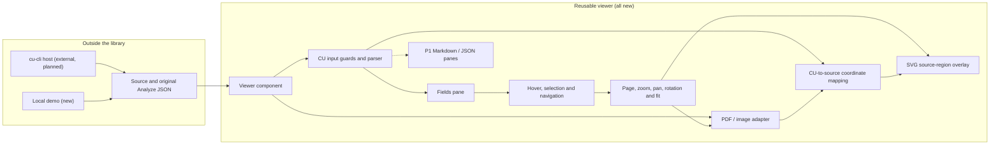
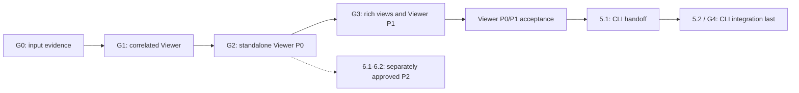

# Dev Plan: Content Understanding Result Viewer

> **Area**: integration / reusable React component
> **Target repository**: changjian-wang/cu-result-viewer
> **Requirements baseline**: [requirements](requirements.md) and [roadmap](roadmap.md), at commit `163814a`
> **Design approval**: initial baseline and MIT/LGPL-candidate direction approved by the task owner; distribution approval remains pending
> **Status**: In Progress; approved product appearance frozen and visually tested; task 2.4/2.5 verified scope retained; full P0/distribution gates remain open
> **Execution order**: complete the standalone Viewer P0/P1 scope and acceptance first; cu-cli integration is the final mainline stage
> **Last updated**: 2026-10-12

## Table of Contents

- [Document Summary](#document-summary)
- [Planning Basis](#planning-basis)
- [Prerequisites and Decisions](#prerequisites-and-decisions)
- [Architecture](#architecture)
  - [Architecture Diagram](#architecture-diagram)
  - [Input and Module Contracts](#input-and-module-contracts)
  - [Impact Analysis](#impact-analysis)
- [Implementation Phases](#implementation-phases)
  - [Phase 1: Evidence and Decisions](#phase-1-evidence-and-decisions)
  - [Phase 2: End-to-End Vertical Slice](#phase-2-end-to-end-vertical-slice)
  - [Phase 3: Complete the P0 Library and Demo](#phase-3-complete-the-p0-library-and-demo)
  - [Phase 4: Complete Viewer P1 and Standalone Acceptance](#phase-4-complete-viewer-p1-and-standalone-acceptance)
  - [Phase 5: cu-cli Integration Last](#phase-5-cu-cli-integration-last)
  - [Separate Follow-up: P2 Planning](#separate-follow-up-p2-planning)
- [Milestones and Sequencing](#milestones-and-sequencing)
- [Structured Task List](#structured-task-list)
- [Test Plan](#test-plan)
  - [Infrastructure and Commands](#infrastructure-and-commands)
  - [Coverage and Scenarios](#coverage-and-scenarios)
  - [Test Data and Measurement](#test-data-and-measurement)
- [Risks and Mitigations](#risks-and-mitigations)
- [Rollout and Rollback](#rollout-and-rollback)
- [Success Metrics](#success-metrics)
- [Change Log](#change-log)

## Document Summary

Build a rendering-only React/TypeScript library that accepts an original PDF/image and serialized CU Analyze JSON, then connects extracted fields to their source regions.

- **Start with a verified vertical slice**: a real multi-page PDF and image, analyzer-independent fields, and cross-page polygon highlighting.
- **Finish the Viewer, then integrate**: complete the rendering-only P0 library/demo, rich result views and standalone P1 UX, then validate the actual component without cu-cli. Only afterward perform the CLI handoff and integration.
- **Keep priorities and ownership separate**: existing P0/P1 requirement labels remain unchanged; CLI work is an external delivery stage, not a prerequisite for Viewer development, startup or standalone acceptance. TIFF/DI remain independently scoped P2.

**Owner-approved scheduling change, 2026-10-12**: mainline execution is phases **1 -> 2 -> 3 -> 4 -> 5**, with CLI last. Tasks, acceptance criteria, tests and gates are renumbered to match that order: Viewer P1 is `4.1-4.4` / G3, and CLI is `5.1-5.2` / G4. Phase 6 is an independent P2 follow-up, not a mainline prerequisite. Task **4.2** Fields/Markdown/JSON switching is now verified; the next ordered Viewer task is **4.3**, accessible UX and reviewed extensions. Existing technical prerequisites and outstanding P0 format/licensing/CI gates are not silently waived.

## Planning Basis

At investigation start, this repository contained only [README](../README.md), [requirements](requirements.md), and [roadmap](roadmap.md), with a clean worktree. There is no implementation, dependency manifest, test infrastructure, published package, or verified CLI integration to extend. All implementation paths below are proposed targets, not existing capabilities.

The local reference repository `C:\github\content-understanding`, inspected at commit `9fadee3`, is also a planning repository, not a source of production viewer code. This plan borrows its document structure and traceability:

| Reference | Applied here |
| --- | --- |
| [Canonical development-plan template](../../content-understanding/templates/dev-plan.md) | Prerequisites, architecture, phased tasks, risks, rollout, and measurable success criteria. |
| [Workflow development-plan template](../../content-understanding/cu-workflow/references/template-dev-plan.md) | A JSON task list, explicit dependencies, effort estimates, and an integrated test plan. |
| [Development-plan quality guidelines](../../content-understanding/.github/skills/cu-dev-plan/references/dev-plan-guidelines.md) | Concrete file targets and verifiable acceptance criteria. |
| [MarkItDown integration plan](../../content-understanding/planning/CY-2026-H1/integration/markitdown-integration/dev-plan-markitdown-integration.md) | Acceptance-to-test mapping through `covers_criteria`; not its SDK, service calls, or Python architecture. |
| [cu-cli proposal](../../content-understanding/planning/CY-2026-H1/integration/cu-cli/feature-cu-cli.md) | Host context only; it does not establish a current `--view` command or serialized output contract. |

These local reference links assume the repositories remain sibling directories. No reference document's approval, chosen dependency, endpoint, or completed checkbox is inherited.

The cu-cli proposal describes a terminal-native tool and excludes a GUI/Studio replacement. The current viewer brief explicitly targets a local browser inspection workflow. This is an integration coordination question, not permission to remove the viewer requirement or expand the CLI into a Studio replacement.

## Prerequisites and Decisions

The plan can be reviewed now, but implementation decisions must not be treated as approved facts. Phase 1 records evidence and obtains task-owner approval before freezing the public input and rendering architecture.

| Decision | Required evidence or decision | Gate / owner |
| --- | --- | --- |
| D1: CU input | Supported API version(s), actual saved and cu-cli output, wrappers, field value variants, grounding encoding, page numbering, units, dimensions, and orientation. | G0; viewer owner with CU/CLI maintainers. |
| D2: Runtime and source contract | React and browser versions; string URL protocols and loading policy; untyped Blob/ArrayBuffer format detection; invalid or missing source behavior. Filesystem paths are not browser URLs. | G0; viewer and host owners. |
| D3: Rendering and decoding | Compare PDF.js and both highlighter candidates; inspect OCR-Form-Tools patterns; record versions/licenses and local assets. Validate `.jpg`, `.jpeg`, `.jpe`, `.png`, `.bmp`, `.heif`, and `.heic`, including fallback costs. | G0 selects an approach; unresolved format coverage blocks P0 sign-off. |
| D4: Distribution and budgets | Private distribution, licensing, peer dependencies, package assets, representative file/result sizes, and measured performance budgets. Public publication requires a separate decision. | Before G2; project owner. |
| D5: CLI ownership | Preserve verified saved/CLI input evidence; confirm the external repository, maintainer and viewing handoff only in the final CLI phase. | G0 input evidence remains valid; G2 + G3 before task 5.1, approved handoff before 5.2. No Viewer startup/development blocker. |
| D6: Incomplete extension requirement | Clarify the truncated `Result-pane` item rather than inventing its API. | Before finalizing that P1 extension; not a P0 blocker. |

Minimum G0 data is a sanitized, real multi-page PDF/result pair and an image/result pair with verified grounding. Record remaining format/version/sample gaps explicitly. A gap may allow the thin slice to start, but cannot be counted as supported coverage or waived silently at release.

Proposed tooling is npm, TypeScript, Vite, Vitest, React Testing Library, and Playwright. Prefer a small single-package library plus demo, not a monorepo or application framework. These are recommendations; Phase 1 approves compatible versions, and task 2.1 establishes the actual manifests and conventions.

For PDF, the initial recommendation is PDF.js behind a thin internal adapter with an SVG overlay. Select a highlighter wrapper instead if the evaluation demonstrates a better fit for CU polygons, rotation, and embedding. This is not a decision to implement a custom PDF renderer. HEIF/HEIC decoding may need a lazy client-side fallback; native browser support must not be assumed.

## Architecture

### Architecture Diagram



The CLI's analysis, credentials, browser launch, and local server stay outside the library. The demo and ordinary React consumers run the Viewer independently, without a CLI service or handoff. Fetching an explicitly supplied source URL is allowed by the source policy; calling CU services is not.

### Input and Module Contracts

- **Public input**: retain the conceptual `source: File | Blob | ArrayBuffer | string` and `result: unknown`. Finalize string/binary semantics in D2. Hosts supply parsed, original serialized JSON, not SDK objects or a normalized viewer schema.
- **CU parser**: narrow `unknown` through guards, recognize only verified response shapes, and derive internal field/page/region records. Preserve `0`, `false`, null, missing confidence, duplicate field names, nested relationships, and all source regions. Do not mutate the supplied result or guess DI conventions.
- **Field identity**: derive stable internal identities from verified content/field paths, not field labels alone. P0 displays generic values; P1 adds richer nested/array/table navigation.
- **Source adapter**: share page metadata, render/cancel/dispose, and intrinsic dimensions across PDF and image implementations. Keep PDF.js types private. Add decoding behind the image adapter rather than format-specific application flows.
- **Geometry**: map verified CU coordinates into source coordinates, then apply one shared viewport transformation for the rendered page and overlay. Verify page origins, units, dimension swaps, PDF rotation, and image orientation rather than applying ad hoc offsets.
- **Interaction**: separate transient hover from persistent selection. A grounded field navigates to its verified page; an ungrounded field remains inspectable and does not trigger fabricated navigation. P0 uses a primary verified region while preserving additional regions for P1.
- **Lifecycle and errors**: cancel obsolete loads/renders, ignore stale completions, and release owned object URLs, workers, canvases, and decoded buffers. Show explicit loading/empty/input/rendering errors; keep extracted values usable when only source rendering fails.
- **Distribution**: expose the component, necessary public types, and documented styles/assets. React is a peer dependency. Bundle no CU SDK, credentials, analyzer management, telemetry, or required CDN assets.
- **P1 extensions**: add selection callbacks, custom field rendering, viewer events, toolbar/layout customization, and initial page/zoom/fit only after their contracts are reviewed. Do not expose the internal normalized CU model as the integration contract.

### Impact Analysis

| Surface | Change | Boundary |
| --- | --- | --- |
| `src\index.ts`, `src\ContentUnderstandingResultViewer.tsx` | New public library entry/component. | Source plus original JSON; no service or PDF.js types. |
| `src\internal\` | New CU parser, source adapters, geometry, interaction state, and tests. | Internal implementation details. |
| `src\components\`, `src\styles.css` | New panes, overlays, controls, and styles. | Avoid host-global style leakage. |
| `demo\` | New client-side file/result loading host. | No Analyze/authentication workflow. |
| `tests\fixtures\`, `tests\e2e\` | New sanitized sample inventory and browser/consumer coverage. | Real paired samples for normal demos; synthetic data clearly labeled. |
| Root manifests/configuration and CI | New build, type-check, lint, unit, browser, and package checks. | No automatic public publishing. |
| [README](../README.md) and future usage/integration documents | Update only when corresponding commands/APIs exist and pass checks. | Do not turn planned features into delivery claims. |
| cu-cli implementation repository | External host changes after repository/owner/path confirmation. | No CLI/server dependencies enter this package. |
| P1/P2 modules | Later, gated additions. | TIFF/DI do not block P0/P1. |

## Implementation Phases

Effort is provisional: S = hours, M = approximately 1-2 developer days, TBD = cannot estimate before host investigation. These are task-size estimates, not dates or commitments. Split a task if verified scope exceeds a focused implementation session. File actions and criterion/test IDs are authoritative in the [structured list](#structured-task-list).

Phase, task, acceptance and test number prefixes below now use the same revised delivery order. Complete Viewer functionality and independent acceptance before starting any CLI contract or implementation. CLI input fixtures already acquired remain usable without executing that integration stage.

### Phase 1: Evidence and Decisions

**Goal**: establish the facts needed to implement, rather than invent CU geometry or choose a renderer from reputation.

| Task | Work and acceptance | Effort |
| --- | --- | --- |
| `1.1` | Record CU/CLI contracts, approved runtime/source assumptions, real sample provenance and gaps, and Studio observations. **AC-1.1**: a real PDF and image pair have verified field/page/geometry expectations; unresolved decisions have owners and gates. | M |
| `1.2` | Evaluate PDF.js, both highlighter projects, OCR-Form-Tools patterns, and required image decoding. **AC-1.2**: record reproducible polygon/rotation/worker and decoding evidence, candidate versions/licenses, the selected approach, and any format gap blocking P0. | M |

**2026-10-09 progress**: G0's design/candidate direction is approved. [Design decisions](design-decisions.md) and the [fixture inventory](../tests/fixtures/manifest.json) preserve the real pairs and [evidence](rendering-evaluation.md). Tasks 2.1-2.3 are delivered with 339 passing unit cases and 512 actual-geometry browser checks. Next is UI prototype review; formal task 2.4 is gated. Reusable viewer rendering, distribution/update obligations and additional UX/sample coverage remain open.

**2026-10-10 progress**: the approved [running implementation](../README.md#run-the-prototype) now passes 409 unit cases and 52 Chrome/Edge runs. Public inputs, native image formats, eight synthetic EXIF directions and local-only HEIF are exercised in actual components; real pages were visually checked. [Fields styling](prototype/interactive-fields.png), confidence and unavailable-page diagnostics remain consistent. Local HEIF approval is not decoder distribution or full P0/consumer/CLI acceptance.

**2026-10-12 progress**: the owner required final UI parity with the latest approved prototype. The [product visual suite](../tests/e2e/visual.spec.ts) adds nine scenarios per browser and 30 immutable Windows screenshots; combined browser coverage is now 70 runs. Thirty-six repeated comparisons preserve all image hashes, Chrome Fields directly match the approved PNG, and a real icon-size drift probe is detected. Runtime UI/styles are unchanged; this prepares 2.6/3.1 acceptance within implemented scope without closing task 2.5 or full P0 gates.

**2026-10-12 stress progress**: the [stress suite](../tests/e2e/stress.spec.ts) adds three exact 100-round scenarios per browser, totaling 600 PDF/PNG state/input/cancellation rounds and 76 combined runs. Per-round geometry, selection, caller integrity and resource ownership pass. A pan-scrollbar re-centering defect was fixed with local stage clipping; the stressed product context and all 30 unchanged images still match the approved UI. The batch passed 314 related unit cases, type/lint and both builds; broader HEIF/format/DPR, memory budgets and package-consumer gates remain open.

**2026-10-12 package progress**: user-approved optional Node-only Vite resource delivery now passes real React18.3.1/19.3.0 tgz consumers, development/production, Chrome/Edge, types/CSS/Worker/fonts and actual host CSP. Sixteen consumer runs add to76 repository runs:92 local browser checks and416 unit cases. The same product images match without changes. Usage/core CI are configured, not remotely executed or full P0/release approval.

**2026-10-13 task 4.1 progress**: real invoice/receipt arrays, stable one-based item labels, hidden-descendant selection and all current field/group source regions are implemented. Real BillingAddress region switching and a synthetic cross-page structured group pass in Chrome/Edge. At that checkpoint 424 unit cases, 80 repository browser runs and 16 packed-consumer runs passed; all 30 existing product references remained unchanged. Dedicated Tables view and real cross-page structured CU pairs are not claimed.

**2026-10-13 task 4.2 progress**: Fields, sanitized Markdown and the original expandable JSON input now switch without resetting source page/zoom/rotation/pan/pin/region state. Real PDF/PNG Markdown, nine CU HTML invoice tables, missing content, adversarial active content/URLs/images, original envelope keys, parser-rejected raw JSON and explicit limits (1,000,000 Markdown characters; 2,000,000 JSON characters or 20,000 values) pass in Chrome/Edge and isolated React 18/19 Vite consumers. Current totals are 429 unit cases, 86 repository runs and 16 packed-consumer runs: 102 local browser runs. The original 30 product references are unchanged; four task 4.2 pane references were added. Paragraphs/Tables/Code remain disabled pending scope. Task 4.3 is next.

Use the current Studio with representative PDF and image results. Record layout, field/value/confidence presentation, hover versus selection, cross-page navigation, fit/zoom/pan/rotation, and missing-source/grounding behavior. If Studio is inaccessible, record that limitation and leave the behavioral review gate open.

**Exit G0**: input/geometry evidence, runtime/source contract, rendering decision, and design decisions have task-owner approval. No API/codec claim is inferred from the planning reference.

### Phase 2: End-to-End Vertical Slice

**Goal**: prove source/result correlation before broadening controls or result views.

| Task | Work and acceptance | Effort |
| --- | --- | --- |
| `2.1` | Establish the single-package toolchain and public input types. **AC-2.1**: clean install, strict type-check, lint, unit runner, and build pass; accepted source variants and `unknown` result compile without a CU SDK. | S |
| `2.2` | Implement verified CU parsing and internal records. **AC-2.2**: saved and actual CLI shapes produce expected fields/pages/regions without caller normalization; malformed input is explicit and optional values are preserved. | M |
| `2.3` | Implement pure CU/source/viewport geometry transforms. **AC-2.3**: independently derived reference points remain within 1 CSS pixel at the proposed scale/rotation/resize matrix; invalid geometry never becomes a fake region. | M |
| `2.4` | Add a cancellable PDF adapter and source pane. **AC-2.4**: a real multi-page PDF renders with correct dimensions/page counts and local worker assets; render/load failures and cancellation are observable. | M |
| `2.5` | Add the common image adapter and selected decoding path. **AC-2.5**: each P0 image extension is tested against the approved browser matrix; decode failures are explicit and orientation agrees with verified grounding. | M |
| `2.6` | Assemble viewer, generic fields, interaction state, and overlays. **AC-2.6**: hover/select highlights a real PDF/image field, navigates across PDF pages, and preserves selection when hover ends; absent grounding keeps the value visible. | M |

**Task 2.1 delivered**: [public types](../src/index.ts), [input tests](../src/index.test.ts), [package/tooling](../package.json), and [MIT](../LICENSE) are in place. The entry now also exports the prototype component; a passing declaration build is still not sufficient evidence of browser behavior.

**Task 2.2 delivered**: [internal parsing](../src/internal/parseCuResult.ts) and [tests](../src/internal/parseCuResult.test.ts) preserve the original GA data and distinguish explicit errors/issues. The PDF/PNG runs produce 100/42 nodes and 53/13 regions without warnings; this is not visual verification.

**Task 2.3 delivered**: [geometry](../src/internal/geometry.ts) and [tests](../src/internal/geometry.test.ts) map actual page dimensions with reversible view transforms. The unchanged 1 CSS pixel threshold is now checked in both the original experiment and the implemented prototype.

**Prototype review gate (owner-requested)**: [v2 static design](prototype/README.md) and the current [interactive baseline](../README.md#run-the-prototype) are approved for task 2.4 hardening. The first public-input batch verifies real PDF/PNG File, untyped Blob, ArrayBuffer, same-origin HTTP and host-owned blob URLs, caller-data preservation, explicit failures/recovery and controlled replacement/unmount cleanup. This approval removes the UI implementation blocker; it does not close HEIF, rich P1, full format/orientation, 100-switch stress or package-consumer gates.

**Run-first checkpoint**: as soon as any source pane or viewer host is mountable, start it and inspect the real PDF/image and field/source behavior in a browser before expanding features. Do not wait until all P0 controls are complete or substitute parser logs for UI effects.

**Exit G1**: use the demo host introduced in task 3.2, or a temporary test harness, to show real PDF/image correlation with no credentials, CU request, or normalization step. The browser scenario must exercise the integrated rendering path, not only mocked geometry.

### Phase 3: Complete the P0 Library and Demo

**Goal**: make the verified slice reliable and embeddable.

| Task | Work and acceptance | Effort |
| --- | --- | --- |
| `3.1` | Complete zoom, pan, fit modes, rotation, page controls, error states, and disposal. **AC-3.1**: previous/next/jump and counters are correct; alignment survives every transformation; rapid source changes and unmounts cannot display stale results or retain owned resources. | M |
| `3.2` | Add the file-plus-saved-JSON demo and browser regression suite. **AC-3.2**: real paired samples work from all public source variants without service access; missing/invalid inputs, corrupt files, and page bounds give visible, useful outcomes. | M |
| `3.3` | Package library/styles/local rendering assets, add CI and embedding documentation. **AC-3.3**: a separate consumer loads the packed package, types, CSS, worker, and decoder assets; documented commands pass and no runtime CDN/CU dependency is required. | M |

Publish the tested format/browser matrix and measured sample sizes. Missing HEIF/HEIC evidence is a Viewer P0 coverage gap, not an implicit P2 deferral. G2 is a standalone library/demo gate; it requires no CLI contract or implementation.

**Exit G2**: all library/demo P0 scenarios pass, including required image formats and package-consumer verification. The component can enter private host testing.

### Phase 4: Complete Viewer P1 and Standalone Acceptance

**Goal**: finish the Viewer's result representations, inspection UX and reviewed extensions before CLI integration, retaining the original-JSON entry point and approved appearance.

| Task | Work and acceptance | Effort |
| --- | --- | --- |
| `4.1` | Add structured nested/array/table fields and multiple-region navigation. **AC-4.1**: original relationships remain inspectable and every available region can be reached without losing field identity or selection. | M |
| `4.2` | Add Fields/Markdown/JSON tabs using safe Markdown and an evaluated mature JSON tree. **AC-4.2**: formatting and expand/collapse work; unsafe HTML/URL content cannot execute; large-result limits are measured and documented. | M |
| `4.3` | Add accessible keyboard/touch/responsive behavior and reviewed extension points. **AC-4.3**: focus and selection work without a mouse, narrow layouts remain usable, and callbacks/custom renderers/toolbar/layout/initial-view options pass host tests. | M |
| `4.4` | Document MCP Apps/MCP UI and chat-host integration design. **AC-4.4**: data delivery, payload constraints, assets/CSP, loading/errors, lifecycle, and trust boundaries are specified without adding service logic to the core. | S |

Task 4.3 must not finalize `Result-pane` customization until D6 is resolved. Markdown/JSON and other clearly stated P1 behavior can proceed independently. This phase requires MCP integration design/documentation, not an unrequested MCP server implementation.

**Next functional target: 4.3.** Complete keyboard/focus/touch/responsive behavior and only the extension points approved after D6 is resolved. Fields/Markdown/JSON are implemented; Paragraphs/Tables/Code remain disabled placeholders whose semantics must be explicitly scoped before they are advertised. Preserve the approved Fields layout and task 4.2 source-state guarantees.

**Exit G3**: P1 acceptance/tests and reviewed host extension contracts are complete, with limitations documented.

**Standalone Viewer completion**: require **G2 + G3** and reviewed product/independent-consumer evidence. Viewer startup, direct saved-result inspection, rich-pane switching, geometry and lifecycle must work without cu-cli or a new Analyze call. Disabled placeholders cannot count as completed features; preserve approved Fields/layout, with intentional new-view changes reviewed before updating visual baselines.

### Phase 5: cu-cli Integration Last

**Goal**: integrate the completed Viewer as one external host option, without moving host responsibilities into the component.

**Start gate**: complete Viewer P0/P1 and standalone acceptance (**G2 + G3**) first. Both the handoff contract `5.1` and implementation `5.2` are deferred until then; neither can block direct Viewer running or development.

| Task | Work and acceptance | Effort |
| --- | --- | --- |
| `5.1` | Agree and document a minimal handoff using the completed packaged Viewer and original JSON. **AC-5.1**: viewer/CLI owners approve source delivery, saved-result reuse, loopback/file-access boundaries, assets and browser/server lifecycle. | S |
| `5.2` | Implement and test fresh-analysis and saved-result viewing in the confirmed CLI repository. **AC-5.2**: the target `cu analyze sample.pdf --view` flow opens the Viewer; saved viewing makes zero new CU calls; host shutdown and file restrictions match the contract. | TBD |

Task 5.2 also requires the CLI repository/owner, approved task 5.1 and inspected file targets. Do not invent CLI commands or saved-result flags. A selected local server must bind to loopback, expose only explicitly supplied files and load assets locally.

**Exit G4**: both external host paths pass with a real source/result pair. G4 completes CLI delivery; it is not part of standalone Viewer acceptance. The original CLI-inclusive project requirement remains tracked, but its scheduling is last.

### Separate Follow-up: P2 Planning

| Task | Work and acceptance | Effort |
| --- | --- | --- |
| `6.1` | Investigate TIFF/multi-page TIFF, decoder cost, page metadata, and navigation. **AC-6.1**: real sample coverage and a separately approved implementation/test scope are recorded before adding TIFF code. | S |
| `6.2` | Investigate DI output versions, fields, and coordinate conventions independently. **AC-6.2**: real DI fixtures and a separate parser/geometry compatibility plan are approved; no CU assumption is silently reused. | S |

These phase-6 tasks are outside the current mainline. Create bounded TIFF/DI implementation tasks only after separate scope approval. Neither task is a prerequisite for Viewer P0/P1 or the final CLI stage.

## Milestones and Sequencing

| Gate | Tasks / evidence | Depends on |
| --- | --- | --- |
| G0: approved evidence and decisions | 1.1, 1.2 | Sanitized real pairs, Studio access/review, owners' decisions. |
| G1: correlated vertical slice | 2.1-2.6, integrated browser proof | G0; real PDF/image grounding. |
| G2: P0 library/demo candidate | 3.1-3.3, full format matrix | G1. |
| G3: Viewer P1 | 4.1-4.4 | Existing Viewer/package prerequisites; G2 for standalone completion. No CLI dependency. |
| Standalone Viewer completion | G2 + G3; product and independent-consumer review | Required before 5.1 or 5.2. No CLI prerequisite. |
| G4: CLI integration, final mainline gate | 5.1-5.2, fresh and saved workflows | Completed Viewer (G2 + G3), D5 and external host approval. |
| P2 scheduling | 6.1-6.2 | G2 architecture; separate owner approval, not G3. |

Gate IDs also match the revised order: G3 accepts Viewer P1 and G4 accepts final CLI integration. Viewer work can proceed independently of CLI availability; packaging review may overlap other Viewer work, but CLI contract review no longer overlaps unfinished Viewer delivery.



The structured dependency graph below retains the existing technical prerequisites and adds the completed-Viewer prerequisite to CLI work. Task numbers now match execution phases.

## Structured Task List

Paths are relative to the target repository and use Windows separators. `create`/`modify` describe the expected state when that task executes, including files introduced by dependencies. Criterion IDs match the human-readable tables; every criterion has a test through `covers_criteria`. Estimates do not authorize execution before the gates above.

```json
{
  "feature": "cu-result-viewer",
  "status": "in_progress",
  "target_repository": "changjian-wang/cu-result-viewer",
  "design_doc": null,
  "delivery_policy": {
    "approved_on": "2026-10-12",
    "mainline_phases": [1, 2, 3, 4, 5],
    "viewer_completion_gates": ["G2", "G3"],
    "cli_final_tasks": ["5.1", "5.2"],
    "cli_blocks_viewer": false,
    "next_viewer_functional_task": "4.3",
    "separate_p2_tasks": ["6.1", "6.2"]
  },
  "review_gates": [
    {
      "id": "ui-prototype-v1",
      "status": "interactive-baseline-approved-hardening-in-progress",
      "iteration": 2,
      "wireframe_approved": true,
      "interaction_baseline_approved": true,
      "interaction_approval_date": "2026-10-10",
      "browser_checks_passed": true,
      "unit_cases": 429,
      "browser_runs": 102,
      "repository_browser_runs": 86,
      "packed_consumer_browser_runs": 16,
      "stress_browser_runs": 6,
      "stress_rounds_per_browser": 300,
      "visual_browser_runs": 18,
      "visual_baseline_count": 34,
      "visual_baseline": "tests\\e2e\\visual.spec.ts-snapshots",
      "fields_reference": "docs\\prototype\\interactive-fields.png",
      "reference": "docs\\prototype\\README.md",
      "state_preview": "docs\\prototype\\index.html",
      "state_count": 10,
      "sequence": ["wireframe-review", "interactive-prototype", "browser-review"],
      "blocks": []
    }
  ],
  "tasks": [
    {
      "id": "1.1", "phase": 1, "priority": "P0", "title": "Verify input, samples and Studio behavior", "effort": "M", "status": "done",
      "description": "Record D1/D2/D5 evidence, Studio observations, approved runtime/source assumptions and remaining decision owners. Do not infer CU geometry or CLI serialization.",
      "files": [
        {"path": "docs\\design-decisions.md", "action": "create"},
        {"path": "tests\\fixtures\\manifest.json", "action": "create"}
      ],
      "depends_on": [],
      "acceptance_criteria": [{"id": "AC-1.1", "text": "Real PDF/image pairs have verified field, page and geometry expectations; unresolved decisions and sample gaps have owners and gates."}],
      "tests": [{"id": "T-1.1", "type": "manual", "framework": "document-review", "description": "Inspect source/result pairs and Studio; review version, provenance, geometry and decision records with owners.", "covers_criteria": ["AC-1.1"]}]
    },
    {
      "id": "1.2", "phase": 1, "priority": "P0", "title": "Evaluate rendering and decoding", "effort": "M", "status": "done",
      "description": "Compare PDF.js, both react-pdf-highlighter candidates and OCR-Form-Tools patterns. Record reproducible render/overlay/rotation/worker and image-decoding probes, versions, licenses, costs and the selected approach.",
      "files": [{"path": "docs\\rendering-evaluation.md", "action": "create"}],
      "depends_on": ["1.1"],
      "acceptance_criteria": [{"id": "AC-1.2", "text": "Evaluation evidence covers PDF geometry/local assets and every P0 image extension; selected dependencies and blocking gaps are explicitly recorded."}],
      "tests": [{"id": "T-1.2", "type": "manual", "framework": "browser-probe", "description": "Repeat documented probes on approved browsers, including HEIF/HEIC decoding and 90-degree rotations; review license and asset packaging evidence.", "covers_criteria": ["AC-1.2"]}]
    },
    {
      "id": "2.1", "phase": 2, "priority": "P0", "title": "Establish tooling and public input types", "effort": "S", "status": "done",
      "description": "Create the approved npm/TypeScript/Vite toolchain, lint/unit scripts, peer dependencies and conceptual public source/result types. Generate the lockfile with the package manager.",
      "files": [
        {"path": "package.json", "action": "create"},
        {"path": "package-lock.json", "action": "create"},
        {"path": "LICENSE", "action": "create"},
        {"path": ".gitignore", "action": "create"},
        {"path": "tsconfig.json", "action": "create"},
        {"path": "tsconfig.build.json", "action": "create"},
        {"path": "vite.config.ts", "action": "create"},
        {"path": "eslint.config.mjs", "action": "create"},
        {"path": "src\\index.ts", "action": "create"},
        {"path": "src\\index.test.ts", "action": "create"}
      ],
      "depends_on": ["1.1", "1.2"],
      "acceptance_criteria": [{"id": "AC-2.1", "text": "Clean install, strict type-check, lint, unit runner and build pass; public source variants and unknown result compile without CU SDK types."}],
      "tests": [{"id": "T-2.1", "type": "integration", "framework": "toolchain", "description": "Run scripts from a clean install and compile a public-type consumer; inspect declared runtime dependencies for prohibited service/SDK coupling.", "covers_criteria": ["AC-2.1"]}]
    },
    {
      "id": "2.2", "phase": 2, "priority": "P0", "title": "Parse verified CU result shapes", "effort": "M", "status": "done",
      "description": "Guard unknown JSON, recognize verified saved/CLI shapes, and derive internal field/page/region records with stable identities. Preserve all supplied values/regions and report invalid input explicitly.",
      "files": [
        {"path": "src\\internal\\types.ts", "action": "create"},
        {"path": "src\\internal\\parseCuResult.ts", "action": "create"},
        {"path": "src\\internal\\parseCuResult.test.ts", "action": "create"}
      ],
      "depends_on": ["2.1"],
      "acceptance_criteria": [{"id": "AC-2.2", "text": "Verified saved/CLI samples produce expected fields/pages/regions without normalization or mutation; malformed input and absent optional data are distinguishable."}],
      "tests": [{"id": "T-2.2", "type": "unit", "framework": "vitest", "description": "Test actual wrappers/versions, multiple contents, duplicate labels, 0/false/null, missing confidence/grounding, malformed values and frozen input.", "covers_criteria": ["AC-2.2"]}]
    },
    {
      "id": "2.3", "phase": 2, "priority": "P0", "title": "Implement shared geometry transforms", "effort": "M", "status": "done",
      "description": "Map verified CU units/origins/orientation into source and viewport coordinates using shared pure transforms. Reject invalid regions instead of guessing units or pages.",
      "files": [
        {"path": "src\\internal\\geometry.ts", "action": "create"},
        {"path": "src\\internal\\geometry.test.ts", "action": "create"}
      ],
      "depends_on": ["2.2"],
      "acceptance_criteria": [{"id": "AC-2.3", "text": "Independent expected points agree within 1 CSS pixel across the agreed scale/rotation/resize matrix; malformed geometry cannot produce fabricated highlights."}],
      "tests": [{"id": "T-2.3", "type": "unit", "framework": "vitest", "description": "Use hand-derived reference points and verified CU fixtures for transforms/inverses, dimension swaps, page origins, invalid points and non-finite coordinates.", "covers_criteria": ["AC-2.3"]}]
    },
    {
      "id": "2.4", "phase": 2, "priority": "P0", "title": "Render PDF through an internal source adapter", "effort": "M",
      "status": "in_progress",
      "execution_ready": true,
      "implementation_evidence": "Interactive baseline approved; real PDF/PNG public inputs, caller-data preservation and controlled cancellation/unmount resource accounting verified. Full orientation/format, stress and package-consumer acceptance remains open.",
      "description": "Define the private page/render/cancel/dispose contract and implement the selected PDF adapter/source pane with local assets and explicit failure states.",
      "files": [
        {"path": "src\\internal\\source.ts", "action": "create"},
        {"path": "src\\internal\\pdfSource.ts", "action": "create"},
        {"path": "src\\components\\SourcePane.tsx", "action": "create"},
        {"path": "src\\internal\\pdfSource.test.ts", "action": "create"},
        {"path": "src\\internal\\source.test.ts", "action": "create"},
        {"path": "tools\\pdfAssets.ts", "action": "create"}
      ],
      "depends_on": ["2.1"],
      "acceptance_criteria": [{"id": "AC-2.4", "text": "A real multi-page PDF renders with verified dimensions/page counts and local worker assets; load/render failures and cancellation are observable."}],
      "tests": [
        {"id": "T-2.4a", "type": "unit", "framework": "vitest", "description": "Test adapter cancellation, page metadata, disposal and failure propagation.", "covers_criteria": ["AC-2.4"]},
        {"id": "T-2.4b", "type": "e2e", "framework": "playwright", "description": "Render the real PDF in the integrated demo after task 3.2 with external asset requests blocked.", "covers_criteria": ["AC-2.4"]}
      ]
    },
    {
      "id": "2.5", "phase": 2, "priority": "P0", "title": "Render required images through the common adapter", "effort": "M",
      "status": "in_progress",
      "implementation_evidence": "Native PNG/JPEG/BMP and EXIF 1-8 at DPR1/2 pass; owner-approved local-only HEIF primary/CSP/cancellation path works in the component. Production rejects HEIF and contains no decoder binary; broader real pairs/codec variants/distribution obligations remain open.",
      "description": "Reuse the source contract for native/fallback decoding, orientation and intrinsic dimensions. Keep HEIF/HEIC in P0 and expose decode errors explicitly.",
      "files": [
        {"path": "src\\internal\\imageSource.ts", "action": "create"},
        {"path": "src\\internal\\imageSource.test.ts", "action": "create"},
        {"path": "src\\internal\\heifSource.ts", "action": "create"},
        {"path": "src\\internal\\heifSource.test.ts", "action": "create"},
        {"path": "src\\internal\\heif.worker.ts", "action": "create"},
        {"path": "tools\\heifDevelopmentAssets.ts", "action": "create"},
        {"path": "tools\\generate-image-fixtures.mjs", "action": "create"},
        {"path": "tests\\e2e\\image-formats.spec.ts", "action": "create"},
        {"path": "tests\\e2e\\sourceResources.ts", "action": "create"},
        {"path": "tsconfig.worker.json", "action": "create"},
        {"path": "demo\\vite.config.ts", "action": "modify"},
        {"path": "demo\\App.tsx", "action": "modify"},
        {"path": "src\\components\\SourcePane.tsx", "action": "modify"}
      ],
      "depends_on": ["2.4"],
      "acceptance_criteria": [{"id": "AC-2.5", "text": "Every P0 image extension passes the approved browser/decoder matrix; corrupt files fail visibly and image orientation matches verified CU grounding."}],
      "tests": [
        {"id": "T-2.5a", "type": "unit", "framework": "vitest", "description": "Test detection, decode selection, orientation metadata, corrupt data and decoder/resource disposal.", "covers_criteria": ["AC-2.5"]},
        {"id": "T-2.5b", "type": "e2e", "framework": "playwright", "description": "Run the required format matrix through the demo after task 3.2, including HEIF/HEIC fallback assets.", "covers_criteria": ["AC-2.5"]}
      ]
    },
    {
      "id": "2.6", "phase": 2, "priority": "P0", "title": "Connect fields, navigation and source overlays", "effort": "M",
      "status": "prototype-implemented",
      "verification_evidence": "Approved product visual baselines and 1 CSS pixel primary-region checks cover existing PDF/PNG interactions; formal closure retains task 2.5 and wider acceptance dependencies.",
      "description": "Assemble the viewer with generic field/value/confidence rendering, separate hover/selection state, cross-page navigation and shared-transform polygons. Export the component from the public entry.",
      "files": [
        {"path": "src\\ContentUnderstandingResultViewer.tsx", "action": "create"},
        {"path": "src\\components\\FieldsPane.tsx", "action": "create"},
        {"path": "src\\components\\SourcePane.tsx", "action": "modify"},
        {"path": "src\\internal\\interaction.ts", "action": "create"},
        {"path": "src\\internal\\interaction.test.ts", "action": "create"},
        {"path": "tests\\e2e\\visual.spec.ts", "action": "create"},
        {"path": "playwright.config.ts", "action": "modify"},
        {"path": "src\\index.ts", "action": "modify"}
      ],
      "depends_on": ["2.2", "2.3", "2.4", "2.5"],
      "acceptance_criteria": [{"id": "AC-2.6", "text": "Real PDF/image field hover/selection highlights the verified primary region, navigates across pages, retains selection and ungrounded values, and preserves the latest approved product appearance."}],
      "tests": [
        {"id": "T-2.6a", "type": "unit", "framework": "vitest", "description": "Test transient/persistent interaction, cross-page identity, absent grounding and rapid field changes.", "covers_criteria": ["AC-2.6"]},
        {"id": "T-2.6b", "type": "e2e", "framework": "playwright", "description": "Correlate real PDF/image fields and overlays in the integrated harness; repeat in the committed demo after task 3.2.", "covers_criteria": ["AC-2.6"]},
        {"id": "T-2.6visual", "type": "e2e", "framework": "playwright", "description": "Compare approved product default/hover/pin/group/filter/page/image/loading/empty/error images with immutable browser-specific baselines and a deliberate drift probe; preserve geometry and error independence.", "covers_criteria": ["AC-2.6", "AC-3.1", "AC-3.2"]}
      ]
    },
    {
      "id": "3.1", "phase": 3, "priority": "P0", "title": "Complete controls, errors and lifecycle", "effort": "M",
      "status": "partial-prototype",
      "verification_evidence": "PDF/PNG DPR1 stress passes 100 page/transform rounds, 100 public-input replacements and 100 pending cancellations per browser, with current-context visual parity and resource accounting. Pan scrollbar re-centering fixed without baseline updates; broader format/DPR/consumer acceptance remains open.",
      "description": "Add zoom/pan/fit/rotation and PDF page controls; handle loading/empty/errors and last-load-wins source changes. Dispose owned resources and keep source/overlay transforms synchronized.",
      "files": [
        {"path": "src\\components\\Toolbar.tsx", "action": "create"},
        {"path": "src\\styles.css", "action": "modify"},
        {"path": "src\\ContentUnderstandingResultViewer.tsx", "action": "modify"},
        {"path": "src\\components\\SourcePane.tsx", "action": "modify"},
        {"path": "src\\internal\\interaction.ts", "action": "modify"},
        {"path": "src\\internal\\interaction.test.ts", "action": "modify"},
        {"path": "tests\\e2e\\stress.spec.ts", "action": "create"}
      ],
      "depends_on": ["2.6"],
      "acceptance_criteria": [{"id": "AC-3.1", "text": "Controls/page bounds/counters are correct and alignment survives transformations; source replacement/unmount never shows stale content or retains owned resources."}],
      "tests": [
        {"id": "T-3.1a", "type": "unit", "framework": "vitest", "description": "Test state transitions, resource ownership/disposal, out-of-order loads, mount/unmount and React StrictMode cleanup.", "covers_criteria": ["AC-3.1"]},
        {"id": "T-3.1b", "type": "e2e", "framework": "playwright", "description": "Exercise controls, pan/resize and page bounds; run exact 100-round PDF transforms, source replacements and held-request cancellations per browser with geometry/resource checks and current-context approved snapshots.", "covers_criteria": ["AC-3.1", "AC-3.2"]}
      ]
    },
    {
      "id": "3.2", "phase": 3, "priority": "P0", "title": "Deliver the local demo and browser regression suite", "effort": "M",
      "status": "partial-prototype",
      "description": "Load browser-selected source and saved JSON with explicit input errors. Add Playwright configuration/scripts and integrated positive/negative scenarios using the real fixture inventory.",
      "files": [
        {"path": "demo\\index.html", "action": "create"},
        {"path": "demo\\App.tsx", "action": "create"},
        {"path": "playwright.config.ts", "action": "create"},
        {"path": "tests\\e2e\\prototype.spec.ts", "action": "create"},
        {"path": "tests\\e2e\\source-inputs.html", "action": "create"},
        {"path": "tests\\e2e\\source-inputs.tsx", "action": "create"},
        {"path": "tests\\e2e\\source-inputs.spec.ts", "action": "create"},
        {"path": "tests\\e2e\\viewerAssertions.ts", "action": "create"},
        {"path": "demo\\main.tsx", "action": "create"},
        {"path": "demo\\styles.css", "action": "create"},
        {"path": "demo\\vite.config.ts", "action": "create"},
        {"path": "package.json", "action": "modify"}
      ],
      "depends_on": ["3.1"],
      "acceptance_criteria": [{"id": "AC-3.2", "text": "Real paired samples work for File/Blob/ArrayBuffer/approved URL input without CU access; missing/invalid JSON/source, corrupt files and page bounds have visible useful outcomes."}],
      "tests": [{"id": "T-3.2", "type": "e2e", "framework": "playwright", "description": "Run integrated source-type, format, field, control and negative cases with CU/external asset requests blocked; verify source failures do not hide extracted fields.", "covers_criteria": ["AC-3.2"]}]
    },
    {
      "id": "3.3", "phase": 3, "priority": "P0", "title": "Package, document and gate the library", "effort": "M",
      "status": "in_progress",
      "implementation_evidence": "Actual isolated React18/19 Vite tgz hosts pass types/CSS/local resources/CSP and unchanged product snapshots in dev/prod; optional Node plugin approved. Usage and core CI configured; remote CI, full decoder formats and release gates remain open.",
      "description": "Package public types, scoped styles and local worker/decoder resources. Add CI and an isolated packed-package consumer; document only verified APIs, commands, limits and distribution policy.",
      "files": [
        {"path": "package.json", "action": "modify"},
        {"path": "vite.config.ts", "action": "modify"},
        {"path": "README.md", "action": "modify"},
        {"path": "docs\\usage.md", "action": "create"},
        {"path": ".github\\workflows\\ci.yml", "action": "create"},
        {"path": "tests\\e2e\\package-host.spec.ts", "action": "create"},
        {"path": "src\\vite.ts", "action": "create"},
        {"path": "src\\vite.test.ts", "action": "create"},
        {"path": "playwright.consumer.config.ts", "action": "create"},
        {"path": "tools\\prepare-packed-consumers.mjs", "action": "create"},
        {"path": "tools\\verify-packed-consumers.mjs", "action": "create"}
      ],
      "depends_on": ["3.2"],
      "acceptance_criteria": [{"id": "AC-3.3", "text": "An isolated consumer loads the packed library, types, styles and local assets; CI/documented commands pass without a required CU SDK or runtime CDN."}],
      "tests": [{"id": "T-3.3", "type": "integration", "framework": "toolchain-and-playwright", "description": "Build/pack/install into a separate test consumer, compile its public API, render PDF/images under the agreed CSP and inspect network/package contents.", "covers_criteria": ["AC-3.3"]}]
    },
    {
      "id": "4.1", "phase": 4, "priority": "P1", "title": "Add structured fields and multiple-region inspection", "effort": "M",
      "status": "done",
      "implementation_evidence": "Real invoice/receipt arrays use stable Item N labels and retain descendant selection across collapse; real same-page multi-region addresses and a clearly synthetic cross-page array group expose every own/descendant region. Component and Chrome/Edge tests pass without changing approved default visuals.",
      "description": "Extend generic fields for nested objects, arrays/tables and region selection while preserving stable field identity and the original public input.",
      "files": [
        {"path": "src\\components\\FieldsPane.tsx", "action": "modify"},
        {"path": "src\\internal\\interaction.ts", "action": "modify"},
        {"path": "src\\components\\FieldsPane.test.tsx", "action": "create"},
        {"path": "src\\ContentUnderstandingResultViewer.tsx", "action": "modify"},
        {"path": "src\\components\\SourcePane.tsx", "action": "modify"},
        {"path": "src\\styles.css", "action": "modify"},
        {"path": "tests\\e2e\\prototype.spec.ts", "action": "modify"}
      ],
      "depends_on": ["3.3"],
      "acceptance_criteria": [{"id": "AC-4.1", "text": "Nested/array/table relationships remain inspectable and every available source region can be reached without losing field identity/selection."}],
      "tests": [{"id": "T-4.1", "type": "integration", "framework": "react-testing-library-and-playwright", "description": "Use real invoice/receipt structured and multi-region fields plus a labeled synthetic cross-page group to expand table-like arrays, retain hidden selections and navigate every own/descendant region/page.", "covers_criteria": ["AC-4.1"]}]
    },
    {
      "id": "4.2", "phase": 4, "priority": "P1", "title": "Add safe Markdown and interactive JSON panes", "effort": "M",
      "status": "done",
      "implementation_evidence": "Exact MIT React18/19-compatible Markdown/GFM/raw-HTML-sanitize and JSON-tree dependencies render real PDF/PNG output. Chrome/Edge security, missing/invalid/oversized states, original-envelope expansion, source-state retention, four new pane references and isolated packed consumers pass; the previous 30 product images remain byte-for-byte comparison targets.",
      "description": "Evaluate mature Markdown/JSON components and implement real Fields/Markdown/JSON switching with reviewed licenses, safe content and measured size limits; retain document page/zoom/pin state and approved Fields appearance. No CLI dependency.",
      "files": [
        {"path": "src\\components\\MarkdownPane.tsx", "action": "create"},
        {"path": "src\\components\\JsonPane.tsx", "action": "create"},
        {"path": "src\\components\\FieldsPane.tsx", "action": "modify"},
        {"path": "src\\ContentUnderstandingResultViewer.tsx", "action": "modify"},
        {"path": "src\\styles.css", "action": "modify"},
        {"path": "package.json", "action": "modify"},
        {"path": "package-lock.json", "action": "modify"},
        {"path": "tests\\e2e\\rich-results.spec.ts", "action": "create"}
      ],
      "depends_on": ["3.3", "4.1"],
      "acceptance_criteria": [{"id": "AC-4.2", "text": "Fields/Markdown/JSON switch to actual content, preserve source page/zoom/selection and approved Fields appearance; Markdown formatting/JSON expansion work safely with measured size limits."}],
      "tests": [{"id": "T-4.2", "type": "e2e", "framework": "playwright", "description": "Verify actual tab content and preserved source state, headings/lists/tables/code/formatting, original JSON objects/arrays, absent Markdown, unsafe markup/links and the agreed large-result fixture without CLI/service access.", "covers_criteria": ["AC-4.2"]}]
    },
    {
      "id": "4.3", "phase": 4, "priority": "P1", "title": "Complete accessible UX and reviewed extensions", "effort": "M",
      "description": "Add keyboard/focus/touch/responsive behavior and reviewed selection callbacks, custom fields, viewer events, toolbar/layout and initial-view options. Resolve D6 before result-pane customization.",
      "files": [
        {"path": "src\\index.ts", "action": "modify"},
        {"path": "src\\ContentUnderstandingResultViewer.tsx", "action": "modify"},
        {"path": "src\\components\\FieldsPane.tsx", "action": "modify"},
        {"path": "src\\components\\Toolbar.tsx", "action": "modify"},
        {"path": "src\\styles.css", "action": "modify"},
        {"path": "tests\\e2e\\host-extensions.spec.ts", "action": "create"}
      ],
      "depends_on": ["4.1", "4.2"],
      "acceptance_criteria": [{"id": "AC-4.3", "text": "Keyboard/focus/touch and narrow layouts are usable; every approved callback/render/layout/toolbar/initial-view option passes host tests without internal CU/PDF types."}],
      "tests": [{"id": "T-4.3", "type": "e2e", "framework": "playwright", "description": "Test keyboard-only field/tab/control navigation, touch, responsive sizes, focus retention, callbacks and custom host rendering; manually review accessible semantics.", "covers_criteria": ["AC-4.3"]}]
    },
    {
      "id": "4.4", "phase": 4, "priority": "P1", "title": "Specify MCP Apps and chat-host embedding", "effort": "S",
      "description": "Define host-to-viewer original-data delivery, payload limits, assets/CSP, lifecycle, error states and trust boundaries for MCP Apps/MCP UI/chat hosts without adding a service or MCP server to the core.",
      "files": [{"path": "docs\\mcp-apps-integration.md", "action": "create"}],
      "depends_on": ["3.3"],
      "acceptance_criteria": [{"id": "AC-4.4", "text": "Reviewed integration design covers data delivery, payload/assets/CSP, errors/lifecycle and trust boundaries while preserving the rendering-only core."}],
      "tests": [{"id": "T-4.4", "type": "manual", "framework": "host-design-review", "description": "Walk through PDF/image delivery, saved JSON, large payloads, restricted iframe assets, missing data and teardown with a representative host owner.", "covers_criteria": ["AC-4.4"]}]
    },
    {
      "id": "5.1", "phase": 5, "priority": "P0", "title": "Agree the cu-cli handoff contract", "effort": "S",
      "status": "deferred",
      "execution_ready": false,
      "requires_gates": ["G2", "G3"],
      "blocked_by": "Start only after Viewer P0/P1 standalone completion; CLI handoff is the final mainline stage.",
      "description": "After completing the Viewer, confirm the external CLI repository/owners and original-JSON/source handoff, saved viewing, file boundaries, assets and lifecycle; this contract is not a Viewer startup/development prerequisite.",
      "files": [{"path": "docs\\cu-cli-integration.md", "action": "create"}],
      "depends_on": ["3.3", "4.3", "4.4"],
      "acceptance_criteria": [{"id": "AC-5.1", "text": "After standalone Viewer acceptance, Viewer/CLI owners approve the external handoff, saved viewing, local file/assets boundaries and lifecycle."}],
      "tests": [{"id": "T-5.1", "type": "manual", "framework": "host-contract-review", "description": "Confirm G2/G3 completion first, then review the actual CLI implementation and demonstrate embedding the completed Viewer without changing its independent workflow.", "covers_criteria": ["AC-5.1"]}]
    },
    {
      "id": "5.2", "phase": 5, "priority": "P0", "title": "Implement and verify external cu-cli viewing", "effort": "TBD",
      "status": "blocked",
      "repository": null,
      "execution_ready": false,
      "requires_gates": ["G2", "G3"],
      "blocked_by": "Complete standalone Viewer P0/P1 and approve task 5.1; confirm the CLI repository/owner and inspected file targets before final-stage execution.",
      "description": "Last mainline task: implement approved fresh/saved viewing in the external host, reusing the completed Viewer; service/server responsibilities stay outside the component.",
      "files": [],
      "depends_on": ["3.3", "5.1"],
      "acceptance_criteria": [{"id": "AC-5.2", "text": "The agreed cu analyze --view workflow and saved-result path open the same completed Viewer; saved viewing makes zero new CU calls and host lifecycle/file restrictions pass."}],
      "tests": [{"id": "T-5.2", "type": "integration", "framework": "host-native-and-browser", "description": "After G2/G3 and the handoff approval, verify fresh/saved CLI viewing, zero CU networking for saved results, startup/shutdown, path/error/file-boundary cases and no standalone Viewer regression.", "covers_criteria": ["AC-5.2"]}]
    },
    {
      "id": "6.1", "phase": 6, "priority": "P2", "title": "Scope TIFF and multi-page TIFF separately", "effort": "S",
      "description": "Investigate TIFF fixtures, decoding/license/memory costs, page metadata and navigation; obtain separate approval and produce bounded implementation tasks before adding codec code.",
      "files": [{"path": "docs\\p2-tiff-plan.md", "action": "create"}],
      "depends_on": ["3.3"],
      "acceptance_criteria": [{"id": "AC-6.1", "text": "Real TIFF coverage and a separately approved decoder/page-navigation implementation/test scope are documented without changing P0/P1 gates."}],
      "tests": [{"id": "T-6.1", "type": "manual", "framework": "sample-and-scope-review", "description": "Review single/multi-page TIFF samples, decoder proof and page/navigation tests proposed for the follow-up scope.", "covers_criteria": ["AC-6.1"]}]
    },
    {
      "id": "6.2", "phase": 6, "priority": "P2", "title": "Scope DI compatibility independently", "effort": "S",
      "description": "Investigate real DI versions/fields/units/geometry; define separate compatibility and regression tasks without silently interpreting DI JSON as CU.",
      "files": [{"path": "docs\\p2-di-plan.md", "action": "create"}],
      "depends_on": ["3.3"],
      "acceptance_criteria": [{"id": "AC-6.2", "text": "Real DI fixtures and a separately approved parser/geometry compatibility scope are recorded; no unverified CU assumption is inherited."}],
      "tests": [{"id": "T-6.2", "type": "manual", "framework": "sample-and-scope-review", "description": "Compare CU and DI field/geometry conventions using real fixtures and review independent compatibility/regression scenarios.", "covers_criteria": ["AC-6.2"]}]
    }
  ]
}
```

## Test Plan

### Infrastructure and Commands

Task 2.1 establishes the unit/lint/type/build foundation; browser, component, and host infrastructure will be added only when needed:

- **Vitest**: co-located `*.test.ts` for parser, geometry, adapters, and interaction state.
- **React Testing Library**: `*.test.tsx` for component values, state, focus, and custom rendering; use DOM-oriented assertions, not only snapshots.
- **Playwright**: `tests\e2e\*.spec.ts` against the demo and an isolated package consumer; use the approved browser/version matrix.
- **Host-native integration tests**: use the confirmed CLI repository's existing runner rather than creating a competing CLI framework.
- **Manual evidence**: Studio comparisons, dependency/license evaluation, and owner approval remain explicitly manual. They are not reported as automated coverage.

`npm ci --ignore-scripts`, type/lint/unit/E2E/build commands and `npm run verify:consumer` are implemented. Current 429 unit cases, 86 repository browser runs and 16 actual React18/19 Vite consumer runs pass: 102 local browser executions. Existing 600 stress rounds and 30 unchanged product images remain covered, with four new task 4.2 pane references. Core CI is configured, not remotely executed. Full formats/distribution, cross-origin/other hosts, broader stress and memory/latency budgets remain open.

Normal regression tests use saved, sanitized real results, not live Analyze calls. Live service access is only an explicitly approved way to acquire fixtures or verify the external fresh-analysis CLI path. Source URL tests may use the local test server; tests deny CU requests and required external CDN assets. Do not record credentials, SAS URLs, customer documents, or raw sensitive results in test logs or browser artifacts.

### Coverage and Scenarios

Prototype source/field/transform/error coverage now exists in [unit tests](../src/internal/interaction.test.ts) and the [browser suite](../tests/e2e/prototype.spec.ts). The table below remains the full required coverage map; passing the prototype subset does not mean every requirement is complete.

| Requirement / Given | When | Expected result | Criteria / tests |
| --- | --- | --- | --- |
| Real saved result and actual CLI serialization | Pass original JSON unchanged | Expected fields/pages/regions; no public normalization or CU SDK. | AC-1.1, AC-2.1, AC-2.2 / T-1.1, T-2.1, T-2.2 |
| PDF and each required image format | Load with the approved source/browser variants | Correct decoding, dimensions, orientation, page count, and local assets. | AC-1.2, AC-2.4, AC-2.5 / T-1.2, T-2.4a/b, T-2.5a/b |
| A field grounded on another PDF page | Hover, select, then end hover | Correct page/region; persistent selection is not lost. | AC-2.6 / T-2.6a/b |
| Verified source-region reference points | Zoom, pan, rotate, fit, resize, change pages | Overlay remains aligned within the proposed tolerance. | AC-2.3, AC-3.1 / T-2.3, T-3.1b |
| Missing confidence/grounding, zero/false/null, duplicate names | Inspect fields | Values remain truthful; no fabricated confidence, location, or identity collision. | AC-2.2, AC-2.6 / T-2.2, T-2.6a/b |
| Source A loading, then replace with B or unmount | A finishes late | No stale source/overlay; owned URLs/renders/resources are disposed. | AC-3.1 / T-3.1a/b |
| Missing source, empty/invalid result, malformed saved JSON, corrupt file | Load or interact | Explicit input/rendering state; source-only failure does not hide valid fields. | AC-3.2 / T-3.2 |
| Multi-page PDF at first/last page | Previous/next/jump, including invalid input | Correct counters and bounds; invalid page input is reported, not silently guessed. | AC-3.1, AC-3.2 / T-3.1b, T-3.2 |
| Isolated React host installing the packed artifact | Compile and render under the agreed asset/CSP policy | Public types/styles/resources work without repository aliases or runtime CDN. | AC-3.3 / T-3.3 |
| Fresh CLI result and previously saved result | Open the approved viewing paths | Same component; saved path makes zero CU calls; local file boundaries hold. | AC-5.1, AC-5.2 / T-5.1, T-5.2 |
| Nested/array/table fields with several regions | Expand and choose each region | Relationships, selection, and navigation remain correct. | AC-4.1 / T-4.1 |
| Markdown, original JSON, and adversarial markup/links | Switch panes and expand nodes | Supported formatting/tree behavior; no executable unsafe content. | AC-4.2 / T-4.2 |
| Keyboard/touch user or customized host on a narrow viewport | Navigate and change initial/selected state | Usable focus/layout and verified public extensions. | AC-4.3 / T-4.3 |
| Restricted MCP/chat host | Review delivery, load/error and teardown scenarios | Explicit host design and unchanged core boundary. | AC-4.4 / T-4.4 |
| TIFF or DI candidate scope | Review real samples and proposed follow-up tests | Separate approved P2 plans; no P0/P1 scope creep. | AC-6.1, AC-6.2 / T-6.1, T-6.2 |

### Test Data and Measurement

The fixture manifest must identify the source/result pair, provenance and redistribution permission, CU API/output form, source format, page dimensions/orientation/coordinate units, expected field/region references, and sample gaps. Store only approved sanitized assets. Sanitization must preserve the source/result geometry relationship.

Required coverage includes single/multi-page PDF; all P0 image extensions; absent confidence/grounding; zero/false/null values; empty/malformed inputs; and P1 nested, array/table, Markdown, and multiple-region results. A renamed extension alone is not evidence of correct format decoding. Synthetic cases supplement boundary/error tests and must be labeled.

Proposed geometry gate: maximum 1 CSS pixel deviation at independently derived reference vertices, for zoom 0.5/1/2/4, rotations 0/90/180/270 degrees, at least two viewport sizes, pan offsets, and device pixel ratios 1/2. Confirm the tolerance and supported ranges in G0. Assert actual rendered overlay coordinates in browser tests, not just screenshots or a transform followed by its own inverse.

Repeat at least 100 page/transform transitions and rapid source replacements. Assert stable selection/alignment, no stale completions, and balanced disposal of owned resources. Browser memory measurements are supplementary evidence, not a substitute for disposal assertions.

The current DPR1 PDF/PNG batch meets this count through three 100-round scenarios per Chrome/Edge run: pages/transforms, five public-input replacements and held HTTP cancellation. Each checks state/geometry/resources and retains the original product snapshots. Other formats/DPRs, peak memory and approved performance budgets require separate coverage.

Measure initial render, page change, result-pane interaction, bundle/decoder size, and peak memory against recorded representative fixture sizes and hardware/browser versions. Approve numeric performance budgets before G2; do not invent or claim an unmeasured latency target.

## Risks and Mitigations

| Risk | Impact | Likelihood | Mitigation / gate |
| --- | --- | --- | --- |
| CU versions/wrappers or grounding differ from assumptions | High | Medium | Real saved/CLI fixtures and guarded parsing; D1/G0 blocks guessing. |
| HEIF/HEIC cannot decode on target browsers | High | High | Early decoder probes, lazy fallback/license/memory review; block P0 sign-off rather than defer to P2. |
| Overlay drifts due to unit/orientation/rotation mismatch | High | Medium | Shared transform, independent reference points, real browser coordinate assertions. |
| PDF workers/fonts or decoder assets fail in local/embedded hosts | High | Medium | Package local assets; test isolated consumers and agreed CSP/offline delivery. |
| Stale loads or resource leaks on page/source changes | High | Medium | Cancellation/ownership, last-load-wins, StrictMode/unmount and repeated-transition tests. |
| CLI owner/contract or terminal-native positioning conflicts | High | Medium | Defer D5/5.1/5.2 to the final stage after Viewer completion; keep independent development/acceptance unblocked and do not claim integration. |
| Sample access, privacy, or redistribution prevents coverage | High | Medium | Approved sanitized real pairs, provenance manifest, explicit gaps; never substitute fake successful output. |
| Large JSON/Markdown or image decoding blocks the UI | Medium | Medium | Measured budgets, evaluated tree component, bounded/lazy rendering and documented limits. |
| Dependency maintenance, licensing, or React peer conflicts | Medium | Medium | Version/license evaluation, lockfile, no automatic public release, packed-consumer tests. |
| Truncated extension requirement causes an invented API | Medium | High | D6 gates only the affected P1 customization contract. |
| Draft lacks an approved design/runtime matrix | High | Certain until G0 | Record approval and update this plan before describing tasks as execution-ready. |

## Rollout and Rollback

1. **Internal vertical slice**: approved real fixtures only; no publication. Stop if input/geometry evidence contradicts the implementation; correct the shared contract before expanding features.
2. **Private P0 library/demo candidate**: require G2 and package-consumer tests. Retain the previous known-good private artifact; reject candidates with format, transform, lifecycle, or asset regressions.
3. **Complete standalone Viewer**: finish P1 and require G2 + G3, usable result views, product parity, independent consumers and the applicable license/format/performance approvals. CLI availability is not required to run or accept the Viewer.
4. **cu-cli integration, last**: only after standalone completion, perform 5.1 and 5.2 with maintainer approval and verify G4. Roll back the host viewing path independently, without changing Viewer or saved-result semantics.

Public preview/GA and any distribution remain separately approved; no schedule change waives HEIF obligations. The original CLI-inclusive delivery is complete only after its external G4 evidence, but Viewer-only acceptance does not depend on G4. P2 remains outside this mainline, separately approved and nonblocking.

For code rollback, revert only the task's reviewed changes or pin the preceding package/host version; preserve unrelated work and existing saved results. This documentation change itself has no runtime effect.

## Success Metrics

- **P0 coverage**: 100% of the approved PDF/P0 image-format/browser matrix passes with recorded real coverage; no unacknowledged HEIF/HEIC gaps.
- **Input/boundary**: supported saved/CLI JSON requires zero host normalization, zero CU SDK dependencies, and zero CU service calls from the viewer. Saved-result host viewing performs zero new Analyze calls.
- **Source correlation**: verified field/page navigation and geometry remain within the approved tolerance for the full transformation matrix and repeated-transition tests.
- **Packaging/reliability**: isolated packed-package embedding passes; no required CDN assets, stale source results, or undisposed owned resources in the defined tests.
- **Traceability**: every task criterion has a linked test; all automated P0 scenarios and required manual approvals pass before full P0 sign-off.
- **Delivery order**: standalone Viewer P0/P1 passes G2 + G3 without cu-cli; only afterward start 5.1/5.2 and verify G4. Disabled result-view placeholders never count as complete.
- **P1/P2 discipline**: P1 rich panes and reviewed extensions pass their scenarios; TIFF/DI remain separately scoped and do not gate P0/P1.

## Change Log

| Date | Change |
| --- | --- |
| 2026-10-08 | Initial draft based on the documentation-only viewer baseline and local CU planning templates; adds gated architecture/tasks/tests and explicitly blocked external CLI work. |
| 2026-10-09 | Recorded Phase 1 decisions and real cu-cli GA fixtures; retained open Studio/rendering gates and the unchanged implementation task graph. |
| 2026-10-09 | Added owner-reported single-page Studio evidence and actual browser probes; identified PDF dimension mapping and HEIF license/CSP/lifecycle requirements without relaxing acceptance or closing G0. |
| 2026-10-09 | Verified owned libheif 1.23.5 JS/WASM workers and strict-CSP pure JS decoding; reduced the technical HEIF blocker to explicit candidate/distribution approval and implementation coverage. |
| 2026-10-09 | Recorded task-owner approval of the initial design and the Microsoft open-source release goal; main-project and third-party license decisions remain explicit gates, not inferred approvals. |
| 2026-10-09 | Recorded explicit MIT/LGPL-candidate approval and G0 development clearance; completed task 2.1 with actual tooling/types/tests, while retaining distribution and viewer-rendering gates. |
| 2026-10-09 | Completed and executed task 2.2 on real GA inputs with 49 unit cases; recorded the owner's requirement to start and visually inspect the first runnable pane/host before feature expansion. |
| 2026-10-09 | Completed task 2.3, reused region validation in parsing, and ran the actual geometry code through browser effect checks; the reusable source/viewer remains the next implementation surface. |
| 2026-10-09 | Inserted the owner-requested Studio-familiar wireframe → interactive prototype → browser review gate before formal task 2.4; backend foundations and P0/P1 scope remain intact. |
| 2026-10-10 | Optimized the static prototype to v2 with ten state/flow screens and clean source previews. Runtime behavior proposals still await review; formal task 2.4 remains gated and existing implementation is unchanged. |
| 2026-10-10 | Static v2 review approved; built and immediately ran the React prototype, fixed local worker URLs, verified 363 unit cases and 10 browser runs, and retained user interaction/HEIF/consumer/release gates. |
| 2026-10-10 | Aligned live Fields icons/spacing with the owner's screenshot; added collapsed groups, truthful missing filtering and stable descendant colors, verified 368 unit cases and 14 browser runs, and refreshed development/production screenshots without new Analyze calls. |
| 2026-10-10 | Unified Fields/source confidence and actual-source page availability; verified 375 unit cases and 16 browser runs with synthetic mismatch/recovery, synchronized roadmap/fixture coverage, and clarified that static v2 images retain historical UI rather than current Fields acceptance. |
| 2026-10-10 | Owner approved the interactive implementation baseline; added a test-only public-input host and controlled cancellation/resource checks. Combined 36 browser runs and 36 targeted unit cases pass; the existing unit total stays 375, runtime/demo code is unchanged, and full P0/format/consumer gates remain open. |
| 2026-10-10 | Implemented the common image adapter and owner-approved local-only HEIF Worker; native formats, synthetic EXIF/DPR and same-origin no-eval/no-WASM CSP/cancellation pass. Verified 409 unit cases and 52 browser runs; no decoder binary entered either distribution build, and full P0/license gates remain open. |
| 2026-10-12 | Owner required prototype/final UI parity; froze 30 product images with nine visual scenarios per browser, exact approved Chrome Fields pixels and an intentional drift probe. Combined 70 runs and 36 repeat visual comparisons pass without UI/style changes; formal 2.5/P0 and 100-switch/consumer gates remain open. |
| 2026-10-12 | Verified 600 DPR1 PDF/PNG state/input/cancellation rounds across six stress runs and 76 combined browser runs; 314 related unit cases pass. Fixed pan-scrollbar re-centering with stage clipping while preserving all 30 image hashes; broader stress/performance/consumer and formal P0 gates remain open. |
| 2026-10-12 | Verified real React18/19 tgz consumers with approved optional Node-only Vite assets and directory normalization;16 dev/prod CSP/resource/screenshot runs plus76 repository runs and416 unit cases pass. Usage/core CI added, unchanged product references retained, full format/remote-CI/release gates left open. |
| 2026-10-12 | Owner required Viewer-first delivery: renumber P1 as 4.1-4.4/G3 and CLI as 5.1-5.2/G4, then synchronize acceptance/test IDs, dependencies, gates and rollout. Preserve verified completion evidence and separate P2; next Viewer functional target is real rich-pane switching in 4.2. |
| 2026-10-13 | Completed scoped task4.1: stable real array/table-like hierarchy, hidden descendant selection and every own/descendant source region, with synthetic cross-page coverage. Verified424 unit,80 repository and16 consumer runs;30 approved images unchanged. Dedicated Tables pane and real cross-page structured pair remain open;4.2 is next. |
| 2026-10-13 | Completed task 4.2: real sanitized Markdown (including nine CU HTML tables), original interactive JSON, tab/source-state retention, adversarial/missing/oversized states and React18/19 package-host coverage. Verified 429 unit, 86 repository and 16 consumer runs; retained all 30 existing product images and added four rich-pane references. Paragraphs/Tables/Code remain scoped out; 4.3 is next. |
