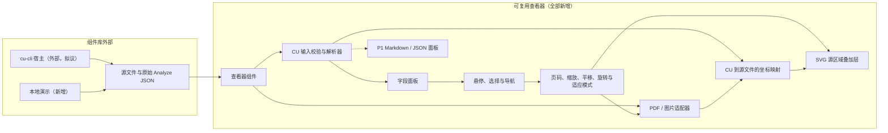

# 开发计划：Content Understanding 结果查看器

> **领域**：集成 / 可复用 React 组件
> **目标仓库**：changjian-wang/cu-result-viewer
> **需求基线**：[需求](requirements.md)与[路线图](roadmap.md)，对应提交 `163814a`
> **设计批准情况**：待批准；本仓库尚无已获批准的设计文档
> **状态**：草稿（Draft）；所有实现任务均待开始
> **最后更新**：2026-10-08
> **语言**：本文件是[英文原版](dev-plan.md)的简体中文译本；技术标识、JSON 键名和枚举值保持原文

## 目录

- [文档摘要](#文档摘要)
- [规划依据](#规划依据)
- [前置条件与决策](#前置条件与决策)
- [架构](#架构)
  - [架构图](#架构图)
  - [输入与模块契约](#输入与模块契约)
  - [影响分析](#影响分析)
- [实现阶段](#实现阶段)
  - [阶段 1：事实验证与决策](#阶段-1事实验证与决策)
  - [阶段 2：端到端最小闭环](#阶段-2端到端最小闭环)
  - [阶段 3：完成 P0 组件库与演示](#阶段-3完成-p0-组件库与演示)
  - [阶段 4：cu-cli 宿主集成](#阶段-4cu-cli-宿主集成)
  - [阶段 5：P1 结果查看与宿主体验](#阶段-5p1-结果查看与宿主体验)
  - [阶段 6：独立规划 P2](#阶段-6独立规划-p2)
- [里程碑与实施顺序](#里程碑与实施顺序)
- [结构化任务清单](#结构化任务清单)
- [测试计划](#测试计划)
  - [基础设施与命令](#基础设施与命令)
  - [覆盖范围与场景](#覆盖范围与场景)
  - [测试数据与测量](#测试数据与测量)
- [风险与缓解措施](#风险与缓解措施)
- [发布与回滚](#发布与回滚)
- [成功指标](#成功指标)
- [变更记录](#变更记录)

## 文档摘要

开发一个仅负责渲染的 React/TypeScript 组件库，接收原始 PDF/图片和序列化的 CU Analyze JSON，并将提取字段与源文件中的对应区域关联起来。

- **从经过验证的端到端最小闭环开始**：使用真实多页 PDF 和图片，展示不依赖特定分析器的字段，并实现跨页多边形高亮。
- **先完成 P0，再扩展用户体验**：覆盖全部必需图片格式，保证变换与资源清理可靠，提供本地演示、安装包使用方测试，以及协调完成的 cu-cli 集成。
- **保持优先级与职责边界独立**：丰富的 Fields/Markdown/JSON 视图和宿主定制属于 P1；MCP 集成设计属于 P1；TIFF 及所有 DI 专属工作属于 P2。

## 规划依据

调研开始时，本仓库仅包含 [README](../README.md)、[需求](requirements.md)和[路线图](roadmap.md)，工作区干净。当前没有可扩展的实现、依赖清单、测试基础设施、已发布的包或经过验证的 CLI 集成。下文中的所有实现路径都是拟议目标，不代表已有能力。

本地参考仓库 [content-understanding](../../content-understanding)（`C:\github\content-understanding`，检查时对应提交 `9fadee3`）同样是规划仓库，并非生产级查看器代码的来源。本计划借鉴其文档结构与可追溯性：

| 参考资料 | 本计划中的应用 |
| --- | --- |
| [标准开发计划模板](../../content-understanding/templates/dev-plan.md) | 前置条件、架构、分阶段任务、风险、发布安排及可测量的成功标准。 |
| [工作流开发计划模板](../../content-understanding/cu-workflow/references/template-dev-plan.md) | JSON 任务清单、显式依赖、工作量估算，以及集成在同一文档中的测试计划。 |
| [开发计划质量指南](../../content-understanding/.github/skills/cu-dev-plan/references/dev-plan-guidelines.md) | 明确的目标文件与可验证的验收标准。 |
| [MarkItDown 集成计划](../../content-understanding/planning/CY-2026-H1/integration/markitdown-integration/dev-plan-markitdown-integration.md) | 通过 `covers_criteria` 建立验收标准与测试的映射；不继承其 SDK、服务调用或 Python 架构。 |
| [cu-cli 提案](../../content-understanding/planning/CY-2026-H1/integration/cu-cli/feature-cu-cli.md) | 仅作为宿主背景；不能据此认定当前已存在 `--view` 命令或序列化输出契约。 |

这些本地参考链接假设两个仓库仍位于同级目录。任何参考文档中的批准状态、已选依赖、服务端点或已完成复选项，都不直接继承到本项目。

cu-cli 提案将其定位为终端原生工具，并排除了 GUI/Studio 替代品。当前查看器需求则明确要求本地浏览器查看流程。这是一个需要协调的集成问题，并不意味着可以删除查看器需求，或将 CLI 扩展成 Studio 替代品。

## 前置条件与决策

本计划现在可以进入评审，但不能将实现决策视为已获批准的事实。阶段 1 需要记录验证依据并取得任务负责人的批准，然后才能冻结公共输入契约与渲染架构。

| 决策 | 所需依据或决定 | 验收门槛 / 负责人 |
| --- | --- | --- |
| D1：CU 输入 | 支持的 API 版本、实际保存的结果与 cu-cli 输出、外层包装、字段值变体、来源定位信息（grounding）编码、页码、单位、尺寸及方向。 | G0；查看器负责人及 CU/CLI 维护者。 |
| D2：运行环境与源文件契约 | React 和浏览器版本；字符串 URL 的协议及加载策略；无类型 Blob/ArrayBuffer 的格式识别；无效或缺失源文件的行为。文件系统路径不是浏览器 URL。 | G0；查看器与宿主负责人。 |
| D3：渲染与解码 | 比较 PDF.js 和两个高亮库候选；参考 OCR-Form-Tools 的实现模式；记录版本、许可证及本地资源。验证 `.jpg`、`.jpeg`、`.jpe`、`.png`、`.bmp`、`.heif`、`.heic`，包括备用解码方案的成本。 | G0 确定方案；未解决的格式覆盖问题阻塞 P0 验收。 |
| D4：分发与预算 | 私有分发、许可证、对等依赖、包内资源、代表性文件/结果大小，以及实测性能预算。公开发布需要单独决策。 | G2 之前；项目负责人。 |
| D5：CLI 职责归属 | 确认实现仓库、维护者、分析/已保存结果入口、实际结果序列化方式，以及对浏览器查看流程的共识。 | 在 G0 提供输入依据；任务 4.2 开始前批准宿主契约。 |
| D6：不完整的扩展需求 | 澄清被截断的 `Result-pane` 条目，不自行编造其 API。 | 在最终确定该 P1 扩展之前；不阻塞 P0。 |

G0 最少需要一组已脱敏的真实多页 PDF/结果配对，以及一组来源定位已验证的图片/结果配对。明确记录其余格式、版本和样本缺口。存在缺口时可以允许最小闭环开始，但不能将缺口计入已支持范围，也不能在发布时默默豁免。

拟议工具链为 npm、TypeScript、Vite、Vitest、React Testing Library 和 Playwright。优先采用小型单包组件库加演示，而不是 monorepo 或应用框架。这些只是建议；阶段 1 批准兼容版本，任务 2.1 建立实际依赖清单与约定。

PDF 的初步建议是通过轻量内部适配器使用 PDF.js，并以 SVG 绘制叠加层。如果评估证明高亮库包装组件更适合 CU 多边形、旋转和嵌入，则改选包装组件。这不代表决定自研 PDF 渲染器。HEIF/HEIC 解码可能需要按需加载的客户端备用方案；不能假设浏览器原生支持。

## 架构

### 架构图



所有运行时模块均为新增；已有文件只修改文档。CLI 的分析、凭据、浏览器启动和本地服务器均位于组件库外部。源文件加载策略允许获取显式传入的源文件 URL，但不允许调用 CU 服务。

### 输入与模块契约

- **公共输入**：保留概念性契约 `source: File | Blob | ArrayBuffer | string` 和 `result: unknown`。在 D2 中最终确定字符串与二进制输入的语义。宿主提供已解析的原始序列化 JSON，而不是 SDK 对象或标准化后的查看器专属结构。
- **CU 解析器**：通过类型守卫收窄 `unknown`，只识别经过验证的响应结构，并推导内部字段、页面和区域记录。保留 `0`、`false`、null、缺失置信度、重复字段名、嵌套关系以及全部源区域。不修改传入结果，也不猜测 DI 约定。
- **字段标识**：根据经过验证的内容/字段路径生成稳定的内部标识，而不是仅依赖字段标签。P0 展示通用值；P1 增加更丰富的嵌套、数组和表格导航。
- **源文件适配器**：PDF 与图片实现共享页面元数据、渲染/取消/释放接口，以及原始尺寸。PDF.js 类型保持私有。将解码封装在图片适配器内部，而不是为每种格式增加独立应用流程。
- **几何处理**：将经过验证的 CU 坐标映射到源文件坐标，然后对渲染页面和叠加层应用同一套视口变换。验证页面原点、单位、宽高交换、PDF 旋转与图片方向，不使用临时偏移修补。
- **交互**：区分临时悬停与持久选择。具有来源定位信息的字段导航到已验证的页面；没有来源定位信息的字段仍可查看，不触发虚构的导航。P0 使用一个主要的已验证区域，同时保留其他区域供 P1 使用。
- **生命周期与错误**：取消过时的加载/渲染，忽略过期完成结果，释放自身持有的对象 URL、Worker、画布及解码缓冲区。明确展示加载、空数据、输入错误和渲染错误；仅源文件渲染失败时，仍能查看提取值。
- **分发**：导出组件、必要的公共类型，以及已说明的样式/资源。React 作为对等依赖。不打包 CU SDK、凭据、分析器管理、遥测或必须依赖 CDN 的资源。
- **P1 扩展**：仅在契约评审后增加选择回调、自定义字段渲染、查看器事件、工具栏/布局定制，以及初始页码/缩放/适应模式。不将内部标准化 CU 模型暴露为集成契约。

### 影响分析

| 范围 | 变更 | 边界 |
| --- | --- | --- |
| `src\index.ts`、`src\ContentUnderstandingResultViewer.tsx` | 新增公共组件库入口与组件。 | 接收源文件和原始 JSON；不暴露服务或 PDF.js 类型。 |
| `src\internal\` | 新增 CU 解析器、源文件适配器、几何处理、交互状态及测试。 | 均为内部实现细节。 |
| `src\components\`、`src\styles.css` | 新增面板、叠加层、控件及样式。 | 避免样式污染宿主全局。 |
| `demo\` | 新增客户端文件/结果加载宿主。 | 不包含 Analyze 或身份认证流程。 |
| `tests\fixtures\`、`tests\e2e\` | 新增脱敏样本清单及浏览器/包使用方覆盖。 | 常规演示使用真实配对样本；合成数据明确标注。 |
| 根目录依赖清单、配置及 CI | 新增构建、类型检查、lint、单元测试、浏览器测试和包检查。 | 不自动公开发布。 |
| [README](../README.md)及后续使用/集成文档 | 仅在对应命令/API 已存在且检查通过后更新。 | 不将计划功能写成已交付能力。 |
| cu-cli 实现仓库 | 确认仓库、负责人及路径后，修改外部宿主。 | CLI/服务器依赖不进入本包。 |
| P1/P2 模块 | 后续按门槛新增。 | TIFF/DI 不阻塞 P0/P1。 |

## 实现阶段

工作量估算暂定为：S = 数小时，M = 约 1-2 个开发人日，TBD = 宿主调研前无法估算。这些是任务规模估计，不是日期或交付承诺。如果验证后的范围超出一次专注实现会话，应拆分任务。文件操作及验收/测试编号以[结构化清单](#结构化任务清单)为准。

### 阶段 1：事实验证与决策

**目标**：建立实现所需的事实依据，而不是编造 CU 几何信息或仅凭声誉选择渲染器。

| 任务 | 工作内容与验收 | 工作量 |
| --- | --- | --- |
| `1.1` | 记录 CU/CLI 契约、已批准的运行环境/源文件假设、真实样本来源与缺口，以及 Studio 观察结果。**AC-1.1**：真实 PDF 和图片配对的字段、页码及几何预期已验证；未决问题均有负责人和验收门槛。 | M |
| `1.2` | 评估 PDF.js、两个高亮项目、OCR-Form-Tools 实现模式，以及必需图片格式的解码。**AC-1.2**：记录可复现的多边形/旋转/Worker/解码依据、候选版本/许可证、所选方案，以及阻塞 P0 的格式缺口。 | M |

使用当前 Studio 查看有代表性的 PDF 和图片结果。记录布局、字段名/值/置信度展示、悬停与选择的区别、跨页导航、适应/缩放/平移/旋转，以及缺失源文件或来源定位信息时的行为。如果无法访问 Studio，应记录限制，并保持行为评审门槛未通过。

**G0 通过条件**：输入/几何依据、运行环境/源文件契约、渲染方案和设计决策均获得任务负责人的批准。不从参考规划文档推断任何 API 或编解码能力。

### 阶段 2：端到端最小闭环

**目标**：先证明源文件与结果的关联，再扩展控件或结果视图。

| 任务 | 工作内容与验收 | 工作量 |
| --- | --- | --- |
| `2.1` | 建立单包工具链和公共输入类型。**AC-2.1**：干净安装、严格类型检查、lint、单元测试运行器和构建均通过；支持的源文件变体及 `unknown` 结果可在不依赖 CU SDK 的情况下编译。 | S |
| `2.2` | 实现已验证的 CU 解析及内部记录。**AC-2.2**：已保存结果与实际 CLI 结构无需调用方标准化即可生成预期字段/页面/区域；明确报告畸形输入，并保留可选值。 | M |
| `2.3` | 实现纯函数形式的 CU/源文件/视口几何变换。**AC-2.3**：在拟议的缩放/旋转/尺寸变化矩阵中，与独立推导参考点的误差不超过 1 CSS 像素；无效几何信息不能变成虚构区域。 | M |
| `2.4` | 增加可取消的 PDF 适配器和源文件面板。**AC-2.4**：真实多页 PDF 按正确尺寸/页数渲染，并使用本地 Worker 资源；渲染/加载失败和取消均可观察。 | M |
| `2.5` | 增加通用图片适配器及所选解码路径。**AC-2.5**：每种 P0 图片扩展名均在已批准的浏览器矩阵中测试；明确展示解码失败，方向与已验证的来源定位一致。 | M |
| `2.6` | 组装查看器、通用字段、交互状态和叠加层。**AC-2.6**：悬停/选择真实 PDF/图片字段时高亮对应区域，支持 PDF 跨页导航，悬停结束后保留选择；没有来源定位信息时仍展示字段值。 | M |

**G1 通过条件**：使用任务 3.2 引入的演示宿主或临时测试宿主，证明真实 PDF/图片的关联无需凭据、CU 请求或标准化步骤。浏览器场景必须执行集成后的实际渲染路径，不能只测试模拟几何信息。

### 阶段 3：完成 P0 组件库与演示

**目标**：让已验证的最小闭环可靠且可嵌入。

| 任务 | 工作内容与验收 | 工作量 |
| --- | --- | --- |
| `3.1` | 完成缩放、平移、适应模式、旋转、页码控件、错误状态和资源释放。**AC-3.1**：上一页/下一页/跳页及计数正确；所有变换后保持对齐；快速更换源文件或卸载时，不展示过期结果，也不保留自身持有的资源。 | M |
| `3.2` | 增加加载文件与已保存 JSON 的演示，以及浏览器回归测试集。**AC-3.2**：真实配对样本通过所有公共源文件输入变体工作，无需服务访问；输入缺失/无效、文件损坏和页码边界均有可见且有用的处理结果。 | M |
| `3.3` | 打包组件库、样式和本地渲染资源，增加 CI 与嵌入文档。**AC-3.3**：独立使用方能够加载安装包、类型、CSS、Worker 和解码器资源；文档命令通过，不要求运行时 CDN/CU 依赖。 | M |

发布已测试的格式/浏览器矩阵和实测样本大小。缺少 HEIF/HEIC 依据属于 P0 覆盖缺口，而不是默认延后到 P2。G2 是组件库/演示的验收门槛，不代表外部 CLI 工作已完成。

**G2 通过条件**：全部组件库/演示 P0 场景通过，包括必需图片格式与安装包使用方验证。组件可以进入私有宿主测试。

### 阶段 4：cu-cli 宿主集成

**目标**：完成所需宿主流程，但不把宿主职责移入组件。

| 任务 | 工作内容与验收 | 工作量 |
| --- | --- | --- |
| `4.1` | 就使用已打包查看器和原始 JSON 的最小交接方案达成共识并形成文档。**AC-4.1**：查看器/CLI 负责人批准源文件交付、已保存结果复用、回环地址/文件访问边界、资源加载，以及浏览器/服务器生命周期职责。 | S |
| `4.2` | 在已确认的 CLI 仓库实现并测试新分析与已保存结果查看路径。**AC-4.2**：目标 `cu analyze sample.pdf --view` 流程打开查看器；约定的已保存结果路径不发起任何新 CU 调用；宿主关闭和文件访问限制符合文档。 | TBD |

在记录 CLI 实现仓库和实际文件路径之前，任务 4.2 明确处于阻塞状态。不编造已有 CLI 命令、已保存结果标志或宿主文件名。如果选择本地服务器，它必须绑定到回环地址，仅暴露显式提供的文件，并从本地加载包内资源。

**G3 通过条件**：两个宿主路径均使用真实源文件/结果配对通过验证。完整 P0 验收要求 G2 和 G3 同时通过；外部延迟不妨碍组件库开发或内部测试。

### 阶段 5：P1 结果查看与宿主体验

**目标**：改善查看体验，同时保留原有的原始 JSON 输入入口。

| 任务 | 工作内容与验收 | 工作量 |
| --- | --- | --- |
| `5.1` | 增加结构化嵌套/数组/表格字段，以及多区域导航。**AC-5.1**：原始关系仍可查看，所有可用区域均可访问，且不丢失字段标识或选择状态。 | M |
| `5.2` | 使用安全 Markdown 和经过评估的成熟 JSON 树，增加 Fields/Markdown/JSON 标签页。**AC-5.2**：格式展示与展开/折叠正常；不安全的 HTML/URL 内容不能执行；大结果限制经过测量并写入文档。 | M |
| `5.3` | 增加无障碍键盘/触摸/响应式行为，以及经过评审的扩展点。**AC-5.3**：不使用鼠标也能操作焦点与选择，窄布局仍可用，回调/自定义渲染器/工具栏/布局/初始视图选项通过宿主测试。 | M |
| `5.4` | 编写 MCP Apps/MCP UI 与聊天宿主的集成设计。**AC-5.4**：明确数据交付、载荷限制、资源/CSP、加载/错误、生命周期和信任边界，不向核心添加服务逻辑。 | S |

任务 5.3 必须在 D6 解决后才能最终确定 `Result-pane` 定制。Markdown/JSON 及其他已经明确的 P1 行为可以独立推进。本阶段要求 MCP 集成设计/文档，不要求实现未被请求的 MCP 服务器。

**G4 通过条件**：P1 验收/测试以及经过评审的宿主扩展契约完成，并记录限制。

### 阶段 6：独立规划 P2

| 任务 | 工作内容与验收 | 工作量 |
| --- | --- | --- |
| `6.1` | 调研 TIFF/多页 TIFF、解码器成本、页面元数据和导航。**AC-6.1**：在增加 TIFF 代码之前，记录真实样本覆盖和单独批准的实现/测试范围。 | S |
| `6.2` | 独立调研 DI 输出版本、字段和坐标约定。**AC-6.2**：真实 DI 测试样本和独立的解析器/几何兼容计划获批；不默默复用 CU 假设。 | S |

这些是后续规划任务，并不代表本草稿已经覆盖 TIFF/DI 实现。只有在范围单独批准后，才创建边界明确的实现任务。两项任务均不是 P0 或 P1 的前置条件。

## 里程碑与实施顺序

| 验收门槛 | 任务 / 依据 | 依赖 |
| --- | --- | --- |
| G0：验证依据与决策获批 | 1.1、1.2 | 已脱敏的真实配对样本、Studio 访问/评审、负责人的决策。 |
| G1：源文件与结果关联的最小闭环 | 2.1-2.6、集成浏览器验证 | G0；真实 PDF/图片来源定位信息。 |
| G2：P0 组件库/演示候选版本 | 3.1-3.3、完整格式矩阵 | G1。 |
| G3：P0 CLI 集成 | 4.1-4.2、新分析与已保存结果流程 | 发布依赖 G2；实现依赖 D5 和宿主批准。 |
| G4：P1 | 5.1-5.4 | 实现依赖 G2；G3 不是代码依赖。 |
| P2 排期 | 6.1-6.2 | G2 架构及负责人单独批准，不依赖 G4。 |

共享契约建立后，解析器与几何工作可以独立于源文件适配器推进。图片渲染复用 PDF 任务引入的源文件接口。演示存在后，打包与宿主契约评审可以并行。任务是否就绪由下方的依赖图决定，而不是由表格顺序决定。

## 结构化任务清单

路径相对于目标仓库，使用 Windows 分隔符。`create`/`modify` 描述任务执行时的预期文件状态，包括由前置任务引入的文件。验收编号与人工阅读表格一致；每项验收标准均通过 `covers_criteria` 关联测试。工作量估计不代表可以在上述门槛通过前执行任务。

```json
{
  "feature": "cu-result-viewer",
  "status": "draft",
  "target_repository": "changjian-wang/cu-result-viewer",
  "design_doc": null,
  "tasks": [
    {
      "id": "1.1", "phase": 1, "priority": "P0", "title": "验证输入、样本与 Studio 行为", "effort": "M",
      "description": "记录 D1/D2/D5 依据、Studio 观察结果、已批准的运行环境/源文件假设，以及剩余决策的负责人。不推断 CU 几何信息或 CLI 序列化方式。",
      "files": [
        {"path": "docs\\design-decisions.md", "action": "create"},
        {"path": "tests\\fixtures\\manifest.json", "action": "create"}
      ],
      "depends_on": [],
      "acceptance_criteria": [{"id": "AC-1.1", "text": "真实 PDF/图片配对的字段、页面和几何预期已验证；未决问题和样本缺口均有负责人及验收门槛。"}],
      "tests": [{"id": "T-1.1", "type": "manual", "framework": "document-review", "description": "检查源文件/结果配对及 Studio；与负责人评审版本、来源、几何信息和决策记录。", "covers_criteria": ["AC-1.1"]}]
    },
    {
      "id": "1.2", "phase": 1, "priority": "P0", "title": "评估渲染与解码", "effort": "M",
      "description": "比较 PDF.js、两个 react-pdf-highlighter 候选和 OCR-Form-Tools 实现模式。记录可复现的渲染/叠加层/旋转/Worker/图片解码验证、版本、许可证、成本及所选方案。",
      "files": [{"path": "docs\\rendering-evaluation.md", "action": "create"}],
      "depends_on": ["1.1"],
      "acceptance_criteria": [{"id": "AC-1.2", "text": "评估依据覆盖 PDF 几何信息/本地资源及每种 P0 图片扩展名；明确记录所选依赖及阻塞缺口。"}],
      "tests": [{"id": "T-1.2", "type": "manual", "framework": "browser-probe", "description": "在已批准的浏览器中重复文档所述验证，包括 HEIF/HEIC 解码与 90 度旋转；评审许可证和资源打包依据。", "covers_criteria": ["AC-1.2"]}]
    },
    {
      "id": "2.1", "phase": 2, "priority": "P0", "title": "建立工具链与公共输入类型", "effort": "S",
      "description": "建立已批准的 npm/TypeScript/Vite 工具链、lint/单元测试脚本、对等依赖，以及概念性的公共源文件/结果类型。通过包管理器生成锁文件。",
      "files": [
        {"path": "package.json", "action": "create"},
        {"path": "tsconfig.json", "action": "create"},
        {"path": "vite.config.ts", "action": "create"},
        {"path": "eslint.config.js", "action": "create"},
        {"path": "src\\index.ts", "action": "create"}
      ],
      "depends_on": ["1.1", "1.2"],
      "acceptance_criteria": [{"id": "AC-2.1", "text": "干净安装、严格类型检查、lint、单元测试运行器和构建均通过；公共源文件变体及 unknown 结果无需 CU SDK 类型即可编译。"}],
      "tests": [{"id": "T-2.1", "type": "integration", "framework": "toolchain", "description": "在干净安装后运行脚本，并编译使用公共类型的示例；检查声明的运行时依赖是否包含禁止的服务/SDK 耦合。", "covers_criteria": ["AC-2.1"]}]
    },
    {
      "id": "2.2", "phase": 2, "priority": "P0", "title": "解析已验证的 CU 结果结构", "effort": "M",
      "description": "校验 unknown JSON，识别已验证的保存/CLI 结构，并生成具有稳定标识的内部字段/页面/区域记录。保留全部传入值/区域，明确报告无效输入。",
      "files": [
        {"path": "src\\internal\\types.ts", "action": "create"},
        {"path": "src\\internal\\parseCuResult.ts", "action": "create"},
        {"path": "src\\internal\\parseCuResult.test.ts", "action": "create"}
      ],
      "depends_on": ["2.1"],
      "acceptance_criteria": [{"id": "AC-2.2", "text": "已验证的保存/CLI 样本无需标准化或修改即可生成预期字段/页面/区域；可区分畸形输入与缺失可选数据。"}],
      "tests": [{"id": "T-2.2", "type": "unit", "framework": "vitest", "description": "测试实际外层包装/版本、多内容项、重复标签、0/false/null、缺失置信度/来源定位、畸形值和冻结后的输入。", "covers_criteria": ["AC-2.2"]}]
    },
    {
      "id": "2.3", "phase": 2, "priority": "P0", "title": "实现共享几何变换", "effort": "M",
      "description": "使用共享纯函数变换，将已验证的 CU 单位/原点/方向映射到源文件与视口坐标。拒绝无效区域，不猜测单位或页码。",
      "files": [
        {"path": "src\\internal\\geometry.ts", "action": "create"},
        {"path": "src\\internal\\geometry.test.ts", "action": "create"}
      ],
      "depends_on": ["2.2"],
      "acceptance_criteria": [{"id": "AC-2.3", "text": "在约定的缩放/旋转/尺寸变化矩阵中，与独立预期点的误差不超过 1 CSS 像素；畸形几何信息不能生成虚构高亮。"}],
      "tests": [{"id": "T-2.3", "type": "unit", "framework": "vitest", "description": "使用手工推导参考点和已验证 CU 测试样本，测试变换/逆变换、宽高交换、页面原点、无效点及非有限坐标。", "covers_criteria": ["AC-2.3"]}]
    },
    {
      "id": "2.4", "phase": 2, "priority": "P0", "title": "通过内部源文件适配器渲染 PDF", "effort": "M",
      "description": "定义私有的页面/渲染/取消/释放契约，实现所选 PDF 适配器与源文件面板，使用本地资源并明确展示失败状态。",
      "files": [
        {"path": "src\\internal\\source.ts", "action": "create"},
        {"path": "src\\internal\\pdfSource.ts", "action": "create"},
        {"path": "src\\components\\SourcePane.tsx", "action": "create"},
        {"path": "src\\internal\\pdfSource.test.ts", "action": "create"}
      ],
      "depends_on": ["2.1"],
      "acceptance_criteria": [{"id": "AC-2.4", "text": "真实多页 PDF 按已验证的尺寸/页数渲染，并使用本地 Worker 资源；加载/渲染失败和取消均可观察。"}],
      "tests": [
        {"id": "T-2.4a", "type": "unit", "framework": "vitest", "description": "测试适配器取消、页面元数据、资源释放及错误传播。", "covers_criteria": ["AC-2.4"]},
        {"id": "T-2.4b", "type": "e2e", "framework": "playwright", "description": "任务 3.2 完成后，在阻止外部资源请求的集成演示中渲染真实 PDF。", "covers_criteria": ["AC-2.4"]}
      ]
    },
    {
      "id": "2.5", "phase": 2, "priority": "P0", "title": "通过通用适配器渲染必需图片格式", "effort": "M",
      "description": "复用源文件契约，支持原生/备用解码、方向及原始尺寸。HEIF/HEIC 保持在 P0，明确展示解码错误。",
      "files": [
        {"path": "src\\internal\\imageSource.ts", "action": "create"},
        {"path": "src\\internal\\imageSource.test.ts", "action": "create"},
        {"path": "src\\components\\SourcePane.tsx", "action": "modify"}
      ],
      "depends_on": ["2.4"],
      "acceptance_criteria": [{"id": "AC-2.5", "text": "每种 P0 图片扩展名均通过已批准的浏览器/解码器矩阵；损坏文件明确失败，图片方向与已验证的 CU 来源定位一致。"}],
      "tests": [
        {"id": "T-2.5a", "type": "unit", "framework": "vitest", "description": "测试格式识别、解码方案选择、方向元数据、损坏数据，以及解码器/资源释放。", "covers_criteria": ["AC-2.5"]},
        {"id": "T-2.5b", "type": "e2e", "framework": "playwright", "description": "任务 3.2 完成后，通过演示运行必需格式矩阵，包括 HEIF/HEIC 备用解码资源。", "covers_criteria": ["AC-2.5"]}
      ]
    },
    {
      "id": "2.6", "phase": 2, "priority": "P0", "title": "关联字段、导航与源文件叠加层", "effort": "M",
      "description": "组装查看器，提供通用字段/值/置信度展示、独立悬停/选择状态、跨页导航，以及使用共享变换的多边形。从公共入口导出组件。",
      "files": [
        {"path": "src\\ContentUnderstandingResultViewer.tsx", "action": "create"},
        {"path": "src\\components\\FieldsPane.tsx", "action": "create"},
        {"path": "src\\components\\Overlay.tsx", "action": "create"},
        {"path": "src\\internal\\interaction.ts", "action": "create"},
        {"path": "src\\internal\\interaction.test.ts", "action": "create"},
        {"path": "src\\index.ts", "action": "modify"}
      ],
      "depends_on": ["2.2", "2.3", "2.4", "2.5"],
      "acceptance_criteria": [{"id": "AC-2.6", "text": "悬停/选择真实 PDF/图片字段时，高亮已验证的主要区域并支持跨页导航；悬停结束后保留选择，没有来源定位信息的值仍可查看。"}],
      "tests": [
        {"id": "T-2.6a", "type": "unit", "framework": "vitest", "description": "测试临时/持久交互、跨页标识、缺失来源定位及快速切换字段。", "covers_criteria": ["AC-2.6"]},
        {"id": "T-2.6b", "type": "e2e", "framework": "playwright", "description": "在集成测试宿主中关联真实 PDF/图片字段与叠加层；任务 3.2 完成后，在纳入仓库的演示中重复验证。", "covers_criteria": ["AC-2.6"]}
      ]
    },
    {
      "id": "3.1", "phase": 3, "priority": "P0", "title": "完成控件、错误状态与生命周期", "effort": "M",
      "description": "增加缩放/平移/适应/旋转和 PDF 页码控件；处理加载/空数据/错误及以最后一次加载为准的源文件更换。释放自身持有的资源，保持源文件/叠加层变换同步。",
      "files": [
        {"path": "src\\components\\Toolbar.tsx", "action": "create"},
        {"path": "src\\styles.css", "action": "create"},
        {"path": "src\\ContentUnderstandingResultViewer.tsx", "action": "modify"},
        {"path": "src\\components\\SourcePane.tsx", "action": "modify"},
        {"path": "src\\internal\\interaction.ts", "action": "modify"},
        {"path": "src\\internal\\interaction.test.ts", "action": "modify"}
      ],
      "depends_on": ["2.6"],
      "acceptance_criteria": [{"id": "AC-3.1", "text": "控件/页码边界/计数正确，各种变换后保持对齐；更换源文件或卸载时，不展示过期内容，也不保留自身持有的资源。"}],
      "tests": [
        {"id": "T-3.1a", "type": "unit", "framework": "vitest", "description": "测试状态转换、资源归属/释放、乱序完成的加载、挂载/卸载，以及 React StrictMode 清理。", "covers_criteria": ["AC-3.1"]},
        {"id": "T-3.1b", "type": "e2e", "framework": "playwright", "description": "在任务 3.2 的演示中测试全部控件、平移/尺寸变化、页码边界，以及 100 次重复切换。", "covers_criteria": ["AC-3.1"]}
      ]
    },
    {
      "id": "3.2", "phase": 3, "priority": "P0", "title": "交付本地演示与浏览器回归测试集", "effort": "M",
      "description": "加载浏览器选择的源文件和已保存 JSON，明确展示输入错误。增加 Playwright 配置/脚本，使用真实测试样本清单执行集成正常/异常场景。",
      "files": [
        {"path": "demo\\index.html", "action": "create"},
        {"path": "demo\\App.tsx", "action": "create"},
        {"path": "playwright.config.ts", "action": "create"},
        {"path": "tests\\e2e\\viewer.spec.ts", "action": "create"},
        {"path": "package.json", "action": "modify"}
      ],
      "depends_on": ["3.1"],
      "acceptance_criteria": [{"id": "AC-3.2", "text": "真实配对样本可通过 File/Blob/ArrayBuffer/已批准 URL 输入工作，无需 CU 访问；JSON/源文件缺失或无效、文件损坏和页码边界均有可见且有用的处理结果。"}],
      "tests": [{"id": "T-3.2", "type": "e2e", "framework": "playwright", "description": "在阻止 CU/外部资源请求的情况下，运行集成源文件类型、格式、字段、控件及异常场景；验证源文件失败不会隐藏提取字段。", "covers_criteria": ["AC-3.2"]}]
    },
    {
      "id": "3.3", "phase": 3, "priority": "P0", "title": "打包组件库、编写文档并建立验收门槛", "effort": "M",
      "description": "打包公共类型、限定作用域的样式，以及本地 Worker/解码器资源。增加 CI 和隔离的安装包使用方测试；仅记录已验证的 API、命令、限制与分发策略。",
      "files": [
        {"path": "package.json", "action": "modify"},
        {"path": "vite.config.ts", "action": "modify"},
        {"path": "README.md", "action": "modify"},
        {"path": "docs\\usage.md", "action": "create"},
        {"path": ".github\\workflows\\ci.yml", "action": "create"},
        {"path": "tests\\e2e\\package-host.spec.ts", "action": "create"}
      ],
      "depends_on": ["3.2"],
      "acceptance_criteria": [{"id": "AC-3.3", "text": "隔离的使用方能够加载已打包组件库、类型、样式及本地资源；CI/文档命令通过，不要求 CU SDK 或运行时 CDN。"}],
      "tests": [{"id": "T-3.3", "type": "integration", "framework": "toolchain-and-playwright", "description": "构建/打包并安装到独立测试使用方，编译其公共 API，在约定 CSP 下渲染 PDF/图片，并检查网络请求与包内容。", "covers_criteria": ["AC-3.3"]}]
    },
    {
      "id": "4.1", "phase": 4, "priority": "P0", "title": "就 cu-cli 交接契约达成共识", "effort": "S",
      "description": "确认宿主仓库与负责人；记录原始 JSON 交接、浏览器可读取的源文件交付、已保存结果路径、回环地址/文件限制、资源及宿主生命周期。",
      "files": [{"path": "docs\\cu-cli-integration.md", "action": "create"}],
      "depends_on": ["1.1", "3.2"],
      "acceptance_criteria": [{"id": "AC-4.1", "text": "查看器/CLI 负责人批准宿主交接、已保存结果复用、本地交付/安全边界、资源加载及生命周期职责。"}],
      "tests": [{"id": "T-4.1", "type": "manual", "framework": "host-contract-review", "description": "依据实际 CLI 实现与终端原生提案评审契约；演示最小的源文件加原始 JSON 嵌入方式。", "covers_criteria": ["AC-4.1"]}]
    },
    {
      "id": "4.2", "phase": 4, "priority": "P0", "title": "实现并验证外部 cu-cli 查看流程", "effort": "TBD",
      "repository": null,
      "execution_ready": false,
      "blocked_by": "执行前确认 cu-cli 实现仓库/负责人，并用经过检查的实际路径替换空文件目标。",
      "description": "在外部宿主实现约定的 --view 新分析流程，以及已批准的已保存结果查看路径；不把服务/服务器职责移入查看器。",
      "files": [],
      "depends_on": ["3.3", "4.1"],
      "acceptance_criteria": [{"id": "AC-4.2", "text": "约定的 cu analyze --view 流程与已保存结果路径打开同一查看器；已保存结果查看不发起新 CU 调用，宿主生命周期/文件限制通过验证。"}],
      "tests": [{"id": "T-4.2", "type": "integration", "framework": "host-native-and-browser", "description": "使用真实配对样本运行新分析与已保存结果查看；已保存结果查看时禁止 CU 网络访问；测试启动/关闭、含空格路径、缺失文件及未授权本地文件请求。", "covers_criteria": ["AC-4.2"]}]
    },
    {
      "id": "5.1", "phase": 5, "priority": "P1", "title": "增加结构化字段与多区域查看", "effort": "M",
      "description": "扩展通用字段以支持嵌套对象、数组/表格和区域选择，同时保持稳定字段标识及原有公共输入。",
      "files": [
        {"path": "src\\components\\FieldsPane.tsx", "action": "modify"},
        {"path": "src\\internal\\interaction.ts", "action": "modify"},
        {"path": "src\\components\\FieldsPane.test.tsx", "action": "create"},
        {"path": "tests\\e2e\\viewer.spec.ts", "action": "modify"}
      ],
      "depends_on": ["3.3"],
      "acceptance_criteria": [{"id": "AC-5.1", "text": "嵌套/数组/表格关系仍可查看，每个可用源区域均可访问，且不丢失字段标识/选择状态。"}],
      "tests": [{"id": "T-5.1", "type": "integration", "framework": "react-testing-library-and-playwright", "description": "使用真实结构化和多区域测试样本展开字段、选择数组/表格条目，并导航到全部关联区域/页面。", "covers_criteria": ["AC-5.1"]}]
    },
    {
      "id": "5.2", "phase": 5, "priority": "P1", "title": "增加安全 Markdown 与交互式 JSON 面板", "effort": "M",
      "description": "评估成熟 JSON 树与 Markdown 渲染器，然后增加 Fields/Markdown/JSON 标签页；评审许可证、不安全内容处理方式，并测量大结果行为。",
      "files": [
        {"path": "src\\components\\MarkdownPane.tsx", "action": "create"},
        {"path": "src\\components\\JsonPane.tsx", "action": "create"},
        {"path": "src\\ContentUnderstandingResultViewer.tsx", "action": "modify"},
        {"path": "package.json", "action": "modify"},
        {"path": "tests\\e2e\\rich-results.spec.ts", "action": "create"}
      ],
      "depends_on": ["3.3"],
      "acceptance_criteria": [{"id": "AC-5.2", "text": "必需 Markdown 格式和 JSON 展开/折叠正常；不安全 HTML/URL 不能执行，实测结果大小限制写入文档。"}],
      "tests": [{"id": "T-5.2", "type": "e2e", "framework": "playwright", "description": "验证标题/列表/表格/代码/格式、原始 JSON 对象/数组、缺失 Markdown、危险标记/链接，以及约定的大结果测试样本。", "covers_criteria": ["AC-5.2"]}]
    },
    {
      "id": "5.3", "phase": 5, "priority": "P1", "title": "完成无障碍体验与已评审扩展", "effort": "M",
      "description": "增加键盘/焦点/触摸/响应式行为，以及已评审的选择回调、自定义字段、查看器事件、工具栏/布局和初始视图选项。结果面板定制前解决 D6。",
      "files": [
        {"path": "src\\index.ts", "action": "modify"},
        {"path": "src\\ContentUnderstandingResultViewer.tsx", "action": "modify"},
        {"path": "src\\components\\FieldsPane.tsx", "action": "modify"},
        {"path": "src\\components\\Toolbar.tsx", "action": "modify"},
        {"path": "src\\styles.css", "action": "modify"},
        {"path": "tests\\e2e\\host-extensions.spec.ts", "action": "create"}
      ],
      "depends_on": ["5.1", "5.2"],
      "acceptance_criteria": [{"id": "AC-5.3", "text": "键盘/焦点/触摸和窄布局可用；每个已批准的回调/渲染/布局/工具栏/初始视图选项均通过宿主测试，且不依赖内部 CU/PDF 类型。"}],
      "tests": [{"id": "T-5.3", "type": "e2e", "framework": "playwright", "description": "测试纯键盘字段/标签页/控件导航、触摸、响应式尺寸、焦点保留、回调及自定义宿主渲染；人工评审无障碍语义。", "covers_criteria": ["AC-5.3"]}]
    },
    {
      "id": "5.4", "phase": 5, "priority": "P1", "title": "制定 MCP Apps 与聊天宿主嵌入方案", "effort": "S",
      "description": "为 MCP Apps/MCP UI/聊天宿主定义宿主到查看器的原始数据交付、载荷限制、资源/CSP、生命周期、错误状态和信任边界；不向核心添加服务或 MCP 服务器。",
      "files": [{"path": "docs\\mcp-apps-integration.md", "action": "create"}],
      "depends_on": ["3.3"],
      "acceptance_criteria": [{"id": "AC-5.4", "text": "经过评审的集成设计覆盖数据交付、载荷/资源/CSP、错误/生命周期及信任边界，并保持核心仅负责渲染。"}],
      "tests": [{"id": "T-5.4", "type": "manual", "framework": "host-design-review", "description": "与代表性宿主负责人逐项评审 PDF/图片交付、已保存 JSON、大载荷、受限 iframe 资源、缺失数据及清理。", "covers_criteria": ["AC-5.4"]}]
    },
    {
      "id": "6.1", "phase": 6, "priority": "P2", "title": "单独确定 TIFF 与多页 TIFF 范围", "effort": "S",
      "description": "调研 TIFF 测试样本、解码/许可证/内存成本、页面元数据和导航；单独取得批准，并在添加编解码代码前产出边界明确的实现任务。",
      "files": [{"path": "docs\\p2-tiff-plan.md", "action": "create"}],
      "depends_on": ["3.3"],
      "acceptance_criteria": [{"id": "AC-6.1", "text": "记录真实 TIFF 覆盖及单独批准的解码器/页面导航实现与测试范围，不改变 P0/P1 门槛。"}],
      "tests": [{"id": "T-6.1", "type": "manual", "framework": "sample-and-scope-review", "description": "评审单页/多页 TIFF 样本、解码器验证，以及为后续范围提出的页面/导航测试。", "covers_criteria": ["AC-6.1"]}]
    },
    {
      "id": "6.2", "phase": 6, "priority": "P2", "title": "独立确定 DI 兼容范围", "effort": "S",
      "description": "调研真实 DI 版本/字段/单位/几何信息；定义独立的兼容性和回归任务，不默默把 DI JSON 解释成 CU。",
      "files": [{"path": "docs\\p2-di-plan.md", "action": "create"}],
      "depends_on": ["3.3"],
      "acceptance_criteria": [{"id": "AC-6.2", "text": "记录真实 DI 测试样本及单独批准的解析器/几何兼容范围；不继承未经验证的 CU 假设。"}],
      "tests": [{"id": "T-6.2", "type": "manual", "framework": "sample-and-scope-review", "description": "使用真实测试样本比较 CU 与 DI 的字段/几何约定，并评审独立的兼容性/回归场景。", "covers_criteria": ["AC-6.2"]}]
    }
  ]
}
```

## 测试计划

### 基础设施与命令

当前没有测试基础设施。仅引入已批准实现所需的工具：

- **Vitest**：使用与实现文件同目录的 `*.test.ts`，覆盖解析器、几何处理、适配器及交互状态。
- **React Testing Library**：使用 `*.test.tsx` 覆盖组件值、状态、焦点及自定义渲染；采用面向 DOM 的断言，而不只使用快照。
- **Playwright**：使用 `tests\e2e\*.spec.ts` 测试演示和隔离的安装包使用方；采用已批准的浏览器/版本矩阵。
- **宿主原生集成测试**：使用已确认 CLI 仓库的现有运行器，不另建一套 CLI 框架。
- **人工验证依据**：Studio 对比、依赖/许可证评估，以及负责人批准，仍明确属于人工工作，不计入自动化覆盖。

任务 2.1/3.2/3.3 完成后要求提供的脚本契约：`npm ci`、`npm run typecheck`、`npm run lint`、`npm run test:unit`、`npm run test:e2e`、`npm run build`，以及使用 `npm pack` 进行安装包使用方验证。这些命令在当前仅有文档的仓库中尚不能运行，也未经过验证。

常规回归测试使用已保存、已脱敏的真实结果，不实时调用 Analyze。访问真实服务只用于明确批准的测试样本获取，或验证外部 CLI 新分析路径。源文件 URL 测试可以使用本地测试服务器；测试禁止 CU 请求及对必需外部 CDN 资源的依赖。不在测试日志或浏览器产物中记录凭据、SAS URL、客户文档或未经处理的敏感结果。

### 覆盖范围与场景

当前尚无运行时测试覆盖。以下场景用于补齐需求缺口：

| 需求 / 前提 | 操作 | 预期结果 | 验收标准 / 测试 |
| --- | --- | --- | --- |
| 真实已保存结果与实际 CLI 序列化输出 | 原样传入原始 JSON | 得到预期字段/页面/区域；不要求公共输入标准化或 CU SDK。 | AC-1.1、AC-2.1、AC-2.2 / T-1.1、T-2.1、T-2.2 |
| PDF 及每种必需图片格式 | 使用已批准的源文件/浏览器变体加载 | 解码、尺寸、方向、页数和本地资源正确。 | AC-1.2、AC-2.4、AC-2.5 / T-1.2、T-2.4a/b、T-2.5a/b |
| 字段定位到另一 PDF 页面 | 悬停、选择，再结束悬停 | 页面/区域正确；持久选择不丢失。 | AC-2.6 / T-2.6a/b |
| 已验证的源区域参考点 | 缩放、平移、旋转、适应、调整尺寸、翻页 | 叠加层在拟议容差内保持对齐。 | AC-2.3、AC-3.1 / T-2.3、T-3.1b |
| 缺失置信度/来源定位、zero/false/null、重复名称 | 查看字段 | 真实展示值；不虚构置信度、位置，也不产生标识冲突。 | AC-2.2、AC-2.6 / T-2.2、T-2.6a/b |
| 源文件 A 正在加载，随后更换为 B 或卸载 | A 延迟完成 | 不显示过期源文件/叠加层；释放自身持有的 URL、渲染任务和资源。 | AC-3.1 / T-3.1a/b |
| 源文件缺失、结果为空/无效、保存的 JSON 畸形、文件损坏 | 加载或交互 | 明确展示输入/渲染状态；仅源文件失败时不隐藏有效字段。 | AC-3.2 / T-3.2 |
| 多页 PDF 位于首页/末页 | 上一页/下一页/跳页，包括无效输入 | 计数和边界正确；报告无效页码输入，不默默猜测。 | AC-3.1、AC-3.2 / T-3.1b、T-3.2 |
| 隔离 React 宿主安装已打包产物 | 在约定资源/CSP 策略下编译和渲染 | 公共类型、样式和资源无需仓库别名或运行时 CDN 即可工作。 | AC-3.3 / T-3.3 |
| 新 CLI 结果和先前保存的结果 | 打开已批准的查看路径 | 使用同一组件；已保存结果路径不调用 CU；本地文件边界有效。 | AC-4.1、AC-4.2 / T-4.1、T-4.2 |
| 嵌套/数组/表格字段关联多个区域 | 展开并选择每个区域 | 关系、选择和导航保持正确。 | AC-5.1 / T-5.1 |
| Markdown、原始 JSON 及恶意标记/链接 | 切换面板并展开节点 | 支持规定的格式/树行为；不执行不安全内容。 | AC-5.2 / T-5.2 |
| 键盘/触摸用户，或窄视口中的定制宿主 | 导航并改变初始/选择状态 | 焦点/布局可用，公共扩展经过验证。 | AC-5.3 / T-5.3 |
| 受限 MCP/聊天宿主 | 评审交付、加载/错误及清理场景 | 宿主设计明确，核心边界不变。 | AC-5.4 / T-5.4 |
| TIFF 或 DI 候选范围 | 评审真实样本与拟议后续测试 | 单独批准 P2 计划；不扩大 P0/P1 范围。 | AC-6.1、AC-6.2 / T-6.1、T-6.2 |

### 测试数据与测量

测试样本清单必须标明源文件/结果配对、来源和再分发许可、CU API/输出形式、源文件格式、页面尺寸/方向/坐标单位、预期字段/区域引用，以及样本缺口。只存储已批准的脱敏资源。脱敏必须保留源文件与结果之间的几何对应关系。

必需覆盖包括单页/多页 PDF、全部 P0 图片扩展名、缺失置信度/来源定位、zero/false/null、空/畸形输入，以及 P1 嵌套、数组/表格、Markdown 和多区域结果。仅修改扩展名不能证明格式解码正确。合成案例只补充边界/错误测试，且必须标注。

拟议几何验收门槛：在独立推导的参考顶点上，最大偏差为 1 CSS 像素；覆盖缩放 0.5/1/2/4、旋转 0/90/180/270 度、至少两种视口尺寸、平移偏移及设备像素比 1/2。在 G0 确认容差和支持范围。浏览器测试应断言实际渲染的叠加层坐标，而不只是截图或某个变换后再应用其自身逆变换。

至少重复 100 次页面/变换切换及快速源文件更换。断言选择/对齐稳定、无过期完成结果，以及自身持有资源的创建与释放配对。浏览器内存测量只是补充依据，不能替代资源释放断言。

基于已记录的代表性测试样本大小及硬件/浏览器版本，测量首次渲染、翻页、结果面板交互、包/解码器大小和峰值内存。在 G2 之前批准量化性能预算；不编造或声称达到未经测量的延迟目标。

## 风险与缓解措施

| 风险 | 影响 | 可能性 | 缓解措施 / 验收门槛 |
| --- | --- | --- | --- |
| CU 版本/外层包装或来源定位信息与假设不同 | 高 | 中 | 使用真实保存/CLI 测试样本及带守卫的解析；D1/G0 阻止猜测。 |
| HEIF/HEIC 无法在目标浏览器中解码 | 高 | 高 | 尽早验证解码器，评审按需备用方案、许可证和内存；阻塞 P0 验收，不延后到 P2。 |
| 单位/方向/旋转不匹配导致叠加层漂移 | 高 | 中 | 共享变换、独立参考点和真实浏览器坐标断言。 |
| PDF Worker/字体或解码器资源在本地/嵌入宿主中失效 | 高 | 中 | 打包本地资源；测试隔离使用方及约定 CSP/离线交付。 |
| 页面/源文件变化时出现过期加载或资源泄漏 | 高 | 中 | 取消及资源归属管理、以最后一次加载为准、StrictMode/卸载和重复切换测试。 |
| CLI 负责人/契约或终端原生定位存在冲突 | 高 | 中 | D5 和任务 4.1 批准；将外部任务 4.2 记为阻塞，不宣称集成完成。 |
| 样本访问、隐私或再分发限制妨碍覆盖 | 高 | 中 | 使用已批准的脱敏真实配对、来源清单并明确缺口；不以伪造成功输出代替。 |
| 大型 JSON/Markdown 或图片解码阻塞界面 | 中 | 中 | 实测预算、经评估的树组件、有界/按需渲染及书面限制。 |
| 依赖维护、许可证或 React 对等依赖冲突 | 中 | 中 | 版本/许可证评估、锁文件、不自动公开发布，以及安装包使用方测试。 |
| 截断的扩展需求导致编造 API | 中 | 高 | D6 仅约束受影响的 P1 定制契约。 |
| 草稿缺少已批准设计/运行环境矩阵 | 高 | G0 前必然存在 | 记录批准并更新本计划，再将任务描述为可执行。 |

## 发布与回滚

1. **内部最小闭环**：仅使用已批准的真实测试样本，不发布。如果输入/几何依据与实现矛盾，应暂停，先修正共享契约，再扩展功能。
2. **私有 P0 组件库/演示候选版本**：要求 G2 和安装包使用方测试通过。保留前一个已知正常的私有产物；拒绝存在格式、变换、生命周期或资源回归的候选版本。
3. **cu-cli 宿主小范围试用**：要求 G3 和维护者显式批准。使用宿主现有的选择启用/回滚机制；失败时禁用新查看路径，或恢复先前宿主/产物版本，不改变分析或已保存结果的语义。
4. **私有 P0 发布，然后推进 P1**：完整 P0 验收要求组件库和宿主验证依据齐备。G4 后独立发布 P1，同时重新执行 P0 回归。公开预览/GA 和许可证属于单独批准事项，不是自动进入的最后阶段。
5. **P2**：只安排单独批准的 TIFF/DI 实现计划，不让它们延迟或削弱 P0/P1 门槛。

代码回滚时，仅撤销该任务已评审的变更，或固定到前一个包/宿主版本；保留无关工作及现有保存结果。本次文档变更本身没有运行时影响。

## 成功指标

- **P0 覆盖**：已批准的 PDF/P0 图片格式/浏览器矩阵 100% 通过，并记录真实覆盖；不存在未声明的 HEIF/HEIC 缺口。
- **输入/边界**：支持的保存/CLI JSON 不需要任何宿主标准化，组件不依赖 CU SDK，也不调用 CU 服务。宿主查看已保存结果时不发起新的 Analyze 调用。
- **源文件关联**：在完整变换矩阵及重复切换测试中，已验证的字段/页面导航和几何信息保持在批准容差内。
- **打包/可靠性**：隔离的安装包嵌入测试通过；规定测试中不存在必需 CDN 资源、过期源文件结果或未释放的自身持有资源。
- **可追溯性**：每项任务验收标准均关联测试；完整 P0 验收前，全部自动化 P0 场景及必需人工批准均通过。
- **P1/P2 范围纪律**：P1 丰富面板和已评审扩展通过对应场景；TIFF/DI 保持独立范围，不阻塞 P0/P1。

## 变更记录

| 日期 | 变更 |
| --- | --- |
| 2026-10-08 | 基于仅有文档的查看器基线及本地 CU 规划模板形成初始草稿；增加带验收门槛的架构/任务/测试，并明确阻塞的外部 CLI 工作。 |
