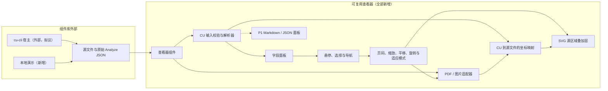
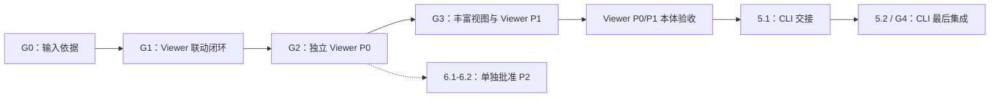

# 开发计划：Content Understanding 结果查看器

> **领域**：集成 / 可复用 React 组件
> **目标仓库**：changjian-wang/cu-result-viewer
> **需求基线**：[需求](requirements.md)与[路线图](roadmap.md)，对应提交 `163814a`
> **设计批准情况**：负责人已批准初始基线；RC-3已选择包内MIT/Apache `heic-rs`替代历史LGPL候选。HEVC产品/专利及公开发布批准仍待完成。
> **状态**：实施中；获批产品外观已固化并加入视觉测试，保留 2.4/2.5 已验证范围；完整 P0/分发门槛仍开放
> **执行顺序**：先完成可独立运行的 Viewer P0/P1 本体及验收，cu-cli 集成为主线最后阶段
> **最后更新**：2026-10-12
> **语言**：本文件是[英文原版](dev-plan.md)的简体中文译本；技术标识、JSON 键名和枚举值保持原文

## 目录

- [文档摘要](#文档摘要)
- [规划依据](#规划依据)
- [前置条件与决策](#前置条件与决策)
- [架构](#架构)
  - [架构图](#架构图)
  - [输入与模块契约](#输入与模块契约)
  - [影响分析](#影响分析)
- [实现阶段](#实现阶段)
  - [阶段 1：事实验证与决策](#阶段-1事实验证与决策)
  - [阶段 2：端到端最小闭环](#阶段-2端到端最小闭环)
  - [阶段 3：完成 P0 组件库与演示](#阶段-3完成-p0-组件库与演示)
  - [阶段 4：完成 Viewer P1 与独立验收](#阶段-4完成-viewer-p1-与独立验收)
  - [阶段 5：最后进行 cu-cli 集成](#阶段-5最后进行-cu-cli-集成)
  - [独立后续：P2 规划](#独立后续p2-规划)
- [里程碑与实施顺序](#里程碑与实施顺序)
- [结构化任务清单](#结构化任务清单)
- [测试计划](#测试计划)
  - [基础设施与命令](#基础设施与命令)
  - [覆盖范围与场景](#覆盖范围与场景)
  - [测试数据与测量](#测试数据与测量)
- [风险与缓解措施](#风险与缓解措施)
- [发布与回滚](#发布与回滚)
- [成功指标](#成功指标)
- [变更记录](#变更记录)

## 文档摘要

开发一个仅负责渲染的 React/TypeScript 组件库，接收原始 PDF/图片和序列化的 CU Analyze JSON，并将提取字段与源文件中的对应区域关联起来。

- **从经过验证的端到端最小闭环开始**：使用真实多页 PDF 和图片，展示不依赖特定分析器的字段，并实现跨页多边形高亮。
- **先完成 Viewer，再集成**：完成仅渲染的 P0 组件库/演示、丰富结果视图及 P1 独立交互，再验证实际组件无需 cu-cli 即可工作；随后才做 CLI 交接与集成。
- **保持优先级与职责边界独立**：原有 P0/P1 需求标记不变；CLI 属于外部交付阶段，不是 Viewer 开发、启动或独立验收的前置条件。TIFF/DI 继续独立 P2。

**2026-10-12 负责人批准的排期调整**：主线按阶段 **1 → 2 → 3 → 4 → 5** 执行，CLI 最后。任务、验收、测试和门槛全部按顺序重编号：Viewer P1 为 `4.1-4.4` / G3，CLI 为 `5.1-5.2` / G4；阶段 6 仅为独立 P2 后续，不是主线前置。任务 **4.2** 的 Fields/Markdown/JSON 切换已验证；已批准的任务 **4.2a** 先完成动态Studio结果标签，再继续其余P1 UX/扩展。既有技术前置以及未完成的P0格式/许可/CI门槛不被默默豁免。

## 规划依据

调研开始时，本仓库仅包含 [README](../README.md)、[需求](requirements.md)和[路线图](roadmap.md)，工作区干净。当前没有可扩展的实现、依赖清单、测试基础设施、已发布的包或经过验证的 CLI 集成。下文中的所有实现路径都是拟议目标，不代表已有能力。

本地参考仓库 [content-understanding](../../content-understanding)（`C:\github\content-understanding`，检查时对应提交 `9fadee3`）同样是规划仓库，并非生产级查看器代码的来源。本计划借鉴其文档结构与可追溯性：

| 参考资料 | 本计划中的应用 |
| --- | --- |
| [标准开发计划模板](../../content-understanding/templates/dev-plan.md) | 前置条件、架构、分阶段任务、风险、发布安排及可测量的成功标准。 |
| [工作流开发计划模板](../../content-understanding/cu-workflow/references/template-dev-plan.md) | JSON 任务清单、显式依赖、工作量估算，以及集成在同一文档中的测试计划。 |
| [开发计划质量指南](../../content-understanding/.github/skills/cu-dev-plan/references/dev-plan-guidelines.md) | 明确的目标文件与可验证的验收标准。 |
| [MarkItDown 集成计划](../../content-understanding/planning/CY-2026-H1/integration/markitdown-integration/dev-plan-markitdown-integration.md) | 通过 `covers_criteria` 建立验收标准与测试的映射；不继承其 SDK、服务调用或 Python 架构。 |
| [cu-cli 提案](../../content-understanding/planning/CY-2026-H1/integration/cu-cli/feature-cu-cli.md) | 仅作为宿主背景；不能据此认定当前已存在 `--view` 命令或序列化输出契约。 |

这些本地参考链接假设两个仓库仍位于同级目录。任何参考文档中的批准状态、已选依赖、服务端点或已完成复选项，都不直接继承到本项目。

cu-cli 提案将其定位为终端原生工具，并排除了 GUI/Studio 替代品。当前查看器需求则明确要求本地浏览器查看流程。这是一个需要协调的集成问题，并不意味着可以删除查看器需求，或将 CLI 扩展成 Studio 替代品。

## 前置条件与决策

本计划现在可以进入评审，但不能将实现决策视为已获批准的事实。阶段 1 需要记录验证依据并取得任务负责人的批准，然后才能冻结公共输入契约与渲染架构。

| 决策 | 所需依据或决定 | 验收门槛 / 负责人 |
| --- | --- | --- |
| D1：CU 输入 | 支持的 API 版本、实际保存的结果与 cu-cli 输出、外层包装、字段值变体、来源定位信息（grounding）编码、页码、单位、尺寸及方向。 | G0；查看器负责人及 CU/CLI 维护者。 |
| D2：运行环境与源文件契约 | React 和浏览器版本；字符串 URL 的协议及加载策略；无类型 Blob/ArrayBuffer 的格式识别；无效或缺失源文件的行为。文件系统路径不是浏览器 URL。 | G0；查看器与宿主负责人。 |
| D3：渲染与解码 | 比较 PDF.js 和两个高亮库候选；参考 OCR-Form-Tools 的实现模式；记录版本、许可证及本地资源。验证 `.jpg`、`.jpeg`、`.jpe`、`.png`、`.bmp`、`.heif`、`.heic`，包括备用解码方案的成本。 | G0 确定方案；未解决的格式覆盖问题阻塞 P0 验收。 |
| D4：分发与预算 | 私有分发、许可证、对等依赖、包内资源、代表性文件/结果大小，以及实测性能预算。公开发布需要单独决策。 | G2 之前；项目负责人。 |
| D5：CLI 职责归属 | 保留已验证的保存/CLI 输入依据；仅在最后的 CLI 阶段确认外部仓库、维护者与查看交接方案。 | G0 输入依据仍有效；G2 + G3 后开展 5.1，交接获批后开展 5.2。不阻塞 Viewer 启动/开发。 |
| D6：不完整的扩展需求 | 字段选择回调、自定义渲染、查看器事件、工具栏/布局定制及初始页码/缩放/适应模式是明确P1需求；原始`Result-pane`条目被截断。 | 实现已明确扩展点，只澄清缺失后半段，不自行编造。 |
| D7：P1交互范围 | 源需求明确无障碍、键盘、触摸、响应式及自动滚动/居中；当前桌面交付中，负责人延期触摸，批准Chrome/Edge键盘/焦点/ARIA、Windows Narrator、桌面双栏尺寸适配及按需原文居中。 | 触摸保留为延期P1；不推断移动端、捏合、堆叠或其他触摸行为。 |
| D8：动态Studio结果视图 | 已知顺序为Fields、Markdown、Paragraphs、Tables、Figures、Signatures、Metadata、Result、Code；从原始JSON读取API version，只显示适用非空视图。 | Paragraphs/Tables/Figures/Signatures关联原文；Metadata为键值；Result为原始JSON；Code为只读Python/C#/JavaScript SDK示例。 |

G0 最少需要一组已脱敏的真实多页 PDF/结果配对，以及一组来源定位已验证的图片/结果配对。明确记录其余格式、版本和样本缺口。存在缺口时可以允许最小闭环开始，但不能将缺口计入已支持范围，也不能在发布时默默豁免。

拟议工具链为 npm、TypeScript、Vite、Vitest、React Testing Library 和 Playwright。优先采用小型单包组件库加演示，而不是 monorepo 或应用框架。这些只是建议；阶段 1 批准兼容版本，任务 2.1 建立实际依赖清单与约定。

PDF 的初步建议是通过轻量内部适配器使用 PDF.js，并以 SVG 绘制叠加层。如果评估证明高亮库包装组件更适合 CU 多边形、旋转和嵌入，则改选包装组件。这不代表决定自研 PDF 渲染器。HEIF/HEIC 解码可能需要按需加载的客户端备用方案；不能假设浏览器原生支持。

## 架构

### 架构图



CLI 的分析、凭据、浏览器启动和本地服务器均位于组件库外部。演示与普通 React 使用方可独立运行 Viewer，无需 CLI 服务或交接契约。源文件加载策略允许获取显式传入的源文件 URL，但不允许调用 CU 服务。

### 输入与模块契约

- **公共输入**：保留概念性契约 `source: File | Blob | ArrayBuffer | string` 和 `result: unknown`。在 D2 中最终确定字符串与二进制输入的语义。宿主提供已解析的原始序列化 JSON，而不是 SDK 对象或标准化后的查看器专属结构。
- **CU 解析器**：通过类型守卫收窄 `unknown`，只识别经过验证的响应结构，并推导内部字段、页面和区域记录。保留 `0`、`false`、null、缺失置信度、重复字段名、嵌套关系以及全部源区域。不修改传入结果，也不猜测 DI 约定。
- **字段标识**：根据经过验证的内容/字段路径生成稳定的内部标识，而不是仅依赖字段标签。P0 展示通用值；P1 增加更丰富的嵌套、数组和表格导航。
- **源文件适配器**：PDF 与图片实现共享页面元数据、渲染/取消/释放接口，以及原始尺寸。PDF.js 类型保持私有。将解码封装在图片适配器内部，而不是为每种格式增加独立应用流程。
- **几何处理**：将经过验证的 CU 坐标映射到源文件坐标，然后对渲染页面和叠加层应用同一套视口变换。验证页面原点、单位、宽高交换、PDF 旋转与图片方向，不使用临时偏移修补。
- **交互**：区分临时悬停与持久选择。具有来源定位信息的字段导航到已验证的页面；没有来源定位信息的字段仍可查看，不触发虚构的导航。P0 使用一个主要的已验证区域，同时保留其他区域供 P1 使用。
- **生命周期与错误**：取消过时的加载/渲染，忽略过期完成结果，释放自身持有的对象 URL、Worker、画布及解码缓冲区。明确展示加载、空数据、输入错误和渲染错误；仅源文件渲染失败时，仍能查看提取值。
- **分发**：导出组件、必要的公共类型，以及已说明的样式/资源。React 作为对等依赖。不打包 CU SDK、凭据、分析器管理、遥测或必须依赖 CDN 的资源。
- **P1 扩展范围**：增加明确要求的字段选择回调、自定义字段渲染、查看器事件、工具栏/布局定制、初始页码和初始缩放/适应模式，同时不暴露内部标准化CU/PDF模型；不推断被截断的`Result-pane`后半段。

### 影响分析

| 范围 | 变更 | 边界 |
| --- | --- | --- |
| `src\index.ts`、`src\ContentUnderstandingResultViewer.tsx` | 新增公共组件库入口与组件。 | 接收源文件和原始 JSON；不暴露服务或 PDF.js 类型。 |
| `src\internal\` | 新增 CU 解析器、源文件适配器、几何处理、交互状态及测试。 | 均为内部实现细节。 |
| `src\components\`、`src\styles.css` | 新增面板、叠加层、控件及样式。 | 避免样式污染宿主全局。 |
| `demo\` | 新增客户端文件/结果加载宿主。 | 不包含 Analyze 或身份认证流程。 |
| `tests\fixtures\`、`tests\e2e\` | 新增脱敏样本清单及浏览器/包使用方覆盖。 | 常规演示使用真实配对样本；合成数据明确标注。 |
| 根目录依赖清单、配置及 CI | 新增构建、类型检查、lint、单元测试、浏览器测试和包检查。 | 不自动公开发布。 |
| [README](../README.md)及后续使用/集成文档 | 仅在对应命令/API 已存在且检查通过后更新。 | 不将计划功能写成已交付能力。 |
| cu-cli 实现仓库 | 确认仓库、负责人及路径后，修改外部宿主。 | CLI/服务器依赖不进入本包。 |
| P1/P2 模块 | 后续按门槛新增。 | TIFF/DI 不阻塞 P0/P1。 |

## 实现阶段

工作量估算暂定为：S = 数小时，M = 约 1-2 个开发人日，TBD = 宿主调研前无法估算。这些是任务规模估计，不是日期或交付承诺。如果验证后的范围超出一次专注实现会话，应拆分任务。文件操作及验收/测试编号以[结构化清单](#结构化任务清单)为准。

下方阶段、任务、验收和测试编号前缀现已统一对应新的执行顺序。先完成 Viewer 功能与独立验收，再开始任何 CLI 契约或实现；既有 CLI 获取的保存结果可以继续使用，不需要执行集成阶段。

### 阶段 1：事实验证与决策

**目标**：建立实现所需的事实依据，而不是编造 CU 几何信息或仅凭声誉选择渲染器。

| 任务 | 工作内容与验收 | 工作量 |
| --- | --- | --- |
| `1.1` | 记录 CU/CLI 契约、已批准的运行环境/源文件假设、真实样本来源与缺口，以及 Studio 观察结果。**AC-1.1**：真实 PDF 和图片配对的字段、页码及几何预期已验证；未决问题均有负责人和验收门槛。 | M |
| `1.2` | 评估 PDF.js、两个高亮项目、OCR-Form-Tools 实现模式，以及必需图片格式的解码。**AC-1.2**：记录可复现的多边形/旋转/Worker/解码依据、候选版本/许可证、所选方案，以及阻塞 P0 的格式缺口。 | M |

**2026-10-09 进展**：负责人已批准 G0 设计/候选方向。[设计决策](design-decisions.md)与[样本清单](../tests/fixtures/manifest.json)保留真实配对及[依据](rendering-evaluation.md)。任务 2.1-2.3 已交付，339 个单元案例及 512 个实际几何浏览器检查通过。下一项为界面原型评审，正式任务 2.4 受此门槛约束。可复用查看器渲染、分发/更新义务及额外 UX/样本覆盖仍未完成。

**2026-10-10 进展**：获批的[可运行实现](../README.md#run-the-prototype)现通过 409 个单元案例和 Chrome/Edge 共 52 次运行。公共输入、原生图片格式、八种合成 EXIF 方向及仅本机 HEIF 均执行实际组件路径，页面已查看效果。[Fields 样式](prototype/interactive-fields.png)、置信度及不可用页诊断保持一致。本机 HEIF 批准不等于解码器分发或完整 P0/调用方/CLI 验收。

**2026-10-12 进展**：负责人要求最终 UI 与最新获批原型一致。[产品视觉测试](../tests/e2e/visual.spec.ts)新增每浏览器九个场景和 30 张不可自动改写的 Windows 图片，浏览器合并覆盖现为 70 次。连续 36 次比较保持全部图片哈希，Chrome Fields 直接匹配批准 PNG，真实图标尺寸漂移能被检测。产品 UI/样式未改；本批为已实现范围的 2.6/3.1 验收准备，不关闭 2.5 或完整 P0 门槛。

**2026-10-12 压力进展**：[压力测试](../tests/e2e/stress.spec.ts)新增每浏览器三组精确 100 轮，共 600 轮 PDF/PNG 状态/输入/取消及合并 76 次运行。逐轮几何、选择、调用方完整性与资源归属通过。局部舞台裁剪修复了平移滚动条重新居中问题；压力当前上下文仍匹配原型，30 张图片未改。314 个相关单元案例、类型/lint与两种构建通过；更广 HEIF/格式/DPR、内存预算及安装包门槛保留。

**2026-10-12 安装包进展**：用户批准的可选Node端Vite资源交付已在真实React18.3.1/19.3.0 tgz使用方通过，覆盖开发/生产、Chrome/Edge、类型/CSS/Worker/字体和实际宿主CSP。16次包验证加76次仓库回归，本地共92次浏览器与416单元案例；同一产品图无需修改。使用说明/核心CI已配置，不称远程CI或完整P0/发布批准。

**2026-10-13 任务4.1进展**：真实发票/收据数组、稳定的 `Item N` 标签、隐藏后代选择及当前全部字段/组来源区域已实现。真实BillingAddress区域切换和合成跨页结构化组在Chrome/Edge通过。该检查点有424单元、80仓库浏览器及16包使用方运行通过，30张产品基线未改。不宣称专属Tables视图或真实跨页结构化CU配对完成。

**2026-10-13 风险收敛进展**：Fields/Markdown/JSON、按需chunk及生产交互预算通过且不重置源状态。RC-3以固定MIT/Apache `heic-rs 0.1.4` WASM替换历史LGPL HEIF候选：9个已评审RGBA样本、开发/生产CSP、失败/生命周期及真实React18/19 tgz使用方通过。RC-4补充受控第二HTTP源站的CORS成功/失败、匿名跨源源文件请求、Viewer源站PDF/HEIF资源、真实PDF DPR2变换、派生原生格式DPR1/2及合成PDF页框/内置旋转边界。当前429单元、104仓库与24包使用方运行，本地共128次。现有34张参考；负责人批准的证据策略接受等价派生编码、代表性且失败明确的PDF覆盖，以及生命周期/安全上限验证；HEVC审批仅阻塞公开发布。

**2026-10-13 RC-Gate复评：Viewer开发与私有验收通过。** 远程CI必须成功，但无法强制branch protection只是平台限制而非阻塞。等像素派生JPEG/BMP与许可HEIF样本无需逐格式Analyze即可满足渲染依据。源文件/解码器验收要求书面安全上限、取消和资源释放配对，时间/内存仅为观察值而非新增硬门槛。HEVC产品/专利及Microsoft/公开发布审批只阻塞公开分发。任务4.2a可以开始，CLI仍排在Viewer本体完成之后。

使用当前 Studio 查看有代表性的 PDF 和图片结果。记录布局、字段名/值/置信度展示、悬停与选择的区别、跨页导航、适应/缩放/平移/旋转，以及缺失源文件或来源定位信息时的行为。如果无法访问 Studio，应记录限制，并保持行为评审门槛未通过。

**G0 通过条件**：输入/几何依据、运行环境/源文件契约、渲染方案和设计决策均获得任务负责人的批准。不从参考规划文档推断任何 API 或编解码能力。

### 阶段 2：端到端最小闭环

**目标**：先证明源文件与结果的关联，再扩展控件或结果视图。

| 任务 | 工作内容与验收 | 工作量 |
| --- | --- | --- |
| `2.1` | 建立单包工具链和公共输入类型。**AC-2.1**：干净安装、严格类型检查、lint、单元测试运行器和构建均通过；支持的源文件变体及 `unknown` 结果可在不依赖 CU SDK 的情况下编译。 | S |
| `2.2` | 实现已验证的 CU 解析及内部记录。**AC-2.2**：已保存结果与实际 CLI 结构无需调用方标准化即可生成预期字段/页面/区域；明确报告畸形输入，并保留可选值。 | M |
| `2.3` | 实现纯函数形式的 CU/源文件/视口几何变换。**AC-2.3**：在拟议的缩放/旋转/尺寸变化矩阵中，与独立推导参考点的误差不超过 1 CSS 像素；无效几何信息不能变成虚构区域。 | M |
| `2.4` | 增加可取消的 PDF 适配器和源文件面板。**AC-2.4**：真实多页 PDF 按正确尺寸/页数渲染，并使用本地 Worker 资源；渲染/加载失败和取消均可观察。 | M |
| `2.5` | 增加通用图片适配器及所选解码路径。**AC-2.5**：每种 P0 图片扩展名均在已批准的浏览器矩阵中测试；明确展示解码失败，方向与已验证的来源定位一致。 | M |
| `2.6` | 组装查看器、通用字段、交互状态和叠加层。**AC-2.6**：悬停/选择真实 PDF/图片字段时高亮对应区域，支持 PDF 跨页导航，悬停结束后保留选择；没有来源定位信息时仍展示字段值。 | M |

**任务 2.1 已交付**：[公共类型](../src/index.ts)、[输入测试](../src/index.test.ts)、[包与工具链](../package.json)及 [MIT](../LICENSE) 已建立。入口现也导出原型组件，但声明构建成功仍不能替代浏览器行为验证。

**任务 2.2 已交付**：[内部解析](../src/internal/parseCuResult.ts)与[测试](../src/internal/parseCuResult.test.ts)保留原始 GA 数据，并明确区分错误与警告。PDF/PNG 运行得到 100/42 个节点和 53/13 个区域，均无警告；这不是可视化验证。

**任务 2.3 已交付**：[几何模块](../src/internal/geometry.ts)与[测试](../src/internal/geometry.test.ts)按真实页面尺寸实现可逆视图变换。原实验和已实现原型均保留并检查 1 CSS 像素门槛。

**原型评审门槛（负责人要求）**：[v2 静态设计](prototype/README.md)与当前[交互基线](../README.md#run-the-prototype)已获批准，可开展任务 2.4 加固。首批公共输入验证覆盖真实 PDF/PNG 的 File、无 MIME 类型 Blob、ArrayBuffer、同源 HTTP 和宿主自有 blob URL，以及调用方数据保留、明确失败/恢复和受控替换/卸载清理。批准解除 UI 实施阻塞，不关闭 HEIF、丰富 P1、完整格式/方向、100 次切换压力或安装包调用方门槛。

**先运行检查点**：任何源文件面板或查看器宿主一旦可挂载，就先启动，在浏览器中查看真实 PDF/图片及字段—原文联动，再扩展功能。不等全部 P0 控件完成，也不用解析日志代替页面效果。

**G1 通过条件**：使用任务 3.2 引入的演示宿主或临时测试宿主，证明真实 PDF/图片的关联无需凭据、CU 请求或标准化步骤。浏览器场景必须执行集成后的实际渲染路径，不能只测试模拟几何信息。

### 阶段 3：完成 P0 组件库与演示

**目标**：让已验证的最小闭环可靠且可嵌入。

| 任务 | 工作内容与验收 | 工作量 |
| --- | --- | --- |
| `3.1` | 完成缩放、平移、适应模式、旋转、页码控件、错误状态和资源释放。**AC-3.1**：上一页/下一页/跳页及计数正确；所有变换后保持对齐；快速更换源文件或卸载时，不展示过期结果，也不保留自身持有的资源。 | M |
| `3.2` | 增加加载文件与已保存 JSON 的演示，以及浏览器回归测试集。**AC-3.2**：真实配对样本通过所有公共源文件输入变体工作，无需服务访问；输入缺失/无效、文件损坏和页码边界均有可见且有用的处理结果。 | M |
| `3.3` | 打包组件库、样式和本地渲染资源，增加 CI 与嵌入文档。**AC-3.3**：独立使用方能够加载安装包、类型、CSS、Worker 和解码器资源；文档命令通过，不要求运行时 CDN/CU 依赖。 | M |

发布已测试的格式/浏览器矩阵和实测样本大小。缺少 HEIF/HEIC 依据属于 Viewer P0 覆盖缺口，不是默认延后到 P2。G2 是独立组件库/演示的验收门槛，不要求 CLI 契约或实现。

**G2 通过条件**：全部组件库/演示 P0 场景通过，包括必需图片格式与安装包使用方验证。组件可以进入私有宿主测试。

### 阶段 4：完成 Viewer P1 与独立验收

**目标**：在CLI集成前完成Viewer结果表示、P1交互UX和明确扩展点，保留原始JSON入口与获批外观。

| 任务 | 工作内容与验收 | 工作量 |
| --- | --- | --- |
| `4.1` | 增加结构化嵌套/数组/表格字段，以及多区域导航。**AC-4.1**：原始关系仍可查看，所有可用区域均可访问，且不丢失字段标识或选择状态。 | M |
| `4.2` | 使用安全 Markdown 和经过评估的成熟 JSON 树，增加 Fields/Markdown/JSON 标签页。**AC-4.2**：格式展示与展开/折叠正常；不安全的 HTML/URL 内容不能执行；大结果限制经过测量并写入文档。 | M |
| `4.2a` | 增加已批准的动态Studio结果标签。**AC-4.2a**：从原始JSON读取API version；按Studio顺序条件显示Fields/Markdown/Paragraphs/Tables/Figures/Signatures/Metadata/Result/Code；明细视图关联原文、保持源状态、保留原始JSON并生成安全只读SDK示例。 | L |
| `4.3a` | 完成当前桌面交互/无障碍范围。**AC-4.3a**：Chrome/Edge键盘导航、可见/稳定焦点、ARIA及Windows Narrator通过；Source/Result保持带最小宽度/滚动的桌面双栏；选择原文关联项时保持缩放/旋转，仅在区域不在可见原文视口时居中。触摸/移动端延期。 | M |
| `4.3b` | 增加明确具名宿主扩展点。**AC-4.3b**：可选字段选择回调、自定义字段渲染、查看器事件、工具栏/布局定制、初始页码及初始缩放/适应模式保持默认行为且不暴露内部CU/PDF.js模型。 | M |
| `4.4` | 编写 MCP Apps/MCP UI 与聊天宿主的集成设计。**AC-4.4**：明确数据交付、载荷限制、资源/CSP、加载/错误、生命周期和信任边界，不向核心添加服务逻辑。 | S |

D6只约束被截断的`Result-pane`后半段；其他具名扩展点是明确需求。本阶段要求MCP集成设计/文档，不要求实现未被请求的MCP服务器。

**下一功能目标：4.2a。** 实现已批准的动态Studio结果标签并移除禁用占位；随后完成已批准的4.3a桌面交互/无障碍及4.3b具名扩展点，触摸保持延期。不推断单独移动端应用或缺失的`Result-pane`后半段。保持已确认Fields布局及任务4.2源状态保证。

**G3 通过条件**：全部已确认结果视图、当前桌面交互/无障碍范围、具名扩展点和MCP集成设计通过验收/测试；触摸及被截断的`Result-pane`后半段明确延期。

**Viewer 本体完成条件**：要求 **G2 + G3** 及产品/独立使用方评审依据通过。Viewer 启动、直接查看保存结果、丰富面板切换、几何与生命周期应无需 cu-cli 或新的 Analyze 调用；禁用占位不能算功能完成。保持已确认的 Fields/布局，新增视图的有意变化须评审后再更新视觉基线。

### 阶段 5：最后进行 cu-cli 集成

**目标**：把已完成的 Viewer 接入一种外部宿主，不把宿主职责移入组件。

**开始门槛**：先完成 Viewer P0/P1 本体及独立验收（**G2 + G3**）。交接契约 `5.1` 和实现 `5.2` 都延后到该门槛之后，均不得阻塞 Viewer 直接运行或开发。

| 任务 | 工作内容与验收 | 工作量 |
| --- | --- | --- |
| `5.1` | 就已完成的安装包 Viewer 与原始 JSON 的最小交接形成共识。**AC-5.1**：查看器/CLI 负责人批准源交付、保存结果复用、本地文件边界、资源及浏览器/服务器生命周期。 | S |
| `5.2` | 在已确认 CLI 仓库实现新分析与保存结果查看。**AC-5.2**：目标 `cu analyze sample.pdf --view` 打开 Viewer；保存结果查看不新增 CU 调用，宿主关闭与文件限制符合契约。 | TBD |

5.2 还需确认 CLI 仓库/负责人、批准 5.1 并检查实际文件目标。不编造 CLI 命令或保存结果标志；选择本地服务器时，必须绑定回环地址、只交付显式文件并本地加载资源。

**G4 通过条件**：两个外部宿主路径使用真实配对通过。G4 关闭 CLI 交付，不属于 Viewer 本体独立验收；原始包含 CLI 的项目要求仍被追踪，但其执行顺序在最后。

### 独立后续：P2 规划

| 任务 | 工作内容与验收 | 工作量 |
| --- | --- | --- |
| `6.1` | 调研 TIFF/多页 TIFF、解码器成本、页面元数据和导航。**AC-6.1**：在增加 TIFF 代码之前，记录真实样本覆盖和单独批准的实现/测试范围。 | S |
| `6.2` | 独立调研 DI 输出版本、字段和坐标约定。**AC-6.2**：真实 DI 测试样本和独立的解析器/几何兼容计划获批；不默默复用 CU 假设。 | S |

这些阶段 6 任务不属于当前主线。只有范围单独批准后，才创建 TIFF/DI 实现任务；两项都不是 Viewer P0/P1 或最后 CLI 阶段的前置条件。

## 里程碑与实施顺序

| 验收门槛 | 任务 / 依据 | 依赖 |
| --- | --- | --- |
| G0：验证依据与决策获批 | 1.1、1.2 | 已脱敏的真实配对样本、Studio 访问/评审、负责人的决策。 |
| G1：源文件与结果关联的最小闭环 | 2.1-2.6、集成浏览器验证 | G0；真实 PDF/图片来源定位信息。 |
| G2：P0 组件库/演示候选版本 | 3.1-3.3、完整格式矩阵 | G1。 |
| G3：Viewer P1 | 4.1-4.4 | 既有 Viewer/安装包技术前置；本体完成要求 G2，无 CLI 依赖。 |
| Viewer 本体完成 | G2 + G3；产品及独立使用方评审 | 5.1/5.2 开始前必须通过，不依赖 CLI。 |
| G4：CLI 集成，主线最后门槛 | 5.1-5.2、新分析与保存结果流程 | 已完成的 Viewer（G2 + G3）、D5 与外部宿主批准。 |
| P2 排期 | 6.1-6.2 | G2 架构及负责人单独批准，不依赖 G3。 |

门槛也已按新顺序统一：G3 验收 Viewer P1，G4 验收最后的 CLI 集成。Viewer 开发不依赖 CLI 可用性；打包评审可与其他本体工作并行，但 CLI 契约评审不再与未完成的 Viewer 交付并行。



下方结构化依赖保留既有技术前置，并为 CLI 工作增加已完成 Viewer 的前置要求；任务编号与执行阶段现已一致。

## 结构化任务清单

路径相对于目标仓库，使用 Windows 分隔符。`create`/`modify` 描述任务执行时的预期文件状态，包括由前置任务引入的文件。验收编号与人工阅读表格一致；每项验收标准均通过 `covers_criteria` 关联测试。工作量估计不代表可以在上述门槛通过前执行任务。

```json
{
  "feature": "cu-result-viewer",
  "status": "in_progress",
  "target_repository": "changjian-wang/cu-result-viewer",
  "design_doc": null,
  "delivery_policy": {
    "approved_on": "2026-10-12",
    "mainline_phases": [1, 2, 3, 4, 5],
    "viewer_completion_gates": ["G2", "G3"],
    "cli_final_tasks": ["5.1", "5.2"],
    "cli_blocks_viewer": false,
    "next_viewer_functional_task": "4.2a",
    "task_4_3_adds_public_extension_api": true,
    "supported_bundler_profile": "Vite 8",
    "separate_p2_tasks": ["6.1", "6.2"]
  },
  "review_gates": [
    {
      "id": "ui-prototype-v1",
      "status": "interactive-baseline-approved-hardening-in-progress",
      "iteration": 2,
      "wireframe_approved": true,
      "interaction_baseline_approved": true,
      "interaction_approval_date": "2026-10-10",
      "browser_checks_passed": true,
      "unit_cases": 429,
      "browser_runs": 128,
      "repository_browser_runs": 104,
      "packed_consumer_browser_runs": 24,
      "stress_browser_runs": 6,
      "stress_rounds_per_browser": 300,
      "visual_browser_runs": 18,
      "visual_baseline_count": 34,
      "visual_baseline": "tests\\e2e\\visual.spec.ts-snapshots",
      "fields_reference": "docs\\prototype\\interactive-fields.png",
      "reference": "docs\\prototype\\README.md",
      "state_preview": "docs\\prototype\\index.html",
      "state_count": 10,
      "sequence": ["wireframe-review", "interactive-prototype", "browser-review"],
      "blocks": []
    }
  ],
  "tasks": [
    {
      "id": "1.1", "phase": 1, "priority": "P0", "title": "验证输入、样本与 Studio 行为", "effort": "M", "status": "done",
      "description": "记录 D1/D2/D5 依据、Studio 观察结果、已批准的运行环境/源文件假设，以及剩余决策的负责人。不推断 CU 几何信息或 CLI 序列化方式。",
      "files": [
        {"path": "docs\\design-decisions.md", "action": "create"},
        {"path": "tests\\fixtures\\manifest.json", "action": "create"}
      ],
      "depends_on": [],
      "acceptance_criteria": [{"id": "AC-1.1", "text": "真实 PDF/图片配对的字段、页面和几何预期已验证；未决问题和样本缺口均有负责人及验收门槛。"}],
      "tests": [{"id": "T-1.1", "type": "manual", "framework": "document-review", "description": "检查源文件/结果配对及 Studio；与负责人评审版本、来源、几何信息和决策记录。", "covers_criteria": ["AC-1.1"]}]
    },
    {
      "id": "1.2", "phase": 1, "priority": "P0", "title": "评估渲染与解码", "effort": "M", "status": "done",
      "description": "比较 PDF.js、两个 react-pdf-highlighter 候选和 OCR-Form-Tools 实现模式。记录可复现的渲染/叠加层/旋转/Worker/图片解码验证、版本、许可证、成本及所选方案。",
      "files": [{"path": "docs\\rendering-evaluation.md", "action": "create"}],
      "depends_on": ["1.1"],
      "acceptance_criteria": [{"id": "AC-1.2", "text": "评估依据覆盖 PDF 几何信息/本地资源及每种 P0 图片扩展名；明确记录所选依赖及阻塞缺口。"}],
      "tests": [{"id": "T-1.2", "type": "manual", "framework": "browser-probe", "description": "在已批准的浏览器中重复文档所述验证，包括 HEIF/HEIC 解码与 90 度旋转；评审许可证和资源打包依据。", "covers_criteria": ["AC-1.2"]}]
    },
    {
      "id": "2.1", "phase": 2, "priority": "P0", "title": "建立工具链与公共输入类型", "effort": "S", "status": "done",
      "description": "建立已批准的 npm/TypeScript/Vite 工具链、lint/单元测试脚本、对等依赖，以及概念性的公共源文件/结果类型。通过包管理器生成锁文件。",
      "files": [
        {"path": "package.json", "action": "create"},
        {"path": "package-lock.json", "action": "create"},
        {"path": "LICENSE", "action": "create"},
        {"path": ".gitignore", "action": "create"},
        {"path": "tsconfig.json", "action": "create"},
        {"path": "tsconfig.build.json", "action": "create"},
        {"path": "vite.config.ts", "action": "create"},
        {"path": "eslint.config.mjs", "action": "create"},
        {"path": "src\\index.ts", "action": "create"},
        {"path": "src\\index.test.ts", "action": "create"}
      ],
      "depends_on": ["1.1", "1.2"],
      "acceptance_criteria": [{"id": "AC-2.1", "text": "干净安装、严格类型检查、lint、单元测试运行器和构建均通过；公共源文件变体及 unknown 结果无需 CU SDK 类型即可编译。"}],
      "tests": [{"id": "T-2.1", "type": "integration", "framework": "toolchain", "description": "在干净安装后运行脚本，并编译使用公共类型的示例；检查声明的运行时依赖是否包含禁止的服务/SDK 耦合。", "covers_criteria": ["AC-2.1"]}]
    },
    {
      "id": "2.2", "phase": 2, "priority": "P0", "title": "解析已验证的 CU 结果结构", "effort": "M", "status": "done",
      "description": "校验 unknown JSON，识别已验证的保存/CLI 结构，并生成具有稳定标识的内部字段/页面/区域记录。保留全部传入值/区域，明确报告无效输入。",
      "files": [
        {"path": "src\\internal\\types.ts", "action": "create"},
        {"path": "src\\internal\\parseCuResult.ts", "action": "create"},
        {"path": "src\\internal\\parseCuResult.test.ts", "action": "create"}
      ],
      "depends_on": ["2.1"],
      "acceptance_criteria": [{"id": "AC-2.2", "text": "已验证的保存/CLI 样本无需标准化或修改即可生成预期字段/页面/区域；可区分畸形输入与缺失可选数据。"}],
      "tests": [{"id": "T-2.2", "type": "unit", "framework": "vitest", "description": "测试实际外层包装/版本、多内容项、重复标签、0/false/null、缺失置信度/来源定位、畸形值和冻结后的输入。", "covers_criteria": ["AC-2.2"]}]
    },
    {
      "id": "2.3", "phase": 2, "priority": "P0", "title": "实现共享几何变换", "effort": "M", "status": "done",
      "description": "使用共享纯函数变换，将已验证的 CU 单位/原点/方向映射到源文件与视口坐标。拒绝无效区域，不猜测单位或页码。",
      "files": [
        {"path": "src\\internal\\geometry.ts", "action": "create"},
        {"path": "src\\internal\\geometry.test.ts", "action": "create"}
      ],
      "depends_on": ["2.2"],
      "acceptance_criteria": [{"id": "AC-2.3", "text": "在约定的缩放/旋转/尺寸变化矩阵中，与独立预期点的误差不超过 1 CSS 像素；畸形几何信息不能生成虚构高亮。"}],
      "tests": [{"id": "T-2.3", "type": "unit", "framework": "vitest", "description": "使用手工推导参考点和已验证 CU 测试样本，测试变换/逆变换、宽高交换、页面原点、无效点及非有限坐标。", "covers_criteria": ["AC-2.3"]}]
    },
    {
      "id": "2.4", "phase": 2, "priority": "P0", "title": "通过内部源文件适配器渲染 PDF", "effort": "M",
      "status": "in_progress",
      "execution_ready": true,
      "implementation_evidence": "交互基线已批准；真实 PDF/PNG 公共输入、调用方数据保留及受控取消/卸载资源配对已验证。完整方向/格式、压力及安装包调用方验收仍开放。",
      "description": "定义私有的页面/渲染/取消/释放契约，实现所选 PDF 适配器与源文件面板，使用本地资源并明确展示失败状态。",
      "files": [
        {"path": "src\\internal\\source.ts", "action": "create"},
        {"path": "src\\internal\\pdfSource.ts", "action": "create"},
        {"path": "src\\components\\SourcePane.tsx", "action": "create"},
        {"path": "src\\internal\\pdfSource.test.ts", "action": "create"},
        {"path": "src\\internal\\source.test.ts", "action": "create"},
        {"path": "tools\\pdfAssets.ts", "action": "create"}
      ],
      "depends_on": ["2.1"],
      "acceptance_criteria": [{"id": "AC-2.4", "text": "真实多页 PDF 按已验证的尺寸/页数渲染，并使用本地 Worker 资源；加载/渲染失败和取消均可观察。"}],
      "tests": [
        {"id": "T-2.4a", "type": "unit", "framework": "vitest", "description": "测试适配器取消、页面元数据、资源释放及错误传播。", "covers_criteria": ["AC-2.4"]},
        {"id": "T-2.4b", "type": "e2e", "framework": "playwright", "description": "任务 3.2 完成后，在阻止外部资源请求的集成演示中渲染真实 PDF。", "covers_criteria": ["AC-2.4"]}
      ]
    },
    {
      "id": "2.5", "phase": 2, "priority": "P0", "title": "通过通用适配器渲染必需图片格式", "effort": "M",
      "status": "in_progress",
      "implementation_evidence": "原生PNG/JPEG/BMP与DPR1/2的EXIF1-8验证通过。生产HEIF使用固定宽松许可heic-rs0.1.4 WASM，具备可重现Rust输入、许可证/SBOM、9样本RGBA corpus、严格仅WASM Worker CSP、生命周期及真实React18/19 tgz开发/生产覆盖。更广真实CU配对、alpha/非零变换/10-bit及HEVC产品/发布批准仍开放。",
      "description": "复用源文件契约，支持原生/备用解码、方向及原始尺寸。HEIF/HEIC 保持在 P0，明确展示解码错误。",
      "files": [
        {"path": "src\\internal\\imageSource.ts", "action": "create"},
        {"path": "src\\internal\\imageSource.test.ts", "action": "create"},
        {"path": "src\\internal\\heifSource.ts", "action": "create"},
        {"path": "src\\internal\\heifSource.test.ts", "action": "create"},
        {"path": "src\\internal\\heif.worker.ts", "action": "create"},
        {"path": "tools\\heifAssets.ts", "action": "create"},
        {"path": "tools\\build-heic-codec.ps1", "action": "create"},
        {"path": "codecs\\heic-rs-wasm", "action": "create"},
        {"path": "assets\\heif", "action": "create"},
        {"path": "tools\\generate-image-fixtures.mjs", "action": "create"},
        {"path": "tests\\e2e\\image-formats.spec.ts", "action": "create"},
        {"path": "tests\\e2e\\sourceResources.ts", "action": "create"},
        {"path": "tsconfig.worker.json", "action": "create"},
        {"path": "demo\\vite.config.ts", "action": "modify"},
        {"path": "demo\\App.tsx", "action": "modify"},
        {"path": "src\\components\\SourcePane.tsx", "action": "modify"}
      ],
      "depends_on": ["2.4"],
      "acceptance_criteria": [{"id": "AC-2.5", "text": "每种 P0 图片扩展名均通过已批准的浏览器/解码器矩阵；损坏文件明确失败，图片方向与已验证的 CU 来源定位一致。"}],
      "tests": [
        {"id": "T-2.5a", "type": "unit", "framework": "vitest", "description": "测试格式识别、解码方案选择、方向元数据、损坏数据，以及解码器/资源释放。", "covers_criteria": ["AC-2.5"]},
        {"id": "T-2.5b", "type": "e2e", "framework": "playwright", "description": "任务 3.2 完成后，通过演示运行必需格式矩阵，包括 HEIF/HEIC 备用解码资源。", "covers_criteria": ["AC-2.5"]}
      ]
    },
    {
      "id": "2.6", "phase": 2, "priority": "P0", "title": "关联字段、导航与源文件叠加层", "effort": "M",
      "status": "prototype-implemented",
      "verification_evidence": "获批产品视觉基线与1 CSS像素主要区域检查覆盖现有PDF/PNG联动；正式关闭仍保留2.5及更广验收依赖。",
      "description": "组装查看器，提供通用字段/值/置信度展示、独立悬停/选择状态、跨页导航，以及使用共享变换的多边形。从公共入口导出组件。",
      "files": [
        {"path": "src\\ContentUnderstandingResultViewer.tsx", "action": "create"},
        {"path": "src\\components\\FieldsPane.tsx", "action": "create"},
        {"path": "src\\components\\SourcePane.tsx", "action": "modify"},
        {"path": "src\\internal\\interaction.ts", "action": "create"},
        {"path": "src\\internal\\interaction.test.ts", "action": "create"},
        {"path": "tests\\e2e\\visual.spec.ts", "action": "create"},
        {"path": "playwright.config.ts", "action": "modify"},
        {"path": "src\\index.ts", "action": "modify"}
      ],
      "depends_on": ["2.2", "2.3", "2.4", "2.5"],
      "acceptance_criteria": [{"id": "AC-2.6", "text": "悬停/选择真实PDF/图片字段时，高亮主要区域、支持跨页、保留选择及无定位值，同时保持最新获批产品外观一致。"}],
      "tests": [
        {"id": "T-2.6a", "type": "unit", "framework": "vitest", "description": "测试临时/持久交互、跨页标识、缺失来源定位及快速切换字段。", "covers_criteria": ["AC-2.6"]},
        {"id": "T-2.6b", "type": "e2e", "framework": "playwright", "description": "在集成测试宿主中关联真实 PDF/图片字段与叠加层；任务 3.2 完成后，在纳入仓库的演示中重复验证。", "covers_criteria": ["AC-2.6"]},
        {"id": "T-2.6visual", "type": "e2e", "framework": "playwright", "description": "使用不可自动更新的浏览器独立基线核对产品默认/悬停/固定/分组过滤/页码图片/加载空错误，并用真实漂移探针验证检测能力；保留几何与错误独立性。", "covers_criteria": ["AC-2.6", "AC-3.1", "AC-3.2"]}
      ]
    },
    {
      "id": "3.1", "phase": 3, "priority": "P0", "title": "完成控件、错误状态与生命周期", "effort": "M",
      "status": "partial-prototype",
      "verification_evidence": "PDF/PNG DPR1每浏览器100轮页面变换、100次公共输入替换及100次挂起取消通过，核对当前产品视觉与资源配对。局部修复平移滚动条居中偏移且基线未变；更广格式/DPR/调用方验收保留。",
      "description": "增加缩放/平移/适应/旋转和 PDF 页码控件；处理加载/空数据/错误及以最后一次加载为准的源文件更换。释放自身持有的资源，保持源文件/叠加层变换同步。",
      "files": [
        {"path": "src\\styles.css", "action": "modify"},
        {"path": "src\\ContentUnderstandingResultViewer.tsx", "action": "modify"},
        {"path": "src\\components\\SourcePane.tsx", "action": "modify"},
        {"path": "src\\internal\\interaction.ts", "action": "modify"},
        {"path": "src\\internal\\interaction.test.ts", "action": "modify"},
        {"path": "tests\\e2e\\stress.spec.ts", "action": "create"}
      ],
      "depends_on": ["2.6"],
      "acceptance_criteria": [{"id": "AC-3.1", "text": "控件/页码边界/计数正确，各种变换后保持对齐；更换源文件或卸载时，不展示过期内容，也不保留自身持有的资源。"}],
      "tests": [
        {"id": "T-3.1a", "type": "unit", "framework": "vitest", "description": "测试状态转换、资源归属/释放、乱序完成的加载、挂载/卸载，以及 React StrictMode 清理。", "covers_criteria": ["AC-3.1"]},
        {"id": "T-3.1b", "type": "e2e", "framework": "playwright", "description": "检查控件、平移/尺寸与页码边界；每浏览器精确执行100轮PDF变换、源替换和挂起请求取消，核对几何/资源及压力当前上下文的原型截图。", "covers_criteria": ["AC-3.1", "AC-3.2"]}
      ]
    },
    {
      "id": "3.2", "phase": 3, "priority": "P0", "title": "交付本地演示与浏览器回归测试集", "effort": "M",
      "status": "partial-prototype",
      "description": "加载浏览器选择的源文件和已保存 JSON，明确展示输入错误。增加 Playwright 配置/脚本，使用真实测试样本清单执行集成正常/异常场景。",
      "files": [
        {"path": "demo\\index.html", "action": "create"},
        {"path": "demo\\App.tsx", "action": "create"},
        {"path": "playwright.config.ts", "action": "create"},
        {"path": "tests\\e2e\\prototype.spec.ts", "action": "create"},
        {"path": "tests\\e2e\\source-inputs.html", "action": "create"},
        {"path": "tests\\e2e\\source-inputs.tsx", "action": "create"},
        {"path": "tests\\e2e\\source-inputs.spec.ts", "action": "create"},
        {"path": "tests\\e2e\\viewerAssertions.ts", "action": "create"},
        {"path": "demo\\main.tsx", "action": "create"},
        {"path": "demo\\styles.css", "action": "create"},
        {"path": "demo\\vite.config.ts", "action": "create"},
        {"path": "package.json", "action": "modify"}
      ],
      "depends_on": ["3.1"],
      "acceptance_criteria": [{"id": "AC-3.2", "text": "真实配对样本可通过 File/Blob/ArrayBuffer/已批准 URL 输入工作，无需 CU 访问；JSON/源文件缺失或无效、文件损坏和页码边界均有可见且有用的处理结果。"}],
      "tests": [{"id": "T-3.2", "type": "e2e", "framework": "playwright", "description": "在阻止 CU/外部资源请求的情况下，运行集成源文件类型、格式、字段、控件及异常场景；验证源文件失败不会隐藏提取字段。", "covers_criteria": ["AC-3.2"]}]
    },
    {
      "id": "3.3", "phase": 3, "priority": "P0", "title": "打包组件库、编写文档并建立验收门槛", "effort": "M",
      "status": "in_progress",
      "implementation_evidence": "真实隔离React18/19 Vite tgz宿主在开发/生产通过类型/CSS/本地资源/CSP及旧产品截图；Node插件获批。远程push及手动触发的core/browser/performance/consumer/600轮stress任务通过。完整编解码格式及发布门槛保留。",
      "description": "打包公共类型、限定作用域的样式，以及本地 Worker/解码器资源。增加 CI 和隔离的安装包使用方测试；仅记录已验证的 API、命令、限制与分发策略。",
      "files": [
        {"path": "package.json", "action": "modify"},
        {"path": "vite.config.ts", "action": "modify"},
        {"path": "README.md", "action": "modify"},
        {"path": "docs\\usage.md", "action": "create"},
        {"path": ".github\\workflows\\ci.yml", "action": "create"},
        {"path": "tests\\e2e\\package-host.spec.ts", "action": "create"},
        {"path": "src\\vite.ts", "action": "create"},
        {"path": "src\\vite.test.ts", "action": "create"},
        {"path": "playwright.consumer.config.ts", "action": "create"},
        {"path": "tools\\prepare-packed-consumers.mjs", "action": "create"},
        {"path": "tools\\verify-packed-consumers.mjs", "action": "create"}
      ],
      "depends_on": ["3.2"],
      "acceptance_criteria": [{"id": "AC-3.3", "text": "隔离的使用方能够加载已打包组件库、类型、样式及本地资源；CI/文档命令通过，不要求 CU SDK 或运行时 CDN。"}],
      "tests": [{"id": "T-3.3", "type": "integration", "framework": "toolchain-and-playwright", "description": "构建/打包并安装到独立测试使用方，编译其公共 API，在约定 CSP 下渲染 PDF/图片，并检查网络请求与包内容。", "covers_criteria": ["AC-3.3"]}]
    },
    {
      "id": "4.1", "phase": 4, "priority": "P1", "title": "增加结构化字段与多区域查看", "effort": "M",
      "status": "done",
      "implementation_evidence": "真实发票/收据数组使用稳定Item N标签，折叠时保留后代选择；真实同页多区域地址及明确标注的合成跨页数组组可访问全部自身/后代区域。组件和Chrome/Edge测试通过，默认获批视觉未变。",
      "description": "扩展通用字段以支持嵌套对象、数组/表格和区域选择，同时保持稳定字段标识及原有公共输入。",
      "files": [
        {"path": "src\\components\\FieldsPane.tsx", "action": "modify"},
        {"path": "src\\internal\\interaction.ts", "action": "modify"},
        {"path": "src\\components\\FieldsPane.test.tsx", "action": "create"},
        {"path": "src\\ContentUnderstandingResultViewer.tsx", "action": "modify"},
        {"path": "src\\components\\SourcePane.tsx", "action": "modify"},
        {"path": "src\\styles.css", "action": "modify"},
        {"path": "tests\\e2e\\prototype.spec.ts", "action": "modify"}
      ],
      "depends_on": ["3.3"],
      "acceptance_criteria": [{"id": "AC-4.1", "text": "嵌套/数组/表格关系仍可查看，每个可用源区域均可访问，且不丢失字段标识/选择状态。"}],
      "tests": [{"id": "T-4.1", "type": "integration", "framework": "react-testing-library-and-playwright", "description": "使用真实发票/收据结构化与多区域字段及明确标注的合成跨页组，展开表格式数组、保留隐藏选择并导航全部自身/后代区域/页面。", "covers_criteria": ["AC-4.1"]}]
    },
    {
      "id": "4.2", "phase": 4, "priority": "P1", "title": "增加安全 Markdown 与交互式 JSON 面板", "effort": "M",
      "status": "done",
      "implementation_evidence": "固定版本且MIT、兼容React18/19的Markdown/GFM/原始HTML清洗和JSON树依赖渲染真实PDF/PNG结果。Chrome/Edge安全、缺失/无效/超限状态、原始envelope展开、源状态保持、4张新增面板图和隔离安装包使用方均通过。任务4.2未改旧视觉；RC-3后续只刷新含页脚的全页参考。",
      "description": "评估成熟Markdown/JSON组件，真正实现Fields/Markdown/JSON切换、许可证评审、安全内容及实测大小限制；保留文档页码/缩放/固定状态与获批Fields外观，无CLI依赖。",
      "files": [
        {"path": "src\\components\\MarkdownPane.tsx", "action": "create"},
        {"path": "src\\components\\JsonPane.tsx", "action": "create"},
        {"path": "src\\components\\FieldsPane.tsx", "action": "modify"},
        {"path": "src\\ContentUnderstandingResultViewer.tsx", "action": "modify"},
        {"path": "src\\styles.css", "action": "modify"},
        {"path": "package.json", "action": "modify"},
        {"path": "package-lock.json", "action": "modify"},
        {"path": "tests\\e2e\\rich-results.spec.ts", "action": "create"}
      ],
      "depends_on": ["3.3", "4.1"],
      "acceptance_criteria": [{"id": "AC-4.2", "text": "Fields/Markdown/JSON切换到真实内容且保留源页码/缩放/选择与获批Fields外观；Markdown格式/JSON展开安全可用，记录实测大小限制。"}],
      "tests": [{"id": "T-4.2", "type": "e2e", "framework": "playwright", "description": "无需CLI/服务，验证标签真实内容与源状态保留、标题列表表格代码格式、原始JSON对象数组、缺失Markdown、危险标记链接及约定大结果样本。", "covers_criteria": ["AC-4.2"]}]
    },
    {
      "id": "4.2a", "phase": 4, "priority": "P1", "title": "增加动态Studio结果视图", "effort": "L",
      "status": "in_progress",
      "implementation_evidence": "第一批实现GA/Preview版本及明细容器守卫、Studio顺序非空标签、Result替代省略号/JSON、content视图保持/回退及可见警告，不修改输入或重新挂载SourcePane。专用明细渲染、缩略图、metadata复制和Code示例留到第二批。443单元、36相关浏览器、4性能及24功能使用方通过；未更新既有截图文件。",
      "description": "从原始JSON读取API version，并根据当前content实际非空值生成Studio已知顺序标签。在现有Fields/Markdown基础上增加Paragraphs、Tables、Figures、Signatures、Metadata、Result和Code，不保留禁用占位，也不执行服务逻辑。",
      "files": [
        {"path": "src\\components\\ParagraphsPane.tsx", "action": "create"},
        {"path": "src\\components\\TablesPane.tsx", "action": "create"},
        {"path": "src\\components\\FiguresPane.tsx", "action": "create"},
        {"path": "src\\components\\SignaturesPane.tsx", "action": "create"},
        {"path": "src\\components\\MetadataPane.tsx", "action": "create"},
        {"path": "src\\components\\CodePane.tsx", "action": "create"},
        {"path": "src\\components\\FieldsPane.tsx", "action": "modify"},
        {"path": "src\\components\\SourcePane.tsx", "action": "modify"},
        {"path": "src\\internal\\parseCuResult.ts", "action": "modify"},
        {"path": "src\\internal\\types.ts", "action": "modify"},
        {"path": "src\\internal\\resultViews.ts", "action": "create"},
        {"path": "src\\internal\\resultViews.test.ts", "action": "create"},
        {"path": "src\\styles.css", "action": "modify"},
        {"path": "tests\\e2e\\rich-results.spec.ts", "action": "modify"}
      ],
      "depends_on": ["4.1", "4.2"],
      "acceptance_criteria": [{"id": "AC-4.2a", "text": "对2025-11-01 GA和2026-06-01-preview输入，适用标签按Studio顺序出现且空标签缺席。Paragraphs/Tables保留明细/source结构；Figures/Signatures裁剪source缩略图并导航；Metadata保留返回键值顺序；Result为未改原始JSON；Code使用结果analyzerId/API version和安全endpoint/key/file占位提供Python/C#/JavaScript示例。"}],
      "tests": [{"id": "T-4.2a", "type": "integration", "framework": "react-testing-library-and-playwright", "description": "验证版本感知的条件标签推导、content切换、键盘/鼠标原文导航、原生网格跨度、figure/signature缩略图、metadata键值复制、未改Result JSON、Code语言切换/复制/占位，以及不调用Analyze且源状态保持。", "covers_criteria": ["AC-4.2a"]}]
    },
    {
      "id": "4.3a", "phase": 4, "priority": "P1", "title": "完成桌面交互与无障碍", "effort": "M",
      "description": "完成当前桌面Chrome/Edge键盘/焦点/ARIA及Windows Narrator评审。Source/Result保持带最小宽度与滚动的桌面双栏。保持缩放/旋转，仅在所选区域位于可见视口外时调整原文平移。负责人延期触摸/移动端。",
      "files": [
        {"path": "src\\ContentUnderstandingResultViewer.tsx", "action": "modify"},
        {"path": "src\\components\\FieldsPane.tsx", "action": "modify"},
        {"path": "src\\components\\SourcePane.tsx", "action": "modify"},
        {"path": "src\\styles.css", "action": "modify"},
        {"path": "tests\\e2e\\accessibility.spec.ts", "action": "create"}
      ],
      "depends_on": ["4.1", "4.2", "4.2a"],
      "acceptance_criteria": [{"id": "AC-4.3a", "text": "字段、动态结果标签和源文件控件可用键盘操作，焦点可见/稳定且ARIA正确；Windows Narrator通过；桌面双栏最小宽度/滚动工作；仅在原文区域位于可见视口外时居中，缩放/旋转不变。"}],
      "tests": [{"id": "T-4.3a", "type": "e2e", "framework": "playwright-and-manual-narrator", "description": "测试Chrome/Edge键盘/焦点/ARIA、桌面双栏容器尺寸变化及条件原文居中；执行Windows Narrator走查，不增加触摸/移动端测试。", "covers_criteria": ["AC-4.3a"]}]
    },
    {
      "id": "4.3b", "phase": 4, "priority": "P1", "title": "增加具名宿主扩展点", "effort": "M",
      "description": "严格增加原始需求具名的可选扩展点：字段选择回调、自定义字段渲染、查看器事件、工具栏定制、布局定制、初始页码及初始缩放/适应模式。省略时保持默认行为，不暴露内部CU/PDF.js模型；被截断的Result-pane后半段继续延期。",
      "files": [
        {"path": "src\\index.ts", "action": "modify"},
        {"path": "src\\ContentUnderstandingResultViewer.tsx", "action": "modify"},
        {"path": "src\\components\\FieldsPane.tsx", "action": "modify"},
        {"path": "src\\components\\SourcePane.tsx", "action": "modify"},
        {"path": "src\\components\\Toolbar.tsx", "action": "create"},
        {"path": "src\\styles.css", "action": "modify"},
        {"path": "tests\\e2e\\host-extensions.spec.ts", "action": "create"}
      ],
      "depends_on": ["4.1", "4.2", "4.2a"],
      "acceptance_criteria": [{"id": "AC-4.3b", "text": "每个明确具名的可选扩展点在独立宿主中工作，省略时保留默认行为，并通过稳定公共类型且不暴露内部CU/PDF.js模型；不新增推断的Result-pane API。"}],
      "tests": [{"id": "T-4.3b", "type": "integration", "framework": "react-testing-library-and-playwright", "description": "在宿主中验证回调、自定义字段渲染、查看器事件、工具栏/布局定制及初始页码/缩放/适应，包括省略prop的默认行为与公共类型检查。", "covers_criteria": ["AC-4.3b"]}]
    },
    {
      "id": "4.4", "phase": 4, "priority": "P1", "title": "制定 MCP Apps 与聊天宿主嵌入方案", "effort": "S",
      "description": "为 MCP Apps/MCP UI/聊天宿主定义宿主到查看器的原始数据交付、载荷限制、资源/CSP、生命周期、错误状态和信任边界；不向核心添加服务或 MCP 服务器。",
      "files": [{"path": "docs\\mcp-apps-integration.md", "action": "create"}],
      "depends_on": ["3.3"],
      "acceptance_criteria": [{"id": "AC-4.4", "text": "经过评审的集成设计覆盖数据交付、载荷/资源/CSP、错误/生命周期及信任边界，并保持核心仅负责渲染。"}],
      "tests": [{"id": "T-4.4", "type": "manual", "framework": "host-design-review", "description": "与代表性宿主负责人逐项评审 PDF/图片交付、已保存 JSON、大载荷、受限 iframe 资源、缺失数据及清理。", "covers_criteria": ["AC-4.4"]}]
    },
    {
      "id": "5.1", "phase": 5, "priority": "P0", "title": "就 cu-cli 交接契约达成共识", "effort": "S",
      "status": "deferred",
      "execution_ready": false,
      "requires_gates": ["G2", "G3"],
      "blocked_by": "仅在Viewer P0/P1独立完成后开始，CLI交接属于主线最后阶段。",
      "description": "Viewer完成后再确认外部CLI仓库/负责人，以及原始JSON/源交付、保存查看、文件边界、资源和生命周期；此契约不是Viewer启动/开发前置。",
      "files": [{"path": "docs\\cu-cli-integration.md", "action": "create"}],
      "depends_on": ["3.3", "4.2a", "4.3a", "4.3b", "4.4"],
      "acceptance_criteria": [{"id": "AC-5.1", "text": "Viewer独立验收后，查看器/CLI负责人批准外部交接、保存查看、本地文件/资源边界与生命周期。"}],
      "tests": [{"id": "T-5.1", "type": "manual", "framework": "host-contract-review", "description": "先确认G2/G3完成，再评审实际CLI实现，演示嵌入已完成Viewer且不改变其独立运行流程。", "covers_criteria": ["AC-5.1"]}]
    },
    {
      "id": "5.2", "phase": 5, "priority": "P0", "title": "实现并验证外部 cu-cli 查看流程", "effort": "TBD",
      "status": "blocked",
      "repository": null,
      "execution_ready": false,
      "requires_gates": ["G2", "G3"],
      "blocked_by": "完成Viewer P0/P1本体、批准5.1并确认CLI仓库/负责人及已检查文件目标，才执行最后阶段。",
      "description": "主线最后任务：在外部宿主实现获批新分析/保存结果查看，复用已完成Viewer；服务/服务器职责不进入组件。",
      "files": [],
      "depends_on": ["3.3", "5.1"],
      "acceptance_criteria": [{"id": "AC-5.2", "text": "约定cu analyze --view与保存结果路径打开同一已完成Viewer；保存查看不新增CU调用，宿主生命周期/文件限制通过。"}],
      "tests": [{"id": "T-5.2", "type": "integration", "framework": "host-native-and-browser", "description": "G2/G3与交接批准后验证CLI新分析/保存查看、保存时零CU网络、启动关闭/路径错误文件边界，以及独立Viewer无回归。", "covers_criteria": ["AC-5.2"]}]
    },
    {
      "id": "6.1", "phase": 6, "priority": "P2", "title": "单独确定 TIFF 与多页 TIFF 范围", "effort": "S",
      "description": "调研 TIFF 测试样本、解码/许可证/内存成本、页面元数据和导航；单独取得批准，并在添加编解码代码前产出边界明确的实现任务。",
      "files": [{"path": "docs\\p2-tiff-plan.md", "action": "create"}],
      "depends_on": ["3.3"],
      "acceptance_criteria": [{"id": "AC-6.1", "text": "记录真实 TIFF 覆盖及单独批准的解码器/页面导航实现与测试范围，不改变 P0/P1 门槛。"}],
      "tests": [{"id": "T-6.1", "type": "manual", "framework": "sample-and-scope-review", "description": "评审单页/多页 TIFF 样本、解码器验证，以及为后续范围提出的页面/导航测试。", "covers_criteria": ["AC-6.1"]}]
    },
    {
      "id": "6.2", "phase": 6, "priority": "P2", "title": "独立确定 DI 兼容范围", "effort": "S",
      "description": "调研真实 DI 版本/字段/单位/几何信息；定义独立的兼容性和回归任务，不默默把 DI JSON 解释成 CU。",
      "files": [{"path": "docs\\p2-di-plan.md", "action": "create"}],
      "depends_on": ["3.3"],
      "acceptance_criteria": [{"id": "AC-6.2", "text": "记录真实 DI 测试样本及单独批准的解析器/几何兼容范围；不继承未经验证的 CU 假设。"}],
      "tests": [{"id": "T-6.2", "type": "manual", "framework": "sample-and-scope-review", "description": "使用真实测试样本比较 CU 与 DI 的字段/几何约定，并评审独立的兼容性/回归场景。", "covers_criteria": ["AC-6.2"]}]
    }
  ]
}
```

## 测试计划

### 基础设施与命令

任务 2.1 已建立单元测试/lint/类型/构建基础；浏览器、组件及宿主测试设施将在需要时补充：

- **Vitest**：使用与实现文件同目录的 `*.test.ts`，覆盖解析器、几何处理、适配器及交互状态。
- **React Testing Library**：使用 `*.test.tsx` 覆盖组件值、状态、焦点及自定义渲染；采用面向 DOM 的断言，而不只使用快照。
- **Playwright**：使用 `tests\e2e\*.spec.ts` 测试演示和隔离的安装包使用方；采用已批准的浏览器/版本矩阵。
- **宿主原生集成测试**：使用已确认 CLI 仓库的现有运行器，不另建一套 CLI 框架。
- **人工验证依据**：Studio 对比、依赖/许可证评估，以及负责人批准，仍明确属于人工工作，不计入自动化覆盖。

`npm ci --ignore-scripts`、类型/lint/单元/E2E/构建、`npm run verify:performance`和`npm run verify:consumer`已实现。429单元案例、104仓库浏览器和24真实React18/19 Vite包使用方运行通过，本地合计128次。已有600压力轮及34张评审参考通过；RC-3仅为HEIF状态页脚刷新22张全页图。RC-4后的远程[push CI](https://github.com/changjian-wang/cu-result-viewer/actions/runs/38370248168)及此前的[完整手动CI](https://github.com/changjian-wang/cu-result-viewer/actions/runs/38365385502)通过。更广真实格式配对、HTTPS/带凭据宿主及源文件/解码器预算仍开放；非Vite bundler明确为未验证且不阻塞当前验收。

常规回归测试使用已保存、已脱敏的真实结果，不实时调用 Analyze。访问真实服务只用于明确批准的测试样本获取，或验证外部 CLI 新分析路径。源文件 URL 测试可以使用本地测试服务器；测试禁止 CU 请求及对必需外部 CDN 资源的依赖。不在测试日志或浏览器产物中记录凭据、SAS URL、客户文档或未经处理的敏感结果。

### 覆盖范围与场景

原型源文件/字段/变换/错误覆盖已存在于[状态单元测试](../src/internal/interaction.test.ts)和[浏览器测试](../tests/e2e/prototype.spec.ts)。下表仍是完整需求覆盖图；原型子集通过不代表每项需求都完成。

| 需求 / 前提 | 操作 | 预期结果 | 验收标准 / 测试 |
| --- | --- | --- | --- |
| 真实已保存结果与实际 CLI 序列化输出 | 原样传入原始 JSON | 得到预期字段/页面/区域；不要求公共输入标准化或 CU SDK。 | AC-1.1、AC-2.1、AC-2.2 / T-1.1、T-2.1、T-2.2 |
| PDF 及每种必需图片格式 | 使用已批准的源文件/浏览器变体加载 | 解码、尺寸、方向、页数和本地资源正确。 | AC-1.2、AC-2.4、AC-2.5 / T-1.2、T-2.4a/b、T-2.5a/b |
| 字段定位到另一 PDF 页面 | 悬停、选择，再结束悬停 | 页面/区域正确；持久选择不丢失。 | AC-2.6 / T-2.6a/b |
| 已验证的源区域参考点 | 缩放、平移、旋转、适应、调整尺寸、翻页 | 叠加层在拟议容差内保持对齐。 | AC-2.3、AC-3.1 / T-2.3、T-3.1b |
| 缺失置信度/来源定位、zero/false/null、重复名称 | 查看字段 | 真实展示值；不虚构置信度、位置，也不产生标识冲突。 | AC-2.2、AC-2.6 / T-2.2、T-2.6a/b |
| 源文件 A 正在加载，随后更换为 B 或卸载 | A 延迟完成 | 不显示过期源文件/叠加层；释放自身持有的 URL、渲染任务和资源。 | AC-3.1 / T-3.1a/b |
| 源文件缺失、结果为空/无效、保存的 JSON 畸形、文件损坏 | 加载或交互 | 明确展示输入/渲染状态；仅源文件失败时不隐藏有效字段。 | AC-3.2 / T-3.2 |
| 多页 PDF 位于首页/末页 | 上一页/下一页/跳页，包括无效输入 | 计数和边界正确；报告无效页码输入，不默默猜测。 | AC-3.1、AC-3.2 / T-3.1b、T-3.2 |
| 隔离 React 宿主安装已打包产物 | 在约定资源/CSP 策略下编译和渲染 | 公共类型、样式和资源无需仓库别名或运行时 CDN 即可工作。 | AC-3.3 / T-3.3 |
| 新 CLI 结果和先前保存的结果 | 打开已批准的查看路径 | 使用同一组件；已保存结果路径不调用 CU；本地文件边界有效。 | AC-5.1、AC-5.2 / T-5.1、T-5.2 |
| 嵌套/数组/表格字段关联多个区域 | 展开并选择每个区域 | 关系、选择和导航保持正确。 | AC-4.1 / T-4.1 |
| Markdown、原始 JSON 及恶意标记/链接 | 切换面板并展开节点 | 支持规定的格式/树行为；不执行不安全内容。 | AC-4.2 / T-4.2 |
| GA/Preview content含任一已知结果视图值 | 选择content、切换标签并选择原文关联项 | Studio顺序的适用标签渲染已确认数据/SDK示例；无值没有标签；原始Result和源状态保持。 | AC-4.2a / T-4.2a |
| 桌面键盘/Narrator用户或调整尺寸的嵌入宿主 | 导航、选择并触发原文导航 | 无障碍焦点/语义、双栏最小宽度/滚动及条件原文居中工作，不加入触摸/移动端行为。 | AC-4.3a / T-4.3a |
| 使用具名可选扩展点的宿主 | 配置回调/渲染/事件/工具栏/布局/初始视图 | 扩展通过稳定公共类型工作；省略prop保留默认；不泄漏内部模型或推断Result-pane API。 | AC-4.3b / T-4.3b |
| 受限 MCP/聊天宿主 | 评审交付、加载/错误及清理场景 | 宿主设计明确，核心边界不变。 | AC-4.4 / T-4.4 |
| TIFF 或 DI 候选范围 | 评审真实样本与拟议后续测试 | 单独批准 P2 计划；不扩大 P0/P1 范围。 | AC-6.1、AC-6.2 / T-6.1、T-6.2 |

### 测试数据与测量

测试样本清单必须标明源文件/结果配对、来源和再分发许可、CU API/输出形式、源文件格式、页面尺寸/方向/坐标单位、预期字段/区域引用，以及样本缺口。只存储已批准的脱敏资源。脱敏必须保留源文件与结果之间的几何对应关系。

必需覆盖包括单页/多页 PDF、全部 P0 图片扩展名、缺失置信度/来源定位、zero/false/null、空/畸形输入，以及 P1 嵌套、数组/表格、Markdown 和多区域结果。仅修改扩展名不能证明格式解码正确。合成案例只补充边界/错误测试，且必须标注。

拟议几何验收门槛：在独立推导的参考顶点上，最大偏差为 1 CSS 像素；覆盖缩放 0.5/1/2/4、旋转 0/90/180/270 度、至少两种视口尺寸、平移偏移及设备像素比 1/2。在 G0 确认容差和支持范围。浏览器测试应断言实际渲染的叠加层坐标，而不只是截图或某个变换后再应用其自身逆变换。

至少重复 100 次页面/变换切换及快速源文件更换。断言选择/对齐稳定、无过期完成结果，以及自身持有资源的创建与释放配对。浏览器内存测量只是补充依据，不能替代资源释放断言。

当前DPR1 PDF/PNG批次已在Chrome/Edge每浏览器通过三组百次计数：页面/变换、五种公共输入替换、挂起HTTP取消；逐轮核对状态/几何/资源，并保留原型截图。其他格式/DPR、峰值内存与批准后的性能预算仍需单独覆盖。

基于已记录的代表性测试样本大小及硬件/浏览器版本，测量首次渲染、翻页、结果面板交互、包/解码器大小和峰值内存。在 G2 之前批准量化性能预算；不编造或声称达到未经测量的延迟目标。

## 风险与缓解措施

| 风险 | 影响 | 可能性 | 缓解措施 / 验收门槛 |
| --- | --- | --- | --- |
| CU 版本/外层包装或来源定位信息与假设不同 | 高 | 中 | 使用真实保存/CLI 测试样本及带守卫的解析；D1/G0 阻止猜测。 |
| HEIF/HEIC 无法在目标浏览器中解码 | 高 | 高 | 尽早验证解码器，评审按需备用方案、许可证和内存；阻塞 P0 验收，不延后到 P2。 |
| 单位/方向/旋转不匹配导致叠加层漂移 | 高 | 中 | 共享变换、独立参考点和真实浏览器坐标断言。 |
| PDF Worker/字体或解码器资源在本地/嵌入宿主中失效 | 高 | 中 | 打包本地资源；测试隔离使用方及约定 CSP/离线交付。 |
| 页面/源文件变化时出现过期加载或资源泄漏 | 高 | 中 | 取消及资源归属管理、以最后一次加载为准、StrictMode/卸载和重复切换测试。 |
| CLI 负责人/契约或终端原生定位存在冲突 | 高 | 中 | D5/5.1/5.2延后到Viewer完成后的最后阶段；独立开发/验收不被阻塞，不宣称已有集成。 |
| 样本访问、隐私或再分发限制妨碍覆盖 | 高 | 中 | 使用已批准的脱敏真实配对、来源清单并明确缺口；不以伪造成功输出代替。 |
| 大型 JSON/Markdown 或图片解码阻塞界面 | 中 | 中 | 实测预算、经评估的树组件、有界/按需渲染及书面限制。 |
| 依赖维护、许可证或 React 对等依赖冲突 | 中 | 中 | 版本/许可证评估、锁文件、不自动公开发布，以及安装包使用方测试。 |
| 截断的扩展需求导致编造 API | 中 | 高 | 只实现明确具名扩展点；被截断的`Result-pane`后半段保持阻塞直至澄清。 |
| 草稿缺少已批准设计/运行环境矩阵 | 高 | G0 前必然存在 | 记录批准并更新本计划，再将任务描述为可执行。 |

## 发布与回滚

1. **内部最小闭环**：仅使用已批准的真实测试样本，不发布。如果输入/几何依据与实现矛盾，应暂停，先修正共享契约，再扩展功能。
2. **私有 P0 组件库/演示候选版本**：要求 G2 和安装包使用方测试通过。保留前一个已知正常的私有产物；拒绝存在格式、变换、生命周期或资源回归的候选版本。
3. **完成独立 Viewer 本体**：完成P1并要求G2 + G3、真实可用结果视图、原型一致性、独立使用方及适用的许可/格式/性能批准。运行或验收Viewer不要求CLI可用。
4. **cu-cli最后集成**：本体完成后才开展5.1/5.2，取得维护者批准并验证G4；宿主查看路径可独立回滚，不改变Viewer或保存结果语义。

公开预览/GA及任何分发仍需单独批准，排期调整不豁免HEIF义务。原始包含CLI的整体交付须最终取得G4依据，但Viewer独立验收不依赖G4。P2在本次主线之外单独批准且不阻塞。

代码回滚时，仅撤销该任务已评审的变更，或固定到前一个包/宿主版本；保留无关工作及现有保存结果。本次文档变更本身没有运行时影响。

## 成功指标

- **P0 覆盖**：已批准的 PDF/P0 图片格式/浏览器矩阵 100% 通过，并记录真实覆盖；不存在未声明的 HEIF/HEIC 缺口。
- **输入/边界**：支持的保存/CLI JSON 不需要任何宿主标准化，组件不依赖 CU SDK，也不调用 CU 服务。宿主查看已保存结果时不发起新的 Analyze 调用。
- **源文件关联**：在完整变换矩阵及重复切换测试中，已验证的字段/页面导航和几何信息保持在批准容差内。
- **打包/可靠性**：隔离的安装包嵌入测试通过；规定测试中不存在必需 CDN 资源、过期源文件结果或未释放的自身持有资源。
- **可追溯性**：每项任务验收标准均关联测试；完整 P0 验收前，全部自动化 P0 场景及必需人工批准均通过。
- **交付顺序**：Viewer P0/P1本体无需cu-cli通过G2 + G3后，才开始5.1/5.2并验证G4；禁用结果占位不计作完成。
- **P1/P2 范围纪律**：全部已确认结果视图、当前桌面无障碍/键盘/双栏/条件居中范围及明确具名扩展点通过对应场景；触摸和被截断的`Result-pane`后半段保持延期。TIFF/DI保持独立范围，不阻塞P0/P1。

## 变更记录

| 日期 | 变更 |
| --- | --- |
| 2026-10-08 | 基于仅有文档的查看器基线及本地 CU 规划模板形成初始草稿；增加带验收门槛的架构/任务/测试，并明确阻塞的外部 CLI 工作。 |
| 2026-10-09 | 记录阶段 1 决策及真实 cu-cli GA 配对样本；保留未通过的 Studio/渲染门槛，实现任务依赖图保持不变。 |
| 2026-10-09 | 增加负责人反馈的 Studio 单页走查和真实浏览器验证；明确 PDF 尺寸映射及 HEIF 许可/CSP/生命周期要求，不放宽验收标准，也不将 G0 标记为通过。 |
| 2026-10-09 | 验证显式拥有的 libheif 1.23.5 JS/WASM Worker，以及严格 CSP 下的纯 JS 解码；将 HEIF 技术阻塞收敛为明确的候选/分发批准与实现覆盖要求。 |
| 2026-10-09 | 记录负责人对初始设计的批准，以及微软开源发布目标；主项目与第三方许可选择仍需明确，不推断其已获批准。 |
| 2026-10-09 | 记录明确的 MIT/LGPL 候选批准及 G0 初始开发许可；完成任务 2.1 的真实工具链/类型/测试，同时保留分发与查看器渲染门槛。 |
| 2026-10-09 | 完成任务 2.2 并运行真实 GA 输入，49 个单元案例通过；记录负责人要求：首次可运行的面板/宿主先启动并检查效果，再扩展功能。 |
| 2026-10-09 | 完成任务 2.3，在解析中复用区域校验，并将实际几何代码接入浏览器检查效果；可复用源文件面板/查看器仍为下一实施对象。 |
| 2026-10-09 | 在正式任务 2.4 前加入负责人要求的 Studio 风格线框 → 交互原型 → 浏览器评审门槛；保留现有底层基础和 P0/P1 范围。 |
| 2026-10-10 | 将静态原型优化为 v2，补齐十种状态/流程画面及干净源文件素材。运行行为提案仍待评审，正式任务 2.4 保持受限，现有实现未改。 |
| 2026-10-10 | v2 静态评审获批；实现并立即启动 React 原型，修复本地 Worker URL，验证 363 个单元案例与 10 个浏览器运行，同时保留用户交互/HEIF/安装包/发布门槛。 |
| 2026-10-10 | 按负责人截图对齐可运行 Fields 图标/间距，增加默认折叠、真实缺失过滤和稳定的后代颜色；验证 368 个单元案例及 14 个浏览器运行，刷新开发/生产截图，没有新增 Analyze 调用。 |
| 2026-10-10 | 统一 Fields/原文置信度与实际来源页可用性；通过合成失配/恢复验证 375 个单元案例及 16 个浏览器运行，同步路线图/样本覆盖，并明确静态 v2 图片保留历史 UI，不作为最新 Fields 验收基线。 |
| 2026-10-10 | 负责人批准交互实施基线；新增独立公共输入宿主及受控取消/资源校验，合并 36 次浏览器运行和 36 个相关单元案例通过；单元总数仍为 375，运行组件/演示代码未改，完整 P0/格式/调用方门槛保留。 |
| 2026-10-10 | 实现通用图片适配器及负责人批准的仅本机 HEIF Worker；原生格式、合成 EXIF/DPR、同源无 eval/无 WASM CSP 与取消通过。验证 409 个单元案例和 52 次浏览器运行，两个分发构建均没有解码二进制，完整 P0/许可门槛保留。 |
| 2026-10-12 | 负责人要求原型/最终UI一致；固化30张产品图片与每浏览器九个视觉场景，Chrome Fields精确匹配批准图并用真实漂移探针验证。合并70次运行及36次视觉重复比较通过，UI/样式未改；保留正式2.5/P0及100压力/调用方门槛。 |
| 2026-10-12 | 六个压力运行验证600轮DPR1 PDF/PNG状态/输入/取消，合并76次浏览器和314相关单测通过。局部舞台裁剪修复平移滚动条居中偏移，30图哈希未变；更广压力/性能/调用方及正式P0门槛保留。 |
| 2026-10-12 | 真实React18/19 tgz宿主通过获批Node端Vite资产及目录规范化；16次开发/生产CSP/资源/截图、76次仓库回归和416单元案例通过。新增使用说明/核心CI，产品基线未变，完整格式/远程CI/发布门槛保留。 |
| 2026-10-12 | 负责人要求Viewer优先：将P1重编号为4.1-4.4/G3、CLI重编号为5.1-5.2/G4，并同步验收/测试编号、依赖、门槛与交付顺序。保留已有验证依据及独立P2；下一功能目标为4.2真实结果面板切换。 |
| 2026-10-13 | 完成4.1已定范围：真实数组/表格式层级、隐藏后代选择及全部自身/后代来源区域，补充合成跨页覆盖。424单元、80仓库和16消费者运行通过，30张获批图片不变；专属Tables视图/真实跨页结构化配对仍开放，下一项4.2。 |
| 2026-10-13 | 完成任务4.2：真实安全Markdown（含9个CU HTML表格）、原始交互JSON、标签/源状态保持、攻击/缺失/超限状态及React18/19安装包宿主覆盖。429单元、86仓库及16消费者运行通过；保留原有30张产品图并新增4张富结果面板图。 |
| 2026-10-13 | RC-1实测并关闭富结果包体/UI阻塞风险：按需chunk将library入口从479.97降至47.29 kB、demo主入口从603.46降至261.31 kB；最终实测50k/500k上限及Chrome/Edge生产预算在hosted并行负载下通过。该检查点为429单元、90仓库及16消费者运行；4.3继续等待后续风险收敛。 |
| 2026-10-13 | RC-2建立真实远程CI：push运行38347604633通过core/browser/performance/packed-consumer；手动运行38348199406另通过6测试/600轮stress。hosted runner仅跳过版本敏感像素比较；固定版本本地零差异视觉门槛继续强制。 |
| 2026-10-13 | RC-3以固定MIT/Apache heic-rs0.1.4 WASM替换已评估但未分发的LGPL decoder。可重现哈希、许可证/SBOM、9样本跨浏览器RGBA、CSP/失败/生命周期及24次React18/19 tgz使用方运行通过。更广真实CU配对及HEVC产品/公开发布批准仍为外部门槛。 |
| 2026-10-13 | RC-4新增10次仓库运行：第二HTTP源站CORS正/负路径且不转发cookie/Authorization、PDF/HEIF资源保持Viewer同源、真实PDF DPR2首末页变换、派生PNG/JPEG/BMP DPR1/2生命周期，以及合成CropBox/MediaBox/内置旋转边界。远程运行38370248168通过core/browser/performance/packed-consumer。后续负责人决定接受等价派生编码、匿名HTTP/HTTPS CORS、代表性且失败明确的PDF覆盖，以及生命周期/安全上限验证。 |
| 2026-10-13 | 初始RC-5范围记录错误移除了原始P1明确的触摸/响应式/自动导航及扩展需求。负责人提供的原始需求取代该缩减；只有被截断的`Result-pane`后半段仍待确认，Vite8继续作为当前支持bundler配置。 |
| 2026-10-13 | 需求对齐批准4.2a动态Studio标签：Fields、Markdown、Paragraphs、Tables、Figures、Signatures、Metadata、Result、Code根据GA/Preview返回值生成，无值隐藏。无障碍补充Chrome/Edge自动化与Windows Narrator走查；不推断单独移动端应用。 |
| 2026-10-13 | 负责人逐项复评RC-Gate：远程CI成功时required-check强制能力非阻塞；不要求逐编码Analyze配对或硬源文件内存/延迟预算；HEVC审批仅阻塞公开发布。门槛通过Viewer开发/私有验收，已批准任务4.2a可启动。 |
| 2026-10-13 | 任务4.2a第一批交付GA/Preview解析守卫及动态Studio标签显示/切换，包含Result、content回退和可见畸形明细警告。443单元、36相关功能浏览器、4性能及24功能使用方通过。专用渲染器仍待第二批；标签栏发生批准范围内变化，34张既有视觉参考保持未改、等待评审更新，不宣称本批像素匹配。 |
